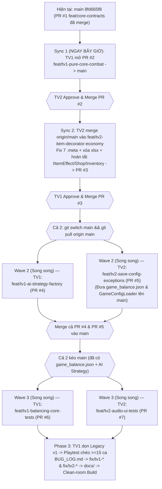
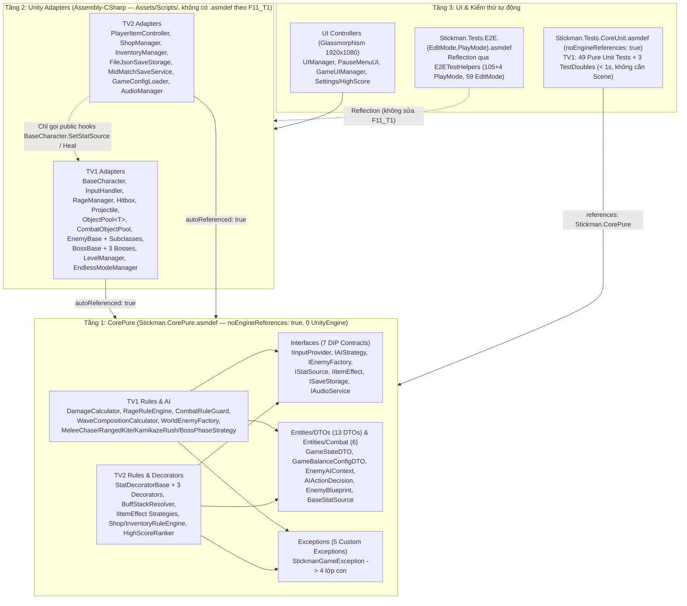

# HƯỚNG DẪN TỰ ĐỘNG HÓA & THỰC THI CHI TIẾT — THÀNH VIÊN 1 (TV1)

> **Dự án:** `Stickman game` (**MULTI-DIMENSIONS STICKMAN** — Unity `6000.5.4f1`, C# `9.0`, `-warn:4 -nowarn:0649 -warnaserror+`)  
> **Học phần:** MI4090 – Lập trình hướng đối tượng (Nhóm 02 thành viên: **TV1** & **TV2**)  
> **Đường dẫn Repo chuẩn:** `c:\Users\Admin\Documents\Tài liệu của TAnh\2026.1\VibeApp\OOP Project\Stickman game`  
> **Remote GitHub:** `https://github.com/tienanh2701/Stickman-game-project.git`  
> **Mục đích tài liệu:** Playbook tự thực thi toàn diện (Automation & Implementation Playbook) để TV1 hoặc AI Agent của TV1 hoàn thiện 100% các nhánh còn lại (**Nhánh 2 → Nhánh 3 → Phase 3 → Docs → Release**) mà không cần dò lại mã nguồn, không xung đột với TV2 và không vi phạm bất kỳ quy tắc kiểm định nào (`verify_project.py`, `F11_T1`, `F11_T2`, `EditMode`, `PlayMode`).

---

## MỤC LỤC

1. [Phần 1 — Tổng quan phân công lại & Hiện trạng TV1](#phần-1--tổng-quan-phân-công-lại--hiện-trạng-tv1)
2. [Phần 2 — Hướng dẫn thực thi từng nhánh (FULL CODE 100% biên dịch sạch)](#phần-2--hướng-dẫn-thực-thi-từng-nhánh-full-code-100-biên-dịch-sạch)
   - [2.1. Nhánh 2 — `feat/tv1-ai-strategy-factory` (PR #4)](#21-nhánh-2--feattv1-ai-strategy-factory-pr-4)
   - [2.2. Nhánh 3 — `feat/tv1-balancing-core-tests` (PR #6)](#22-nhánh-3--feattv1-balancing-core-tests-pr-6)
   - [2.3. Phase 3 (Phần TV1) — Legacy v1 Cleanup, Playtest chéo TV2, `docs/` TV1 & Clean-room Build](#23-phase-3-phần-tv1--legacy-v1-cleanup-playtest-chéo-tv2-docs-tv1--clean-room-build)
3. [Phần 3 — Quy trình tự động hóa & Gate kiểm chứng (Hạn chế check lại)](#phần-3--quy-trình-tự-động-hóa--gate-kiểm-chứng-hạn-chế-check-lại)
4. [Phần 4 — Kiến thức cấu trúc, OOP/SOLID/GoF/Thuật toán & Vấn đáp MI4090 cần nhớ](#phần-4--kiến-thức-cấu-trúc-oopsolidgofthuật-toán--vấn-đáp-mi4090-cần-nhớ)

---

## PHẦN 1 — TỔNG QUAN PHÂN CÔNG LẠI & HIỆN TRẠNG TV1

### 1.1. Hiện trạng đã hoàn thành của TV1 & Thao tác mở PR #2 ngay bây giờ

TV1 đã hoàn thành trọn vẹn **Phase 1 (`feat/core-contracts` → đã merge vào `main` tại `8fd665f8`)** và **Nhánh 1 (`feat/tv1-pure-core-combat` tại commit `ecdc4b7b`, đã push lên `origin/feat/tv1-pure-core-combat`)** với kết quả kiểm định xanh toàn bộ:

- **Số lượng bài kiểm thử hiện tại:** **`89/89` EditMode PASS** (`30 CoreUnit` = 3 smoke + 27 TV1; `59 EditMode E2E`) và **`105/105` PlayMode PASS**.
- **Lưu ý thực trạng (đã kiểm chứng trên repo):**
  - Bài test **`T5_B12`** (`Tier5_AdversarialUiHardeningTests.cs:672-719`) **đã PASS** (đã dùng đúng đường dẫn `HudItemSlotsPanel/SlotQ/InnerBg/ItemIcon`), KHÔNG còn FAIL.
  - Hàm **`GameUIManager.BindBoss(BossController)`** (`GameUIManager.cs:1181-1227`) **đã sạch lambda rò rỉ** (đã dùng handler có tên `HandleLegacyBossHealthChanged` / `HandleLegacyBossDeath` + `UnbindLegacyBoss()`).
  - Trong thư mục `Tools/` hiện có thể tồn tại `Tools/__pycache__/` nếu trước đó chạy `python` quên cờ `-B` → cần xóa ngay để không vi phạm `F11_T1`.

| Commit trên `feat/tv1-pure-core-combat` | Nội dung đã hoàn thành (KHÔNG làm lại) |
| :--- | :--- |
| `04dceb0b` | Tạo `Assets/CorePure/Entities/Combat/{BaseStatSource,CombatActionType,CombatActorState,CombatAttackKind,CombatDamageInput,CombatDamageResult}.cs` và `Assets/CorePure/Rules/Combat/{CombatRuleGuard,DamageCalculator,RageRuleEngine}.cs` (đủ `.meta`, `0 using UnityEngine;`). |
| `a728b8f9` | Adapter hóa `BaseCharacter.cs` (thêm `SetStatSource`, `ResetStatSource`, `SetInputProvider`, ủy quyền `DamageCalculator` & `CombatRuleGuard`), `InputHandler.cs` (`: IInputProvider`), `RageManager.cs` (ủy quyền `RageRuleEngine`) và nâng cấp `Tools/verify_project.py` (biên dịch `Stickman.CorePure` + kiểm tra `0 using UnityEngine/UnityEditor`). |
| `aeda1f71` | Tạo `ICombatTargetProfile.cs`, `IFreezable.cs`; bỏ toàn bộ `is`/`as` downcast trong `Projectile.cs`, `EnemyBase.cs`, `LordKivaAI.cs`; sửa `TetherCableHitbox.cs` không giả mạo `IDamageable` (bảo toàn LSP). |
| `ecdc4b7b` | Viết **27 Pure Logic Unit Tests** (`CombatRuleGuardTests` = 7, `DamageCalculatorTests` = 11, `RageRuleEngineTests` = 9) + **2 Test Doubles** (`MockStatSource`, `StubInputProvider`) tại `Assets/Tests/CoreUnit/TV1/`. |

**Lệnh chuẩn hóa vệ sinh & đẩy/mở PR #2 ngay bây giờ trên PowerShell:**

```powershell
cd "c:\Users\Admin\Documents\Tài liệu của TAnh\2026.1\VibeApp\OOP Project\Stickman game"

# 1. Xóa sạch __pycache__ nếu có (bắt buộc cho F11_T1)
Get-ChildItem -Path . -Directory -Recurse -Filter "__pycache__" -ErrorAction SilentlyContinue | Remove-Item -Recurse -Force

# 2. Đảm bảo đang ở đúng nhánh và đồng bộ với origin
git switch feat/tv1-pure-core-combat
git status --short
git checkout -- ProjectSettings/ProjectSettings.asset
python -B Tools/verify_project.py

# 3. Đẩy nhánh (nếu có commit mới) rồi mở PR #2 (feat/tv1-pure-core-combat -> main) trên GitHub
git push -u origin feat/tv1-pure-core-combat
```

> Sau khi đẩy lên, vào <https://github.com/tienanh2701/Stickman-game-project/pulls> tạo **PR #2: `feat/tv1-pure-core-combat` → `main`**, báo TV2 **Approve & Merge** để mở khóa Sync 2.

---

### 1.2. Bảng phân công lại DONE vs REMAINING (Đồng bộ 100% giữa TV1 và TV2)

> **Ghi nhận tiến độ TV2 (`origin/feat/tv2-item-decorator-economy` = `e03577bc`):** TV2 đã commit 6 file thuần C# trong `Assets/CorePure/Patterns/Decorators/` (`DefaultStatSource`, `StatDecoratorBase`, `SpinalFluidShieldDecorator`, `UltraDivineWaterDecorator`, `RageRegenDecorator`, `BuffStackResolver`). TV2 sẽ tự xử lý 2 lỗi vệ sinh trên nhánh đó (bổ sung 7 `.meta` thiếu + `git rm Checklist_BTL_Game_v2026.xlsx`), merge `origin/main` sau PR #2 của TV1 rồi hoàn tất phần còn lại của PR #3.

| Thành viên | ĐÃ HOÀN THÀNH (DONE) | CÒN PHẢI LÀM (REMAINING) |
| :--- | :--- | :--- |
| **TV1** | • Phase 1 `feat/core-contracts` (đã merge `main` `8fd665f8`)<br>• Nhánh 1 `feat/tv1-pure-core-combat` (`ecdc4b7b`, 4 commits, 27 Pure Unit Tests + 2 TestDoubles, `89/89` EditMode, `105/105` PlayMode — chờ merge **PR #2**) | 1. **Mở & Merge PR #2** (`feat/tv1-pure-core-combat` → `main`).<br>2. **Nhánh 2 `feat/tv1-ai-strategy-factory` (PR #4):** `Assets/CorePure/AI/*` (`AIDifficultyTuning`, `MeleeChaseStrategy`, `RangedKiteStrategy`, `KamikazeRushStrategy`, `BossPhaseStrategy`, `AIStrategyRegistry`), `WorldEnemyFactory : IEnemyFactory`, `ObjectPool<T>` & `CombatObjectPool`, nâng cấp `Projectile.cs` chống tunneling (`CircleCastAll`), loại bỏ đường dẫn cứng `"Assets/Prefabs/..."` trong `EndlessModeManager.cs` bằng `EndlessEnemyCatalogSO`, gắn `IAIStrategy` vào `EnemyBase`/subclasses & `BossBase`/`BrolyBossController`.<br>3. **Nhánh 3 `feat/tv1-balancing-core-tests` (PR #6):** `WaveCompositionCalculator` thuần C#, cân bằng 12 `Level_W*_S*.asset` + đồng bộ `GameBalanceConfigDTO` ngoài build, bổ sung **+22 Pure Unit Tests** (tổng **49 TV1 CoreUnit Tests**) + **`SpyAudioService`** (đạt **3 TestDoubles**), và **4 PlayMode Tests** cho `Hitbox` & `BossBase` multi-phase.<br>4. **Phase 3 (TV1):** Dọn Legacy v1 an toàn (audit 0 ref trước khi xóa), Playtest chéo phần TV2 (`>= 3` bug vào `BUG_LOG.md`), nhánh `fix/tv1-<id>` + Regression Test 1-1, bộ tài liệu `docs/` TV1 + `README.md`, Build Clean-room ra `../Releases/Version_Final/`. |
| **TV2** | • Nhánh 1 **một phần** (`origin/feat/tv2-item-decorator-economy` `e03577bc`: 6 lớp Decorator + `BuffStackResolver` trong `CorePure/Patterns/Decorators/`) | 1. **Hoàn tất Nhánh 1 (PR #3):** Fix 7 `.meta` thiếu + `git rm Checklist_BTL_Game_v2026.xlsx`, merge `origin/main`, cài `IItemEffect` + `ItemEffectRegistry` + Item #4 (`RageElixir = 4`), refactor `PlayerItemController` gọi `BaseCharacter.SetStatSource` không double-count, tách `ShopRuleEngine` + `InventoryRuleEngine`.<br>2. **Nhánh 2 `feat/tv2-save-config-exceptions` (PR #5):** `FileJsonSaveStorage`, `MidMatchSaveService`, `HighScoreRanker`/`HighScoreService`, `StreamingAssets/Config/game_balance.json` + `GameConfigLoader`, xử lý 6 khối `catch` nuốt lỗi + `CustomException`.<br>3. **Nhánh 3 `feat/tv2-audio-ui-tests` (PR #7):** `AudioManager : IAudioService` + BGM/SFX thật, UI Settings & HighScore, tách helper `UIManager`, `>= 12` CoreUnit Tests + 3 TestDoubles (`InMemorySaveStorage`, `FakeClock`, `SpyAudioService`).<br>4. **Phase 3 (TV2):** Playtest chéo phần TV1 (`>= 3` bug), `fix/tv2-<id>` + Regression Test 1-1, bộ tài liệu `docs/` TV2 (gồm UML Class Diagram tổng thể `>= 20` lớp). |

---

### 1.3. Bảng ranh giới sở hữu file độc quyền (Vùng cấm — Zero Merge Conflict)

| Khu vực | TV1 ĐỘC QUYỀN SỬA (Của bạn) | TV2 ĐỘC QUYỀN SỬA (Vùng cấm TV1!) | Quy ước đồng bộ & Khóa an toàn |
| :--- | :--- | :--- | :--- |
| `Assets/CorePure/` | `AI/`, `Entities/Combat/`, `Rules/Combat/` | `Patterns/Decorators/`, `Patterns/Items/`, `Rules/Economy/`, `Rules/Persistence/` | **`Interfaces/`, `Exceptions/`, `Entities/DTOs/` ĐÃ ĐÓNG BĂNG.** Không tự ý sửa chữ ký contract nếu không có đồng thuận PR từ cả 2 bên. |
| `Assets/Scripts/` | `Characters/`, `Combat/`, `Core/` *(trừ `Enums.cs` dòng 39)*, `Enemies/`, `Environment/`, `GameModes/`, `Level/`, `VFX/` | `Auth/`, `Economy/`, `Items/`, `Audio/`, `Persistence/`, `UI/` (`UIManager`, `PauseMenuUI`, `GlassHudTheme`, `MenuBackgroundLoader`, `GameUIManager`, `HudItemSlotsUI`, Settings/HighScore UI) | **`Enums.cs`**: CHỈ TV2 thêm `RageElixir = 4` ở PR #3; TV1 **KHÔNG** đụng `Enums.cs`.<br>**`BaseCharacter.cs`**: TV1 sở hữu; giữ nguyên 100% public hooks (`SetStatSource`, `ResetStatSource`, `Heal`, `CleanseDebuffs`, `ActivateSpinalFluidBuff`, `ActivateUltraWaterBuff`, `RageManager.RuleEngine.SetRageExact`) để TV2 gọi mà không cần sửa `BaseCharacter.cs`. |
| `Assets/Scenes/` | `Stickman_DemoScene.unity` | `MainMenu.unity`, `CharacterSelectScene.unity` | **Cấm tuyệt đối sửa chéo Scene.** TV2 dựng UI Pause/Settings/HighScore bằng code động nên không đụng `Stickman_DemoScene.unity`. |
| `Assets/Prefabs/` & Assets | `Prefabs/{Characters,Enemies,Combat,Hazards}/`, `Data/Levels/Level_W*_S*.asset`, `Resources/EndlessPrefabs/` | `Resources/Items/`, `Resources/Audio/`, `Audio/{BGM,SFX}/`, `StreamingAssets/Config/` | **KHÓA R3:** Cả 2 thành viên **CẤM** thêm/xóa/đổi tên bất kỳ PNG nào trong `Assets/Sprites/{Characters,Combat,Enemies,Maps,VFX,UI/Items}` (716 files) và `Assets/Sprites/UI/SlicedUI/01..09/` (107 PNGs). |
| `Assets/Tests/` | `Tests/CoreUnit/TV1/`, file PlayMode mới cho Combat/Boss trong `Tests/E2E/PlayMode/` | `Tests/CoreUnit/TV2/` | Không sửa các bài test `Tier1`–`Tier5` hiện có. File trong `Tests/E2E/PlayMode/` cấm `using System.Linq;`, cấm lời gọi `.Where/.Any/.Select/.ToArray/.Count/.FirstOrDefault(` và cấm từ khóa `UnityEditor`. |
| `docs/` | `01_Survey_GDD/GDD_*.md`, `02_Analysis_UML/{PackageDiagram_3Tier,Combat_State_Sequence,Algorithms_TV1}.md`, `03_Design_Patterns/TV1_Patterns_And_Tradeoffs.md`, `04_Testing_QA/TestMatrix_TV1.md`, `README.md` | `01_Survey_GDD/{UseCases,SceneMap}.md`, `02_Analysis_UML/{DataDictionary,UML_Master_ClassDiagram,SaveShop_*,Algorithms_TV2}.md`, `03_Design_Patterns/TV2_*.md`, `04_Testing_QA/{TestMatrix_TV2,BUG_LOG}.md` | Ở Phase 3, TV2 tạo khung `docs/04_Testing_QA/BUG_LOG.md` trước, sau đó cả 2 người cùng nối thêm `>= 3` bug tìm được khi playtest chéo. |

---

### 1.4. Thứ tự Merge & Các điểm đồng bộ bắt buộc giữa TV1 và TV2



**3 điểm đồng bộ cốt lõi TV1 cần nhớ:**
1. **Sync 1 (PR #2):** TV1 cần merge PR #2 trước để TV2 nhận `BaseCharacter.SetStatSource` và `BaseStatSource` cho PR #3.
2. **Wave 2 → Wave 3 (PR #5 → PR #6):** Nhánh 3 của TV1 (`feat/tv1-balancing-core-tests`) đọc `Assets/StreamingAssets/Config/game_balance.json` do TV2 tạo ở PR #5. Nếu TV1 khởi tạo Nhánh 3 trước khi PR #5 merge, TV1 vẫn có fallback mặc định từ `WaveCompositionCalculator.ResolveCampaignLevelBalance(...)`, rồi chạy lại công cụ đồng bộ sau khi kéo PR #5.
3. **Phase 3 (Legacy v1 cleanup):** Trước khi TV1 xóa `BossController.cs` & `BaseEnemy.cs`, phối hợp TV2 kiểm tra lại `GameUIManager.cs` (dòng 94–95, 1073–1076, 1181–1227) để đảm bảo xóa sạch nhánh legacy mà không lỗi biên dịch.

---

## PHẦN 2 — HƯỚNG DẪN THỰC THI TỪNG NHÁNH (FULL CODE 100% BIÊN DỊCH SẠCH)

> **Quy tắc biên dịch bắt buộc áp dụng cho MỌI đoạn code dưới đây:**
> - Tuân thủ **C# 9.0** (`namespace ... { ... }` dạng khối — KHÔNG file-scoped namespace; KHÔNG `required`; KHÔNG primary constructor trên class; KHÔNG constructor không tham số trên `struct`).
> - Biên dịch sạch 100% với **`-warn:4 -nowarn:0649 -warnaserror+`** (không biến thừa, không trường private chưa dùng, không API Unity cũ gây CS0618; luôn dùng `rb.linearVelocity` và `FindAnyObjectByType<T>()`).
> - Mọi file trong `Assets/CorePure/` và `Assets/Tests/CoreUnit/` có **0 dòng `using UnityEngine;` / `using UnityEditor;`**.
> - Mỗi `public class : MonoBehaviour | ScriptableObject | EnemyBase | BossBase` trùng tên 100% với tên file `.cs` (theo `check_class_filenames()` trong `Tools/verify_project.py`).

---

### 2.1. Nhánh 2 — `feat/tv1-ai-strategy-factory` (PR #4)

#### Bước 0 — Khởi tạo nhánh từ `main` mới nhất (sau khi PR #2 & PR #3 đã merge)

```powershell
cd "c:\Users\Admin\Documents\Tài liệu của TAnh\2026.1\VibeApp\OOP Project\Stickman game"
git switch main
git pull origin main
git switch -c feat/tv1-ai-strategy-factory
```

#### Bước 2.1A — Tầng Pure C# AI Strategies (`Assets/CorePure/AI/`, `0 using UnityEngine;`)

##### File 1: `Assets/CorePure/AI/AIDifficultyTuning.cs`

```csharp
using System;
using StickmanBeatEmUp.CorePure.Entities.DTOs;

namespace StickmanBeatEmUp.CorePure.AI
{
    /// <summary>
    /// Mức độ khó chuẩn cho AI kẻ địch/Boss (tương thích EnemyAIContext.DifficultyLevel).
    /// </summary>
    public enum AIDifficultyPreset
    {
        Easy = 0,
        Normal = 1,
        Hard = 2
    }

    /// <summary>
    /// Bộ hiệu chỉnh thông số chiến thuật thuần C# theo độ khó Easy / Normal / Hard.
    /// </summary>
    public static class AIDifficultyTuning
    {
        public static int ClampDifficulty(int difficultyLevel)
        {
            if (difficultyLevel <= (int)AIDifficultyPreset.Easy)
            {
                return (int)AIDifficultyPreset.Easy;
            }

            if (difficultyLevel >= (int)AIDifficultyPreset.Hard)
            {
                return (int)AIDifficultyPreset.Hard;
            }

            return (int)AIDifficultyPreset.Normal;
        }

        public static float GetRangeScale(int difficultyLevel)
        {
            int clamped = ClampDifficulty(difficultyLevel);
            if (clamped == (int)AIDifficultyPreset.Easy)
            {
                return 0.90f;
            }

            if (clamped == (int)AIDifficultyPreset.Hard)
            {
                return 1.12f;
            }

            return 1.0f;
        }

        public static float GetMoveSpeedScale(int difficultyLevel)
        {
            int clamped = ClampDifficulty(difficultyLevel);
            if (clamped == (int)AIDifficultyPreset.Easy)
            {
                return 0.85f;
            }

            if (clamped == (int)AIDifficultyPreset.Hard)
            {
                return 1.15f;
            }

            return 1.0f;
        }

        public static float GetCooldownReadyThreshold(int difficultyLevel)
        {
            int clamped = ClampDifficulty(difficultyLevel);
            if (clamped == (int)AIDifficultyPreset.Hard)
            {
                return 0.18f;
            }

            // Easy và Normal đều sẵn sàng tấn công khi AttackCooldownRemaining <= 0f
            // (tránh deadlock khi Adapter kẹp AttackCooldownRemaining >= 0f).
            return 0f;
        }

        public static float GetAttackCooldownScale(int difficultyLevel)
        {
            int clamped = ClampDifficulty(difficultyLevel);
            if (clamped == (int)AIDifficultyPreset.Easy)
            {
                return 1.25f;
            }

            if (clamped == (int)AIDifficultyPreset.Hard)
            {
                return 0.85f;
            }

            return 1.0f;
        }

        public static float GetFleeRangeScale(int difficultyLevel)
        {
            int clamped = ClampDifficulty(difficultyLevel);
            if (clamped == (int)AIDifficultyPreset.Easy)
            {
                return 0.85f;
            }

            if (clamped == (int)AIDifficultyPreset.Hard)
            {
                return 1.15f;
            }

            return 1.0f;
        }

        public static int GetParryTriggerHits(int difficultyLevel)
        {
            int clamped = ClampDifficulty(difficultyLevel);
            if (clamped == (int)AIDifficultyPreset.Easy)
            {
                return 4;
            }

            if (clamped == (int)AIDifficultyPreset.Hard)
            {
                return 2;
            }

            return 3;
        }

        public static float GetBossPhase2HpRatio(int difficultyLevel)
        {
            int clamped = ClampDifficulty(difficultyLevel);
            if (clamped == (int)AIDifficultyPreset.Easy)
            {
                return 0.40f;
            }

            if (clamped == (int)AIDifficultyPreset.Hard)
            {
                return 0.60f;
            }

            return 0.50f;
        }

        public static bool IsDeadOrInvalid(EnemyAIContext context)
        {
            if (context.IsPlayerDead)
            {
                return true;
            }

            if (float.IsNaN(context.EnemyHp) || context.EnemyHp <= 0f)
            {
                return true;
            }

            return float.IsNaN(context.EnemyX) || float.IsNaN(context.PlayerX);
        }

        public static float ComputeHorizontalSign(float deltaX, float deadZone = 0.05f)
        {
            if (float.IsNaN(deltaX) || Math.Abs(deltaX) <= deadZone)
            {
                return 0f;
            }

            return deltaX > 0f ? 1f : -1f;
        }

        public static float SanitizePositive(float value, float fallback)
        {
            if (float.IsNaN(value) || float.IsInfinity(value) || value <= 0f)
            {
                return fallback;
            }

            return value;
        }
    }
}
```

##### File 2: `Assets/CorePure/AI/MeleeChaseStrategy.cs`

```csharp
using System;
using StickmanBeatEmUp.CorePure.Entities.DTOs;
using StickmanBeatEmUp.CorePure.Interfaces;

namespace StickmanBeatEmUp.CorePure.AI
{
    /// <summary>
    /// Chiến lược AI cận chiến: áp sát người chơi theo trục X, dừng ở tầm đánh và ra đòn theo cooldown/độ khó.
    /// </summary>
    public sealed class MeleeChaseStrategy : IAIStrategy
    {
        public const string ID = "melee_chase";

        private readonly float defaultAttackRange;
        private readonly float verticalTolerance;

        public string StrategyId => ID;

        public MeleeChaseStrategy(float defaultAttackRange = 1.45f, float verticalTolerance = 1.8f)
        {
            this.defaultAttackRange = AIDifficultyTuning.SanitizePositive(defaultAttackRange, 1.45f);
            this.verticalTolerance = AIDifficultyTuning.SanitizePositive(verticalTolerance, 1.8f);
        }

        public AIActionDecision ComputeAction(EnemyAIContext context)
        {
            if (AIDifficultyTuning.IsDeadOrInvalid(context))
            {
                return AIActionDecision.IdleDecision;
            }

            float dx = context.PlayerX - context.EnemyX;
            float distX = Math.Abs(dx);
            float distY = Math.Abs(context.PlayerY - context.EnemyY);

            int difficulty = AIDifficultyTuning.ClampDifficulty(context.DifficultyLevel);
            float baseRange = AIDifficultyTuning.SanitizePositive(context.AttackRange, defaultAttackRange);
            float effectiveRange = baseRange * AIDifficultyTuning.GetRangeScale(difficulty);

            if (distX <= effectiveRange && distY <= verticalTolerance)
            {
                float readyThreshold = AIDifficultyTuning.GetCooldownReadyThreshold(difficulty);
                if (!float.IsNaN(context.AttackCooldownRemaining) && context.AttackCooldownRemaining <= readyThreshold)
                {
                    bool lowHpHardFinisher = difficulty == (int)AIDifficultyPreset.Hard &&
                                             context.EnemyMaxHp > 0f &&
                                             (context.EnemyHp / context.EnemyMaxHp) <= 0.50f;
                    AIActionType strike = lowHpHardFinisher ? AIActionType.HeavyAttack : AIActionType.LightAttack;
                    return new AIActionDecision(strike, 0f, true, false);
                }

                return new AIActionDecision(AIActionType.Idle, 0f, true, false);
            }

            float sign = AIDifficultyTuning.ComputeHorizontalSign(dx);
            if (sign == 0f)
            {
                return new AIActionDecision(AIActionType.Idle, 0f, true, false);
            }

            float moveDir = sign * AIDifficultyTuning.GetMoveSpeedScale(difficulty);
            return new AIActionDecision(AIActionType.MoveTowardPlayer, moveDir, true, false);
        }
    }
}
```

##### File 3: `Assets/CorePure/AI/RangedKiteStrategy.cs`

```csharp
using System;
using StickmanBeatEmUp.CorePure.Entities.DTOs;
using StickmanBeatEmUp.CorePure.Interfaces;

namespace StickmanBeatEmUp.CorePure.AI
{
    /// <summary>
    /// Chiến lược AI tầm xa (Kite): lùi khi quá gần FleeRange, tiến khi quá xa PreferredRange * 1.15 và xả đạn trong vùng tối ưu.
    /// </summary>
    public sealed class RangedKiteStrategy : IAIStrategy
    {
        public const string ID = "ranged_kite";

        private readonly float defaultPreferredRange;
        private readonly float defaultFleeRange;
        private readonly float retreatSpeedFactor;

        public string StrategyId => ID;

        public RangedKiteStrategy(
            float defaultPreferredRange = 6.5f,
            float defaultFleeRange = 2.5f,
            float retreatSpeedFactor = 0.9f)
        {
            this.defaultPreferredRange = AIDifficultyTuning.SanitizePositive(defaultPreferredRange, 6.5f);
            this.defaultFleeRange = AIDifficultyTuning.SanitizePositive(defaultFleeRange, 2.5f);
            this.retreatSpeedFactor = AIDifficultyTuning.SanitizePositive(retreatSpeedFactor, 0.9f);
        }

        public AIActionDecision ComputeAction(EnemyAIContext context)
        {
            if (AIDifficultyTuning.IsDeadOrInvalid(context))
            {
                return AIActionDecision.IdleDecision;
            }

            float dx = context.PlayerX - context.EnemyX;
            float distX = Math.Abs(dx);

            int difficulty = AIDifficultyTuning.ClampDifficulty(context.DifficultyLevel);
            float pref = AIDifficultyTuning.SanitizePositive(context.PreferredRange, defaultPreferredRange);
            float flee = AIDifficultyTuning.SanitizePositive(context.FleeRange, defaultFleeRange) *
                         AIDifficultyTuning.GetFleeRangeScale(difficulty);
            float moveScale = AIDifficultyTuning.GetMoveSpeedScale(difficulty);

            float signToPlayer = AIDifficultyTuning.ComputeHorizontalSign(dx, 0.001f);
            if (signToPlayer == 0f)
            {
                signToPlayer = 1f;
            }

            if (distX < flee)
            {
                float awayDir = -signToPlayer * retreatSpeedFactor * moveScale;
                return new AIActionDecision(AIActionType.MoveAwayFromPlayer, awayDir, false, false);
            }

            if (distX > pref * 1.15f)
            {
                float towardDir = signToPlayer * moveScale;
                return new AIActionDecision(AIActionType.MoveTowardPlayer, towardDir, true, false);
            }

            float readyThreshold = AIDifficultyTuning.GetCooldownReadyThreshold(difficulty);
            if (!float.IsNaN(context.AttackCooldownRemaining) && context.AttackCooldownRemaining <= readyThreshold)
            {
                return new AIActionDecision(AIActionType.RangedVolley, 0f, true, false);
            }

            return new AIActionDecision(AIActionType.Idle, 0f, true, false);
        }
    }
}
```

##### File 4: `Assets/CorePure/AI/KamikazeRushStrategy.cs`

```csharp
using System;
using StickmanBeatEmUp.CorePure.Entities.DTOs;
using StickmanBeatEmUp.CorePure.Interfaces;

namespace StickmanBeatEmUp.CorePure.AI
{
    /// <summary>
    /// Chiến lược AI cảm tử (Saibaman Kamikaze): lao tốc độ 1.5x về phía người chơi và kích nổ ngay khi vào tầm nổ.
    /// </summary>
    public sealed class KamikazeRushStrategy : IAIStrategy
    {
        public const string ID = "kamikaze_rush";

        private readonly float defaultDetonateRange;
        private readonly float verticalTolerance;
        private readonly float rushSpeedFactor;

        public string StrategyId => ID;

        public KamikazeRushStrategy(
            float defaultDetonateRange = 1.45f,
            float verticalTolerance = 1.8f,
            float rushSpeedFactor = 1.5f)
        {
            this.defaultDetonateRange = AIDifficultyTuning.SanitizePositive(defaultDetonateRange, 1.45f);
            this.verticalTolerance = AIDifficultyTuning.SanitizePositive(verticalTolerance, 1.8f);
            this.rushSpeedFactor = AIDifficultyTuning.SanitizePositive(rushSpeedFactor, 1.5f);
        }

        public AIActionDecision ComputeAction(EnemyAIContext context)
        {
            if (AIDifficultyTuning.IsDeadOrInvalid(context))
            {
                return AIActionDecision.IdleDecision;
            }

            float dx = context.PlayerX - context.EnemyX;
            float distX = Math.Abs(dx);
            float distY = Math.Abs(context.PlayerY - context.EnemyY);

            int difficulty = AIDifficultyTuning.ClampDifficulty(context.DifficultyLevel);
            float range = AIDifficultyTuning.SanitizePositive(context.AttackRange, defaultDetonateRange) *
                          AIDifficultyTuning.GetRangeScale(difficulty);

            if (distX <= range && distY <= verticalTolerance)
            {
                float readyThreshold = AIDifficultyTuning.GetCooldownReadyThreshold(difficulty);
                if (!float.IsNaN(context.AttackCooldownRemaining) && context.AttackCooldownRemaining <= readyThreshold)
                {
                    return new AIActionDecision(AIActionType.Detonate, 0f, true, false);
                }

                return new AIActionDecision(AIActionType.Idle, 0f, true, false);
            }

            float sign = AIDifficultyTuning.ComputeHorizontalSign(dx);
            if (sign == 0f)
            {
                return new AIActionDecision(AIActionType.Idle, 0f, true, false);
            }

            float moveDir = sign * rushSpeedFactor * AIDifficultyTuning.GetMoveSpeedScale(difficulty);
            return new AIActionDecision(AIActionType.MoveTowardPlayer, moveDir, true, false);
        }
    }
}
```

##### File 5: `Assets/CorePure/AI/BossPhaseStrategy.cs`

```csharp
using System;
using StickmanBeatEmUp.CorePure.Entities.DTOs;
using StickmanBeatEmUp.CorePure.Interfaces;

namespace StickmanBeatEmUp.CorePure.AI
{
    /// <summary>
    /// Chiến lược AI đa pha cho Boss (Phase 1 chuẩn, Phase 2 cuồng nộ khi HP giảm hoặc Nộ đạt 100):
    /// ưu tiên kích khiên/Roar khi đầy nộ, phản đòn khi bị spam đánh nhẹ, dùng SpecialPhase/HeavyAttack theo cự ly & độ khó.
    /// </summary>
    public sealed class BossPhaseStrategy : IAIStrategy
    {
        public const string ID = "boss_phase";

        private readonly float defaultMeleeRange;
        private readonly float specialTriggerMinRange;
        private readonly float rageShieldThreshold;

        public string StrategyId => ID;

        public BossPhaseStrategy(
            float defaultMeleeRange = 2.3f,
            float specialTriggerMinRange = 4.2f,
            float rageShieldThreshold = 100f)
        {
            this.defaultMeleeRange = AIDifficultyTuning.SanitizePositive(defaultMeleeRange, 2.3f);
            this.specialTriggerMinRange = AIDifficultyTuning.SanitizePositive(specialTriggerMinRange, 4.2f);
            this.rageShieldThreshold = AIDifficultyTuning.SanitizePositive(rageShieldThreshold, 100f);
        }

        public AIActionDecision ComputeAction(EnemyAIContext context)
        {
            if (AIDifficultyTuning.IsDeadOrInvalid(context))
            {
                return AIActionDecision.IdleDecision;
            }

            int difficulty = AIDifficultyTuning.ClampDifficulty(context.DifficultyLevel);
            float hpRatio = context.EnemyMaxHp > 0f ? (context.EnemyHp / context.EnemyMaxHp) : 1f;
            bool isPhase2 = hpRatio <= AIDifficultyTuning.GetBossPhase2HpRatio(difficulty);

            // 1. Khi đầy thanh Nộ Boss (ví dụ Broly Rage >= 100) -> kích hoạt SpecialPhase + Khiên
            if (!float.IsNaN(context.EnemyRage) && context.EnemyRage >= rageShieldThreshold)
            {
                return new AIActionDecision(AIActionType.SpecialPhase, 0f, true, true);
            }

            // 2. Phản đòn khi người chơi spam quá nhiều đòn nhẹ trong cửa sổ thời gian
            int parryHitsRequired = AIDifficultyTuning.GetParryTriggerHits(difficulty);
            if (context.IsPlayerAttacking && context.LightHitsReceivedInWindow >= parryHitsRequired)
            {
                return new AIActionDecision(AIActionType.ParryCounter, 0f, true, isPhase2);
            }

            float dx = context.PlayerX - context.EnemyX;
            float distX = Math.Abs(dx);
            float meleeRange = AIDifficultyTuning.SanitizePositive(context.AttackRange, defaultMeleeRange) *
                               AIDifficultyTuning.GetRangeScale(difficulty);
            float maxSpecialRange = Math.Max(
                specialTriggerMinRange + 1.5f,
                AIDifficultyTuning.SanitizePositive(context.PreferredRange, 8.5f));
            float readyThreshold = AIDifficultyTuning.GetCooldownReadyThreshold(difficulty);
            bool attackReady = !float.IsNaN(context.AttackCooldownRemaining) &&
                               context.AttackCooldownRemaining <= readyThreshold;

            // 3. Trong tầm cận chiến
            if (distX <= meleeRange)
            {
                if (!attackReady)
                {
                    return new AIActionDecision(AIActionType.Idle, 0f, true, false);
                }

                bool useHeavy = isPhase2 || difficulty == (int)AIDifficultyPreset.Hard;
                return new AIActionDecision(
                    useHeavy ? AIActionType.HeavyAttack : AIActionType.LightAttack,
                    0f,
                    true,
                    false);
            }

            // 4. Tầm trung/xa khi cooldown sẵn sàng -> chiêu đặc biệt (Lariat / Spikes / Laser) hoặc HeavyAttack
            if (attackReady && distX <= maxSpecialRange)
            {
                if (isPhase2 || distX >= specialTriggerMinRange)
                {
                    return new AIActionDecision(AIActionType.SpecialPhase, 0f, true, false);
                }

                if (difficulty == (int)AIDifficultyPreset.Hard)
                {
                    return new AIActionDecision(AIActionType.HeavyAttack, 0f, true, false);
                }
            }

            // 5. Áp sát mục tiêu (tăng tốc 1.15x ở Phase 2)
            float sign = AIDifficultyTuning.ComputeHorizontalSign(dx);
            if (sign == 0f)
            {
                return new AIActionDecision(AIActionType.Idle, 0f, true, false);
            }

            float phaseSpeedMult = isPhase2 ? 1.15f : 1.0f;
            float moveDir = sign * AIDifficultyTuning.GetMoveSpeedScale(difficulty) * phaseSpeedMult;
            return new AIActionDecision(AIActionType.MoveTowardPlayer, moveDir, true, false);
        }
    }
}
```

##### File 6: `Assets/CorePure/AI/AIStrategyRegistry.cs`

```csharp
using System;
using System.Collections.Generic;
using StickmanBeatEmUp.CorePure.Interfaces;

namespace StickmanBeatEmUp.CorePure.AI
{
    /// <summary>
    /// Kho đăng ký chiến lược AI theo StrategyId, cho phép mở rộng thêm IAIStrategy mới tại runtime (OCP)
    /// mà không cần sửa đổi câu lệnh switch/if ở bất kỳ lớp cũ nào.
    /// </summary>
    public sealed class AIStrategyRegistry
    {
        private readonly Dictionary<string, IAIStrategy> strategies =
            new Dictionary<string, IAIStrategy>(StringComparer.OrdinalIgnoreCase);

        public static AIStrategyRegistry Default { get; } = CreateDefault();

        public int Count => strategies.Count;

        public static AIStrategyRegistry CreateDefault()
        {
            AIStrategyRegistry registry = new AIStrategyRegistry();
            registry.Register(new MeleeChaseStrategy());
            registry.Register(new RangedKiteStrategy());
            registry.Register(new KamikazeRushStrategy());
            registry.Register(new BossPhaseStrategy());
            return registry;
        }

        public void Register(IAIStrategy strategy)
        {
            if (strategy == null)
            {
                throw new ArgumentNullException(nameof(strategy));
            }

            if (string.IsNullOrWhiteSpace(strategy.StrategyId))
            {
                throw new ArgumentException("StrategyId must not be empty.", nameof(strategy));
            }

            strategies[strategy.StrategyId.Trim()] = strategy;
        }

        public bool Contains(string strategyId)
        {
            if (string.IsNullOrWhiteSpace(strategyId))
            {
                return false;
            }

            return strategies.ContainsKey(strategyId.Trim());
        }

        public bool TryResolve(string strategyId, out IAIStrategy strategy)
        {
            if (string.IsNullOrWhiteSpace(strategyId))
            {
                strategy = null;
                return false;
            }

            return strategies.TryGetValue(strategyId.Trim(), out strategy);
        }

        public IAIStrategy Resolve(string strategyId)
        {
            if (TryResolve(strategyId, out IAIStrategy found))
            {
                return found;
            }

            if (strategies.TryGetValue(MeleeChaseStrategy.ID, out IAIStrategy fallback))
            {
                return fallback;
            }

            return new MeleeChaseStrategy();
        }
    }
}
```

---

#### Bước 2.1B — GoF Factory Method thuần C# (`WorldEnemyFactory : IEnemyFactory`)

##### File 7: `Assets/CorePure/Rules/Combat/WorldEnemyFactory.cs` (`0 using UnityEngine;`)

```csharp
using System;
using System.Collections.Generic;
using StickmanBeatEmUp.CorePure.AI;
using StickmanBeatEmUp.CorePure.Entities.DTOs;
using StickmanBeatEmUp.CorePure.Exceptions;
using StickmanBeatEmUp.CorePure.Interfaces;

namespace StickmanBeatEmUp.CorePure.Rules.Combat
{
    /// <summary>
    /// Triển khai GoF Factory Method thuần C# cho IEnemyFactory:
    /// tạo bản thiết kế EnemyBlueprint chuẩn cho 13 kẻ địch/Boss thuộc 3 World kèm hệ số cân bằng Campaign hoặc Endless.
    /// </summary>
    public sealed class WorldEnemyFactory : IEnemyFactory
    {
        private readonly Dictionary<string, EnemyBlueprint> catalog =
            new Dictionary<string, EnemyBlueprint>(StringComparer.OrdinalIgnoreCase);

        private readonly GameBalanceConfigDTO balanceConfig;

        public WorldEnemyFactory(GameBalanceConfigDTO balanceConfig = null)
        {
            if (balanceConfig != null)
            {
                balanceConfig.Validate();
                this.balanceConfig = balanceConfig;
            }

            RegisterDefaultCatalog();
        }

        public int RegisteredTemplateCount => catalog.Count;

        public void RegisterTemplate(EnemyBlueprint template)
        {
            if (template == null || string.IsNullOrWhiteSpace(template.enemyId))
            {
                throw new InvalidGameConfigException("enemyId", "EnemyBlueprint template must have a non-empty enemyId.");
            }

            if (template.maxHealth <= 0f || template.moveSpeed < 0f || template.attackDamage < 0f)
            {
                throw new InvalidGameConfigException(template.enemyId, "EnemyBlueprint stats are out of valid bounds.");
            }

            catalog[template.enemyId.Trim()] = CloneBlueprint(template);
        }

        public bool CanCreate(string enemyId)
        {
            if (string.IsNullOrWhiteSpace(enemyId))
            {
                return false;
            }

            return catalog.ContainsKey(enemyId.Trim());
        }

        public EnemyBlueprint CreateEnemyBlueprint(string enemyId, int worldIndex, int waveIndex, bool isEndlessMode)
        {
            if (string.IsNullOrWhiteSpace(enemyId))
            {
                throw new InvalidGameConfigException("enemyId", "enemyId must not be null or empty.");
            }

            if (worldIndex < 1 || worldIndex > 3)
            {
                throw new InvalidGameConfigException("worldIndex", $"worldIndex must be in [1, 3], got {worldIndex}.");
            }

            if (waveIndex < 1)
            {
                throw new InvalidGameConfigException("waveIndex", $"waveIndex must be >= 1, got {waveIndex}.");
            }

            string normalizedId = enemyId.Trim();
            if (!catalog.TryGetValue(normalizedId, out EnemyBlueprint template))
            {
                throw new InvalidGameConfigException("enemyId", $"Unknown enemyId '{normalizedId}' in WorldEnemyFactory.");
            }

            EnemyBlueprint result = CloneBlueprint(template);
            result.worldIndex = worldIndex;

            ComputeMultipliers(result.isBoss, worldIndex, waveIndex, isEndlessMode, out float hpMult, out float dmgMult);
            result.healthMultiplier = hpMult;
            result.damageMultiplier = dmgMult;
            result.maxHealth = template.maxHealth * hpMult;
            result.attackDamage = template.attackDamage * dmgMult;
            result.heavyAttackDamage = template.heavyAttackDamage * dmgMult;

            return result;
        }

        private void ComputeMultipliers(
            bool isBoss,
            int worldIndex,
            int waveOrStageIndex,
            bool isEndlessMode,
            out float hpMult,
            out float dmgMult)
        {
            if (isEndlessMode)
            {
                float hpGrowth = balanceConfig != null ? balanceConfig.endlessWaveHpGrowth : 0.03f;
                float maxDmg = balanceConfig != null ? balanceConfig.endlessMaxDamageMultiplier : 1.75f;

                if (isBoss)
                {
                    int bossTier = Math.Max(0, (waveOrStageIndex / 5) - 1);
                    hpMult = 1f + 0.10f * bossTier;
                    dmgMult = waveOrStageIndex <= 5
                        ? 1f
                        : Math.Min(maxDmg, 1f + 0.015f * (waveOrStageIndex - 5));
                }
                else
                {
                    hpMult = 1f + hpGrowth * (waveOrStageIndex - 1);
                    dmgMult = Math.Min(maxDmg, 1f + 0.015f * (waveOrStageIndex - 1));
                }
                return;
            }

            int clampedStage = Math.Max(1, Math.Min(4, waveOrStageIndex));
            if (balanceConfig != null && balanceConfig.levels != null)
            {
                for (int i = 0; i < balanceConfig.levels.Count; i++)
                {
                    LevelBalanceDTO lvl = balanceConfig.levels[i];
                    if (lvl != null && lvl.worldIndex == worldIndex && lvl.stageIndex == clampedStage)
                    {
                        hpMult = lvl.enemyHpMultiplier > 0f ? lvl.enemyHpMultiplier : 1f;
                        dmgMult = lvl.enemyDamageMultiplier > 0f ? lvl.enemyDamageMultiplier : 1f;
                        return;
                    }
                }
            }

            hpMult = (float)Math.Round(1.00f + 0.30f * (worldIndex - 1) + (clampedStage == 4 ? 0.25f : 0.08f * (clampedStage - 1)), 2);
            dmgMult = (float)Math.Round(1.00f + 0.20f * (worldIndex - 1) + 0.05f * (clampedStage - 1), 2);
        }

        private void RegisterDefaultCatalog()
        {
            // World 1 — Attack on Titan (đồng bộ chính xác số liệu Assets/Data/Enemies/W1_*.asset)
            RegisterTemplate(CreateTemplate("w1_pure_titan", 1, MeleeChaseStrategy.ID, 10f, 5f, 5f, 3.5f, 1.5f, false, false));
            RegisterTemplate(CreateTemplate("w1_beast_titan", 1, RangedKiteStrategy.ID, 10f, 3f, 3f, 3.5f, 2.1f, false, false));
            RegisterTemplate(CreateTemplate("w1_female_titan", 1, MeleeChaseStrategy.ID, 50f, 10f, 15f, 2.45f, 1.5f, false, false));
            RegisterTemplate(CreateTemplate("w1_warhammer_boss", 1, BossPhaseStrategy.ID, 150f, 15f, 20f, 2.45f, 1.85f, true, true));

            // World 2 — Dragon Ball Wasteland (Assets/Data/Enemies/W2_*.asset)
            RegisterTemplate(CreateTemplate("w2_saibamen", 2, MeleeChaseStrategy.ID, 5f, 12f, 12f, 5.25f, 1.3f, false, false));
            RegisterTemplate(CreateTemplate("w2_frieza_soldier", 2, RangedKiteStrategy.ID, 10f, 3f, 3f, 3.5f, 1.7f, false, false));
            RegisterTemplate(CreateTemplate("w2_saibaman_kamikaze", 2, KamikazeRushStrategy.ID, 5f, 12f, 12f, 5.25f, 1.2f, false, false));
            RegisterTemplate(CreateTemplate("w2_nappa", 2, MeleeChaseStrategy.ID, 50f, 10f, 18f, 2.45f, 1.65f, true, false));
            RegisterTemplate(CreateTemplate("w2_broly_boss", 2, BossPhaseStrategy.ID, 150f, 15f, 25f, 3.0f, 1.65f, true, true));

            // World 3 — Diend Neo Ruins (Assets/Data/Enemies/W3_*.asset)
            RegisterTemplate(CreateTemplate("w3_shocker", 3, MeleeChaseStrategy.ID, 10f, 5f, 5f, 3.5f, 1.25f, false, false));
            RegisterTemplate(CreateTemplate("w3_kasshin", 3, RangedKiteStrategy.ID, 10f, 3f, 3f, 3.5f, 1.65f, false, false));
            RegisterTemplate(CreateTemplate("w3_shadow_moon", 3, MeleeChaseStrategy.ID, 50f, 10f, 15f, 2.45f, 1.45f, false, false));
            RegisterTemplate(CreateTemplate("w3_mecha_boss", 3, BossPhaseStrategy.ID, 150f, 15f, 20f, 1.5f, 1.9f, true, true));
        }

        private static EnemyBlueprint CreateTemplate(
            string enemyId,
            int worldIndex,
            string strategyId,
            float maxHealth,
            float attackDamage,
            float heavyAttackDamage,
            float moveSpeed,
            float attackCooldown,
            bool hasSuperArmor,
            bool isBoss)
        {
            return new EnemyBlueprint
            {
                enemyId = enemyId,
                worldIndex = worldIndex,
                strategyId = strategyId,
                maxHealth = maxHealth,
                attackDamage = attackDamage,
                heavyAttackDamage = heavyAttackDamage,
                moveSpeed = moveSpeed,
                attackCooldown = attackCooldown,
                hasSuperArmor = hasSuperArmor,
                isBoss = isBoss,
                healthMultiplier = 1f,
                damageMultiplier = 1f
            };
        }

        private static EnemyBlueprint CloneBlueprint(EnemyBlueprint src)
        {
            return new EnemyBlueprint
            {
                enemyId = src.enemyId,
                worldIndex = src.worldIndex,
                strategyId = src.strategyId,
                maxHealth = src.maxHealth,
                attackDamage = src.attackDamage,
                heavyAttackDamage = src.heavyAttackDamage,
                moveSpeed = src.moveSpeed,
                attackCooldown = src.attackCooldown,
                hasSuperArmor = src.hasSuperArmor,
                isBoss = src.isBoss,
                healthMultiplier = src.healthMultiplier,
                damageMultiplier = src.damageMultiplier
            };
        }
    }
}
```

---

#### Bước 2.1C — Generic `ObjectPool<T>` & `CombatObjectPool` (Unity Adapters)

##### File 8: `Assets/Scripts/Core/ObjectPool.cs`

```csharp
using System;
using System.Collections.Generic;
using UnityEngine;

namespace StickmanBeatEmUp.Core
{
    /// <summary>
    /// Hợp đồng tùy chọn cho các đối tượng combat hỗ trợ tái sử dụng trong ObjectPool.
    /// </summary>
    public interface IPoolableCombatObject
    {
        void OnSpawnedFromPool();
        void OnReturnedToPool();
    }

    /// <summary>
    /// Generic Object Pool tái sử dụng Component Unity với chi phí O(1) mỗi lần mượn/trả,
    /// triệt tiêu GC spike do Instantiate/Destroy liên tục trong vòng lặp chiến đấu.
    /// </summary>
    public sealed class ObjectPool<T> where T : Component
    {
        private readonly T prefab;
        private readonly Transform poolRoot;
        private readonly Stack<T> inactive = new Stack<T>();
        private readonly HashSet<T> activeInstances = new HashSet<T>();
        private readonly Action<T> onGet;
        private readonly Action<T> onRelease;
        private readonly int maxPoolSize;

        public int ActiveCount => activeInstances.Count;
        public int InactiveCount => inactive.Count;
        public int TotalCreated { get; private set; }

        public ObjectPool(
            T prefab,
            Transform poolRoot = null,
            int initialCapacity = 0,
            int maxPoolSize = 128,
            Action<T> onGet = null,
            Action<T> onRelease = null)
        {
            if (prefab == null)
            {
                throw new ArgumentNullException(nameof(prefab));
            }

            this.prefab = prefab;
            this.poolRoot = poolRoot;
            this.maxPoolSize = Mathf.Max(1, maxPoolSize);
            this.onGet = onGet;
            this.onRelease = onRelease;

            Prewarm(initialCapacity);
        }

        public void Prewarm(int count)
        {
            int target = Mathf.Clamp(count, 0, maxPoolSize);
            while (inactive.Count < target)
            {
                T created = CreateInstance();
                created.gameObject.SetActive(false);
                inactive.Push(created);
            }
        }

        public T Get(Vector3 position, Quaternion rotation)
        {
            T instance = null;
            while (inactive.Count > 0 && instance == null)
            {
                instance = inactive.Pop();
            }

            if (instance == null)
            {
                instance = CreateInstance();
            }

            Transform tr = instance.transform;
            tr.SetParent(null, false);
            tr.SetPositionAndRotation(position, rotation);
            instance.gameObject.SetActive(true);

            activeInstances.Add(instance);
            if (instance is IPoolableCombatObject poolable)
            {
                poolable.OnSpawnedFromPool();
            }

            onGet?.Invoke(instance);
            return instance;
        }

        public void Release(T instance)
        {
            if (instance == null)
            {
                return;
            }

            if (!activeInstances.Remove(instance))
            {
                return;
            }

            if (instance is IPoolableCombatObject poolable)
            {
                poolable.OnReturnedToPool();
            }

            onRelease?.Invoke(instance);

            if (inactive.Count >= maxPoolSize)
            {
                UnityEngine.Object.Destroy(instance.gameObject);
                return;
            }

            instance.gameObject.SetActive(false);
            if (poolRoot != null)
            {
                instance.transform.SetParent(poolRoot, false);
            }

            inactive.Push(instance);
        }

        public void Clear()
        {
            while (inactive.Count > 0)
            {
                T item = inactive.Pop();
                if (item != null)
                {
                    UnityEngine.Object.Destroy(item.gameObject);
                }
            }

            activeInstances.Clear();
        }

        private T CreateInstance()
        {
            T created = UnityEngine.Object.Instantiate(prefab, poolRoot);
            TotalCreated++;
            return created;
        }
    }
}
```

##### File 9: `Assets/Scripts/Combat/CombatObjectPool.cs`

```csharp
using System.Collections.Generic;
using UnityEngine;
using StickmanBeatEmUp.Core;
using StickmanBeatEmUp.Enemies;

namespace StickmanBeatEmUp.Combat
{
    /// <summary>
    /// Quản lý tập trung Object Pool cho Projectile, BeamAttack, Explosion và EnemyBase theo Prefab ID.
    /// Tự động fallback sang Instantiate/Destroy nếu chưa gắn trong test scene tối giản.
    /// </summary>
    public class CombatObjectPool : MonoBehaviour
    {
        public static CombatObjectPool Instance { get; private set; }

        [Header("Pool Limits")]
        [SerializeField] private int maxProjectilePoolSize = 96;
        [SerializeField] private int maxBeamPoolSize = 24;
        [SerializeField] private int maxExplosionPoolSize = 32;
        [SerializeField] private int maxEnemyPoolSize = 32;

        private readonly Dictionary<GameObject, ObjectPool<Projectile>> projectilePools = new Dictionary<GameObject, ObjectPool<Projectile>>();
        private readonly Dictionary<Projectile, GameObject> projectileInstanceToPrefab = new Dictionary<Projectile, GameObject>();

        private readonly Dictionary<GameObject, ObjectPool<BeamAttack>> beamPools = new Dictionary<GameObject, ObjectPool<BeamAttack>>();
        private readonly Dictionary<BeamAttack, GameObject> beamInstanceToPrefab = new Dictionary<BeamAttack, GameObject>();

        private readonly Dictionary<GameObject, ObjectPool<Explosion>> explosionPools = new Dictionary<GameObject, ObjectPool<Explosion>>();
        private readonly Dictionary<Explosion, GameObject> explosionInstanceToPrefab = new Dictionary<Explosion, GameObject>();

        private readonly Dictionary<GameObject, ObjectPool<EnemyBase>> enemyPools = new Dictionary<GameObject, ObjectPool<EnemyBase>>();
        private readonly Dictionary<EnemyBase, GameObject> enemyInstanceToPrefab = new Dictionary<EnemyBase, GameObject>();

        [RuntimeInitializeOnLoadMethod(RuntimeInitializeLoadType.SubsystemRegistration)]
        private static void ResetStatics()
        {
            Instance = null;
        }

        private void Awake()
        {
            if (Instance == null)
            {
                Instance = this;
            }
            else if (Instance != this)
            {
                Destroy(gameObject);
            }
        }

        private void OnDestroy()
        {
            ClearAllPools();
            if (Instance == this)
            {
                Instance = null;
            }
        }

        public static CombatObjectPool EnsureInstance()
        {
            if (Instance != null)
            {
                return Instance;
            }

            CombatObjectPool existing = FindAnyObjectByType<CombatObjectPool>();
            if (existing != null)
            {
                Instance = existing;
                return existing;
            }

            GameObject go = new GameObject("CombatObjectPool");
            return go.AddComponent<CombatObjectPool>();
        }

        public Projectile SpawnProjectile(GameObject prefab, Vector3 position, Quaternion rotation)
        {
            if (prefab == null)
            {
                return null;
            }

            Projectile prefabComp = prefab.GetComponent<Projectile>();
            if (prefabComp == null)
            {
                GameObject raw = Instantiate(prefab, position, rotation);
                return raw.GetComponent<Projectile>();
            }

            if (!projectilePools.TryGetValue(prefab, out ObjectPool<Projectile> pool))
            {
                pool = new ObjectPool<Projectile>(prefabComp, transform, 0, maxProjectilePoolSize);
                projectilePools[prefab] = pool;
            }

            Projectile instance = pool.Get(position, rotation);
            projectileInstanceToPrefab[instance] = prefab;
            instance.SetReturnToPoolCallback(DespawnProjectile);
            return instance;
        }

        public void DespawnProjectile(Projectile instance)
        {
            if (instance == null)
            {
                return;
            }

            if (projectileInstanceToPrefab.TryGetValue(instance, out GameObject key) &&
                projectilePools.TryGetValue(key, out ObjectPool<Projectile> pool))
            {
                pool.Release(instance);
                return;
            }

            Destroy(instance.gameObject);
        }

        public BeamAttack SpawnBeam(GameObject prefab, Vector3 position, Quaternion rotation)
        {
            if (prefab == null)
            {
                return null;
            }

            BeamAttack prefabComp = prefab.GetComponent<BeamAttack>();
            if (prefabComp == null)
            {
                GameObject raw = Instantiate(prefab, position, rotation);
                return raw.GetComponent<BeamAttack>();
            }

            if (!beamPools.TryGetValue(prefab, out ObjectPool<BeamAttack> pool))
            {
                pool = new ObjectPool<BeamAttack>(prefabComp, transform, 0, maxBeamPoolSize);
                beamPools[prefab] = pool;
            }

            BeamAttack instance = pool.Get(position, rotation);
            beamInstanceToPrefab[instance] = prefab;
            instance.SetReturnToPoolCallback(DespawnBeam);
            return instance;
        }

        public void DespawnBeam(BeamAttack instance)
        {
            if (instance == null)
            {
                return;
            }

            if (beamInstanceToPrefab.TryGetValue(instance, out GameObject key) &&
                beamPools.TryGetValue(key, out ObjectPool<BeamAttack> pool))
            {
                pool.Release(instance);
                return;
            }

            Destroy(instance.gameObject);
        }

        public Explosion SpawnExplosion(GameObject prefab, Vector3 position, Quaternion rotation)
        {
            if (prefab == null)
            {
                return null;
            }

            Explosion prefabComp = prefab.GetComponent<Explosion>();
            if (prefabComp == null)
            {
                GameObject raw = Instantiate(prefab, position, rotation);
                return raw.GetComponent<Explosion>();
            }

            if (!explosionPools.TryGetValue(prefab, out ObjectPool<Explosion> pool))
            {
                pool = new ObjectPool<Explosion>(prefabComp, transform, 0, maxExplosionPoolSize);
                explosionPools[prefab] = pool;
            }

            Explosion instance = pool.Get(position, rotation);
            explosionInstanceToPrefab[instance] = prefab;
            instance.SetReturnToPoolCallback(DespawnExplosion);
            return instance;
        }

        public void DespawnExplosion(Explosion instance)
        {
            if (instance == null)
            {
                return;
            }

            if (explosionInstanceToPrefab.TryGetValue(instance, out GameObject key) &&
                explosionPools.TryGetValue(key, out ObjectPool<Explosion> pool))
            {
                pool.Release(instance);
                return;
            }

            Destroy(instance.gameObject);
        }

        public EnemyBase SpawnEnemy(GameObject prefab, Vector3 position, Quaternion rotation)
        {
            if (prefab == null)
            {
                return null;
            }

            EnemyBase prefabComp = prefab.GetComponent<EnemyBase>();
            if (prefabComp == null)
            {
                GameObject raw = Instantiate(prefab, position, rotation);
                return raw.GetComponent<EnemyBase>();
            }

            if (!enemyPools.TryGetValue(prefab, out ObjectPool<EnemyBase> pool))
            {
                pool = new ObjectPool<EnemyBase>(prefabComp, transform, 0, maxEnemyPoolSize);
                enemyPools[prefab] = pool;
            }

            EnemyBase instance = pool.Get(position, rotation);
            enemyInstanceToPrefab[instance] = prefab;
            instance.SetReturnToPoolCallback(DespawnEnemy);
            return instance;
        }

        public void DespawnEnemy(EnemyBase instance)
        {
            if (instance == null)
            {
                return;
            }

            if (enemyInstanceToPrefab.TryGetValue(instance, out GameObject key) &&
                enemyPools.TryGetValue(key, out ObjectPool<EnemyBase> pool))
            {
                pool.Release(instance);
                return;
            }

            Destroy(instance.gameObject);
        }

        public void ClearAllPools()
        {
            foreach (KeyValuePair<GameObject, ObjectPool<Projectile>> kv in projectilePools) kv.Value.Clear();
            foreach (KeyValuePair<GameObject, ObjectPool<BeamAttack>> kv in beamPools) kv.Value.Clear();
            foreach (KeyValuePair<GameObject, ObjectPool<Explosion>> kv in explosionPools) kv.Value.Clear();
            foreach (KeyValuePair<GameObject, ObjectPool<EnemyBase>> kv in enemyPools) kv.Value.Clear();

            projectilePools.Clear();
            projectileInstanceToPrefab.Clear();
            beamPools.Clear();
            beamInstanceToPrefab.Clear();
            explosionPools.Clear();
            explosionInstanceToPrefab.Clear();
            enemyPools.Clear();
            enemyInstanceToPrefab.Clear();
        }
    }
}
```

**Bổ sung hook pool gọn sạch vào `Assets/Scripts/Combat/BeamAttack.cs` và `Assets/Scripts/Combat/Explosion.cs`:**

1. Trong `Assets/Scripts/Combat/BeamAttack.cs`:
   - Đổi chữ ký lớp thành `public class BeamAttack : MonoBehaviour, IPoolableCombatObject`.
   - Thêm trường `private System.Action<BeamAttack> returnToPoolCallback;` và 3 method:

```csharp
        public void SetReturnToPoolCallback(System.Action<BeamAttack> callback)
        {
            returnToPoolCallback = callback;
        }

        public void OnSpawnedFromPool()
        {
            timer = 0f;
            nextTickTime = 0f;
            activeStarted = false;
            fadeOutStarted = false;
            isCancelling = false;
            cancelElapsed = 0f;
            nextActiveTickElapsed = 0f;
            alreadyHitTargets.Clear();
            if (boxCol != null) boxCol.enabled = true;
        }

        public void OnReturnedToPool()
        {
            followAnchor = null;
            alreadyHitTargets.Clear();
            if (boxCol != null) boxCol.enabled = false;
            if (lineRenderer != null) lineRenderer.enabled = false;
        }

        private void ReleaseOrDestroy()
        {
            if (returnToPoolCallback != null)
            {
                returnToPoolCallback(this);
                return;
            }

            Destroy(gameObject);
        }
```
   - Thay 4 lời gọi `Destroy(gameObject);` tại các dòng `162`, `211`, `230`, `285` trong `BeamAttack.cs` thành `ReleaseOrDestroy();` (giữ nguyên `Destroy(tex)` tại dòng `588`).

2. Trong `Assets/Scripts/Combat/Explosion.cs`:
   - Thêm `using System;` và `using System.Collections;`, đổi chữ ký lớp thành `public class Explosion : MonoBehaviour, IPoolableCombatObject`.
   - Thêm trường `private Action<Explosion> returnToPoolCallback;`, `private Coroutine despawnRoutine;` và thay `Destroy(gameObject, duration);` (dòng `93`) bằng:

```csharp
        public void SetReturnToPoolCallback(Action<Explosion> callback)
        {
            returnToPoolCallback = callback;
        }

        public void OnSpawnedFromPool()
        {
            hasTriggered = false;
            sourceAttacker = null;
            if (despawnRoutine != null)
            {
                StopCoroutine(despawnRoutine);
                despawnRoutine = null;
            }
        }

        public void OnReturnedToPool()
        {
            hasTriggered = false;
            sourceAttacker = null;
            if (despawnRoutine != null)
            {
                StopCoroutine(despawnRoutine);
                despawnRoutine = null;
            }
        }

        private void ScheduleReleaseOrDestroy()
        {
            if (returnToPoolCallback != null)
            {
                if (despawnRoutine != null)
                {
                    StopCoroutine(despawnRoutine);
                }
                despawnRoutine = StartCoroutine(ReleaseAfterDurationRoutine());
                return;
            }

            Destroy(gameObject, duration);
        }

        private IEnumerator ReleaseAfterDurationRoutine()
        {
            if (duration > 0f)
            {
                yield return new WaitForSeconds(duration);
            }
            despawnRoutine = null;
            returnToPoolCallback?.Invoke(this);
        }
```
   *(Gọi `ScheduleReleaseOrDestroy();` ở cuối `TriggerExplosion()` thay cho `Destroy(gameObject, duration);`.)*

---

#### Bước 2.1D — Nâng cấp `Assets/Scripts/Core/Projectile.cs` (Chống Tunneling bằng `Physics2D.CircleCastAll` + Hỗ trợ Object Pool)

Thay thế toàn bộ phần lõi di chuyển & va chạm trong `Assets/Scripts/Core/Projectile.cs` bằng bản hoàn chỉnh dưới đây (giữ nguyên 100% public API: `TargetLayer`, `Attacker`, `SetSpeed`, `ConfigureTitanBoulder`, `Initialize`, `TriggerBoulderExplosion`, `ICombatTargetProfile`, và bổ sung anti-tunneling sweep + `IPoolableCombatObject`):

```csharp
using System;
using System.Collections;
using System.Collections.Generic;
using UnityEngine;
using StickmanBeatEmUp.Characters;
using StickmanBeatEmUp.Level;

namespace StickmanBeatEmUp.Core
{
    /// <summary>
    /// Đạn/Chưởng cho cả Player và Enemy:
    /// - Hỗ trợ xuyên thấu (Piercing), Titan Boulder nổ diện rộng, Object Pool và
    /// - Chống tunneling giữa vị trí khung hình vật lý trước và hiện tại bằng Physics2D.CircleCastAll.
    /// </summary>
    [RequireComponent(typeof(Collider2D), typeof(Rigidbody2D))]
    public class Projectile : MonoBehaviour, IPoolableCombatObject
    {
        [Header("Projectile Stats")]
        [SerializeField] private float speed = 12f;
        [SerializeField] private float lifeTime = 3f;
        [SerializeField] private bool isPiercing = false;
        [SerializeField] private int maxPierceCount = 999;
        [SerializeField] private LayerMask targetLayer;

        [Header("Anti-Tunneling Sweep")]
        [SerializeField] private float minSweepRadius = 0.14f;
        [SerializeField] private float maxSweepRadius = 0.65f;

        [Header("Impact Effect (Optional)")]
        [SerializeField] private GameObject impactVfxPrefab;

        private Rigidbody2D rb;
        private Collider2D projCollider;
        private DamageData damageData;
        private int currentPierced = 0;
        private Vector2 moveDirection = Vector2.right;

        private bool isTitanBoulder = false;
        private float boulderExplosionRadius = 7.0f;
        private GameObject boulderExplosionVfx;
        private bool hasExploded = false;
        private bool hasConsumed = false;
        private Coroutine lifeCoroutine;

        private Vector2 previousPosition;
        private bool hasPreviousPosition;
        private float sweepRadius = 0.22f;
        private Action<Projectile> returnToPoolCallback;

        private readonly HashSet<IDamageable> hitTargets = new HashSet<IDamageable>();
        private static Sprite cachedShockwaveRingSprite;

        [RuntimeInitializeOnLoadMethod(RuntimeInitializeLoadType.SubsystemRegistration)]
        private static void ResetStaticCache()
        {
            cachedShockwaveRingSprite = null;
        }

        private void Awake()
        {
            rb = GetComponent<Rigidbody2D>();
            rb.gravityScale = 0f;
            projCollider = GetComponent<Collider2D>();
            projCollider.isTrigger = true;
            sweepRadius = ResolveSweepRadius();
        }

        public LayerMask TargetLayer => targetLayer;
        public GameObject Attacker => damageData.attacker;

        public void SetReturnToPoolCallback(Action<Projectile> callback)
        {
            returnToPoolCallback = callback;
        }

        public void OnSpawnedFromPool()
        {
            currentPierced = 0;
            hasConsumed = false;
            hasExploded = false;
            isTitanBoulder = false;
            boulderExplosionVfx = null;
            hasPreviousPosition = false;
            hitTargets.Clear();
            if (projCollider != null) projCollider.enabled = true;
        }

        public void OnReturnedToPool()
        {
            if (lifeCoroutine != null)
            {
                StopCoroutine(lifeCoroutine);
                lifeCoroutine = null;
            }
            if (rb != null) rb.linearVelocity = Vector2.zero;
            hasConsumed = true;
            hasPreviousPosition = false;
            hitTargets.Clear();
            if (projCollider != null) projCollider.enabled = false;
        }

        public void SetSpeed(float newSpeed)
        {
            speed = newSpeed;
            if (rb != null && rb.linearVelocity.sqrMagnitude > 0.001f)
            {
                rb.linearVelocity = moveDirection * speed;
            }
        }

        public void ConfigureTitanBoulder(float explosionRadius, GameObject explosionVfx)
        {
            isTitanBoulder = true;
            isPiercing = true;
            boulderExplosionRadius = explosionRadius > 0f ? explosionRadius : 7.0f;
            boulderExplosionVfx = explosionVfx;
            hasExploded = false;
        }

        public void Initialize(DamageData damage, Vector2 direction, LayerMask targetMask, bool piercing = false)
        {
            damageData = damage;
            moveDirection = direction.sqrMagnitude > 0.0001f ? direction.normalized : Vector2.right;
            targetLayer = targetMask;
            isPiercing = isTitanBoulder || piercing;
            currentPierced = 0;
            hasConsumed = false;
            hasExploded = false;
            hitTargets.Clear();

            float angle = Mathf.Atan2(moveDirection.y, moveDirection.x) * Mathf.Rad2Deg;
            transform.rotation = Quaternion.Euler(0f, 0f, angle);

            if (rb == null) rb = GetComponent<Rigidbody2D>();
            if (projCollider == null) projCollider = GetComponent<Collider2D>();
            if (projCollider != null) projCollider.enabled = true;
            sweepRadius = ResolveSweepRadius();

            rb.linearVelocity = moveDirection * speed;
            previousPosition = rb.position;
            hasPreviousPosition = true;

            if (lifeCoroutine != null) StopCoroutine(lifeCoroutine);
            lifeCoroutine = StartCoroutine(LifetimeRoutine());
        }

        private float ResolveSweepRadius()
        {
            if (projCollider is CircleCollider2D circle)
            {
                float maxScale = Mathf.Max(Mathf.Abs(transform.lossyScale.x), Mathf.Abs(transform.lossyScale.y));
                return Mathf.Clamp(circle.radius * maxScale, minSweepRadius, maxSweepRadius);
            }

            if (projCollider != null)
            {
                Vector3 ext = projCollider.bounds.extents;
                float minExtent = Mathf.Min(ext.x, ext.y);
                if (minExtent > 0.001f)
                {
                    return Mathf.Clamp(minExtent, minSweepRadius, maxSweepRadius);
                }
            }

            return Mathf.Clamp(0.22f, minSweepRadius, maxSweepRadius);
        }

        private IEnumerator LifetimeRoutine()
        {
            yield return new WaitForSeconds(lifeTime);
            lifeCoroutine = null;

            if (isTitanBoulder)
            {
                TriggerBoulderExplosion();
            }
            else if (!hasConsumed)
            {
                hasConsumed = true;
                ReleaseOrDestroy();
            }
        }

        private void FixedUpdate()
        {
            if (hasConsumed || hasExploded) return;

            Vector2 currentPos = rb != null ? rb.position : (Vector2)transform.position;
            if (!hasPreviousPosition)
            {
                previousPosition = currentPos;
                hasPreviousPosition = true;
                return;
            }

            SweepForTunneling(previousPosition, currentPos);
            previousPosition = currentPos;
        }

        private void Update()
        {
            if (isTitanBoulder && !hasExploded)
            {
                if (transform.position.x <= -22f || transform.position.x >= 42f)
                {
                    TriggerBoulderExplosion();
                }
            }
        }

        private void SweepForTunneling(Vector2 fromPos, Vector2 toPos)
        {
            Vector2 delta = toPos - fromPos;
            float distance = delta.magnitude;
            if (distance <= 0.0005f)
            {
                return;
            }

            int sweepMask = isTitanBoulder ? ~0 : targetLayer.value;
            RaycastHit2D[] hits = Physics2D.CircleCastAll(fromPos, sweepRadius, delta / distance, distance, sweepMask);
            if (hits == null || hits.Length == 0)
            {
                return;
            }

            // Sắp xếp tăng dần theo distance (Insertion Sort tại chỗ, không cấp phát rác)
            for (int i = 1; i < hits.Length; i++)
            {
                RaycastHit2D key = hits[i];
                int j = i - 1;
                while (j >= 0 && hits[j].distance > key.distance)
                {
                    hits[j + 1] = hits[j];
                    j--;
                }
                hits[j + 1] = key;
            }

            for (int i = 0; i < hits.Length; i++)
            {
                if (hasConsumed || hasExploded)
                {
                    break;
                }

                Collider2D hitCol = hits[i].collider;
                if (hitCol == null || hitCol == projCollider)
                {
                    continue;
                }

                ProcessColliderHit(hitCol);
            }
        }

        private void OnTriggerEnter2D(Collider2D other)
        {
            ProcessColliderHit(other);
        }

        private void ProcessColliderHit(Collider2D other)
        {
            if (hasConsumed || hasExploded || other == null) return;

            if (damageData.attacker != null &&
                (other.gameObject == damageData.attacker || other.transform.IsChildOf(damageData.attacker.transform)))
            {
                return;
            }

            if (isTitanBoulder && IsWallOrBoundary(other))
            {
                TriggerBoulderExplosion();
                return;
            }

            if (((1 << other.gameObject.layer) & targetLayer.value) == 0) return;

            IDamageable target = other.GetComponent<IDamageable>() ?? other.GetComponentInParent<IDamageable>();
            if (target == null || target.IsDead || hitTargets.Contains(target)) return;

            if (damageData.attacker != null && target.Transform.gameObject == damageData.attacker)
            {
                return;
            }

            if (isTitanBoulder && IsEliteOrBoss(other, target))
            {
                TriggerBoulderExplosion();
                return;
            }

            hitTargets.Add(target);

            DamageData deliveredDamage = damageData;
            float dirSign = Mathf.Abs(moveDirection.x) > 0.01f ? Mathf.Sign(moveDirection.x) : 1f;
            deliveredDamage.knockbackForce = new Vector2(
                dirSign * Mathf.Abs(damageData.knockbackForce.x),
                damageData.knockbackForce.y);

            target.TakeDamage(deliveredDamage);
            BaseCharacter.NotifyAttackerHit(damageData.attacker, damageData.attackType, target);
            SpawnImpactVfx();

            if (!isPiercing)
            {
                hasConsumed = true;
                ReleaseOrDestroy();
                return;
            }

            currentPierced++;
            if (currentPierced >= maxPierceCount)
            {
                if (isTitanBoulder)
                {
                    TriggerBoulderExplosion();
                }
                else
                {
                    hasConsumed = true;
                    ReleaseOrDestroy();
                }
            }
        }

        private void ReleaseOrDestroy()
        {
            if (lifeCoroutine != null)
            {
                StopCoroutine(lifeCoroutine);
                lifeCoroutine = null;
            }

            if (rb != null)
            {
                rb.linearVelocity = Vector2.zero;
            }

            if (returnToPoolCallback != null)
            {
                returnToPoolCallback(this);
                return;
            }

            Destroy(gameObject);
        }

        private bool IsWallOrBoundary(Collider2D other)
        {
            if (other.isTrigger) return false;
            if (((1 << other.gameObject.layer) & targetLayer.value) != 0) return false;
            if (other.GetComponent<BaseCharacter>() != null || other.GetComponent<IDamageable>() != null) return false;

            string objName = other.gameObject.name;
            if (objName.IndexOf("Ground", StringComparison.OrdinalIgnoreCase) >= 0) return false;

            if (objName.IndexOf("Wall", StringComparison.OrdinalIgnoreCase) >= 0 ||
                objName.IndexOf("Boundary", StringComparison.OrdinalIgnoreCase) >= 0)
            {
                return true;
            }

            return other.bounds.size.y > other.bounds.size.x * 1.5f;
        }

        private static bool IsEliteOrBoss(Collider2D other, IDamageable target)
        {
            if (target != null && target.Transform != null)
            {
                ICombatTargetProfile profile = target.Transform.GetComponent<ICombatTargetProfile>()
                    ?? target.Transform.GetComponentInParent<ICombatTargetProfile>();
                if (profile != null && profile.IsEliteOrBoss)
                {
                    return true;
                }
            }

            if (other != null)
            {
                ICombatTargetProfile otherProfile = other.GetComponent<ICombatTargetProfile>()
                    ?? other.GetComponentInParent<ICombatTargetProfile>();
                if (otherProfile != null && otherProfile.IsEliteOrBoss)
                {
                    return true;
                }
            }

            return false;
        }

        public void TriggerBoulderExplosion()
        {
            if (hasExploded) return;
            hasExploded = true;
            hasConsumed = true;

            if (lifeCoroutine != null)
            {
                StopCoroutine(lifeCoroutine);
                lifeCoroutine = null;
            }

            if (rb != null) rb.linearVelocity = Vector2.zero;

            SpawnBoulderExplosionVisual();
            CameraFollowBeatEmUp.Instance?.Shake(0.24f, 0.22f);

            Collider2D[] hits = Physics2D.OverlapCircleAll(transform.position, boulderExplosionRadius, targetLayer);
            HashSet<IDamageable> damaged = new HashSet<IDamageable>();
            if (hits != null)
            {
                foreach (Collider2D hitCol in hits)
                {
                    IDamageable target = hitCol.GetComponent<IDamageable>() ?? hitCol.GetComponentInParent<IDamageable>();
                    if (target == null || target.IsDead || damaged.Contains(target)) continue;
                    if (damageData.attacker != null && target.Transform.gameObject == damageData.attacker) continue;

                    damaged.Add(target);

                    float dirX = target.Transform.position.x >= transform.position.x ? 1f : -1f;
                    DamageData aoeData = damageData;
                    aoeData.knockbackForce = new Vector2(dirX * Mathf.Abs(damageData.knockbackForce.x), Mathf.Abs(damageData.knockbackForce.y));

                    target.TakeDamage(aoeData);
                    BaseCharacter.NotifyAttackerHit(damageData.attacker, damageData.attackType, target);
                }
            }

            ReleaseOrDestroy();
        }

        private void SpawnBoulderExplosionVisual()
        {
            GameObject prefab = boulderExplosionVfx != null ? boulderExplosionVfx : impactVfxPrefab;
            float explosionDiameter = Mathf.Max(1f, boulderExplosionRadius * 2f);
            SpriteRenderer mySr = GetComponent<SpriteRenderer>();
            int baseSortingLayer = mySr != null ? mySr.sortingLayerID : 0;
            int baseSortingOrder = mySr != null ? mySr.sortingOrder : 6;

            GameObject ringObj = new GameObject("BoulderExplosionShockwaveRing");
            ringObj.transform.position = transform.position;
            ringObj.transform.localScale = new Vector3(explosionDiameter, explosionDiameter, 1f);
            SpriteRenderer ringSr = ringObj.AddComponent<SpriteRenderer>();
            ringSr.sprite = GetOrCreateShockwaveRingSprite();
            ringSr.color = new Color(1f, 0.58f, 0.18f, 0.85f);
            ringSr.sortingLayerID = baseSortingLayer;
            ringSr.sortingOrder = baseSortingOrder + 2;
            Destroy(ringObj, 0.35f);

            if (prefab != null)
            {
                GameObject vfx = Instantiate(prefab, transform.position, Quaternion.identity);
                Combat.Explosion exp = vfx.GetComponent<Combat.Explosion>();
                if (exp != null)
                {
                    Destroy(exp);
                }
                SpriteRenderer vfxSr = vfx.GetComponentInChildren<SpriteRenderer>();
                float spriteExtent = vfxSr != null && vfxSr.sprite != null
                    ? Mathf.Max(0.5f, Mathf.Max(vfxSr.sprite.bounds.size.x, vfxSr.sprite.bounds.size.y))
                    : 1f;
                vfx.transform.localScale = Vector3.one * (explosionDiameter / spriteExtent);
                Destroy(vfx, 0.45f);
                return;
            }

            if (mySr != null && mySr.sprite != null)
            {
                float spriteExtent = Mathf.Max(0.5f, Mathf.Max(mySr.sprite.bounds.size.x, mySr.sprite.bounds.size.y));
                GameObject burst = new GameObject("BoulderExplosionBurst");
                burst.transform.position = transform.position;
                burst.transform.localScale = Vector3.one * (explosionDiameter / spriteExtent);
                SpriteRenderer sr = burst.AddComponent<SpriteRenderer>();
                sr.sprite = mySr.sprite;
                sr.color = new Color(1f, 0.6f, 0.25f, 0.8f);
                sr.sortingLayerID = baseSortingLayer;
                sr.sortingOrder = baseSortingOrder + 1;
                Destroy(burst, 0.35f);
            }
        }

        private static Sprite GetOrCreateShockwaveRingSprite()
        {
            if (cachedShockwaveRingSprite != null) return cachedShockwaveRingSprite;

            const int size = 64;
            Texture2D tex = new Texture2D(size, size, TextureFormat.RGBA32, false);
            tex.wrapMode = TextureWrapMode.Clamp;
            Vector2 center = new Vector2((size - 1) * 0.5f, (size - 1) * 0.5f);
            float maxDist = size * 0.5f;

            for (int y = 0; y < size; y++)
            {
                for (int x = 0; x < size; x++)
                {
                    float normDist = Vector2.Distance(new Vector2(x, y), center) / maxDist;
                    float alpha = 0f;
                    if (normDist <= 1f)
                    {
                        float ringAlpha = Mathf.Clamp01(1f - Mathf.Abs(normDist - 0.88f) / 0.14f);
                        float fillAlpha = normDist < 0.88f ? 0.18f * (normDist / 0.88f) : 0f;
                        alpha = Mathf.Max(ringAlpha, fillAlpha);
                    }
                    tex.SetPixel(x, y, new Color(1f, 1f, 1f, alpha));
                }
            }
            tex.Apply();

            cachedShockwaveRingSprite = Sprite.Create(tex, new Rect(0f, 0f, size, size), new Vector2(0.5f, 0.5f), size);
            return cachedShockwaveRingSprite;
        }

        private void SpawnImpactVfx()
        {
            if (impactVfxPrefab != null)
            {
                Instantiate(impactVfxPrefab, transform.position, Quaternion.identity);
            }
        }
    }
}
```

---

#### Bước 2.1E — Loại bỏ đường dẫn cứng `"Assets/Prefabs/..."` trong `EndlessModeManager.cs`

##### File 10: `Assets/Scripts/GameModes/EndlessEnemyCatalogSO.cs`

```csharp
using System.Collections.Generic;
using UnityEngine;

namespace StickmanBeatEmUp.GameModes
{
    /// <summary>
    /// Danh mục ScriptableObject chứa Prefab kẻ địch 3 World cho Endless Mode,
    /// thay thế hoàn toàn các mảng đường dẫn cứng "Assets/Prefabs/..." trong EndlessModeManager.
    /// </summary>
    [CreateAssetMenu(fileName = "EndlessEnemyCatalog", menuName = "Stickman BeatEmUp/Endless Enemy Catalog SO")]
    public class EndlessEnemyCatalogSO : ScriptableObject
    {
        [Header("3-World Canonical Endless Pools")]
        public List<GameObject> meleeCreeps = new List<GameObject>();
        public List<GameObject> rangedCreeps = new List<GameObject>();
        public List<GameObject> elites = new List<GameObject>();
        public List<GameObject> bosses = new List<GameObject>();
    }
}
```

##### Bản vá đầy đủ cho `Assets/Scripts/GameModes/EndlessModeManager.cs`

1. **Xóa hoàn toàn dòng `25–53`** (`#if UNITY_EDITOR private static readonly string[] CanonicalMeleeCreepPaths ... #endif`) và **xóa hoàn toàn dòng `902–914`** (`LoadCanonicalPrefabs`).
2. **Thêm trường `[SerializeField]` ngay trên phần `[Header("Endless Categorized Pools")]` (dòng `65`):**

```csharp
        [Header("Catalog Registry (Zero Hardcoded Paths)")]
        [SerializeField] private EndlessEnemyCatalogSO enemyCatalog;
        [SerializeField] private string catalogResourcePath = "EndlessPrefabs/EndlessEnemyCatalog";
```

3. **Thay thế thân hàm `AutoLoadPrefabsZeroNullFallback()` (dòng `800–895`) bằng phiên bản sạch không chứa đường dẫn cứng:**

```csharp
        public void AutoLoadPrefabsZeroNullFallback()
        {
            // 1. Gộp và phân loại các Prefab đã gắn qua Inspector / ConfigureCategorizedPrefabPools
            List<GameObject> snapshot = new List<GameObject>();
            CollectNonNullUnique(snapshot, meleeCreeps);
            CollectNonNullUnique(snapshot, rangedCreeps);
            CollectNonNullUnique(snapshot, elites);
            CollectNonNullUnique(snapshot, bosses);
            if (!hasExplicitCategorizedConfig)
            {
                CollectNonNullUnique(snapshot, creepPrefabs);
                CollectNonNullUnique(snapshot, elitePrefabs);
                CollectNonNullUnique(snapshot, bossPrefabs);
            }

            meleeCreeps.Clear();
            rangedCreeps.Clear();
            elites.Clear();
            bosses.Clear();

            for (int i = 0; i < snapshot.Count; i++)
            {
                ClassifyAndAddCategorizedPrefab(snapshot[i], meleeCreeps, rangedCreeps, elites, bosses);
            }

            // 2. Bổ sung từ EndlessEnemyCatalogSO (SerializeField hoặc Resources)
            if (AnyCategoryEmpty())
            {
                EndlessEnemyCatalogSO resolvedCatalog = enemyCatalog != null
                    ? enemyCatalog
                    : (!string.IsNullOrEmpty(catalogResourcePath)
                        ? Resources.Load<EndlessEnemyCatalogSO>(catalogResourcePath)
                        : null);
                if (resolvedCatalog != null)
                {
                    if (meleeCreeps.Count == 0) AddUniqueValid(meleeCreeps, resolvedCatalog.meleeCreeps);
                    if (rangedCreeps.Count == 0) AddUniqueValid(rangedCreeps, resolvedCatalog.rangedCreeps);
                    if (elites.Count == 0) AddUniqueValid(elites, resolvedCatalog.elites);
                    if (bosses.Count == 0) AddUniqueValid(bosses, resolvedCatalog.bosses);
                }
            }

            // 3. Quét LevelManager.AllStages & StageManager.AllLevels (12 màn thuộc 3 World — hoạt động cả trong Build)
            if (AnyCategoryEmpty() || !hasExplicitCategorizedConfig)
            {
                List<GameObject> harvestedMelee = new List<GameObject>();
                List<GameObject> harvestedRanged = new List<GameObject>();
                List<GameObject> harvestedElites = new List<GameObject>();
                List<GameObject> harvestedBosses = new List<GameObject>();

                IEnumerable<StageDataSO> stageSource = levelManager != null ? levelManager.AllStages : null;
                if (stageSource != null)
                {
                    foreach (StageDataSO stage in stageSource)
                    {
                        CollectPrefabsFromStage(stage, harvestedMelee, harvestedRanged, harvestedElites, harvestedBosses);
                    }
                }

                StageManager stageManager = StageManager.Instance != null
                    ? StageManager.Instance
                    : (GetComponent<StageManager>() ?? FindAnyObjectByType<StageManager>());
                if (stageManager != null && stageManager.AllLevels != null)
                {
                    foreach (LevelDataSO lvl in stageManager.AllLevels)
                    {
                        CollectPrefabsFromStage(lvl, harvestedMelee, harvestedRanged, harvestedElites, harvestedBosses);
                    }
                }

                if (meleeCreeps.Count == 0) AddUniqueValid(meleeCreeps, harvestedMelee);
                if (rangedCreeps.Count == 0) AddUniqueValid(rangedCreeps, harvestedRanged);
                if (elites.Count == 0) AddUniqueValid(elites, harvestedElites);
                if (bosses.Count == 0) AddUniqueValid(bosses, harvestedBosses);
            }

            // 4. Quét Resources/EndlessPrefabs ở runtime nếu vẫn còn nhóm rỗng
            if (AnyCategoryEmpty())
            {
                GameObject[] resourcePrefabs = Resources.LoadAll<GameObject>("EndlessPrefabs");
                if (resourcePrefabs != null && resourcePrefabs.Length > 0)
                {
                    List<GameObject> resMelee = new List<GameObject>();
                    List<GameObject> resRanged = new List<GameObject>();
                    List<GameObject> resElites = new List<GameObject>();
                    List<GameObject> resBosses = new List<GameObject>();

                    for (int i = 0; i < resourcePrefabs.Length; i++)
                    {
                        ClassifyAndAddCategorizedPrefab(resourcePrefabs[i], resMelee, resRanged, resElites, resBosses);
                    }

                    if (meleeCreeps.Count == 0) AddUniqueValid(meleeCreeps, resMelee);
                    if (rangedCreeps.Count == 0) AddUniqueValid(rangedCreeps, resRanged);
                    if (elites.Count == 0) AddUniqueValid(elites, resElites);
                    if (bosses.Count == 0) AddUniqueValid(bosses, resBosses);
                }
            }

            // 5. Fallback chéo giữa melee và ranged để wave không bao giờ treo trong scene test tối giản
            if (meleeCreeps.Count == 0 && rangedCreeps.Count > 0) AddUniqueValid(meleeCreeps, rangedCreeps);
            if (rangedCreeps.Count == 0 && meleeCreeps.Count > 0) AddUniqueValid(rangedCreeps, meleeCreeps);

            SyncLegacyArraysFromCategorized();
        }
```

4. *(Tùy chọn tích hợp Pool trong `SpawnEndlessEnemy` dòng `591`)*: Với quái thường (`!isBossSpawn && prefab.GetComponent<EnemyBase>() != null`), gọi:

```csharp
            GameObject obj;
            if (!isBossSpawn && CombatObjectPool.Instance != null && prefab.GetComponent<EnemyBase>() != null)
            {
                EnemyBase pooledEnemy = CombatObjectPool.Instance.SpawnEnemy(prefab, spawnPos, Quaternion.identity);
                obj = pooledEnemy != null ? pooledEnemy.gameObject : Instantiate(prefab, spawnPos, Quaternion.identity);
            }
            else
            {
                obj = Instantiate(prefab, spawnPos, Quaternion.identity);
            }
```

*(Nhớ thêm `using StickmanBeatEmUp.Combat;` ở đầu `EndlessModeManager.cs`.)*

---

#### Bước 2.1F — Gắn `IAIStrategy` & Pooling vào `EnemyBase`, `MeleeCreep`, `RangedCreep`, `KamikazeCreep`, `BossBase`, `BrolyBossController`

##### 1. Cập nhật `Assets/Scripts/Enemies/EnemyBase.cs`

Thêm 3 `using` ở đầu file:
```csharp
using StickmanBeatEmUp.CorePure.AI;
using StickmanBeatEmUp.CorePure.Entities.DTOs;
using StickmanBeatEmUp.CorePure.Interfaces;
```

Đổi chữ ký lớp thành:
```csharp
public abstract class EnemyBase : MonoBehaviour, IDamageable, ICombatTargetProfile, IFreezable, IPoolableCombatObject
```

Thêm phần cấu hình Strategy & Pool vào `EnemyBase`:

```csharp
        [Header("AI Strategy (GoF Strategy)")]
        [SerializeField] protected int aiDifficultyLevel = (int)AIDifficultyPreset.Normal;

        protected IAIStrategy aiStrategy;
        private Action<EnemyBase> returnToPoolCallback;

        public IAIStrategy CurrentStrategy => aiStrategy ?? (aiStrategy = CreateDefaultStrategy());
        public int AiDifficultyLevel
        {
            get => aiDifficultyLevel;
            set => aiDifficultyLevel = AIDifficultyTuning.ClampDifficulty(value);
        }

        public void SetStrategy(IAIStrategy strategy)
        {
            if (strategy != null)
            {
                aiStrategy = strategy;
            }
        }

        public void SetStrategyById(string strategyId)
        {
            aiStrategy = AIStrategyRegistry.Default.Resolve(strategyId);
        }

        public void SetReturnToPoolCallback(Action<EnemyBase> callback)
        {
            returnToPoolCallback = callback;
        }

        protected virtual IAIStrategy CreateDefaultStrategy()
        {
            return new MeleeChaseStrategy();
        }

        protected virtual EnemyAIContext BuildAIContext()
        {
            BaseCharacter targetChar = playerTarget != null ? playerTarget.GetComponent<BaseCharacter>() : null;
            bool isTargetAttacking = targetChar != null &&
                (targetChar.CurrentState == CharacterState.Attack || targetChar.CurrentState == CharacterState.Skill);

            return new EnemyAIContext
            {
                EnemyX = transform.position.x,
                EnemyY = transform.position.y,
                PlayerX = playerTarget != null ? playerTarget.position.x : transform.position.x,
                PlayerY = playerTarget != null ? playerTarget.position.y : transform.position.y,
                EnemyHp = CurrentHealth,
                EnemyMaxHp = MaxHealth,
                EnemyRage = 0f,
                AttackRange = enemyData != null ? enemyData.attackRange : 1.45f,
                PreferredRange = enemyData != null ? enemyData.preferredRange : 6.5f,
                FleeRange = enemyData != null ? enemyData.fleeDistance : 2.5f,
                AttackCooldownRemaining = Mathf.Max(0f, nextAttackTime - Time.time),
                IsPlayerDead = targetChar != null && targetChar.IsDead,
                IsPlayerAttacking = isTargetAttacking,
                LightHitsReceivedInWindow = 0,
                DeltaTime = Time.deltaTime,
                DifficultyLevel = aiDifficultyLevel
            };
        }

        public virtual void ApplyCampaignScaling(float hpMultiplier, float damageMultiplier)
        {
            runtimeHealthMult = Mathf.Max(0.1f, hpMultiplier);
            runtimeDamageMult = Mathf.Max(0.1f, damageMultiplier);
            CurrentHealth = MaxHealth;
            OnHealthChanged?.Invoke(CurrentHealth, MaxHealth);
        }

        public virtual void OnSpawnedFromPool()
        {
            IsDead = false;
            suppressCoinsAndDeathEvents = false;
            isActing = false;
            isStaggered = false;
            isFrozen = false;
            isSuperArmorActive = false;
            isShielded = false;
            nextAttackTime = 0f;
            runtimeHealthMult = 1f;
            runtimeDamageMult = 1f;
            runtimeMoveSpeedMult = 1f;
            runtimeStaggerMult = 1f;
            runtimeDamageReduction = 0f;
            runtimeAttackSpeedMult = 1f;
            isEndlessEnraged = false;
            hurtDuration = baseHurtDuration;
            ApplyEnragedVisuals(false);

            if (rb != null)
            {
                rb.bodyType = RigidbodyType2D.Dynamic;
                rb.linearVelocity = Vector2.zero;
            }
            if (col != null) col.enabled = true;
            if (animator != null) animator.speed = 1f;

            CurrentHealth = MaxHealth;
            OnHealthChanged?.Invoke(CurrentHealth, MaxHealth);
            FindPlayerTarget();
            SetAnimState(0);
        }

        public virtual void OnReturnedToPool()
        {
            InterruptActions();
            StopAllCoroutines();
            DeactivateMeleeHitbox();
            if (rb != null) rb.linearVelocity = Vector2.zero;
        }

        private IEnumerator ReturnToPoolAfterDelayRoutine(float delay)
        {
            if (delay > 0f)
            {
                yield return new WaitForSeconds(delay);
            }
            returnToPoolCallback?.Invoke(this);
        }
```

- Trong `EnemyBase.Awake()` (cuối hàm, sau dòng `156`), bổ sung:
  ```csharp
            if (aiStrategy == null)
            {
                aiStrategy = CreateDefaultStrategy();
            }
  ```
- Trong `EnemyBase.DestroySilentlyWithoutReward()` (dòng `678`), thay `Destroy(gameObject);` bằng:
  ```csharp
            if (returnToPoolCallback != null)
            {
                returnToPoolCallback(this);
                return;
            }
            Destroy(gameObject);
  ```
- Trong `EnemyBase.Die()` (dòng `715`), thay `Destroy(gameObject, 1.35f);` bằng:
  ```csharp
            if (returnToPoolCallback != null)
            {
                StartCoroutine(ReturnToPoolAfterDelayRoutine(1.35f));
                return;
            }
            Destroy(gameObject, 1.35f);
  ```

##### 2. Cập nhật `Assets/Scripts/Enemies/MeleeCreep.cs` (dòng `1–56`)

Thêm `using StickmanBeatEmUp.CorePure.AI;`, `using StickmanBeatEmUp.CorePure.Entities.DTOs;`, `using StickmanBeatEmUp.CorePure.Interfaces;`, và cập nhật `CreateDefaultStrategy()` + `TickBehavior()`:

```csharp
        protected override IAIStrategy CreateDefaultStrategy()
        {
            return isKamikaze ? (IAIStrategy)new KamikazeRushStrategy() : new MeleeChaseStrategy();
        }

        protected override void TickBehavior()
        {
            AIActionDecision decision = CurrentStrategy.ComputeAction(BuildAIContext());

            switch (decision.ActionType)
            {
                case AIActionType.Detonate:
                    StopHorizontalMovement();
                    if (decision.ShouldFacePlayer) FaceTarget();
                    actionRoutine = StartCoroutine(KamikazeRoutine());
                    break;

                case AIActionType.LightAttack:
                case AIActionType.HeavyAttack:
                    StopHorizontalMovement();
                    if (decision.ShouldFacePlayer) FaceTarget();
                    actionRoutine = StartCoroutine(isKamikaze ? KamikazeRoutine() : MeleeAttackRoutine());
                    break;

                case AIActionType.MoveTowardPlayer:
                case AIActionType.MoveAwayFromPlayer:
                {
                    float speed = enemyData != null ? enemyData.moveSpeed : 3.5f;
                    MoveHorizontally(decision.MoveDirectionX, speed);
                    SetAnimState(0);
                    break;
                }

                default:
                    StopHorizontalMovement();
                    if (decision.ShouldFacePlayer) FaceTarget();
                    SetAnimState(0);
                    break;
            }
        }
```

##### 3. Cập nhật `Assets/Scripts/Enemies/RangedCreep.cs`

Thêm `using StickmanBeatEmUp.Combat;`, `using StickmanBeatEmUp.CorePure.AI;`, `using StickmanBeatEmUp.CorePure.Entities.DTOs;`, `using StickmanBeatEmUp.CorePure.Interfaces;`.

- Thay `TickBehavior()` (dòng `27–61`) bằng:

```csharp
        protected override IAIStrategy CreateDefaultStrategy()
        {
            return new RangedKiteStrategy();
        }

        protected override void TickBehavior()
        {
            AIActionDecision decision = CurrentStrategy.ComputeAction(BuildAIContext());
            float speed = enemyData != null ? enemyData.moveSpeed : 2.8f;

            switch (decision.ActionType)
            {
                case AIActionType.MoveAwayFromPlayer:
                case AIActionType.MoveTowardPlayer:
                    MoveHorizontally(decision.MoveDirectionX, speed);
                    SetAnimState(0);
                    break;

                case AIActionType.RangedVolley:
                case AIActionType.LightAttack:
                case AIActionType.HeavyAttack:
                    StopHorizontalMovement();
                    if (decision.ShouldFacePlayer) FaceTarget();
                    actionRoutine = StartCoroutine(FireVolleyRoutine());
                    break;

                default:
                    StopHorizontalMovement();
                    if (decision.ShouldFacePlayer) FaceTarget();
                    SetAnimState(0);
                    break;
            }
        }
```

- Trong `RangedCreep.SpawnProjectiles()` (dòng `109–116`), tái sử dụng `CombatObjectPool` (vẫn fallback sang `Instantiate` nếu pool chưa tạo):

```csharp
                Projectile proj = CombatObjectPool.Instance != null
                    ? CombatObjectPool.Instance.SpawnProjectile(projectilePrefab, spawnPos, Quaternion.identity)
                    : Instantiate(projectilePrefab, spawnPos, Quaternion.identity).GetComponent<Projectile>();
                if (proj != null)
                {
                    proj.SetSpeed(projSpeed);
                    Vector2 kb = new Vector2(facingDirection * 3f, 1.5f);
                    proj.Initialize(new DamageData(dmg, kb, AttackType.EnemyAttack, false, gameObject), dir, playerLayer, false);
                }
```

##### 4. Cập nhật `Assets/Scripts/Enemies/KamikazeCreep.cs` (dòng `17–47`)

Thêm `using StickmanBeatEmUp.CorePure.AI;`, `using StickmanBeatEmUp.CorePure.Entities.DTOs;`, `using StickmanBeatEmUp.CorePure.Interfaces;`:

```csharp
        protected override IAIStrategy CreateDefaultStrategy()
        {
            return new KamikazeRushStrategy();
        }

        protected override void TickBehavior()
        {
            if (playerTarget == null) return;

            AIActionDecision decision = CurrentStrategy.ComputeAction(BuildAIContext());

            switch (decision.ActionType)
            {
                case AIActionType.Detonate:
                case AIActionType.LightAttack:
                case AIActionType.HeavyAttack:
                    StopHorizontalMovement();
                    if (decision.ShouldFacePlayer) FaceTarget();
                    actionRoutine = StartCoroutine(LatchAndExplodeRoutine());
                    break;

                case AIActionType.MoveTowardPlayer:
                case AIActionType.MoveAwayFromPlayer:
                {
                    float baseSpeed = enemyData != null ? enemyData.moveSpeed : 3.5f;
                    float speed = Mathf.Max(baseSpeed > 4.0f ? baseSpeed : baseSpeed * 1.5f, 5.25f);
                    float dirSign = decision.MoveDirectionX >= 0f ? 1f : -1f;
                    MoveHorizontally(dirSign, speed);
                    SetAnimState(0);
                    break;
                }

                default:
                    StopHorizontalMovement();
                    if (decision.ShouldFacePlayer) FaceTarget();
                    SetAnimState(0);
                    break;
            }
        }
```

##### 5. Cập nhật `Assets/Scripts/Enemies/BossBase.cs` và `BrolyBossController.cs`

Trong `Assets/Scripts/Enemies/BossBase.cs`, thêm `using StickmanBeatEmUp.CorePure.AI;`, `using StickmanBeatEmUp.CorePure.Entities.DTOs;`, `using StickmanBeatEmUp.CorePure.Interfaces;` và bổ sung các thành viên Strategy + Campaign scaling:

```csharp
        [Header("Boss AI Strategy (GoF Strategy)")]
        [SerializeField] protected int aiDifficultyLevel = (int)AIDifficultyPreset.Normal;

        protected IAIStrategy bossStrategy;

        public IAIStrategy CurrentStrategy => bossStrategy ?? (bossStrategy = CreateDefaultStrategy());
        public int AiDifficultyLevel
        {
            get => aiDifficultyLevel;
            set => aiDifficultyLevel = AIDifficultyTuning.ClampDifficulty(value);
        }

        public void SetStrategy(IAIStrategy strategy)
        {
            if (strategy != null)
            {
                bossStrategy = strategy;
            }
        }

        protected virtual IAIStrategy CreateDefaultStrategy()
        {
            return new BossPhaseStrategy();
        }

        protected EnemyAIContext BuildBossAIContext(float currentRage, float cooldownRemaining, int lightHitsWindow = 0)
        {
            BaseCharacter targetChar = playerTarget != null ? playerTarget.GetComponent<BaseCharacter>() : null;
            bool isTargetAttacking = targetChar != null &&
                (targetChar.CurrentState == CharacterState.Attack || targetChar.CurrentState == CharacterState.Skill);

            return new EnemyAIContext
            {
                EnemyX = transform.position.x,
                EnemyY = transform.position.y,
                PlayerX = playerTarget != null ? playerTarget.position.x : transform.position.x,
                PlayerY = playerTarget != null ? playerTarget.position.y : transform.position.y,
                EnemyHp = CurrentHealth,
                EnemyMaxHp = MaxHealth,
                EnemyRage = currentRage,
                AttackRange = bossData != null ? bossData.attackRange : 2.3f,
                PreferredRange = bossData != null ? bossData.preferredRange : 8.5f,
                FleeRange = bossData != null ? bossData.fleeDistance : 2.0f,
                AttackCooldownRemaining = Mathf.Max(0f, cooldownRemaining),
                IsPlayerDead = targetChar != null && targetChar.IsDead,
                IsPlayerAttacking = isTargetAttacking,
                LightHitsReceivedInWindow = lightHitsWindow,
                DeltaTime = Time.deltaTime,
                DifficultyLevel = aiDifficultyLevel
            };
        }

        public virtual void ApplyCampaignScaling(float hpMultiplier, float damageMultiplier)
        {
            runtimeHealthMult = Mathf.Max(0.1f, hpMultiplier);
            runtimeDamageMult = Mathf.Max(0.1f, damageMultiplier);
            currentMaxHealth = BaseMaxHealth * runtimeHealthMult;
            CurrentHealth = currentMaxHealth;
            OnEndlessModifiersApplied();
            NotifyHealthChanged();
        }
```

Trong `Assets/Scripts/Enemies/BrolyBossController.cs`, thêm `using StickmanBeatEmUp.CorePure.Entities.DTOs;` và cập nhật `TickBossAI()` (dòng `50–99`) sử dụng `CurrentStrategy.ComputeAction(...)`:

```csharp
        protected override void TickBossAI()
        {
            float dx = playerTarget.position.x - transform.position.x;
            float distX = Mathf.Abs(dx);
            float effectiveRage = hasGreenShield ? 0f : rage;
            float nextReady = Mathf.Min(nextAttackTime, nextSpecialTime);
            EnemyAIContext ctx = BuildBossAIContext(effectiveRage, Mathf.Max(0f, nextReady - Time.time));
            AIActionDecision decision = CurrentStrategy.ComputeAction(ctx);

            if (decision.ShouldActivateShield && !hasGreenShield && rage >= maxRage)
            {
                ActivateGreenKiShield();
                actionRoutine = StartCoroutine(RoarRoutine());
                return;
            }

            switch (decision.ActionType)
            {
                case AIActionType.SpecialPhase:
                    if (Time.time >= nextSpecialTime && distX >= 2.2f)
                    {
                        bool useSlam = distX <= 4.2f && UnityEngine.Random.value > 0.45f;
                        actionRoutine = StartCoroutine(useSlam ? GiganticSlamRoutine() : LariatChargeRoutine());
                        return;
                    }
                    break;

                case AIActionType.HeavyAttack:
                    if (Time.time >= nextAttackTime)
                    {
                        StopHorizontalMovement();
                        FaceTarget();
                        actionRoutine = StartCoroutine(GiganticSlamRoutine());
                        return;
                    }
                    break;

                case AIActionType.LightAttack:
                    if (Time.time >= nextAttackTime)
                    {
                        StopHorizontalMovement();
                        FaceTarget();
                        actionRoutine = StartCoroutine(HeavyStompMeleeRoutine());
                        return;
                    }
                    break;

                case AIActionType.MoveTowardPlayer:
                {
                    float spd = EffectiveMoveSpeed * Mathf.Clamp(Mathf.Abs(decision.MoveDirectionX), 0.7f, 1.35f);
                    FaceTarget();
                    if (rb != null) rb.linearVelocity = new Vector2(Mathf.Sign(decision.MoveDirectionX) * spd, rb.linearVelocity.y);
                    SetAnimState(0);

                    if (Time.time >= nextStompShakeTime)
                    {
                        nextStompShakeTime = Time.time + 0.55f;
                        CameraFollowBeatEmUp.Instance?.Shake(0.12f, 0.14f);
                    }
                    return;
                }
            }

            StopHorizontalMovement();
            if (decision.ShouldFacePlayer) FaceTarget();
            SetAnimState(0);
        }
```

#### Bước 2.1G — Kiểm chứng & Commit Nhánh 2

```powershell
# Mở Unity 1 lần (hoặc chạy script Gate ở Phần 3) để Unity tự sinh đủ .meta cho toàn bộ file mới!
# Kiểm tra sạch:
python -B Tools/verify_project.py
git checkout -- ProjectSettings/ProjectSettings.asset
git status --short

# Chia commit gọn theo từng đầu việc nhỏ (kèm đủ .meta):
git add Assets/CorePure/AI/ Assets/CorePure/Rules/Combat/WorldEnemyFactory.cs Assets/CorePure/Rules/Combat/WorldEnemyFactory.cs.meta
git commit -m "feat(ai): add pure C# IAIStrategy family, AIStrategyRegistry and WorldEnemyFactory"

git add Assets/Scripts/Core/ObjectPool.cs Assets/Scripts/Core/ObjectPool.cs.meta Assets/Scripts/Core/Projectile.cs Assets/Scripts/Combat/CombatObjectPool.cs Assets/Scripts/Combat/CombatObjectPool.cs.meta Assets/Scripts/Combat/BeamAttack.cs Assets/Scripts/Combat/Explosion.cs
git commit -m "feat(combat): add generic ObjectPool, CombatObjectPool and Projectile anti-tunneling CircleCast sweep"

git add Assets/Scripts/GameModes/EndlessEnemyCatalogSO.cs Assets/Scripts/GameModes/EndlessEnemyCatalogSO.cs.meta Assets/Scripts/GameModes/EndlessModeManager.cs Assets/Scripts/Enemies/EnemyBase.cs Assets/Scripts/Enemies/MeleeCreep.cs Assets/Scripts/Enemies/RangedCreep.cs Assets/Scripts/Enemies/KamikazeCreep.cs Assets/Scripts/Enemies/BossBase.cs Assets/Scripts/Enemies/BrolyBossController.cs
git commit -m "refactor(enemies): wire IAIStrategy into EnemyBase/BossBase and remove hardcoded prefab paths in EndlessModeManager"

git push -u origin feat/tv1-ai-strategy-factory
```
→ Tạo **PR #4 (`feat/tv1-ai-strategy-factory` → `main`)** và chờ TV2 review & merge cùng PR #5.

---

### 2.2. Nhánh 3 — `feat/tv1-balancing-core-tests` (PR #6)

> **Điều kiện tiên quyết:** Đã kéo `main` mới nhất (chứa PR #4 của TV1 và PR #5 của TV2 có `Assets/StreamingAssets/Config/game_balance.json` + `GameConfigLoader`).

```powershell
cd "c:\Users\Admin\Documents\Tài liệu của TAnh\2026.1\VibeApp\OOP Project\Stickman game"
git switch main
git pull origin main
git switch -c feat/tv1-balancing-core-tests
```

#### Bước 2.2A — Tách `WaveCompositionCalculator` thuần C# (`Assets/CorePure/Rules/Combat/WaveCompositionCalculator.cs`, `0 using UnityEngine;`)

```csharp
using System;
using StickmanBeatEmUp.CorePure.Entities.DTOs;

namespace StickmanBeatEmUp.CorePure.Rules.Combat
{
    /// <summary>
    /// Kết quả bất biến mô tả số lượng Creep / Elite / Boss cần sinh ở một Wave Endless.
    /// </summary>
    public readonly struct WaveCompositionResult
    {
        public int WaveNumber { get; }
        public int CreepCount { get; }
        public int EliteCount { get; }
        public int BossCount { get; }
        public bool IsBossWave { get; }
        public int TotalEnemies => CreepCount + EliteCount + BossCount;

        public WaveCompositionResult(int waveNumber, int creepCount, int eliteCount, int bossCount, bool isBossWave)
        {
            WaveNumber = waveNumber;
            CreepCount = creepCount;
            EliteCount = eliteCount;
            BossCount = bossCount;
            IsBossWave = isBossWave;
        }
    }

    /// <summary>
    /// Kết quả bất biến mô tả toàn bộ hệ số tăng tiến độ khó của quái/Boss tại một Wave Endless.
    /// </summary>
    public readonly struct WaveScalingResult
    {
        public int WaveNumber { get; }
        public float HealthMultiplier { get; }
        public float DamageMultiplier { get; }
        public float MoveSpeedMultiplier { get; }
        public float StaggerMultiplier { get; }
        public float DamageReduction { get; }
        public float AttackSpeedMultiplier { get; }
        public float EnragedChance { get; }

        public WaveScalingResult(
            int waveNumber,
            float healthMultiplier,
            float damageMultiplier,
            float moveSpeedMultiplier,
            float staggerMultiplier,
            float damageReduction,
            float attackSpeedMultiplier,
            float enragedChance)
        {
            WaveNumber = waveNumber;
            HealthMultiplier = healthMultiplier;
            DamageMultiplier = damageMultiplier;
            MoveSpeedMultiplier = moveSpeedMultiplier;
            StaggerMultiplier = staggerMultiplier;
            DamageReduction = damageReduction;
            AttackSpeedMultiplier = attackSpeedMultiplier;
            EnragedChance = enragedChance;
        }
    }

    /// <summary>
    /// Động cơ tính toán cấu trúc Wave, độ khó Endless và hệ số 12 màn Campaign thuần C# (tách từ EndlessModeManager.cs).
    /// Hỗ trợ đồng bộ tham số động từ GameBalanceConfigDTO (StreamingAssets/Config/game_balance.json).
    /// </summary>
    public static class WaveCompositionCalculator
    {
        public const float DEFAULT_ENDLESS_HP_GROWTH = 0.03f;
        public const float DEFAULT_ENDLESS_DMG_GROWTH = 0.015f;
        public const float DEFAULT_ENDLESS_MAX_DMG_MULT = 1.75f;
        public const float DEFAULT_ENDLESS_SPEED_GROWTH = 0.008f;
        public const float DEFAULT_ENDLESS_MAX_SPEED_MULT = 1.25f;

        /// <summary>
        /// Tính số lượng Creep, Elite và Boss cho một Wave Endless theo công thức chuẩn của EndlessModeManager.
        /// - Creep = 3 + floor(w * 1.2)
        /// - Elite xuất hiện từ Wave 3, cách 2 wave (3, 5*, 7, 9...): 1 + floor((w - 3) / 3)
        /// - Boss xuất hiện mỗi bội số 5 (5, 10, 15...): khi là Wave Boss, Elite = 0 và Creep bị kẹp trong [2, 3].
        /// </summary>
        public static WaveCompositionResult CalculateComposition(
            int wave,
            bool hasBossPool = true,
            bool hasElitePool = true,
            bool hasCreepPool = true)
        {
            int w = Math.Max(1, wave);
            int creepCount = 3 + (int)Math.Floor(w * 1.2f);
            int eliteCount = (w >= 3 && (w - 3) % 2 == 0)
                ? 1 + (int)Math.Floor((w - 3) / 3f)
                : 0;
            bool isBossMilestone = w >= 5 && (w % 5 == 0);
            int bossCount = (isBossMilestone && hasBossPool) ? 1 : 0;

            if (isBossMilestone || bossCount > 0)
            {
                int halved = Math.Max(2, creepCount / 2);
                creepCount = Math.Min(3, Math.Max(2, halved));
                eliteCount = 0;
            }

            if (!hasCreepPool)
            {
                creepCount = 0;
            }

            if (!hasElitePool)
            {
                eliteCount = 0;
            }

            return new WaveCompositionResult(w, creepCount, eliteCount, bossCount, isBossMilestone);
        }

        /// <summary>
        /// Tính hệ số mở rộng chỉ số cho Creep/Elite theo Wave Endless, ưu tiên tham số từ GameBalanceConfigDTO nếu có.
        /// </summary>
        public static WaveScalingResult CalculateEnemyScaling(int wave, GameBalanceConfigDTO balanceConfig = null)
        {
            float hpGrowth = DEFAULT_ENDLESS_HP_GROWTH;
            float maxDmgMult = DEFAULT_ENDLESS_MAX_DMG_MULT;

            if (balanceConfig != null)
            {
                balanceConfig.Validate();
                hpGrowth = balanceConfig.endlessWaveHpGrowth;
                maxDmgMult = balanceConfig.endlessMaxDamageMultiplier;
            }

            int w = Math.Max(1, wave);
            float hpMult = 1f + hpGrowth * (w - 1);
            float dmgMult = Math.Min(maxDmgMult, 1f + DEFAULT_ENDLESS_DMG_GROWTH * (w - 1));
            float speedMult = Math.Min(DEFAULT_ENDLESS_MAX_SPEED_MULT, 1f + DEFAULT_ENDLESS_SPEED_GROWTH * (w - 1));
            float staggerMult = w >= 10 ? 0.80f : 1f;
            float damageReduction = w >= 20 ? Math.Min(0.25f, 0.10f + 0.05f * ((w - 20) / 5)) : 0f;
            float attackSpeedMult = w >= 20 ? 1.12f : 1f;
            float enragedChance = w >= 15 ? 0.15f : 0f;

            return new WaveScalingResult(
                w,
                hpMult,
                dmgMult,
                speedMult,
                staggerMult,
                damageReduction,
                attackSpeedMult,
                enragedChance);
        }

        /// <summary>
        /// Tính hệ số mở rộng chỉ số cho Boss tại các mốc Wave bội số 5 (5, 10, 15...).
        /// </summary>
        public static WaveScalingResult CalculateBossScaling(int wave, GameBalanceConfigDTO balanceConfig = null)
        {
            float maxDmgMult = DEFAULT_ENDLESS_MAX_DMG_MULT;

            if (balanceConfig != null)
            {
                balanceConfig.Validate();
                maxDmgMult = balanceConfig.endlessMaxDamageMultiplier;
            }

            int w = Math.Max(1, wave);
            int bossTier = Math.Max(0, (w / 5) - 1);
            float bossHpMult = 1f + 0.10f * bossTier;
            float bossDmgMult = w <= 5 ? 1f : Math.Min(maxDmgMult, 1f + DEFAULT_ENDLESS_DMG_GROWTH * (w - 5));
            float bossSpeedMult = w <= 5 ? 1f : Math.Min(DEFAULT_ENDLESS_MAX_SPEED_MULT, 1f + DEFAULT_ENDLESS_SPEED_GROWTH * (w - 5));
            float bossStaggerMult = w >= 10 ? 0.80f : 1f;
            float bossDrPct = w >= 20 ? Math.Min(0.25f, 0.10f + 0.05f * ((w - 20) / 5)) : 0f;
            float bossAtkSpd = w >= 20 ? 1.10f : 1f;

            return new WaveScalingResult(
                w,
                bossHpMult,
                bossDmgMult,
                bossSpeedMult,
                bossStaggerMult,
                bossDrPct,
                bossAtkSpd,
                0f);
        }

        /// <summary>
        /// Tra cứu hoặc tính hệ số cân bằng Campaign cho 12 màn (World 1..3 x Stage 1..4).
        /// W1-S1 luôn giữ chính xác (1.00x HP, 1.00x DMG) để tương thích 100% bài test hiện có.
        /// </summary>
        public static LevelBalanceDTO ResolveCampaignLevelBalance(
            int worldIndex,
            int stageIndex,
            GameBalanceConfigDTO balanceConfig = null)
        {
            int w = Math.Max(1, Math.Min(3, worldIndex));
            int s = Math.Max(1, Math.Min(4, stageIndex));

            if (balanceConfig != null)
            {
                balanceConfig.Validate();
                if (balanceConfig.levels != null)
                {
                    for (int i = 0; i < balanceConfig.levels.Count; i++)
                    {
                        LevelBalanceDTO entry = balanceConfig.levels[i];
                        if (entry != null && entry.worldIndex == w && entry.stageIndex == s)
                        {
                            return new LevelBalanceDTO
                            {
                                worldIndex = w,
                                stageIndex = s,
                                enemyHpMultiplier = entry.enemyHpMultiplier > 0f ? entry.enemyHpMultiplier : 1f,
                                enemyDamageMultiplier = entry.enemyDamageMultiplier > 0f ? entry.enemyDamageMultiplier : 1f,
                                bonusClearCoins = entry.bonusClearCoins >= 0 ? entry.bonusClearCoins : 20
                            };
                        }
                    }
                }
            }

            float defaultHpMult = (float)Math.Round(1.00f + 0.30f * (w - 1) + (s == 4 ? 0.25f : 0.08f * (s - 1)), 2);
            float defaultDmgMult = (float)Math.Round(1.00f + 0.20f * (w - 1) + 0.05f * (s - 1), 2);
            int defaultBonusCoins = GetDefaultBonusClearCoins(w, s);

            return new LevelBalanceDTO
            {
                worldIndex = w,
                stageIndex = s,
                enemyHpMultiplier = defaultHpMult,
                enemyDamageMultiplier = defaultDmgMult,
                bonusClearCoins = defaultBonusCoins
            };
        }

        private static int GetDefaultBonusClearCoins(int worldIndex, int stageIndex)
        {
            if (worldIndex == 1)
            {
                return stageIndex == 4 ? 50 : 20 + (stageIndex - 1) * 5;
            }

            if (worldIndex == 2)
            {
                return stageIndex == 4 ? 75 : 35 + (stageIndex - 1) * 5;
            }

            return stageIndex == 4 ? 100 : 50 + (stageIndex - 1) * 10;
        }
    }
}
```

**Ủy quyền `EndlessModeManager.cs` sang `WaveCompositionCalculator`:**
Thêm `using StickmanBeatEmUp.CorePure.Entities.DTOs;` và `using StickmanBeatEmUp.CorePure.Rules.Combat;` ở đầu `EndlessModeManager.cs`, bổ sung trường `private GameBalanceConfigDTO cachedBalanceConfig;` cùng phương thức `public void SetBalanceConfig(GameBalanceConfigDTO config) { cachedBalanceConfig = config; }`, sau đó cập nhật **2 vùng tách biệt** dưới đây:

> **CẢNH BÁO QUAN TRỌNG:** **GIỮ NGUYÊN KHÔNG XÓA/SỬA dòng `376–407`** của `EndlessModeManager.cs` (chứa 4 hàm thiết yếu `ResolvePlayer`, `OnDestroy`, `HandlePlayerStateChanged`, `HandlePlayerDied`) nằm giữa 2 vùng patch!

- **Vùng 1 — Thay `ComputeWaveScaling` & `ComputeBossWaveScaling` tại đúng dòng `339–374`:**

```csharp
        private void ComputeWaveScaling(
            int wave,
            out float hpMult,
            out float dmgMult,
            out float moveSpeedMult,
            out float staggerMult,
            out float damageReduction,
            out float attackSpeedMult)
        {
            WaveScalingResult s = WaveCompositionCalculator.CalculateEnemyScaling(wave, cachedBalanceConfig);
            hpMult = s.HealthMultiplier;
            dmgMult = s.DamageMultiplier;
            moveSpeedMult = s.MoveSpeedMultiplier;
            staggerMult = s.StaggerMultiplier;
            damageReduction = s.DamageReduction;
            attackSpeedMult = s.AttackSpeedMultiplier;
        }

        private void ComputeBossWaveScaling(
            int wave,
            out float bossHpMult,
            out float bossDmgMult,
            out float bossSpeedMult,
            out float bossStaggerMult,
            out float bossDrPct,
            out float bossAtkSpd)
        {
            WaveScalingResult s = WaveCompositionCalculator.CalculateBossScaling(wave, cachedBalanceConfig);
            bossHpMult = s.HealthMultiplier;
            bossDmgMult = s.DamageMultiplier;
            bossSpeedMult = s.MoveSpeedMultiplier;
            bossStaggerMult = s.StaggerMultiplier;
            bossDrPct = s.DamageReduction;
            bossAtkSpd = s.AttackSpeedMultiplier;
        }
```

- **Vùng 2 — Thay `CalculateWaveComposition` tại đúng dòng `409–423` (sau khi giữ nguyên dòng `376–407`):**

```csharp
        private void CalculateWaveComposition(int wave, out int creepCount, out int eliteCount, out int bossCount)
        {
            WaveCompositionResult comp = WaveCompositionCalculator.CalculateComposition(
                wave,
                hasBossPool: bosses.Count > 0,
                hasElitePool: true,
                hasCreepPool: true);
            creepCount = comp.CreepCount;
            eliteCount = comp.EliteCount;
            bossCount = comp.BossCount;
        }
```

---

#### Bước 2.2B — Cân bằng 12 `Level_W*_S*.asset` & Đồng bộ với `GameBalanceConfigDTO` từ TV2

**Bảng thông số mục tiêu tăng tiến đơn điệu cho 12 màn (khớp 100% với `game_balance.json` của TV2):**

| Asset | World / Stage | Số Wave (`F11_T2` giữ nguyên!) | `enemyHpMultiplier` | `enemyDamageMultiplier` | `bonusClearCoins` | Ghi chú |
| :--- | :--- | :---: | :---: | :---: | :---: | :--- |
| `Level_W1_S1.asset` | World 1 (AoT) – Stage 1 | `3` | `1.00` | `1.00` | `20` | Màn chuẩn cho PlayMode tests |
| `Level_W1_S2.asset` | World 1 (AoT) – Stage 2 | `4` | `1.08` | `1.05` | `25` | Tăng nhẹ nhịp chiến đấu |
| `Level_W1_S3.asset` | World 1 (AoT) – Stage 3 | `6` | `1.16` | `1.10` | `30` | Màn dài nhất World 1 |
| `Level_W1_S4.asset` | World 1 (AoT) – Stage 4 [BOSS] | `2` + Boss | `1.25` | `1.15` | `50` | War Hammer Titan + Crystal Core |
| `Level_W2_S1.asset` | World 2 (DB) – Stage 1 | `3` | `1.30` | `1.20` | `35` | Mở đầu World 2 |
| `Level_W2_S2.asset` | World 2 (DB) – Stage 2 | `4` | `1.38` | `1.25` | `40` | Saibaman Kamikaze + Frieza |
| `Level_W2_S3.asset` | World 2 (DB) – Stage 3 | `6` | `1.46` | `1.30` | `45` | Áp lực Elite Nappa |
| `Level_W2_S4.asset` | World 2 (DB) – Stage 4 [BOSS] | `2` + Boss | `1.55` | `1.35` | `75` | Berserker Broly |
| `Level_W3_S1.asset` | World 3 (Diend) – Stage 1 | `3` | `1.60` | `1.40` | `50` | Mở đầu World 3 |
| `Level_W3_S2.asset` | World 3 (Diend) – Stage 2 | `4` | `1.68` | `1.45` | `60` | Shocker + Kasshin + Turrets |
| `Level_W3_S3.asset` | World 3 (Diend) – Stage 3 | `6` | `1.76` | `1.50` | `70` | Elite Shadow Moon |
| `Level_W3_S4.asset` | World 3 (Diend) – Stage 4 [BOSS] | `2` + Boss | `1.85` | `1.55` | `100` | Dai-Shocker Mecha Colossus |

> **QUY TẮC SỐNG CÒN (`F11_T1` & `F11_T2`):**
> - **TUYỆT ĐỐI KHÔNG** thay đổi số lượng file `.asset` trong `Assets/Data/Levels/` (đúng 12 file) và **KHÔNG** thay đổi số wave `{3, 4, 6, 2}`, `isBossStage`, `bossPrefab`, `backgroundSprite`, hay 3 lời gọi `Create4WorldLevels(...)` trong `PrefabBuilder.cs`!
> - Chỉ cập nhật 2 trường `enemyHpMultiplier` và `enemyDamageMultiplier` bằng công cụ Editor dưới đây (tránh tạo script `.py` mới vì `F11_T2` khóa cứng đúng 10 file `.py` trong `Tools/`!).

##### Công cụ Editor đồng bộ 12 Level Asset: `Assets/Editor/CampaignBalanceSyncTool.cs`

```csharp
using System;
using System.IO;
using UnityEditor;
using UnityEngine;
using StickmanBeatEmUp.CorePure.Entities.DTOs;
using StickmanBeatEmUp.CorePure.Exceptions;
using StickmanBeatEmUp.CorePure.Rules.Combat;
using StickmanBeatEmUp.Level;

namespace StickmanBeatEmUp.EditorTools
{
    /// <summary>
    /// Công cụ Editor đồng bộ hệ số enemyHpMultiplier / enemyDamageMultiplier cho 12 Level_W*_S*.asset
    /// từ Assets/StreamingAssets/Config/game_balance.json (hoặc bảng mặc định của WaveCompositionCalculator).
    /// KHÔNG thay đổi waves, bossPrefab, backgroundSprite để bảo toàn 100% bất biến F11_T2.
    /// </summary>
    public static class CampaignBalanceSyncTool
    {
        private const string BalanceJsonRelativePath = "Config/game_balance.json";
        private const string LevelsFolder = "Assets/Data/Levels";

        [MenuItem("Stickman/Balance/Sync 12 Campaign Level Assets")]
        public static void SyncAllCampaignLevels()
        {
            GameBalanceConfigDTO externalConfig = TryLoadExternalBalanceConfig();
            int updatedCount = 0;

            for (int w = 1; w <= 3; w++)
            {
                for (int s = 1; s <= 4; s++)
                {
                    string assetPath = $"{LevelsFolder}/Level_W{w}_S{s}.asset";
                    LevelDataSO levelAsset = AssetDatabase.LoadAssetAtPath<LevelDataSO>(assetPath);
                    if (levelAsset == null)
                    {
                        Debug.LogError($"[CampaignBalanceSyncTool] Missing level asset: {assetPath}");
                        continue;
                    }

                    LevelBalanceDTO balance = WaveCompositionCalculator.ResolveCampaignLevelBalance(w, s, externalConfig);
                    levelAsset.enemyHpMultiplier = balance.enemyHpMultiplier;
                    levelAsset.enemyDamageMultiplier = balance.enemyDamageMultiplier;
                    EditorUtility.SetDirty(levelAsset);
                    updatedCount++;
                }
            }

            AssetDatabase.SaveAssets();
            AssetDatabase.Refresh();
            Debug.Log($"[CampaignBalanceSyncTool] Synced {updatedCount}/12 Campaign Level assets cleanly.");
        }

        private static GameBalanceConfigDTO TryLoadExternalBalanceConfig()
        {
            string fullPath = Path.Combine(Application.streamingAssetsPath, BalanceJsonRelativePath);
            if (!File.Exists(fullPath))
            {
                return null;
            }

            try
            {
                string rawJson = File.ReadAllText(fullPath);
                if (string.IsNullOrWhiteSpace(rawJson))
                {
                    throw new InvalidGameConfigException("game_balance.json", "Balance config file is empty.");
                }

                GameBalanceConfigDTO dto;
                try
                {
                    dto = JsonUtility.FromJson<GameBalanceConfigDTO>(rawJson);
                }
                catch (ArgumentException ex)
                {
                    throw new InvalidGameConfigException("game_balance.json", $"Malformed JSON syntax: {ex.Message}", ex);
                }

                if (dto == null)
                {
                    throw new InvalidGameConfigException("game_balance.json", "Failed to deserialize GameBalanceConfigDTO.");
                }

                dto.Validate();
                return dto;
            }
            catch (StickmanGameException ex)
            {
                Debug.LogError($"[CampaignBalanceSyncTool] Invalid external config ({ex.ErrorCode}): {ex.Message}");
                return null;
            }
            catch (IOException ex)
            {
                Debug.LogError($"[CampaignBalanceSyncTool] IO error reading balance config: {ex.Message}");
                return null;
            }
        }
    }
}
```

##### Áp dụng hệ số `LevelDataSO` + External `game_balance.json` trong `Assets/Scripts/Level/LevelManager.cs`

Thêm `using System.IO;`, `using StickmanBeatEmUp.CorePure.Entities.DTOs;`, `using StickmanBeatEmUp.CorePure.Exceptions;`, `using StickmanBeatEmUp.CorePure.Rules.Combat;` vào đầu `LevelManager.cs`, thêm trường `private GameBalanceConfigDTO runtimeBalanceConfig;` và 2 hàm trợ giúp:

```csharp
        private void LoadRuntimeBalanceConfigIfPresent()
        {
            runtimeBalanceConfig = null;
            string configPath = Path.Combine(Application.streamingAssetsPath, "Config", "game_balance.json");
            if (!File.Exists(configPath))
            {
                return;
            }

            try
            {
                string json = File.ReadAllText(configPath);
                if (string.IsNullOrWhiteSpace(json))
                {
                    return;
                }

                GameBalanceConfigDTO parsed;
                try
                {
                    parsed = JsonUtility.FromJson<GameBalanceConfigDTO>(json);
                }
                catch (ArgumentException ex)
                {
                    throw new InvalidGameConfigException("game_balance.json", $"Malformed JSON syntax: {ex.Message}", ex);
                }

                if (parsed != null)
                {
                    parsed.Validate();
                    runtimeBalanceConfig = parsed;
                }
            }
            catch (StickmanGameException ex)
            {
                Debug.LogWarning($"[LevelManager] External game_balance.json invalid ({ex.ErrorCode}): {ex.Message}");
            }
            catch (IOException ex)
            {
                Debug.LogWarning($"[LevelManager] Cannot read game_balance.json: {ex.Message}");
            }
        }

        private void ResolveCurrentStageMultipliers(out float hpMultiplier, out float damageMultiplier)
        {
            hpMultiplier = 1f;
            damageMultiplier = 1f;

            if (currentStageData is LevelDataSO levelData)
            {
                hpMultiplier = levelData.enemyHpMultiplier > 0f ? levelData.enemyHpMultiplier : 1f;
                damageMultiplier = levelData.enemyDamageMultiplier > 0f ? levelData.enemyDamageMultiplier : 1f;
            }

            if (runtimeBalanceConfig != null && currentStageData != null)
            {
                int worldIdx = ((int)currentStageData.worldType) + 1;
                int stageIdx = Mathf.Clamp(currentStageData.stageNumber, 1, 4);
                LevelBalanceDTO dto = WaveCompositionCalculator.ResolveCampaignLevelBalance(worldIdx, stageIdx, runtimeBalanceConfig);
                hpMultiplier = dto.enemyHpMultiplier;
                damageMultiplier = dto.enemyDamageMultiplier;
            }
        }
```

- Gọi `LoadRuntimeBalanceConfigIfPresent();` trong `LevelManager.Awake()` (ngay sau `ApplyModeGlobalFlags();`).
- Trong `StartEndlessMode(...)`, ngay trước `endlessModeManager.BeginEndless(this, activePlayer);`, truyền config vào Endless: `endlessModeManager.SetBalanceConfig(runtimeBalanceConfig);`.
- Trong `StartNextWaveRoutine()` (dòng `506–518`), sau khi kiểm tra `if (newEnemy != null)`:
  ```csharp
                            ResolveCurrentStageMultipliers(out float stageHpMult, out float stageDmgMult);
                            newEnemy.ApplyCampaignScaling(stageHpMult, stageDmgMult);
                            if (entry.maxHealthOverride > 0f)
                            {
                                newEnemy.SetMaxHealthOverride(entry.maxHealthOverride);
                            }
  ```
- Trong `SpawnBossRoutine()` (dòng `568–575`), sau khi kiểm tra `if (newBoss != null)`:
  ```csharp
                    ResolveCurrentStageMultipliers(out float bossHpMult, out float bossDmgMult);
                    newBoss.ApplyCampaignScaling(bossHpMult, bossDmgMult);
  ```

---

#### Bước 2.2C — Mở rộng Bộ Pure Logic Unit Tests (`Assets/Tests/CoreUnit/TV1/`, `0 using UnityEngine;`)

> Hiện tại `Assets/Tests/CoreUnit/TV1/` đã có **27 tests** + **2 Test Doubles** (`MockStatSource`, `StubInputProvider`).  
> Bước này bổ sung **Test Double thứ 3 (`SpyAudioService`)** + **22 Pure Logic Unit Tests mới** → nâng tổng lên **49 Pure Logic Unit Tests TV1** + **3 Test Doubles** (vượt xa chuẩn MI4090 `>= 12` tests & `>= 3` mocks/stubs), chạy `< 1s` không cần mở Scene!

##### File 11 (Test Double #3): `Assets/Tests/CoreUnit/TV1/TestDoubles/SpyAudioService.cs`

```csharp
using System;
using System.Collections.Generic;
using StickmanBeatEmUp.CorePure.Interfaces;

namespace StickmanBeatEmUp.Tests.CoreUnit.TV1.TestDoubles
{
    /// <summary>
    /// Spy triển khai IAudioService thuần C# ghi lại mọi yêu cầu phát BGM/SFX và thay đổi âm lượng.
    /// Hoàn thiện đủ bộ 3 Test Doubles của TV1: StubInputProvider, MockStatSource và SpyAudioService.
    /// </summary>
    public sealed class SpyAudioService : IAudioService
    {
        private readonly List<string> playedBgmTracks = new List<string>();
        private readonly List<string> playedSfxIds = new List<string>();

        public float MasterVolume { get; private set; } = 1f;
        public bool IsMuted { get; private set; }
        public int StopBgmCallCount { get; private set; }
        public IReadOnlyList<string> PlayedBgmTracks => playedBgmTracks;
        public IReadOnlyList<string> PlayedSfxIds => playedSfxIds;
        public string LastBgmTrack => playedBgmTracks.Count > 0 ? playedBgmTracks[playedBgmTracks.Count - 1] : string.Empty;
        public string LastSfxId => playedSfxIds.Count > 0 ? playedSfxIds[playedSfxIds.Count - 1] : string.Empty;

        public void PlayBgm(string trackId)
        {
            if (!string.IsNullOrWhiteSpace(trackId))
            {
                playedBgmTracks.Add(trackId.Trim());
            }
        }

        public void StopBgm()
        {
            StopBgmCallCount++;
        }

        public void PlaySfx(string sfxId)
        {
            if (!string.IsNullOrWhiteSpace(sfxId))
            {
                playedSfxIds.Add(sfxId.Trim());
            }
        }

        public void SetMasterVolume(float volume)
        {
            if (float.IsNaN(volume) || float.IsInfinity(volume))
            {
                return;
            }

            MasterVolume = Math.Max(0f, Math.Min(1f, volume));
        }

        public void SetMuted(bool muted)
        {
            IsMuted = muted;
        }

        public void Reset()
        {
            playedBgmTracks.Clear();
            playedSfxIds.Clear();
            StopBgmCallCount = 0;
            MasterVolume = 1f;
            IsMuted = false;
        }
    }
}
```

##### File 12: `Assets/Tests/CoreUnit/TV1/AIStrategyTests.cs` (9 Pure Unit Tests)

```csharp
using NUnit.Framework;
using StickmanBeatEmUp.CorePure.AI;
using StickmanBeatEmUp.CorePure.Entities.DTOs;
using StickmanBeatEmUp.CorePure.Interfaces;

namespace StickmanBeatEmUp.Tests.CoreUnit.TV1
{
    [TestFixture]
    public class AIStrategyTests
    {
        private sealed class CustomTestFlankStrategy : IAIStrategy
        {
            public string StrategyId => "custom_flank_test";

            public AIActionDecision ComputeAction(EnemyAIContext context)
            {
                return new AIActionDecision(AIActionType.TeleportBehind, 0f, true, false);
            }
        }

        [Test]
        public void MeleeChaseStrategy_OutOfRange_MovesTowardPlayer_AndScalesSpeedByDifficulty()
        {
            MeleeChaseStrategy strategy = new MeleeChaseStrategy();
            EnemyAIContext easyCtx = new EnemyAIContext
            {
                EnemyX = 0f,
                PlayerX = 6f,
                EnemyHp = 10f,
                EnemyMaxHp = 10f,
                AttackRange = 1.5f,
                DifficultyLevel = (int)AIDifficultyPreset.Easy
            };
            EnemyAIContext hardCtx = easyCtx;
            hardCtx.DifficultyLevel = (int)AIDifficultyPreset.Hard;

            AIActionDecision easyDecision = strategy.ComputeAction(easyCtx);
            AIActionDecision hardDecision = strategy.ComputeAction(hardCtx);

            Assert.AreEqual(AIActionType.MoveTowardPlayer, easyDecision.ActionType);
            Assert.AreEqual(AIActionType.MoveTowardPlayer, hardDecision.ActionType);
            Assert.Greater(hardDecision.MoveDirectionX, easyDecision.MoveDirectionX);
            Assert.AreEqual(0.85f, easyDecision.MoveDirectionX, 0.001f);
            Assert.AreEqual(1.15f, hardDecision.MoveDirectionX, 0.001f);
        }

        [Test]
        public void MeleeChaseStrategy_InRange_ReadyCooldown_UsesLightOnNormalAndHeavyWhenLowHpHard()
        {
            MeleeChaseStrategy strategy = new MeleeChaseStrategy();
            EnemyAIContext normalCtx = new EnemyAIContext
            {
                EnemyX = 0f,
                PlayerX = 1.2f,
                EnemyHp = 10f,
                EnemyMaxHp = 10f,
                AttackRange = 1.5f,
                AttackCooldownRemaining = 0f,
                DifficultyLevel = (int)AIDifficultyPreset.Normal
            };
            EnemyAIContext easyCtx = normalCtx;
            easyCtx.DifficultyLevel = (int)AIDifficultyPreset.Easy;
            easyCtx.PlayerX = 1.0f; // trong tầm Easy (1.5 * 0.90 = 1.35)

            EnemyAIContext hardLowHpCtx = normalCtx;
            hardLowHpCtx.EnemyHp = 4f;
            hardLowHpCtx.DifficultyLevel = (int)AIDifficultyPreset.Hard;
            hardLowHpCtx.AttackCooldownRemaining = 0.15f;

            AIActionDecision easyDecision = strategy.ComputeAction(easyCtx);
            AIActionDecision normalDecision = strategy.ComputeAction(normalCtx);
            AIActionDecision hardDecision = strategy.ComputeAction(hardLowHpCtx);

            Assert.AreEqual(AIActionType.LightAttack, easyDecision.ActionType);
            Assert.AreEqual(AIActionType.LightAttack, normalDecision.ActionType);
            Assert.AreEqual(AIActionType.HeavyAttack, hardDecision.ActionType);
            Assert.AreEqual(1.25f, AIDifficultyTuning.GetAttackCooldownScale((int)AIDifficultyPreset.Easy), 0.001f);
            Assert.AreEqual(1.00f, AIDifficultyTuning.GetAttackCooldownScale((int)AIDifficultyPreset.Normal), 0.001f);
            Assert.AreEqual(0.85f, AIDifficultyTuning.GetAttackCooldownScale((int)AIDifficultyPreset.Hard), 0.001f);
        }

        [Test]
        public void MeleeChaseStrategy_WhenEnemyOrPlayerDead_ReturnsIdle()
        {
            MeleeChaseStrategy strategy = new MeleeChaseStrategy();
            EnemyAIContext playerDead = new EnemyAIContext { EnemyHp = 10f, PlayerX = 1f, IsPlayerDead = true };
            EnemyAIContext enemyDead = new EnemyAIContext { EnemyHp = 0f, PlayerX = 1f, IsPlayerDead = false };

            Assert.AreEqual(AIActionType.Idle, strategy.ComputeAction(playerDead).ActionType);
            Assert.AreEqual(AIActionType.Idle, strategy.ComputeAction(enemyDead).ActionType);
        }

        [Test]
        public void RangedKiteStrategy_ThreeDistanceZones_FleesFiresAndAdvancesCorrectly()
        {
            RangedKiteStrategy strategy = new RangedKiteStrategy();
            EnemyAIContext tooClose = new EnemyAIContext
            {
                EnemyX = 5f,
                PlayerX = 6.5f,
                EnemyHp = 10f,
                PreferredRange = 6.5f,
                FleeRange = 2.6f,
                AttackCooldownRemaining = 0f,
                DifficultyLevel = (int)AIDifficultyPreset.Normal
            };
            EnemyAIContext sweetSpot = tooClose;
            sweetSpot.PlayerX = 10f; // dist = 5.0 in [2.6, 7.475]

            EnemyAIContext tooFar = tooClose;
            tooFar.PlayerX = 15f; // dist = 10.0 > 7.475

            AIActionDecision fleeDecision = strategy.ComputeAction(tooClose);
            AIActionDecision fireDecision = strategy.ComputeAction(sweetSpot);
            AIActionDecision chaseDecision = strategy.ComputeAction(tooFar);

            Assert.AreEqual(AIActionType.MoveAwayFromPlayer, fleeDecision.ActionType);
            Assert.Less(fleeDecision.MoveDirectionX, 0f);
            Assert.AreEqual(AIActionType.RangedVolley, fireDecision.ActionType);
            Assert.AreEqual(AIActionType.MoveTowardPlayer, chaseDecision.ActionType);
            Assert.Greater(chaseDecision.MoveDirectionX, 0f);
        }

        [Test]
        public void KamikazeRushStrategy_RushesFastOutsideRange_AndDetonatesInsideRange()
        {
            KamikazeRushStrategy strategy = new KamikazeRushStrategy();
            EnemyAIContext farCtx = new EnemyAIContext
            {
                EnemyX = 0f,
                PlayerX = 5f,
                EnemyHp = 5f,
                AttackRange = 1.45f,
                DifficultyLevel = (int)AIDifficultyPreset.Normal
            };
            EnemyAIContext closeCtx = farCtx;
            closeCtx.PlayerX = 1.2f;
            closeCtx.AttackCooldownRemaining = 0f;

            AIActionDecision rushDecision = strategy.ComputeAction(farCtx);
            AIActionDecision detonateDecision = strategy.ComputeAction(closeCtx);

            Assert.AreEqual(AIActionType.MoveTowardPlayer, rushDecision.ActionType);
            Assert.AreEqual(1.5f, rushDecision.MoveDirectionX, 0.001f);
            Assert.AreEqual(AIActionType.Detonate, detonateDecision.ActionType);
        }

        [Test]
        public void BossPhaseStrategy_FullRage_TriggersSpecialPhaseWithShieldActivation()
        {
            BossPhaseStrategy strategy = new BossPhaseStrategy();
            EnemyAIContext ctx = new EnemyAIContext
            {
                EnemyX = 10f,
                PlayerX = 6f,
                EnemyHp = 120f,
                EnemyMaxHp = 150f,
                EnemyRage = 100f,
                DifficultyLevel = (int)AIDifficultyPreset.Normal
            };

            AIActionDecision decision = strategy.ComputeAction(ctx);

            Assert.AreEqual(AIActionType.SpecialPhase, decision.ActionType);
            Assert.IsTrue(decision.ShouldActivateShield);
        }

        [Test]
        public void BossPhaseStrategy_Phase1VsPhase2InMelee_TransitionsFromLightToHeavyAttack()
        {
            BossPhaseStrategy strategy = new BossPhaseStrategy();
            EnemyAIContext phase1Ctx = new EnemyAIContext
            {
                EnemyX = 5f,
                PlayerX = 6.5f,
                EnemyHp = 120f,
                EnemyMaxHp = 150f,
                AttackRange = 2.3f,
                AttackCooldownRemaining = 0f,
                DifficultyLevel = (int)AIDifficultyPreset.Normal
            };
            EnemyAIContext phase2Ctx = phase1Ctx;
            phase2Ctx.EnemyHp = 60f; // 40% <= 50% Phase 2 threshold

            Assert.AreEqual(AIActionType.LightAttack, strategy.ComputeAction(phase1Ctx).ActionType);
            Assert.AreEqual(AIActionType.HeavyAttack, strategy.ComputeAction(phase2Ctx).ActionType);
        }

        [Test]
        public void BossPhaseStrategy_SpamLightHits_TriggersParryCounterEarlierOnHard()
        {
            BossPhaseStrategy strategy = new BossPhaseStrategy();
            EnemyAIContext ctx = new EnemyAIContext
            {
                EnemyX = 5f,
                PlayerX = 6.5f,
                EnemyHp = 100f,
                EnemyMaxHp = 150f,
                IsPlayerAttacking = true,
                LightHitsReceivedInWindow = 2,
                AttackRange = 2.3f,
                AttackCooldownRemaining = 1f,
                DifficultyLevel = (int)AIDifficultyPreset.Normal
            };

            Assert.AreNotEqual(AIActionType.ParryCounter, strategy.ComputeAction(ctx).ActionType);

            ctx.DifficultyLevel = (int)AIDifficultyPreset.Hard;
            Assert.AreEqual(AIActionType.ParryCounter, strategy.ComputeAction(ctx).ActionType);
        }

        [Test]
        public void AIStrategyRegistry_OCP_RegistersAndResolvesNewStrategyWithoutModifyingExistingClasses()
        {
            AIStrategyRegistry registry = AIStrategyRegistry.CreateDefault();
            CustomTestFlankStrategy custom = new CustomTestFlankStrategy();

            registry.Register(custom);

            Assert.IsTrue(registry.Contains("custom_flank_test"));
            IAIStrategy resolved = registry.Resolve("custom_flank_test");
            Assert.AreSame(custom, resolved);
            Assert.AreEqual(AIActionType.TeleportBehind, resolved.ComputeAction(new EnemyAIContext { EnemyHp = 10f }).ActionType);
        }
    }
}
```

##### File 13: `Assets/Tests/CoreUnit/TV1/WorldEnemyFactoryTests.cs` (6 Pure Unit Tests)

```csharp
using System.Collections.Generic;
using NUnit.Framework;
using StickmanBeatEmUp.CorePure.AI;
using StickmanBeatEmUp.CorePure.Entities.DTOs;
using StickmanBeatEmUp.CorePure.Exceptions;
using StickmanBeatEmUp.CorePure.Rules.Combat;

namespace StickmanBeatEmUp.Tests.CoreUnit.TV1
{
    [TestFixture]
    public class WorldEnemyFactoryTests
    {
        [Test]
        public void DefaultCatalog_CanCreateAll13CanonicalEnemiesAcross3Worlds()
        {
            WorldEnemyFactory factory = new WorldEnemyFactory();
            string[] canonicalIds =
            {
                "w1_pure_titan", "w1_beast_titan", "w1_female_titan", "w1_warhammer_boss",
                "w2_saibamen", "w2_frieza_soldier", "w2_saibaman_kamikaze", "w2_nappa", "w2_broly_boss",
                "w3_shocker", "w3_kasshin", "w3_shadow_moon", "w3_mecha_boss"
            };

            Assert.AreEqual(13, factory.RegisteredTemplateCount);
            for (int i = 0; i < canonicalIds.Length; i++)
            {
                Assert.IsTrue(factory.CanCreate(canonicalIds[i]), $"Missing template '{canonicalIds[i]}'.");
            }
            Assert.IsFalse(factory.CanCreate("unknown_enemy"));
            Assert.IsFalse(factory.CanCreate(string.Empty));
        }

        [Test]
        public void CreateEnemyBlueprint_EndlessWave11Creep_AppliesExactHpAndDamageScaling()
        {
            WorldEnemyFactory factory = new WorldEnemyFactory();

            EnemyBlueprint bp = factory.CreateEnemyBlueprint("w1_pure_titan", worldIndex: 1, waveIndex: 11, isEndlessMode: true);

            // Wave 11: hpMult = 1 + 0.03 * 10 = 1.30; dmgMult = 1 + 0.015 * 10 = 1.15
            Assert.AreEqual(MeleeChaseStrategy.ID, bp.strategyId);
            Assert.AreEqual(1.30f, bp.healthMultiplier, 0.0001f);
            Assert.AreEqual(1.15f, bp.damageMultiplier, 0.0001f);
            Assert.AreEqual(13.0f, bp.maxHealth, 0.001f);
            Assert.AreEqual(5.75f, bp.attackDamage, 0.001f);
        }

        [Test]
        public void CreateEnemyBlueprint_EndlessBossWave15_AppliesBossTierScaling()
        {
            WorldEnemyFactory factory = new WorldEnemyFactory();

            EnemyBlueprint bossBp = factory.CreateEnemyBlueprint("w2_broly_boss", worldIndex: 2, waveIndex: 15, isEndlessMode: true);

            // Wave 15: bossTier = (15 / 5) - 1 = 2 -> hpMult = 1.20; dmgMult = 1 + 0.015 * 10 = 1.15
            Assert.IsTrue(bossBp.isBoss);
            Assert.IsTrue(bossBp.hasSuperArmor);
            Assert.AreEqual(BossPhaseStrategy.ID, bossBp.strategyId);
            Assert.AreEqual(1.20f, bossBp.healthMultiplier, 0.0001f);
            Assert.AreEqual(1.15f, bossBp.damageMultiplier, 0.0001f);
            Assert.AreEqual(180f, bossBp.maxHealth, 0.01f);
        }

        [Test]
        public void CreateEnemyBlueprint_CampaignWithExternalBalanceConfig_AppliesConfiguredLevelMultipliers()
        {
            GameBalanceConfigDTO cfg = new GameBalanceConfigDTO
            {
                levels = new List<LevelBalanceDTO>
                {
                    new LevelBalanceDTO
                    {
                        worldIndex = 3,
                        stageIndex = 4,
                        enemyHpMultiplier = 1.85f,
                        enemyDamageMultiplier = 1.55f
                    }
                }
            };
            WorldEnemyFactory factory = new WorldEnemyFactory(cfg);

            EnemyBlueprint mecha = factory.CreateEnemyBlueprint("w3_mecha_boss", worldIndex: 3, waveIndex: 4, isEndlessMode: false);

            Assert.AreEqual(1.85f, mecha.healthMultiplier, 0.0001f);
            Assert.AreEqual(1.55f, mecha.damageMultiplier, 0.0001f);
            Assert.AreEqual(277.5f, mecha.maxHealth, 0.01f);
            Assert.AreEqual(31.0f, mecha.heavyAttackDamage, 0.01f);
        }

        [Test]
        public void CreateEnemyBlueprint_InvalidArguments_ThrowsInvalidGameConfigException()
        {
            WorldEnemyFactory factory = new WorldEnemyFactory();

            InvalidGameConfigException unknownEx = Assert.Throws<InvalidGameConfigException>(
                () => factory.CreateEnemyBlueprint("ghost_titan", 1, 1, false));
            InvalidGameConfigException badWorldEx = Assert.Throws<InvalidGameConfigException>(
                () => factory.CreateEnemyBlueprint("w1_pure_titan", 4, 1, false));
            InvalidGameConfigException badWaveEx = Assert.Throws<InvalidGameConfigException>(
                () => factory.CreateEnemyBlueprint("w1_pure_titan", 1, 0, true));

            Assert.AreEqual("INVALID_CONFIG", unknownEx.ErrorCode);
            Assert.AreEqual("worldIndex", badWorldEx.ConfigKey);
            Assert.AreEqual("waveIndex", badWaveEx.ConfigKey);
        }

        [Test]
        public void RegisterTemplate_OCP_AddsCustomEnemyBlueprintAtRuntime()
        {
            WorldEnemyFactory factory = new WorldEnemyFactory();
            factory.RegisterTemplate(new EnemyBlueprint
            {
                enemyId = "w3_cyber_assassin",
                worldIndex = 3,
                strategyId = "ambush_flank",
                maxHealth = 40f,
                attackDamage = 14f,
                heavyAttackDamage = 22f,
                moveSpeed = 4.8f,
                attackCooldown = 1.1f,
                hasSuperArmor = false,
                isBoss = false
            });

            Assert.IsTrue(factory.CanCreate("w3_cyber_assassin"));
            EnemyBlueprint created = factory.CreateEnemyBlueprint("w3_cyber_assassin", 3, 1, isEndlessMode: true);
            Assert.AreEqual("ambush_flank", created.strategyId);
            Assert.AreEqual(40f, created.maxHealth, 0.001f);
        }
    }
}
```

##### File 14: `Assets/Tests/CoreUnit/TV1/WaveCompositionCalculatorTests.cs` (7 Pure Unit Tests + `SpyAudioService`)

```csharp
using System.Collections.Generic;
using NUnit.Framework;
using StickmanBeatEmUp.CorePure.Entities.Combat;
using StickmanBeatEmUp.CorePure.Entities.DTOs;
using StickmanBeatEmUp.CorePure.Exceptions;
using StickmanBeatEmUp.CorePure.Rules.Combat;
using StickmanBeatEmUp.Tests.CoreUnit.TV1.TestDoubles;

namespace StickmanBeatEmUp.Tests.CoreUnit.TV1
{
    [TestFixture]
    public class WaveCompositionCalculatorTests
    {
        [Test]
        public void CalculateComposition_Wave1AndWave3_MatchesCanonicalCreepAndEliteCounts()
        {
            WaveCompositionResult w1 = WaveCompositionCalculator.CalculateComposition(1);
            WaveCompositionResult w3 = WaveCompositionCalculator.CalculateComposition(3);

            // Wave 1: 3 + floor(1.2) = 4 creeps, 0 elites, 0 boss
            Assert.AreEqual(4, w1.CreepCount);
            Assert.AreEqual(0, w1.EliteCount);
            Assert.AreEqual(0, w1.BossCount);
            Assert.IsFalse(w1.IsBossWave);

            // Wave 3: 3 + floor(3.6) = 6 creeps, 1 elite, 0 boss
            Assert.AreEqual(6, w3.CreepCount);
            Assert.AreEqual(1, w3.EliteCount);
            Assert.AreEqual(0, w3.BossCount);
            Assert.AreEqual(7, w3.TotalEnemies);
        }

        [Test]
        public void CalculateComposition_BossMilestoneWave5AndWave25_SuppressesElitesAndClampsCreepsTo2To3()
        {
            WaveCompositionResult w5 = WaveCompositionCalculator.CalculateComposition(5, hasBossPool: true);
            WaveCompositionResult w25 = WaveCompositionCalculator.CalculateComposition(25, hasBossPool: true);

            Assert.IsTrue(w5.IsBossWave);
            Assert.AreEqual(1, w5.BossCount);
            Assert.AreEqual(0, w5.EliteCount);
            Assert.GreaterOrEqual(w5.CreepCount, 2);
            Assert.LessOrEqual(w5.CreepCount, 3);

            Assert.IsTrue(w25.IsBossWave);
            Assert.AreEqual(1, w25.BossCount);
            Assert.AreEqual(0, w25.EliteCount);
            Assert.AreEqual(3, w25.CreepCount);
        }

        [Test]
        public void CalculateComposition_NonPositiveWave_ClampsToWave1()
        {
            WaveCompositionResult w0 = WaveCompositionCalculator.CalculateComposition(0);
            WaveCompositionResult wNeg = WaveCompositionCalculator.CalculateComposition(-10);

            Assert.AreEqual(1, w0.WaveNumber);
            Assert.AreEqual(4, w0.CreepCount);
            Assert.AreEqual(1, wNeg.WaveNumber);
            Assert.AreEqual(4, wNeg.CreepCount);
        }

        [Test]
        public void CalculateEnemyScaling_MilestoneBoundaries_1_10_15_20_40_RespectCapsAndThresholds()
        {
            WaveScalingResult w1 = WaveCompositionCalculator.CalculateEnemyScaling(1);
            WaveScalingResult w10 = WaveCompositionCalculator.CalculateEnemyScaling(10);
            WaveScalingResult w15 = WaveCompositionCalculator.CalculateEnemyScaling(15);
            WaveScalingResult w20 = WaveCompositionCalculator.CalculateEnemyScaling(20);
            WaveScalingResult w40 = WaveCompositionCalculator.CalculateEnemyScaling(40);

            Assert.AreEqual(1.0f, w1.HealthMultiplier, 0.0001f);
            Assert.AreEqual(1.0f, w1.StaggerMultiplier, 0.0001f);
            Assert.AreEqual(0.0f, w1.EnragedChance, 0.0001f);

            Assert.AreEqual(0.80f, w10.StaggerMultiplier, 0.0001f);
            Assert.AreEqual(0.0f, w10.EnragedChance, 0.0001f);

            Assert.AreEqual(0.15f, w15.EnragedChance, 0.0001f);
            Assert.AreEqual(0.0f, w15.DamageReduction, 0.0001f);

            Assert.AreEqual(0.10f, w20.DamageReduction, 0.0001f);
            Assert.AreEqual(1.12f, w20.AttackSpeedMultiplier, 0.0001f);

            Assert.AreEqual(0.25f, w40.DamageReduction, 0.0001f);
            Assert.LessOrEqual(w40.MoveSpeedMultiplier, 1.25f + 0.0001f);
            Assert.LessOrEqual(w40.DamageMultiplier, 1.75f + 0.0001f);
        }

        [Test]
        public void CalculateEnemyScaling_WithCustomConfig_AppliesOverridesAndValidatesInvalidConfig()
        {
            GameBalanceConfigDTO customCfg = new GameBalanceConfigDTO
            {
                endlessWaveHpGrowth = 0.05f,
                endlessMaxDamageMultiplier = 2.0f
            };
            WaveScalingResult w11 = WaveCompositionCalculator.CalculateEnemyScaling(11, customCfg);
            Assert.AreEqual(1.50f, w11.HealthMultiplier, 0.0001f);

            GameBalanceConfigDTO invalidCfg = new GameBalanceConfigDTO { endlessWaveHpGrowth = -0.1f };
            InvalidGameConfigException ex = Assert.Throws<InvalidGameConfigException>(
                () => WaveCompositionCalculator.CalculateEnemyScaling(5, invalidCfg));
            Assert.AreEqual("INVALID_CONFIG", ex.ErrorCode);
        }

        [Test]
        public void ResolveCampaignLevelBalance_Progressive12Stages_StartsAt1_00AndScalesUpToW3S4()
        {
            LevelBalanceDTO w1s1 = WaveCompositionCalculator.ResolveCampaignLevelBalance(1, 1);
            LevelBalanceDTO w2s4 = WaveCompositionCalculator.ResolveCampaignLevelBalance(2, 4);
            LevelBalanceDTO w3s4 = WaveCompositionCalculator.ResolveCampaignLevelBalance(3, 4);

            Assert.AreEqual(1.00f, w1s1.enemyHpMultiplier, 0.0001f);
            Assert.AreEqual(1.00f, w1s1.enemyDamageMultiplier, 0.0001f);
            Assert.AreEqual(20, w1s1.bonusClearCoins);
            Assert.AreEqual(1.55f, w2s4.enemyHpMultiplier, 0.0001f);
            Assert.AreEqual(1.35f, w2s4.enemyDamageMultiplier, 0.0001f);
            Assert.AreEqual(75, w2s4.bonusClearCoins);
            Assert.AreEqual(1.85f, w3s4.enemyHpMultiplier, 0.0001f);
            Assert.AreEqual(1.55f, w3s4.enemyDamageMultiplier, 0.0001f);
            Assert.AreEqual(100, w3s4.bonusClearCoins);

            GameBalanceConfigDTO overrideCfg = new GameBalanceConfigDTO
            {
                levels = new List<LevelBalanceDTO>
                {
                    new LevelBalanceDTO { worldIndex = 1, stageIndex = 2, enemyHpMultiplier = 1.12f, enemyDamageMultiplier = 1.07f, bonusClearCoins = 35 }
                }
            };
            LevelBalanceDTO overridden = WaveCompositionCalculator.ResolveCampaignLevelBalance(1, 2, overrideCfg);
            Assert.AreEqual(1.12f, overridden.enemyHpMultiplier, 0.0001f);
            Assert.AreEqual(1.07f, overridden.enemyDamageMultiplier, 0.0001f);
            Assert.AreEqual(35, overridden.bonusClearCoins);
        }

        [Test]
        public void SpyAudioService_CapturesSegmentFilledAndBossWaveAudioCues()
        {
            SpyAudioService spyAudio = new SpyAudioService();
            RageRuleEngine rage = new RageRuleEngine();
            rage.OnSegmentFilled += seg => spyAudio.PlaySfx($"sfx_rage_segment_{seg}");

            WaveCompositionResult bossWave = WaveCompositionCalculator.CalculateComposition(5, hasBossPool: true);
            if (bossWave.IsBossWave)
            {
                spyAudio.PlayBgm("bgm_boss_alert");
            }

            rage.AddRageFromHit(CombatAttackKind.NormalAttackJ, 10f);
            spyAudio.SetMasterVolume(0.75f);

            Assert.AreEqual("bgm_boss_alert", spyAudio.LastBgmTrack);
            Assert.AreEqual(1, spyAudio.PlayedSfxIds.Count);
            Assert.AreEqual("sfx_rage_segment_1", spyAudio.LastSfxId);
            Assert.AreEqual(0.75f, spyAudio.MasterVolume, 0.0001f);
            Assert.IsFalse(spyAudio.IsMuted);
        }
    }
}
```

---

#### Bước 2.2D — PlayMode Tests cho `Hitbox` & `BossBase` Multi-Phase (`Assets/Tests/E2E/PlayMode/TV1_CombatAndBossPlayModeTests.cs`)

> **LƯU Ý BẮT BUỘC (`F11_T2`):**
> - File nằm trong `Assets/Tests/E2E/PlayMode/` thuộc assembly `Stickman.Tests.E2E.PlayMode.asmdef` nên **dùng Reflection qua `E2ETestHelpers` & `PlayModeTierSupport`** (không tham chiếu trực tiếp `Assembly-CSharp`).
> - **CẤM TUYỆT ĐỐI** `using System.Linq;`, các hàm mở rộng `.Where(`, `.Any(`, `.Select(`, `.ToArray(`, `.Count(`, `.FirstOrDefault(` và từ khóa Editor trong toàn bộ file (kể cả trong comment!).

```csharp
using System;
using System.Collections;
using System.Reflection;
using NUnit.Framework;
using UnityEngine;
using UnityEngine.TestTools;

namespace StickmanBeatEmUp.Tests.E2E.PlayMode
{
    public class TV1_CombatAndBossPlayModeTests
    {
        private static void SetField(object target, string fieldName, object value)
        {
            Assert.IsNotNull(target, $"Target null when setting field '{fieldName}'.");
            Type cursor = target.GetType();
            while (cursor != null)
            {
                FieldInfo fi = cursor.GetField(fieldName, BindingFlags.Instance | BindingFlags.Public | BindingFlags.NonPublic);
                if (fi != null)
                {
                    fi.SetValue(target, value);
                    return;
                }
                cursor = cursor.BaseType;
            }

            Assert.Fail($"Field '{fieldName}' not found on type '{target.GetType().Name}'.");
        }

        private static object GetFieldRecursive(object target, string fieldName)
        {
            Assert.IsNotNull(target, $"Target null when reading field '{fieldName}'.");
            Type cursor = target.GetType();
            while (cursor != null)
            {
                FieldInfo fi = cursor.GetField(fieldName, BindingFlags.Instance | BindingFlags.Public | BindingFlags.NonPublic);
                if (fi != null)
                {
                    return fi.GetValue(target);
                }
                cursor = cursor.BaseType;
            }

            Assert.Fail($"Field '{fieldName}' not found on type '{target.GetType().Name}'.");
            return null;
        }

        private static object CreateDamageData(float amount, string attackTypeName, bool breaksArmor, GameObject attacker)
        {
            Type dmgType = E2ETestHelpers.RequireRuntimeType("StickmanBeatEmUp.Core.DamageData");
            Type atkEnum = E2ETestHelpers.RequireRuntimeType("StickmanBeatEmUp.Core.AttackType");
            object atkVal = Enum.Parse(atkEnum, attackTypeName);
            return Activator.CreateInstance(dmgType, new object[] { amount, Vector2.right * 2f, atkVal, breaksArmor, attacker });
        }

        private static ScriptableObject CreateEnemyData(float maxHp, float attackDmg, float heavyDmg, bool isBoss, bool hasSuperArmor)
        {
            Type dataType = E2ETestHelpers.RequireRuntimeType("StickmanBeatEmUp.Enemies.Stats.EnemyDataSO");
            ScriptableObject so = ScriptableObject.CreateInstance(dataType);
            SetField(so, "maxHealth", maxHp);
            SetField(so, "attackDamage", attackDmg);
            SetField(so, "heavyAttackDamage", heavyDmg);
            SetField(so, "isBoss", isBoss);
            SetField(so, "hasSuperArmor", hasSuperArmor);
            return so;
        }

        [UnityTest]
        [Category("TV1")]
        [Category("Combat")]
        public IEnumerator TV1_Hitbox_ActivateAndDeactivate_AppliesDamageOncePerSwing_AndResetsOnReactivate()
        {
            using (new ScopedPlayerStateBackup(clearForCleanTest: true))
            {
                PlayModeTierSupport.SetSelectedGameMode("Campaign");
                yield return E2ETestHelpers.LoadSceneAndWait("Stickman_DemoScene");

                Component levelMgr = PlayModeTierSupport.RequireManagerInstance("StickmanBeatEmUp.Level.LevelManager");
                PlayModeTierSupport.InvokeMethod(levelMgr, "SetSandboxMode", true);

                int enemyLayer = LayerMask.NameToLayer("Enemy");
                if (enemyLayer < 0) enemyLayer = 8;

                Type meleeType = E2ETestHelpers.RequireRuntimeType("StickmanBeatEmUp.Enemies.MeleeCreep");
                Type hitboxType = E2ETestHelpers.RequireRuntimeType("StickmanBeatEmUp.Core.Hitbox");
                ScriptableObject enemySo = CreateEnemyData(100f, 5f, 10f, false, true);

                GameObject dummyObj = new GameObject("TV1_HitboxTestTarget");
                GameObject hitboxObj = new GameObject("TV1_TestHitbox");
                try
                {
                    dummyObj.layer = enemyLayer;
                    dummyObj.transform.position = new Vector3(4f, -2.5f, 0f);
                    Rigidbody2D dummyRb = dummyObj.AddComponent<Rigidbody2D>();
                    dummyRb.gravityScale = 0f;
                    BoxCollider2D dummyCol = dummyObj.AddComponent<BoxCollider2D>();
                    dummyCol.size = new Vector2(1.5f, 2f);
                    Component enemyComp = dummyObj.AddComponent(meleeType);
                    PlayModeTierSupport.InvokeMethod(enemyComp, "SetData", enemySo);

                    hitboxObj.transform.position = new Vector3(4f, -2.5f, 0f);
                    BoxCollider2D hbCol = hitboxObj.AddComponent<BoxCollider2D>();
                    hbCol.size = new Vector2(2f, 2f);
                    hbCol.isTrigger = true;
                    Component hitboxComp = hitboxObj.AddComponent(hitboxType);
                    SetField(hitboxComp, "targetLayer", (LayerMask)(1 << enemyLayer));

                    yield return new WaitForFixedUpdate();
                    yield return null;

                    float initialHp = (float)PlayModeTierSupport.GetInstanceProperty(enemyComp, "CurrentHealth");
                    Assert.AreEqual(100f, initialHp, 0.01f);

                    object swing1 = CreateDamageData(20f, "NormalAttack_J", false, hitboxObj);
                    PlayModeTierSupport.InvokeMethod(hitboxComp, "Activate", swing1);
                    yield return new WaitForFixedUpdate();
                    yield return new WaitForFixedUpdate();

                    // Phải chỉ trừ 1 lần 20 sát thương dù chồng lấp nhiều FixedUpdate
                    float hpAfterSwing1 = (float)PlayModeTierSupport.GetInstanceProperty(enemyComp, "CurrentHealth");
                    Assert.AreEqual(80f, hpAfterSwing1, 0.01f, "Hitbox must hit each target at most once per Activate.");

                    PlayModeTierSupport.InvokeMethod(hitboxComp, "Deactivate");
                    yield return new WaitForFixedUpdate();
                    Assert.AreEqual(80f, (float)PlayModeTierSupport.GetInstanceProperty(enemyComp, "CurrentHealth"), 0.01f);

                    // Kích hoạt lại đợt 2 phải đánh trúng tiếp
                    object swing2 = CreateDamageData(15f, "Skill_U", false, hitboxObj);
                    PlayModeTierSupport.InvokeMethod(hitboxComp, "Activate", swing2);
                    yield return new WaitForFixedUpdate();
                    Assert.AreEqual(65f, (float)PlayModeTierSupport.GetInstanceProperty(enemyComp, "CurrentHealth"), 0.01f);
                }
                finally
                {
                    UnityEngine.Object.Destroy(hitboxObj);
                    UnityEngine.Object.Destroy(dummyObj);
                    UnityEngine.Object.Destroy(enemySo);
                }
            }
        }

        [UnityTest]
        [Category("TV1")]
        [Category("Boss")]
        public IEnumerator TV1_BossBase_BrolyMultiPhase_RageActivatesGreenShield_AndArmorBreakShattersTo2xStagger()
        {
            using (new ScopedPlayerStateBackup(clearForCleanTest: true))
            {
                PlayModeTierSupport.SetSelectedGameMode("Campaign");
                yield return E2ETestHelpers.LoadSceneAndWait("Stickman_DemoScene");

                Component levelMgr = PlayModeTierSupport.RequireManagerInstance("StickmanBeatEmUp.Level.LevelManager");
                PlayModeTierSupport.InvokeMethod(levelMgr, "SetSandboxMode", true);

                Type brolyType = E2ETestHelpers.RequireRuntimeType("StickmanBeatEmUp.Enemies.BrolyBossController");
                ScriptableObject brolySo = CreateEnemyData(300f, 15f, 25f, true, true);
                GameObject brolyObj = new GameObject("TV1_TestBrolyBoss");

                try
                {
                    brolyObj.transform.position = new Vector3(12f, -2.5f, 0f);
                    Rigidbody2D rb = brolyObj.AddComponent<Rigidbody2D>();
                    rb.gravityScale = 0f;
                    brolyObj.AddComponent<BoxCollider2D>();
                    Component broly = brolyObj.AddComponent(brolyType);
                    PlayModeTierSupport.InvokeMethod(broly, "SetData", brolySo);

                    yield return null;
                    yield return null;

                    // 4 đòn J (+25 rage/đòn = 100 rage) -> kích hoạt Green Ki Shield
                    object lightHit = CreateDamageData(10f, "NormalAttack_J", false, null);
                    for (int i = 0; i < 4; i++)
                    {
                        PlayModeTierSupport.InvokeMethod(broly, "TakeDamage", lightHit);
                    }

                    yield return null;
                    yield return null;

                    Assert.IsTrue((bool)PlayModeTierSupport.GetInstanceProperty(broly, "IsShielded"),
                        "Broly must activate Green Ki Shield after reaching 100 rage.");

                    // Đòn thường không phá giáp khi đang có Green Ki Shield phải gây 0 sát thương
                    float hpBeforeBlocked = (float)PlayModeTierSupport.GetInstanceProperty(broly, "CurrentHealth");
                    PlayModeTierSupport.InvokeMethod(broly, "TakeDamage", lightHit);
                    Assert.AreEqual(hpBeforeBlocked, (float)PlayModeTierSupport.GetInstanceProperty(broly, "CurrentHealth"), 0.01f);

                    // Đòn phá giáp (Skill_I + breaksSuperArmor=true) vỡ khiên -> vào trạng thái Stagger x2 sát thương
                    object breakHit = CreateDamageData(20f, "Skill_I", true, null);
                    PlayModeTierSupport.InvokeMethod(broly, "TakeDamage", breakHit);
                    yield return null;

                    Assert.IsFalse((bool)PlayModeTierSupport.GetInstanceProperty(broly, "IsShielded"));
                    Assert.IsTrue((bool)GetFieldRecursive(broly, "isVulnerableStagger"));
                    Assert.AreEqual(2f, (float)GetFieldRecursive(broly, "damageMultiplier"), 0.01f);

                    float hpBeforeStaggerHit = (float)PlayModeTierSupport.GetInstanceProperty(broly, "CurrentHealth");
                    PlayModeTierSupport.InvokeMethod(broly, "TakeDamage", CreateDamageData(10f, "NormalAttack_J", false, null));
                    float hpAfterStaggerHit = (float)PlayModeTierSupport.GetInstanceProperty(broly, "CurrentHealth");
                    Assert.AreEqual(20f, hpBeforeStaggerHit - hpAfterStaggerHit, 0.01f, "Vulnerable stagger must apply 2x damage.");
                }
                finally
                {
                    UnityEngine.Object.Destroy(brolyObj);
                    UnityEngine.Object.Destroy(brolySo);
                }
            }
        }

        [UnityTest]
        [Category("TV1")]
        [Category("Boss")]
        public IEnumerator TV1_BossBase_TetherWarHammer_DownedBeforeCoreBreak_AndDefeatedWhenCoreShattered()
        {
            using (new ScopedPlayerStateBackup(clearForCleanTest: true))
            {
                PlayModeTierSupport.SetSelectedGameMode("Campaign");
                yield return E2ETestHelpers.LoadSceneAndWait("Stickman_DemoScene");

                Component levelMgr = PlayModeTierSupport.RequireManagerInstance("StickmanBeatEmUp.Level.LevelManager");
                PlayModeTierSupport.InvokeMethod(levelMgr, "SetSandboxMode", true);

                Type tetherType = E2ETestHelpers.RequireRuntimeType("StickmanBeatEmUp.Enemies.TetherBossController");
                Type coreType = E2ETestHelpers.RequireRuntimeType("StickmanBeatEmUp.Enemies.CrystalCore");
                ScriptableObject bossSo = CreateEnemyData(150f, 15f, 20f, true, true);

                GameObject bossObj = new GameObject("TV1_TestWarHammerBoss");
                GameObject coreObj = new GameObject("TV1_TestCrystalCore");
                try
                {
                    bossObj.transform.position = new Vector3(10f, -2.5f, 0f);
                    Rigidbody2D rb = bossObj.AddComponent<Rigidbody2D>();
                    rb.gravityScale = 0f;
                    bossObj.AddComponent<BoxCollider2D>();

                    coreObj.transform.SetParent(bossObj.transform, false);
                    coreObj.AddComponent<BoxCollider2D>();
                    Component coreComp = coreObj.AddComponent(coreType);

                    Component tetherBoss = bossObj.AddComponent(tetherType);
                    PlayModeTierSupport.InvokeMethod(tetherBoss, "SetData", bossSo);

                    yield return null;
                    yield return null;

                    Assert.IsTrue((bool)PlayModeTierSupport.GetInstanceProperty(coreComp, "IsShieldProtected"),
                        "CrystalCore must stay shielded while War Hammer main body stands.");

                    // Hạ HP thân chính về 0 -> phải chuyển sang IsDowned (chưa chết) và mở khóa khiên CrystalCore
                    PlayModeTierSupport.InvokeMethod(tetherBoss, "TakeDamage", CreateDamageData(500f, "Skill_I", true, null));
                    yield return null;

                    Assert.IsTrue((bool)PlayModeTierSupport.GetInstanceProperty(tetherBoss, "IsDowned"));
                    Assert.IsFalse((bool)PlayModeTierSupport.GetInstanceProperty(tetherBoss, "IsDead"));
                    Assert.IsFalse((bool)PlayModeTierSupport.GetInstanceProperty(coreComp, "IsShieldProtected"));

                    // Phá CrystalCore 500 HP -> Boss bị đánh bại hoàn toàn
                    PlayModeTierSupport.InvokeMethod(coreComp, "TakeDamage", CreateDamageData(600f, "Skill_I", true, null));
                    yield return null;

                    Assert.IsTrue((bool)PlayModeTierSupport.GetInstanceProperty(coreComp, "IsDead"));
                    Assert.IsTrue((bool)PlayModeTierSupport.GetInstanceProperty(tetherBoss, "IsDead"));
                }
                finally
                {
                    if (coreObj != null) UnityEngine.Object.Destroy(coreObj);
                    if (bossObj != null) UnityEngine.Object.Destroy(bossObj);
                    UnityEngine.Object.Destroy(bossSo);
                }
            }
        }

        [UnityTest]
        [Category("TV1")]
        [Category("Boss")]
        public IEnumerator TV1_BossBase_MechaColossus_RequiresBothArmsDestroyedToExposeChestCore()
        {
            using (new ScopedPlayerStateBackup(clearForCleanTest: true))
            {
                PlayModeTierSupport.SetSelectedGameMode("Campaign");
                yield return E2ETestHelpers.LoadSceneAndWait("Stickman_DemoScene");

                Component levelMgr = PlayModeTierSupport.RequireManagerInstance("StickmanBeatEmUp.Level.LevelManager");
                PlayModeTierSupport.InvokeMethod(levelMgr, "SetSandboxMode", true);

                Type mechaType = E2ETestHelpers.RequireRuntimeType("StickmanBeatEmUp.Enemies.MechaBossController");
                Type partType = E2ETestHelpers.RequireRuntimeType("StickmanBeatEmUp.Enemies.BossPartHitbox");
                ScriptableObject mechaSo = CreateEnemyData(150f, 15f, 20f, true, true);

                GameObject mechaObj = new GameObject("TV1_TestMechaBoss");
                try
                {
                    mechaObj.transform.position = new Vector3(12f, -2.5f, 0f);
                    Rigidbody2D rb = mechaObj.AddComponent<Rigidbody2D>();
                    rb.gravityScale = 0f;
                    mechaObj.AddComponent<BoxCollider2D>();

                    GameObject leftObj = new GameObject("LeftArm");
                    leftObj.transform.SetParent(mechaObj.transform, false);
                    leftObj.AddComponent<BoxCollider2D>();
                    Component leftPart = leftObj.AddComponent(partType);

                    GameObject rightObj = new GameObject("RightArm");
                    rightObj.transform.SetParent(mechaObj.transform, false);
                    rightObj.AddComponent<BoxCollider2D>();
                    Component rightPart = rightObj.AddComponent(partType);

                    GameObject coreObj = new GameObject("ChestCore");
                    coreObj.transform.SetParent(mechaObj.transform, false);
                    coreObj.AddComponent<BoxCollider2D>();
                    Component corePart = coreObj.AddComponent(partType);

                    Component mecha = mechaObj.AddComponent(mechaType);
                    PlayModeTierSupport.InvokeMethod(mecha, "SetData", mechaSo);
                    PlayModeTierSupport.InvokeMethod(mecha, "ConfigureParts", leftPart, rightPart, corePart, null);

                    yield return null;
                    yield return null;

                    Assert.IsTrue((bool)PlayModeTierSupport.GetInstanceProperty(leftPart, "IsVulnerable"));
                    Assert.IsTrue((bool)PlayModeTierSupport.GetInstanceProperty(rightPart, "IsVulnerable"));
                    Assert.IsFalse((bool)PlayModeTierSupport.GetInstanceProperty(corePart, "IsVulnerable"),
                        "ChestCore must remain invulnerable before both arms are destroyed.");

                    // Phá tay trái -> ChestCore vẫn bất tử
                    PlayModeTierSupport.InvokeMethod(leftPart, "TakeDamage", CreateDamageData(50f, "Skill_I", true, null));
                    yield return null;
                    Assert.IsTrue((bool)PlayModeTierSupport.GetInstanceProperty(leftPart, "IsDead"));
                    Assert.IsFalse((bool)PlayModeTierSupport.GetInstanceProperty(corePart, "IsVulnerable"));

                    // Phá tay phải -> ChestCore mở giáp
                    PlayModeTierSupport.InvokeMethod(rightPart, "TakeDamage", CreateDamageData(50f, "Skill_I", true, null));
                    yield return null;
                    Assert.IsTrue((bool)PlayModeTierSupport.GetInstanceProperty(rightPart, "IsDead"));
                    Assert.IsTrue((bool)PlayModeTierSupport.GetInstanceProperty(corePart, "IsVulnerable"));

                    // Phá ChestCore (70 HP) -> Mecha Colossus bị tiêu diệt
                    PlayModeTierSupport.InvokeMethod(corePart, "TakeDamage", CreateDamageData(80f, "Skill_I", true, null));
                    yield return null;
                    Assert.IsTrue((bool)PlayModeTierSupport.GetInstanceProperty(mecha, "IsDead"));
                }
                finally
                {
                    if (mechaObj != null) UnityEngine.Object.Destroy(mechaObj);
                    UnityEngine.Object.Destroy(mechaSo);
                }
            }
        }
    }
}
```

#### Bước 2.2E — Chạy đồng bộ 12 Level Assets, kiểm chứng & Commit Nhánh 3

1. Mở Unity Editor → chạy menu **`Stickman → Balance → Sync 12 Campaign Level Assets`** để cập nhật 12 file `Assets/Data/Levels/Level_W*_S*.asset` và tự sinh đủ `.meta` cho toàn bộ file `.cs` mới.
2. Đóng Unity Editor → chạy Gate tự động ở Phần 3 (`EditMode` sẽ tăng từ `89` lên **`111/111 PASS`**, `PlayMode` sẽ tăng từ `105` lên **`109/109 PASS`**).
3. Commit sạch và mở **PR #6**:

```powershell
git checkout -- ProjectSettings/ProjectSettings.asset
git status --short

git add Assets/CorePure/Rules/Combat/WaveCompositionCalculator.cs Assets/CorePure/Rules/Combat/WaveCompositionCalculator.cs.meta Assets/Scripts/GameModes/EndlessModeManager.cs Assets/Scripts/Level/LevelManager.cs
git commit -m "feat(balance): extract pure C# WaveCompositionCalculator and sync runtime GameBalanceConfigDTO"

git add Assets/Editor/CampaignBalanceSyncTool.cs Assets/Editor/CampaignBalanceSyncTool.cs.meta Assets/Data/Levels/
git commit -m "feat(balance): apply progressive HP/DMG scaling across 12 Campaign Level assets"

git add Assets/Tests/CoreUnit/TV1/ Assets/Tests/E2E/PlayMode/TV1_CombatAndBossPlayModeTests.cs Assets/Tests/E2E/PlayMode/TV1_CombatAndBossPlayModeTests.cs.meta
git commit -m "test(tv1): add SpyAudioService, 22 pure CoreUnit tests and 4 PlayMode Hitbox/Boss multi-phase tests"

git push -u origin feat/tv1-balancing-core-tests
```

---

### 2.3. Phase 3 (Phần TV1) — Legacy v1 Cleanup, Playtest chéo TV2, `docs/` TV1 & Clean-room Build

#### A. Quy trình dọn Legacy v1 an toàn (Audit-First, Zero Breakage)

Qua kiểm toán mã nguồn thực tế, bộ Legacy v1 gồm **7 script** (`BaseEnemy.cs`, `GruntEnemy.cs`, `RangerEnemy.cs`, `KamikazeEnemy.cs`, `EliteBruiserEnemy.cs`, `BossController.cs`, `EnemyStatsSO.cs`), **5 prefab cũ** (`Assets/Prefabs/Enemies/{Boss_Warlord,Enemy_EliteBruiser,Enemy_Grunt,Enemy_Kamikaze,Enemy_Ranger}.prefab`), các `.asset` cũ không thuộc `Levels/` & `Enemies/`, và `Assets/Scenes/SampleScene.unity`.

**KHÔNG ĐƯỢC XÓA NGAY!** Hiện tại vẫn còn các tham chiếu trong mã nguồn (`BaseEnemy`: 39 ref, `EnemyStatsSO`: 11 ref, `BossController`: 9 ref, `EliteBruiserEnemy`: 3, `RangerEnemy`: 2, `GruntEnemy`: 1, `KamikazeEnemy`: 1) nằm tại:
1. `Assets/Scripts/Combat/GenkiDamaProjectile.cs` (dòng `270`, `431`, `561–566`)
2. `Assets/Scripts/Environment/EmpTerminalInteractable.cs` (dòng `125–127`)
3. `Assets/Scripts/GameModes/EndlessModeManager.cs` (dòng `626–637`, `692–700`, `740–746`, `778–784`, `1007`, `1032–1047`)
4. `Assets/Scripts/GameModes/TrainingModeManager.cs` (nhánh `BaseEnemy legacy` sau dòng `640`)
5. `Assets/Scripts/Level/LevelManager.cs` (dòng `46`, `62`, `527–532`, `577–585`, `602–609`, `750–753`)
6. `Assets/Scripts/Level/RageTestSpawner.cs` (dòng `263`, `283`, `314`, `398`)
7. `Assets/Scripts/UI/GameUIManager.cs` (dòng `94–95`, `1073–1076`, `1181–1227`) — **nhớ phối hợp TV2 vì file này thuộc `UI/`!**

**Quy trình 4 bước an toàn trên nhánh `refactor/tv1-cleanup-legacy-v1`:**
1. Gỡ bỏ lần lượt các nhánh `BaseEnemy` / `BossController` trong 7 file trên (kiểm tra chắc chắn không test E2E nào phản xạ vào `OnBossSpawned` hoặc `BindBoss(BossController)`).
2. Chạy cổng kiểm tra PowerShell bắt buộc phải ra **`0` kết quả** ngoài chính 7 file sắp xóa:
   ```powershell
   Get-ChildItem -Path "Assets\Scripts","Assets\Editor","Assets\Tests" -Recurse -Filter "*.cs" -File -ErrorAction SilentlyContinue |
     Select-String -Pattern "\b(BaseEnemy|GruntEnemy|RangerEnemy|KamikazeEnemy|EliteBruiserEnemy|BossController|EnemyStatsSO)\b" |
     Where-Object { $_.Path -notmatch "(BaseEnemy|GruntEnemy|RangerEnemy|KamikazeEnemy|EliteBruiserEnemy|BossController|EnemyStatsSO)\.cs$" }
   ```
3. Kiểm tra `SampleScene.unity` không nằm trong `EditorBuildSettings` (`F11_T1` yêu cầu đúng 3 scene: `MainMenu`, `Stickman_DemoScene`, `CharacterSelectScene`) và không có test nào mở `SampleScene.unity`.
4. Xóa cả cặp `<file>` và `<file>.meta` (tốt nhất xóa trực tiếp trong cửa sổ Project của Unity Editor), sau đó chạy trọn bộ Gate Phần 3 (`verify_project.py` + `EditMode 100%` + `PlayMode 100%`) rồi mới mở PR!

#### B. Playtest chéo phần TV2 & Quy trình `BUG_LOG.md` + `fix/tv1-<bug-id>`

**Checklist 8 kịch bản TV1 chơi test phần TV2 (bắt buộc phát hiện và ghi `>= 3` lỗi thực tế vào `docs/04_Testing_QA/BUG_LOG.md`):**

| # | Hạng mục TV2 cần test | Kịch bản kiểm thử biên & phá hoại (Adversarial) |
| :-: | :--- | :--- |
| 1 | **Shop BVA** | Mua khi `coins == price` (phải thành công, còn 0 Xu), `coins == price - 1` (phải từ chối `"Không đủ Xu!"`), trang bị vào slot sai (`-1`, `99`). |
| 2 | **4 Vật phẩm & Decorator Stack** | Dùng `SenzuBean`, `SpinalFluid`, `UltraDivineWater`, `RageElixir` (`= 4`); kích đồng thời `SpinalFluid` + `UltraDivineWater` kiểm tra sát thương có đúng `1.5x` (KHÔNG bị double-count thành `2.25x`!), khiên vỡ sớm có tháo `SpinalFluidShieldDecorator` ngay không. |
| 3 | **Inventory biên** | Cộng số lượng lên `99` rồi mua thêm; dùng item khi số lượng `= 0`; kiểm tra Training Free-Use không làm hao hụt kho Campaign. |
| 4 | **Mid-Match Save/Load Round-Trip** | Đang đánh dở Wave 2 (HP còn 65%, Rage = 15, đang bật buff, vị trí X = 8.4) → Mở Pause → bấm **Save** → tắt hẳn game → mở lại → bấm **Load** → đối chiếu 100% `GameStateDTO`. |
| 5 | **Fault-Injection Save JSON** | Mở file save JSON bằng Notepad, sửa hỏng cú pháp `{corrupted` hoặc đổi `coins: -50` / `playerHp: 9999` → mở game Load lại → xác nhận bắt `SaveCorruptedException` có thông báo rõ ràng, không crash. |
| 6 | **External Config JSON** | Đổi `playerBaseMaxHp` hoặc `enemyHpMultiplier` trong `StreamingAssets/Config/game_balance.json` → vào trận xác nhận chỉ số đổi theo; sửa thành số âm `-10` → xác nhận bắt `InvalidGameConfigException`. |
| 7 | **Audio & Settings Persistence** | Kéo Slider Volume BGM/SFX về `0%`, bật Mute → thoát game → mở lại xác nhận giá trị vẫn giữ; đánh/nhảy/mua đồ/chuyển màn kiểm tra không lặp chồng BGM hoặc leak event sau khi đổi Scene 5 lần liên tiếp. |
| 8 | **HighScore Top-K** | Hoàn thành 2 lượt Campaign/Endless với điểm khác nhau → kiểm tra bảng HighScore sắp xếp giảm dần chuẩn, không trùng lặp sai, không vỡ layout 1920x1080. |

**Mẫu bảng 6 cột trong `docs/04_Testing_QA/BUG_LOG.md`:**

```markdown
| Bug ID | Mô tả & Bước tái hiện | Mức độ | Phân hệ & Commit phát hiện | Nhánh Fix & Commit sửa | Regression Test 1-1 |
| :--- | :--- | :-: | :--- | :--- | :--- |
| `BUG-TV2-01` | *(Ví dụ)* Khi dùng liên tiếp `UltraDivineWater` khi buff cũ còn 2s, thời gian không refresh đúng 10s... | Medium | TV2 (`feat/tv2-item-decorator-economy` @ `<sha>`) | `fix/tv2-buff-refresh` (`<sha>`) | `BuffStackResolverTests.ApplyOrRefresh_ActiveBuff_ResetsDurationToFull` |
| `BUG-TV1-01` | *(TV2 ghi lỗi tìm thấy ở phần TV1)* | High | TV1 (`<branch>` @ `<sha>`) | `fix/tv1-01` (`<sha>`) | `TV1_RegressionTests.<TenTest>` |
```

**Quy trình sửa từng bug TV2 báo về cho TV1 (`fix/tv1-<bug-id>`):**
```powershell
git switch main && git pull origin main
git switch -c fix/tv1-<bug-id>
# 1. Viết Regression Test tái hiện lỗi (FAIL trước khi sửa) tại Assets/Tests/CoreUnit/TV1/ hoặc PlayMode
# 2. Sửa lỗi gốc trong code TV1 -> Chạy Gate Phần 3 đảm bảo PASS 100%
# 3. Cập nhật cột 5 & 6 của BUG_LOG.md -> commit & mở PR
git commit -m "fix(combat): resolve <bug-id> with 1-1 regression test"
git push -u origin fix/tv1-<bug-id>
```

#### C. Hồ sơ `docs/` phần TV1 (đúng đường dẫn không trùng TV2)

1. `docs/01_Survey_GDD/GDD_TongQuan_LuatChoi.md` — Bối cảnh 3 World, 3 Nhân vật, bảng Luật chơi, Bất biến miền (`0 <= HP <= MaxHP`, `0 <= Rage <= 30`), Game Loop (FixedUpdate/Update/LateUpdate).
2. `docs/02_Analysis_UML/PackageDiagram_3Tier.md` — Sơ đồ gói 3 tầng (`CorePure` → `Unity Adapters` → `UI/Tests`), hướng phụ thuộc DIP.
3. `docs/02_Analysis_UML/Combat_State_Sequence.md` — State Diagram FSM Nhân vật (`CharacterState` + `CombatRuleGuard`) & Boss 2-Phase; Sequence Diagram luồng ra đòn → `Hitbox`/`Projectile` → `DamageCalculator` → `RageRuleEngine`.
4. `docs/02_Analysis_UML/Algorithms_TV1.md` — Giả mã, phân tích $O(\cdot)$ & ca biên của 5 thuật toán TV1 (trích chuẩn từ Phần 4.4 bên dưới).
5. `docs/03_Design_Patterns/TV1_Patterns_And_Tradeoffs.md` — Template Method, Strategy, Factory Method, Object Pool & phân tích đánh đổi W.
6. `docs/04_Testing_QA/TestMatrix_TV1.md` — Ma trận truy vết Yêu cầu ↔ Unit Test (`CoreUnit/TV1` 49 tests) ↔ PlayMode Test (`Hitbox`/`BossBase`) ↔ Test Doubles (3).
7. `README.md` — Hướng dẫn cài đặt Unity `6000.5.4f1`, cấu trúc 3 tầng, lệnh chạy kiểm thử & build Windows64.

#### D. Build Clean-room ra `../Releases/Version_Final/` (NGOÀI thư mục Git!)

> **CẢNH BÁO `F11_T1`:** **TUYỆT ĐỐI KHÔNG** tạo thư mục `Releases/` bên trong `Stickman game/`. Phải xuất build ra thư mục cha: `c:\Users\Admin\Documents\Tài liệu của TAnh\2026.1\VibeApp\OOP Project\Releases\Version_Final\`.

```powershell
# 1. Đảm bảo nhánh main sạch và xanh 100% trước khi Build
cd "c:\Users\Admin\Documents\Tài liệu của TAnh\2026.1\VibeApp\OOP Project\Stickman game"
git switch main
git pull origin main
python -B Tools/verify_project.py

# 2. Tạo thư mục xuất bản BÊN NGOÀI repo Git
$OutDir = "c:\Users\Admin\Documents\Tài liệu của TAnh\2026.1\VibeApp\OOP Project\Releases\Version_Final"
New-Item -ItemType Directory -Force -Path $OutDir | Out-Null

# 3. Build Windows64 từ Unity Editor (File -> Build Profiles -> Windows -> Build chọn $OutDir\MultiDimensionsStickman.exe)
#    Hoặc chạy Unity batchmode (đóng Unity Editor trước):
$UnityExe = "C:\Program Files\Unity\Hub\Editor\6000.5.4f1\Editor\Unity.exe"
$ProjPath = "c:\Users\Admin\Documents\Tài liệu của TAnh\2026.1\VibeApp\OOP Project\Stickman game"
$BuildExe = Join-Path $OutDir "MultiDimensionsStickman.exe"
$p = Start-Process -FilePath $UnityExe -ArgumentList "-batchmode -quit -projectPath `"$ProjPath`" -buildWindows64Player `"$BuildExe`" -logFile `"$env:TEMP\unity-build.log`"" -Wait -PassThru
Write-Host "Build ExitCode = $($p.ExitCode)"

# 4. Hoàn tác ProjectSettings.asset nếu Unity tự sửa
git checkout -- ProjectSettings/ProjectSettings.asset
```

**Checklist kiểm định Clean-room trước khi nộp:**
- [ ] Copy thư mục `Releases\Version_Final\` sang một ổ/thư mục trung lập (ví dụ `D:\CleanTest_Stickman\`) không chứa mã nguồn.
- [ ] Mở `MultiDimensionsStickman_Data\StreamingAssets\Config\game_balance.json` bằng Notepad, đổi thử `playerBaseMaxHp` (ví dụ `150`), lưu lại và chạy `MultiDimensionsStickman.exe` → xác nhận HP trong game lên `150` mà không cần build lại.
- [ ] Chơi qua MainMenu → Auth → Shop → Campaign W1-S1 → Pause Save → tắt `.exe` → mở lại Load → xác nhận khôi phục đúng vị trí, HP, Rage, xu và vật phẩm.
- [ ] Xác nhận quay xong Video Demo 3–5 phút rõ các tính năng TV1 & TV2.

---

## PHẦN 3 — QUY TRÌNH TỰ ĐỘNG HÓA & GATE KIỂM CHỨNG (HẠN CHẾ CHECK LẠI)

### 3.1. Script PowerShell One-Shot Gate kiểm chứng toàn diện TV1

> **Cách dùng:** Đóng **Unity Editor** (nếu đang mở, tránh khóa `Temp/UnityLockfile`), mở Windows PowerShell và chạy trọn khối lệnh sau trước mỗi lần `git commit` / mở PR. Script tự kiểm tra **7 tầng Gate** và báo ngay lỗi đầu tiên nếu có (dừng bằng mã thoát khác `0`):

```powershell
# ==============================================================================
# TV1 ONE-SHOT VERIFICATION GATE (Unity 6000.5.4f1 + Roslyn C# 9.0 + F11_T1/T2)
# ==============================================================================
$ErrorActionPreference = "Stop"
$RepoPath = "c:\Users\Admin\Documents\Tài liệu của TAnh\2026.1\VibeApp\OOP Project\Stickman game"
$UnityExe = "C:\Program Files\Unity\Hub\Editor\6000.5.4f1\Editor\Unity.exe"
$EditXml  = Join-Path $env:TEMP "tv1-editmode-results.xml"
$PlayXml  = Join-Path $env:TEMP "tv1-playmode-results.xml"
$EditLog  = Join-Path $env:TEMP "tv1-unity-editmode.log"
$PlayLog  = Join-Path $env:TEMP "tv1-unity-playmode.log"

Set-Location $RepoPath
Write-Host "=== [GATE 0] Dọn sạch __pycache__ ===" -ForegroundColor Cyan
Get-ChildItem -Path . -Directory -Recurse -Filter "__pycache__" -ErrorAction SilentlyContinue | Remove-Item -Recurse -Force

Write-Host "=== [GATE 1] Kiểm tra 0 using UnityEngine/UnityEditor trong CorePure & CoreUnit ===" -ForegroundColor Cyan
$pureViolations = Get-ChildItem -Path "Assets\CorePure","Assets\Tests\CoreUnit" -Recurse -Filter "*.cs" -File -ErrorAction SilentlyContinue |
    Select-String -Pattern "^\s*using\s+Unity(?:Engine|Editor)\b"
if ($pureViolations) {
    $pureViolations | ForEach-Object { Write-Error "VIOLATION: $($_.Path):$($_.LineNumber): $($_.Line)" }
    exit 1
}
Write-Host "  OK: 0 vi phạm phụ thuộc UnityEngine/UnityEditor trong CorePure & CoreUnit." -ForegroundColor Green

Write-Host "=== [GATE 2] Kiểm tra bất biến F11_T1 & F11_T2 (Asmdef, Releases, E2E LINQ, Python) ===" -ForegroundColor Cyan
$badAsmdef = Get-ChildItem -Path "Assets\Scripts","Assets\Editor" -Recurse -Filter "*.asmdef" -ErrorAction SilentlyContinue
if ($badAsmdef) { Write-Error "F11_T1 FAIL: Phát hiện .asmdef cấm trong Assets/Scripts hoặc Assets/Editor!"; exit 1 }
if (Test-Path "Releases") { Write-Error "F11_T1 FAIL: Phát hiện thư mục/file Releases bên trong Stickman game!"; exit 1 }
$pyFiles = Get-ChildItem -Path . -Recurse -Filter "*.py" -File
if ($pyFiles.Count -ne 10) { Write-Error "F11_T2 FAIL: Số file .py phải là đúng 10 dưới Tools/, hiện có $($pyFiles.Count)!"; exit 1 }

$e2eLinq = Get-ChildItem -Path "Assets\Tests\E2E" -Recurse -Filter "*.cs" -File -ErrorAction SilentlyContinue |
    Select-String -Pattern "^\s*using\s+System\.Linq\s*;|\.(Where|Any|Select|ToArray|Count|FirstOrDefault)\s*\("
if ($e2eLinq) {
    $e2eLinq | ForEach-Object { Write-Error "F11_T2 LINQ VIOLATION: $($_.Path):$($_.LineNumber)" }
    exit 1
}
$playEditorRef = Get-ChildItem -Path "Assets\Tests\E2E\PlayMode" -Recurse -Filter "*.cs" -File -ErrorAction SilentlyContinue |
    Select-String -Pattern "\bUnityEditor\b"
if ($playEditorRef) {
    $playEditorRef | ForEach-Object { Write-Error "F11_T2 UNITYEDITOR VIOLATION: $($_.Path):$($_.LineNumber)" }
    exit 1
}
Write-Host "  OK: Toàn bộ bất biến F11_T1 / F11_T2 sạch sẽ." -ForegroundColor Green

Write-Host "=== [GATE 3] Chạy Roslyn + Hygiene Static Verify (python -B Tools/verify_project.py) ===" -ForegroundColor Cyan
python -B Tools/verify_project.py
if ($LASTEXITCODE -ne 0) { Write-Error "verify_project.py FAILED (exit=$LASTEXITCODE)"; exit $LASTEXITCODE }

Write-Host "=== [GATE 4] Chạy Unity Batchmode EditMode Tests ===" -ForegroundColor Cyan
if (Test-Path $EditXml) { Remove-Item -Force $EditXml }
$pEdit = Start-Process -FilePath $UnityExe -ArgumentList "-batchmode -projectPath `"$RepoPath`" -runTests -testPlatform EditMode -testResults `"$EditXml`" -logFile `"$EditLog`"" -Wait -PassThru
if (-not (Test-Path $EditXml)) { Write-Error "Không tìm thấy $EditXml (ExitCode=$($pEdit.ExitCode)). Xem $EditLog"; exit 1 }
[xml]$editReport = Get-Content $EditXml
$eRun = $editReport.'test-run'
Write-Host "  EditMode: total=$($eRun.total), passed=$($eRun.passed), failed=$($eRun.failed), result=$($eRun.result)" -ForegroundColor Yellow
if ([int]$eRun.failed -gt 0 -or $pEdit.ExitCode -ne 0) {
    $editReport.SelectNodes("//test-case[@result='Failed']") | ForEach-Object { Write-Host "  FAIL: $($_.fullname) -> $($_.failure.message.'#cdata-section')" -ForegroundColor Red }
    exit 1
}

Write-Host "=== [GATE 5] Chạy Unity Batchmode PlayMode Tests ===" -ForegroundColor Cyan
if (Test-Path $PlayXml) { Remove-Item -Force $PlayXml }
$pPlay = Start-Process -FilePath $UnityExe -ArgumentList "-batchmode -projectPath `"$RepoPath`" -runTests -testPlatform PlayMode -testResults `"$PlayXml`" -logFile `"$PlayLog`"" -Wait -PassThru
if (-not (Test-Path $PlayXml)) { Write-Error "Không tìm thấy $PlayXml (ExitCode=$($pPlay.ExitCode)). Xem $PlayLog"; exit 1 }
[xml]$playReport = Get-Content $PlayXml
$pRun = $playReport.'test-run'
Write-Host "  PlayMode: total=$($pRun.total), passed=$($pRun.passed), failed=$($pRun.failed), result=$($pRun.result)" -ForegroundColor Yellow
if ([int]$pRun.failed -gt 0 -or $pPlay.ExitCode -ne 0) {
    $playReport.SelectNodes("//test-case[@result='Failed']") | ForEach-Object { Write-Host "  FAIL: $($_.fullname) -> $($_.failure.message.'#cdata-section')" -ForegroundColor Red }
    exit 1
}

Write-Host "=== [GATE 6] Kiểm tra ghép cặp 100% .meta & trùng lặp GUID ===" -ForegroundColor Cyan
$missingMetas = Get-ChildItem -Path "Assets\CorePure","Assets\Scripts","Assets\Editor","Assets\Tests","Assets\Data","Assets\Resources" -Recurse -File -ErrorAction SilentlyContinue |
    Where-Object { $_.Extension -ne ".meta" -and $_.Name -ne ".gitkeep" -and -not (Test-Path ($_.FullName + ".meta")) }
if ($missingMetas) {
    $missingMetas | ForEach-Object { Write-Error "MISSING META: $($_.FullName)" }
    exit 1
}
$guidSet = New-Object System.Collections.Generic.HashSet[string]([System.StringComparer]::OrdinalIgnoreCase)
$dupGuids = @()
Get-ChildItem -Path "Assets" -Recurse -Filter "*.meta" -File | ForEach-Object {
    $m = [regex]::Match((Get-Content $_.FullName -Raw), "(?m)^guid:\s*([0-9a-fA-F]{32})\s*$")
    if (-not $m.Success -or -not $guidSet.Add($m.Groups[1].Value)) { $dupGuids += $_.FullName }
}
if ($dupGuids.Count -gt 0) { $dupGuids | ForEach-Object { Write-Error "INVALID/DUP GUID: $_" }; exit 1 }
Write-Host "  OK: 100% .meta hợp lệ, 0 trùng GUID." -ForegroundColor Green

Write-Host "=== [GATE 7] Hoàn tác ProjectSettings/ProjectSettings.asset & xem git status ===" -ForegroundColor Cyan
git checkout -- ProjectSettings/ProjectSettings.asset
git status --short
Write-Host "=== ALL TV1 GATES PASSED! READY TO COMMIT/PR ===" -ForegroundColor Green
```

> **Mẹo chống check lại:** Nếu vừa tạo file `.cs` mới chưa có `.meta`, lần chạy **GATE 4 (Unity Batchmode EditMode)** đầu tiên sẽ tự import và sinh đủ toàn bộ file `.meta` hợp lệ trước khi chạy test — nên sau GATE 6 bạn chỉ việc `git add` và `git commit`!

---

### 3.2. Mẫu Prompt tự động hóa chuẩn cho từng nhánh TV1 (Copy-Paste thẳng cho AI Agent)

#### Prompt 1 — Tự động thực thi Nhánh 2 (`feat/tv1-ai-strategy-factory`)

```text
Bạn là kỹ sư thực thi Nhánh 2 (`feat/tv1-ai-strategy-factory`) cho TV1 tại repo:
`c:\Users\Admin\Documents\Tài liệu của TAnh\2026.1\VibeApp\OOP Project\Stickman game`.

Hãy đọc và triển khai CHÍNH XÁC Mục 2.1 của `docs/HUONG_DAN_CHI_TIET_TV1.md`:
1. Kiểm tra đang ở nhánh `feat/tv1-ai-strategy-factory` (tạo từ `main` mới nhất sau PR #2/#3).
2. Tạo 6 file Pure C# trong `Assets/CorePure/AI/` (`AIDifficultyTuning.cs`, `MeleeChaseStrategy.cs`, `RangedKiteStrategy.cs`, `KamikazeRushStrategy.cs`, `BossPhaseStrategy.cs`, `AIStrategyRegistry.cs`) và `Assets/CorePure/Rules/Combat/WorldEnemyFactory.cs` — BẮT BUỘC 0 `using UnityEngine;` / `using UnityEditor;`.
3. Tạo `Assets/Scripts/Core/ObjectPool.cs`, `Assets/Scripts/Combat/CombatObjectPool.cs`, `Assets/Scripts/GameModes/EndlessEnemyCatalogSO.cs`; nâng cấp `Projectile.cs` (anti-tunneling `Physics2D.CircleCastAll` + `IPoolableCombatObject`), `BeamAttack.cs`, `Explosion.cs`; xóa đường dẫn cứng `"Assets/Prefabs/..."` trong `EndlessModeManager.cs`; gắn `IAIStrategy` vào `EnemyBase.cs`, `MeleeCreep.cs`, `RangedCreep.cs`, `KamikazeCreep.cs`, `BossBase.cs`, `BrolyBossController.cs`.
4. RÀNG BUỘC CỨNG:
   - TUYỆT ĐỐI KHÔNG sửa file thuộc quyền TV2 (`Enums.cs`, `Auth/`, `Economy/`, `Items/`, `UI/`, `MainMenu.unity`, `CharacterSelectScene.unity`, `Assets/Sprites/**`, `Interfaces/`, `Exceptions/`, `Entities/DTOs/`).
   - C# 9.0 chuẩn (`namespace ... { }`), `-warn:4 -nowarn:0649 -warnaserror+`, KHÔNG placeholder `// TODO`.
   - Cuối cùng chạy trọn vẹn Script Gate ở Mục 3.1 (gồm `python -B Tools/verify_project.py`, Unity 6000.5.4f1 batchmode EditMode & PlayMode, sinh đủ `.meta`, và `git checkout -- ProjectSettings/ProjectSettings.asset`). Báo cáo rõ tổng số test PASS và `git status --short`.
```

#### Prompt 2 — Tự động thực thi Nhánh 3 (`feat/tv1-balancing-core-tests`)

```text
Bạn là kỹ sư thực thi Nhánh 3 (`feat/tv1-balancing-core-tests`) cho TV1 tại repo:
`c:\Users\Admin\Documents\Tài liệu của TAnh\2026.1\VibeApp\OOP Project\Stickman game`.

Hãy đọc và triển khai CHÍNH XÁC Mục 2.2 của `docs/HUONG_DAN_CHI_TIET_TV1.md`:
1. Tách `Assets/CorePure/Rules/Combat/WaveCompositionCalculator.cs` (thuần C#, 0 `using UnityEngine;`) và nối `EndlessModeManager.cs` + `LevelManager.cs` đọc runtime `StreamingAssets/Config/game_balance.json` (an toàn không sinh warning nếu thiếu file).
2. Tạo `Assets/Editor/CampaignBalanceSyncTool.cs` và đồng bộ `enemyHpMultiplier` / `enemyDamageMultiplier` cho đúng 12 `Assets/Data/Levels/Level_W{1..3}_S{1..4}.asset` (GIỮ NGUYÊN 100% số wave `{3,4,6,2}`, `isBossStage`, `bossPrefab`, `PrefabBuilder.cs` và 10 file `.py` dưới `Tools/`).
3. Viết `Assets/Tests/CoreUnit/TV1/TestDoubles/SpyAudioService.cs` và 3 bộ test thuần C# (`AIStrategyTests.cs`, `WorldEnemyFactoryTests.cs`, `WaveCompositionCalculatorTests.cs`) — tổng 49 TV1 Pure Unit Tests + 3 TestDoubles, 0 `using UnityEngine;`.
4. Viết `Assets/Tests/E2E/PlayMode/TV1_CombatAndBossPlayModeTests.cs` (4 PlayMode test cho `Hitbox`, `BrolyBossController`, `TetherBossController`+`CrystalCore`, `MechaBossController`+`BossPartHitbox`) dùng Reflection qua `E2ETestHelpers` & `PlayModeTierSupport`, TUYỆT ĐỐI 0 `using System.Linq;`, 0 hàm LINQ và 0 từ `UnityEditor`.
5. Chạy trọn Script Gate ở Mục 3.1, đảm bảo EditMode 100% PASS, PlayMode 100% PASS, đủ `.meta`, hoàn tác `ProjectSettings.asset`.
```

#### Prompt 3 — Tự động hỗ trợ Phase 3 (Dọn Legacy v1 & Sửa Bug `fix/tv1-*`)

```text
Bạn là kỹ sư Phase 3 của TV1 tại `c:\Users\Admin\Documents\Tài liệu của TAnh\2026.1\VibeApp\OOP Project\Stickman game`.
Thực hiện Mục 2.3A/B của `docs/HUONG_DAN_CHI_TIET_TV1.md`:
1. Audit tham chiếu của 7 lớp Legacy v1 (`BaseEnemy`, `GruntEnemy`, `RangerEnemy`, `KamikazeEnemy`, `EliteBruiserEnemy`, `BossController`, `EnemyStatsSO`) trên toàn repo trước khi xóa bất kỳ file nào.
2. Chỉ gỡ các nhánh legacy ở các file thuộc quyền TV1 (nếu đụng `GameUIManager.cs`, dừng lại báo phối hợp TV2 trước!). Xóa đủ cả file gốc và `.meta` tương ứng.
3. Khi sửa bất kỳ bug nào từ `docs/04_Testing_QA/BUG_LOG.md`, luôn tạo nhánh `fix/tv1-<id>`, viết Regression Test FAIL trước -> sửa mã -> chạy Script Gate Mục 3.1 đạt 100% PASS.
```

---

## PHẦN 4 — KIẾN THỨC CẤU TRÚC, OOP/SOLID/GoF/THUẬT TOÁN & VẤN ĐÁP MI4090 CẦN NHỚ

### 4.1. Kiến trúc 3 tầng (`CorePure` → `Unity Adapters` → `UI/Tests`) & Sơ đồ phụ thuộc



**3 câu hỏi kiến trúc giảng viên hay hỏi TV1:**
1. *Vì sao `CorePure` chạy được Unit Test dưới 1 giây mà không cần mở Scene?* → Vì `Stickman.CorePure.asmdef` bật `"noEngineReferences": true` và `"autoReferenced": true`; mọi logic tính sát thương, Nộ, FSM, AI, Factory, Wave đều chỉ dùng kiểu chuẩn `.NET/C#`, còn `Stickman.Tests.CoreUnit.asmdef` chỉ tham chiếu `Stickman.CorePure` + `nunit.framework.dll`.
2. *Vì sao `Assets/Scripts/` không đặt `.asmdef`?* → Do ràng buộc kiểm định **`F11_T1`** cấm đặt `.asmdef` trong `Assets/Scripts/` và `Assets/Editor/` để bảo toàn tương thích Reflection của bộ test E2E `Tier1`–`Tier5` vốn tìm runtime type trong `Assembly-CSharp`.
3. *Vì sao `TV2` có thể cộng dồn buff chỉ số lên nhân vật của `TV1` mà không sửa `BaseCharacter.cs`?* → Nhờ **DIP + GoF Decorator**: `BaseCharacter` chỉ nắm `IStatSource` (`SetStatSource(IStatSource)`) với mặc định `BaseStatSource.Default`; TV2 bọc chuỗi `StatDecoratorBase` qua `BuffStackResolver.BuildStatChain(...)` rồi tiêm vào `BaseCharacter`.

---

### 4.2. Bảng Bất biến miền (Domain Invariants) & Ánh xạ SOLID của TV1

| Bất biến miền / Nguyên lý | Quy tắc chính xác trong mã nguồn | Vị trí cưỡng chế |
| :--- | :--- | :--- |
| **Bất biến Nộ (Rage)** | $0 \le \text{CurrentRageFloat} \le 30$; chia 3 mốc $\times 10$; `Skill I = 10`, `Transform = 30`, `Dash+I = 30` + `IsTransformed == true`; chỉ `NormalAttackJ`, `SkillU`, `ComboDashJ` được tăng nộ (`+1.5/hit`, `+2.0/kill`); giá trị `<= 0 / NaN / Infinity` bị bỏ qua. | `RageRuleEngine.cs` (`ClampRage`, `ConsumeRageOrThrow`) |
| **Bất biến Máu & Sát thương** | $0 \le \text{CurrentHealth} \le \text{MaxHealth}$; `VirtualShieldHP >= 0`; sát thương âm/`NaN` kẹp về `0` (không bao giờ hồi máu!). Thứ tự chuẩn: `Dead/Invuln Guard` → `Attacker IStatSource` → `Block (-80%, mult=0.2)` → `VirtualShield` → `HP Clamp` → `Reflect (<= 4.5m, chỉ EnemyAttack/EnemyHeavyAttack, cấm phản lặp)` → `Hit-Stun`. | `DamageCalculator.cs` (`CalculateIncomingDamage`) |
| **Bất biến FSM Guard** | `Dead` là trạng thái kết thúc (terminal — mọi chuyển trạng thái ra khỏi `Dead` trả `false` hoặc ném `InvalidCombatStateException`). `Stunned` chỉ cho phép về `Idle`, `Hurt`, hoặc `Dead`, cấm mọi đòn đánh/di chuyển/item. | `CombatRuleGuard.cs` (`CanTransition`, `EnsureCanPerformAction`) |
| **Bất biến Hygiene `F11_T1`/`F11_T2`** | `0` `.asmdef` trong `Scripts/Editor`; `0` `__pycache__`; `0` `Releases/` trong repo; đúng `3` Build Scenes; đúng `10` file `.py` dưới `Tools/`; đúng `12` `Level_W*_S*.asset` wave `{3,4,6,2}`; `716` R3 protected files + `107` SlicedUI PNGs; `0` `System.Linq` trong `Tests/E2E/**`. | `Tier1_AssetAndHygieneTests.cs`, `Tier2_NineSliceAndHygieneBoundaryTests.cs` |
| **SRP (Single Responsibility)** | Tách `BaseCharacter` khỏi công thức tính sát thương (`DamageCalculator`), luật Nộ (`RageRuleEngine`), kiểm tra chuyển trạng thái (`CombatRuleGuard`); tách `EndlessModeManager` khỏi tính Wave (`WaveCompositionCalculator`) và danh mục prefab (`EndlessEnemyCatalogSO`). | `CorePure/Rules/Combat/*` |
| **OCP (Open-Closed)** | Thêm hành vi AI mới (`IAIStrategy`) hoặc loại quái mới (`WorldEnemyFactory.RegisterTemplate`) chỉ cần tạo lớp mới và đăng ký vào `AIStrategyRegistry`, KHÔNG sửa `EnemyBase`, `BossBase`, hay các Strategy cũ. | `CorePure/AI/*`, `WorldEnemyFactory.cs` |
| **LSP (Liskov Substitution)** | Sửa `TetherCableHitbox.cs` không kế thừa giả `IDamageable` với thân `TakeDamage` rỗng; mọi lớp thực thi `IDamageable` (`BaseCharacter`, `EnemyBase`, `BossBase`, `CrystalCore`, `BossPartHitbox`) đều tôn trọng hợp đồng giảm HP/phản hồi sát thương. | `TetherCableHitbox.cs`, `IDamageable.cs` |
| **ISP (Interface Segregation)** | Tách nhỏ 2 interface chuyên biệt `ICombatTargetProfile` (`IsEliteOrBoss`) và `IFreezable` (`Freeze(float)`) thay vì ép mọi `IDamageable` mang thuộc tính Boss/Freeze hay dùng 7 phép downcast `is`/`as`. | `ICombatTargetProfile.cs`, `IFreezable.cs`, `Projectile.cs`, `LordKivaAI.cs` |
| **DIP (Dependency Inversion)** | Tầng Core & `BaseCharacter` phụ thuộc interface `IInputProvider`, `IStatSource`, `IAIStrategy`, `IEnemyFactory`, `IAudioService` thay vì phụ thuộc trực tiếp `Keyboard.current`, `InputHandler`, hay `AudioSource`. | `CorePure/Interfaces/*` |

---

### 4.3. Chi tiết 4 GoF Design Patterns của TV1 & Phân tích Đánh đổi (W — Trade-offs)

| Pattern (Nhóm GoF) | Triển khai thực tế của TV1 | Lợi ích đạt được | Đánh đổi / Khi nào KHÔNG nên dùng (W) |
| :--- | :--- | :--- | :--- |
| **1. Template Method** *(Behavioral)* | `BaseCharacter` định nghĩa khung vòng đời (`Update`, `TakeDamage`, `HandleAttackInput`), nhường bước đặc thù cho `GokuController`, `ErenController`, `DiendController`. Tương tự `EnemyBase.Update()` → `TickBehavior()` và `BossBase.Update()` → `TickBossAI()`. | Tránh lặp lại toàn bộ logic vật lý, kẹp biên map `[-22, 42]`, HitSpark, Flash, Freeze, Die giữa 3 anh hùng & 13 kẻ địch. | Kế thừa chặt (compile-time binding): nếu một hành vi thay đổi độc lập với chủng loại (VD: độ khó Easy/Hard hoặc đổi AI giữa trận), nhồi vào lớp con sẽ gây bùng nổ phân cấp → đó là lý do TV1 tách bước quyết định sang **Strategy**. |
| **2. Strategy** *(Behavioral)* | `IAIStrategy` + `MeleeChaseStrategy`, `RangedKiteStrategy`, `KamikazeRushStrategy`, `BossPhaseStrategy` + `AIStrategyRegistry`. `EnemyBase` & `BossBase` nắm `IAIStrategy` và đổi nóng qua `SetStrategy(...)`. | Đạt **OCP tuyệt đối** (điểm neo Live OCP TV1), đổi AI giữa trận (VD: Boss sang Phase 2 hoặc độ khó Easy/Hard), kiểm thử 100% logic AI ở tầng `CorePure` không cần Unity Scene. | Tăng số lượng lớp & chi phí đóng gói `EnemyAIContext` (struct) mỗi frame. Không nên dùng cho hành vi quá đơn giản, chỉ có 1 nhánh cố định không bao giờ thay đổi. |
| **3. Factory Method** *(Creational)* | `IEnemyFactory` + `WorldEnemyFactory` tạo `EnemyBlueprint` (chỉ số + `strategyId` + hệ số Campaign/Endless từ `GameBalanceConfigDTO`) và `RegisterTemplate(...)`. | Gom toàn bộ logic khởi tạo & cân bằng quái 3 World về một nơi duy nhất; dễ đọc thông số từ JSON ngoài build; loại bỏ chuỗi `if/else` và đường dẫn cứng `"Assets/Prefabs/..."`. | Thêm tầng trung gian `EnemyBlueprint` giữa dữ liệu và prefab. Không cần dùng nếu game chỉ có 1–2 loại đối tượng tĩnh không biến thiên theo World/Wave. |
| **4. Object Pool** *(Creational / Optimization)* | `ObjectPool<T>` (`Stack<T>` + `HashSet<T>`) & `CombatObjectPool` quản lý tái sử dụng `Projectile`, `BeamAttack`, `Explosion`, `EnemyBase` qua `IPoolableCombatObject`. | Giảm mạnh cấp phát bộ nhớ & GC spike khi bắn đạn liên tục hoặc spawn nhiều wave Endless; thao tác `Get`/`Release` chỉ tốn $O(1)$ amortized. | Chiếm RAM cố định cho các object đang nghỉ và **rủi ro "dirty state bug"** nếu quên reset trạng thái cũ (`hitTargets`, `IsDead`, `rb.bodyType`, coroutine, `runtimeHealthMult`) trong `OnSpawnedFromPool()`. Không nên pool các Boss xuất hiện duy nhất 1 lần/màn. |

---

### 4.4. Giả mã, Độ phức tạp $O(\cdot)$ & Ca biên của 5 Thuật toán TV1

#### Thuật toán 1: Projectile Anti-Tunneling `CircleCastAll` Sweep (`Assets/Scripts/Core/Projectile.cs`)
- **Mục tiêu:** Ngăn đạn bay tốc độ cao (hoặc khi FPS tụt) nhảy qua thân mục tiêu/tường giữa 2 bước `FixedUpdate`.
- **Giả mã:**
  ```text
  Algorithm SweepForTunneling(prevPos, currPos, sweepRadius, mask):
      delta <- currPos - prevPos
      dist  <- ||delta||
      if dist <= 0.0005 then return
      hits <- Physics2D.CircleCastAll(prevPos, sweepRadius, delta / dist, dist, mask)
      InsertionSortByDistanceAsc(hits)        // Sắp xếp theo khoảng cách va chạm đầu tiên
      for each hit in hits:
          if hasConsumed or hasExploded then break
          if hit.collider == selfCollider then continue
          ProcessColliderHit(hit.collider)    // Deduplicate qua HashSet hitTargets
  ```
- **Độ phức tạp:** Với $k$ collider cắt đoạn $[p_{t-1}, p_t]$ ($k$ rất nhỏ, thực tế $k \le 8$):
  - Thời gian: $O(k^2)$ do Insertion Sort tại chỗ (thực tế $O(1)$ amortized, nhanh hơn QuickSort với $k \le 8$ và **0 cấp phát bộ nhớ phụ**); kiểm tra trùng qua `HashSet<IDamageable>` tốn $O(1)$ trung bình.
  - Không gian: $O(k + h)$ với $h$ là số mục tiêu đã trúng trong đời đạn.
- **Ca biên (Edge Cases):** `dist == 0` (đạn đứng yên → thoát sớm không chia 0); đạn tự va chạm vào `damageData.attacker` (bỏ qua); đạn trúng mục tiêu ở cả `FixedUpdate` sweep lẫn `OnTriggerEnter2D` (không trừ máu 2 lần nhờ `hitTargets.Contains(target)`); Titan Boulder xuyên tường/chạm Boss → kích nổ AoE và dừng vòng lặp ngay.

#### Thuật toán 2: AI Strategy Decision FSM (`Assets/CorePure/AI/*.cs`)
- **Mục tiêu:** Quyết định hành động chiến thuật thuần C# từ `EnemyAIContext` theo loại quái và mức độ khó `Easy/Normal/Hard`.
- **Giả mã (Tổng quát cho `BossPhaseStrategy`):**
  ```text
  Algorithm BossComputeAction(ctx):
      if ctx.IsPlayerDead or ctx.EnemyHp <= 0 or NaN(ctx.EnemyX, ctx.PlayerX) then return Idle
      diff     <- Clamp(ctx.DifficultyLevel, 0, 2)
      isPhase2 <- (ctx.EnemyHp / ctx.EnemyMaxHp) <= Phase2Ratio(diff)   // 0.40 / 0.50 / 0.60
      if ctx.EnemyRage >= 100 then return Decision(SpecialPhase, shield=true)
      if ctx.IsPlayerAttacking and ctx.LightHitsReceived >= ParryHits(diff) then return Decision(ParryCounter, shield=isPhase2)
      distX <- |ctx.PlayerX - ctx.EnemyX|
      ready <- ctx.AttackCooldownRemaining <= ReadyThreshold(diff)      // 0 / 0 / +0.18 (Easy cooldown *1.25x)
      if distX <= ctx.AttackRange * RangeScale(diff):
          if not ready then return Idle(facePlayer=true)
          return (isPhase2 or diff == Hard) ? HeavyAttack : LightAttack
      if ready and distX <= MaxSpecialRange and (isPhase2 or distX >= 4.2):
          return SpecialPhase
      return MoveTowardPlayer(Sign(dx) * MoveScale(diff) * (isPhase2 ? 1.15 : 1.0))
  ```
- **Độ phức tạp:** Thời gian **$O(1)$** và không gian **$O(1)$** cho mỗi thực thể/frame; toàn màn $N$ kẻ địch tốn $O(N)$ tuyến tính.
- **Ca biên:** `EnemyMaxHp <= 0` (tránh chia 0), `EnemyHp <= 0` hoặc `IsPlayerDead` (trả `Idle`), `dx == 0` (với `RangedKiteStrategy` mặc định hướng lùi `+1` để không đứng chết), `DifficultyLevel` âm hoặc `> 2` (kẹp vào `[0..2]`), `AttackCooldownRemaining` là `NaN`.

#### Thuật toán 3: Wave Composition & Progressive Scaling (`WaveCompositionCalculator.cs`)
- **Mục tiêu:** Sinh tổ hợp quái và tăng tiến độ khó Endless/Campaign đồng bộ với `GameBalanceConfigDTO`.
- **Giả mã:**
  ```text
  Algorithm CalculateWave(w, cfg):
      w <- max(1, w)
      creep <- 3 + floor(1.2 * w)
      elite <- (w >= 3 and (w - 3) mod 2 == 0) ? 1 + floor((w - 3) / 3) : 0
      isBoss <- (w >= 5 and w mod 5 == 0)
      if isBoss:
          creep <- Clamp(max(2, creep / 2), 2, 3); elite <- 0; boss <- 1
      hpMult  <- 1 + cfg.endlessWaveHpGrowth * (w - 1)
      dmgMult <- min(cfg.endlessMaxDamageMultiplier, 1 + 0.015 * (w - 1))
      spdMult <- min(1.25, 1 + 0.008 * (w - 1))
      stagger <- (w >= 10) ? 0.80 : 1.0
      dr      <- (w >= 20) ? min(0.25, 0.10 + 0.05 * floor((w - 20) / 5)) : 0.0
      return (creep, elite, boss, hpMult, dmgMult, spdMult, stagger, dr)
  ```
- **Độ phức tạp:** Thời gian **$O(1)$** cho Endless, **$O(L)$** ($L = 12$ màn) cho tra cứu `LevelBalanceDTO`; không gian **$O(1)$**.
- **Ca biên:** `wave <= 0` (kẹp về Wave `1`); mốc `w = 5, 10, 15, 20, 40` (trần `dmgMult <= 1.75`, `speedMult <= 1.25`, `dr <= 0.25`); config JSON hỏng (`endlessWaveHpGrowth < 0` → ném `InvalidGameConfigException`); thiếu pool Boss/Elite.

#### Thuật toán 4: 6-Pass Multi-Height Platform Placement (`Assets/Scripts/Environment/CampaignHazardSpawner.cs:217–452`)
- **Mục tiêu:** Sinh $P \in [6, 7]$ bệ đứng một chiều đa tầng theo chiều ngang sao cho mọi cặp bệ kề nhau đều nhảy qua được ($|\Delta y_i| \le 1.4\text{u} < h_{\text{jump}} = 1.8\text{u}$) và luôn có lối lên từ mặt đất (`isLow[0] = isLow[P-1] = isLow[mid] = true`).
- **Giả mã:**
  ```text
  Algorithm GeneratePlatforms(arenaMinX, arenaMaxX, fragileCount):
      P <- Random(6, 7); adjust P if spanWidth < P*1.6 + (P-1)*1.8
      Sample widths[0..P-1] in [1.6, 2.6], gaps[0..P-2] in [1.8, 3.0]
      Proportionally rescale widths & gaps to fit targetTotal in [minTotal, min(spanWidth, maxTotal)]
      Place centerX[0..P-1] left-to-right with random slack offset
      Mark low entry indices: isLow[0] = isLow[P-1] = isLow[mid] = true
      Sample initial heights[i]: Low in [-1.5, -0.9], High/Mid in [-0.8, 1.1]
      for pass = 1 to 6:                                 // 6-Pass Bidirectional Relaxation
          for i = 1 to P - 1:
              heights[i] <- Clamp(Clamp(heights[i], heights[i-1]-1.4, heights[i-1]+1.4), minY[i], maxY[i])
          for i = P - 2 downto 0:
              heights[i] <- Clamp(Clamp(heights[i], heights[i+1]-1.4, heights[i+1]+1.4), minY[i], maxY[i])
      Reserve 1 solid left-half & 1 solid right-half platform for Wall Cannons
      Fisher-Yates shuffle remaining indices -> pick min(fragileCount, P-2) fragile platforms
  ```
- **Độ phức tạp:** Thời gian **$O(P \cdot K)$** với $K = 6$ hằng số $\Rightarrow$ **$O(P)$** tuyến tính ($P \le 7 \Rightarrow O(1)$ thực tế); không gian **$O(P)$**.
- **Ca biên:** Arena quá hẹp (tự giảm `count` tối thiểu về `3`); `fragileCount > P - 2` (kẹp để bảo toàn ít nhất 2 bệ cứng đặt Wall Cannon); đảm bảo tính khả đạt 2 chiều sau 6 pass hội tụ.

#### Thuật toán 5: 4-Stage Max-Min Safe Enemy Spawn (`Assets/Scripts/GameModes/TrainingModeManager.cs:523–608`)
- **Mục tiêu:** Chọn hoành độ `chosenX` sinh quái trong Training Mode sao cho không đè lên Player hay các quái đang sống (`MinSpawnSeparation >= 1.3u`) và tối đa hóa khoảng trống khi đấu trường đông đặc.
- **Giả mã:**
  ```text
  Algorithm FindSafeSpawnX(playerX, dir, occupiedXs[0..M-1], minX, maxX):
      Stage 1: Scan front x = playerX + dir*(3.2 + 1.35*k) in [minX, maxX] -> return first valid
      Stage 2: Scan back  x = playerX - dir*(3.2 + 1.35*k) in [minX, maxX] -> return first valid
      Stage 3: Scan tighter offsets [1.5, 3.2) step 0.55 front/back        -> return first valid
      Stage 4 (Max-Min Fallback):
          bestDist <- -1; bestX <- Clamp(playerX + dir*3.2, minX, maxX)
          for x = minX to maxX step 0.65:
              if |x - playerX| < MinSpawnSeparation then continue
              nearest <- min( |x - playerX|,  min_{0 <= i < M} |x - occupiedXs[i]| )
              if nearest > bestDist then bestDist <- nearest; bestX <- x
          return Clamp(bestX, minX, maxX)
  ```
- **Độ phức tạp:** Với $G = \lceil (X_{\max} - X_{\min}) / 0.65 \rceil \approx 94$ điểm mẫu và $M$ quái đang sống: trường hợp tốt nhất **$O(M)$** (trúng ngay bước 1), trường hợp xấu nhất (đấu trường dày đặc) **$O(G \cdot M)$**; không gian **$O(M)$** lưu danh sách `occupiedXs`.
- **Ca biên:** `TetherBossController` tự thu hẹp `maxAllowedX = arenaMaxX - 5.5f` để chừa chỗ tách `CrystalCore` và `CartTitan`; Player đứng sát tường trái/phải (tự lật sang Stage 2 phía sau lưng); đấu trường kín hoàn toàn (Stage 4 vẫn chọn điểm thoáng nhất thay vì lặp vô hạn).

---

### 4.5. Kịch bản Thực hành Vấn đáp MI4090 (Live OCP + Live Fault-Injection + Hỏi đáp chéo TV2)

#### A. Kịch bản Live OCP (2–3 phút KHÔNG dùng AI — Tự tập trước ở nhà!)

**Đề bài giả lập hội đồng giao cho TV1:** *"Hãy thêm một chiến lược AI mới cho kẻ địch (ví dụ: `AmbushFlankStrategy` — nếu người chơi đang vung đòn thì dịch chuyển ra sau lưng `TeleportBehind`, nếu không thì tiến áp sát đánh nặng) mà KHÔNG sửa bất kỳ dòng code nào của `EnemyBase`, `MeleeChaseStrategy`, `RangedKiteStrategy`, `KamikazeRushStrategy` hay `BossPhaseStrategy`."*

**Quy trình 3 bước làm trong 2 phút (ZERO dòng sửa lớp cũ!):**
1. **Bước 1 (60 giây):** Tạo file mới `Assets/CorePure/AI/AmbushFlankStrategy.cs`:
   ```csharp
   using System;
   using StickmanBeatEmUp.CorePure.Entities.DTOs;
   using StickmanBeatEmUp.CorePure.Interfaces;

   namespace StickmanBeatEmUp.CorePure.AI
   {
       public sealed class AmbushFlankStrategy : IAIStrategy
       {
           public const string ID = "ambush_flank";
           public string StrategyId => ID;

           public AIActionDecision ComputeAction(EnemyAIContext context)
           {
               if (AIDifficultyTuning.IsDeadOrInvalid(context))
               {
                   return AIActionDecision.IdleDecision;
               }

               float dx = context.PlayerX - context.EnemyX;
               float distX = Math.Abs(dx);
               float range = AIDifficultyTuning.SanitizePositive(context.AttackRange, 1.8f);

               if (context.IsPlayerAttacking && distX <= range * 2.5f && context.AttackCooldownRemaining <= 0f)
               {
                   return new AIActionDecision(AIActionType.TeleportBehind, 0f, true, false);
               }

               if (distX <= range && context.AttackCooldownRemaining <= 0f)
               {
                   return new AIActionDecision(AIActionType.HeavyAttack, 0f, true, false);
               }

               float sign = AIDifficultyTuning.ComputeHorizontalSign(dx);
               return sign == 0f
                   ? new AIActionDecision(AIActionType.Idle, 0f, true, false)
                   : new AIActionDecision(AIActionType.MoveTowardPlayer, sign * 1.1f, true, false);
           }
       }
   }
   ```
2. **Bước 2 (30 giây):** Trong Unit Test mới tại `Assets/Tests/CoreUnit/TV1/AIStrategyTests.cs` (hoặc runtime `enemy.SetStrategy(new AmbushFlankStrategy())`), đăng ký vào `AIStrategyRegistry`:
   ```csharp
   AIStrategyRegistry registry = AIStrategyRegistry.CreateDefault();
   registry.Register(new AmbushFlankStrategy());
   IAIStrategy strat = registry.Resolve(AmbushFlankStrategy.ID);
   AIActionDecision decision = strat.ComputeAction(new EnemyAIContext
   {
       EnemyX = 0f, PlayerX = 3f, EnemyHp = 20f, AttackRange = 1.8f,
       IsPlayerAttacking = true, AttackCooldownRemaining = 0f
   });
   Assert.AreEqual(AIActionType.TeleportBehind, decision.ActionType);
   ```
3. **Bước 3 (30 giây):** Chạy Test Runner (EditMode `CoreUnit`) → XANH trong `< 1s` → Mở `git diff` chứng minh **0 dòng sửa ở tất cả các lớp cũ**!

---

#### B. Kịch bản Live Fault-Injection & Giải thích Call Stack (Debugger)

| Kịch bản | Thao tác gây lỗi (Fault Injection) | Breakpoint & Call Stack cần trình bày trước hội đồng |
| :--- | :--- | :--- |
| **Kịch bản 1 (Combat State Guard)** | Trong `CombatRuleGuardTests` hoặc gọi debug: ép thực hiện `NormalAttack` khi `CombatActorState.Dead`, hoặc gọi `RageRuleEngine.ConsumeRageOrThrow(10, "Idle")` khi `CurrentRage == 9`. | • Đặt Breakpoint tại dòng `throw new InvalidCombatStateException(...)` trong `CombatRuleGuard.cs:213` hoặc `RageRuleEngine.cs:138`.<br>• **Call Stack:** `NUnit TestRunner` → `CombatRuleGuardTests` → `CombatRuleGuard.EnsureCanPerformAction` → `InvalidCombatStateException..ctor` → `StickmanGameException..ctor`.<br>• **Locals/Watch:** chỉ rõ `ErrorCode == "INVALID_COMBAT_STATE"`, `CurrentStateName == "Dead"`, `Message` nêu rõ nguyên nhân; khẳng định trạng thái thực thể không bị biến đổi dở dang (exception-safe). |
| **Kịch bản 2 (External Config / Factory)** | Sửa `Assets/StreamingAssets/Config/game_balance.json` đặt `endlessWaveHpGrowth: -0.5` hoặc truyền `enemyId = "invalid_boss"` vào `WorldEnemyFactory.CreateEnemyBlueprint(...)`. | • Đặt Breakpoint tại `GameBalanceConfigDTO.Validate()` (`GameBalanceConfigDTO.cs:44`) hoặc `WorldEnemyFactory.CreateEnemyBlueprint` (`WorldEnemyFactory.cs`).<br>• **Call Stack:** `LevelManager.LoadRuntimeBalanceConfigIfPresent` → `GameBalanceConfigDTO.Validate` → `throw new InvalidGameConfigException`.<br>• **Locals/Watch:** `ErrorCode == "INVALID_CONFIG"`, `ConfigKey == "endlessScaling"`; chỉ rõ `LevelManager` bắt `StickmanGameException` có kiểm soát và fallback an toàn thay vì crash game. |

---

#### C. Bảng Hỏi – Đáp nhanh kiến thức phần TV2 (Để mượt vòng Vấn đáp chéo)

| # | Câu hỏi hội đồng có thể hỏi TV1 về phần TV2 | Câu trả lời ngắn gọn, chính xác 100% theo mã nguồn |
| :-: | :--- | :--- |
| **1** | TV2 dùng **GoF Decorator** ở đâu và gắn vào nhân vật của TV1 bằng cách nào? | Ở `Assets/CorePure/Patterns/Decorators/`: `StatDecoratorBase : IStatSource` bọc `Inner`, gồm 3 lớp con `SpinalFluidShieldDecorator` (`+40 shield, +5 reflect`), `UltraDivineWaterDecorator` (`x1.5 dmg, x1.3 speed, +2 rage/s`), `RageRegenDecorator` (`+3 rage/s`). `PlayerItemController` dựng chuỗi qua `BuffStackResolver.BuildStatChain(BaseStatSource.Default)` rồi gọi `baseCharacter.SetStatSource(chain)`. |
| **2** | Làm sao tránh **double-counting** giữa `StatDecorator` của TV2 và trường buff cũ trong `BaseCharacter` của TV1? | Vì `BaseCharacter` nhân `StatSource.AttackDamageMultiplier * ultraWaterDamageMultiplier` và cộng `BonusReflectDamage + StatSource.DamageReflectAmount`, nên khi gắn Decorator, TV2 gọi `ActivateSpinalFluidBuff(dur, shield, reflectDamage: 0f)` và `ActivateUltraWaterBuff(dur, dmgMult: 1f, speedMult: 1f, ragePerSec: 0f)` để chỉ giữ HUD/flag còn mọi hệ số lấy duy nhất từ chuỗi `IStatSource`. |
| **3** | Thuật toán `BuffStackResolver` xử lý cộng dồn và hết hạn buff ra sao? Độ phức tạp? | Lưu danh sách buff hoạt động theo `buffId`; dùng lại cùng `buffId` sẽ **refresh thời gian** (không cộng dồn trùng vô hạn); mỗi frame gọi `Tick(dt)` giảm `remainingSeconds` và loại bỏ buff `<= 0` (hoặc khi `remainingShield <= 0` với buff có cờ `expiresWhenShieldDepleted`), sau đó ghép lại chuỗi Decorator trong $O(B)$ ($B$ là số buff đang bật, $B \le 4 \Rightarrow O(1)$). |
| **4** | TV2 khử `switch(itemType)` trong `PlayerItemController.ExecuteItemEffect()` bằng pattern nào và thêm item thứ 4 gì? | Dùng **GoF Strategy (`IItemEffect`)** + `ItemEffectRegistry`, tách thành 4 lớp chiến lược ứng với `SenzuBean (1)`, `SpinalFluid (2)`, `UltraDivineWater (3)` và item thứ 4 **`RageElixir (4)`** (bổ sung ở `Enums.cs`, gắn `RageRegenDecorator` qua `BuffStackResolver` mà không cần sửa `BaseCharacter`). |
| **5** | Kinh tế (`ShopManager` / `InventoryManager`) đã tách logic thuần C# như thế nào? | Tách `ShopRuleEngine` & `InventoryRuleEngine` vào `Assets/CorePure/Rules/Economy/`: kiểm tra BVA `coins >= price`, kẹp số lượng kho `[0..99]`, ném `InvalidPurchaseException` khi không đủ xu hoặc slot không hợp lệ, vẫn giữ thông báo `"Không đủ Xu!"` cho E2E `T5_B03`. |
| **6** | Cơ chế **Save/Load giữa trận** hoạt động qua những lớp nào và khôi phục những gì? | Qua `ISaveStorage` → `FileJsonSaveStorage` và `MidMatchSaveService`, tuần tự hóa `GameStateDTO` chứa cả phần TV1 (`worldIndex`, `stageIndex`, `currentWaveIndex`, `playerHp/MaxHp/PosX/PosY/Rage`, `isTransformed`, `virtualShieldHp`, `activeEnemies`) lẫn TV2 (`coins`, item counts, `equippedSlotQ/E`, `activeBuffs`, `score`) và kiểm định toàn vẹn bằng `GameStateDTO.Validate()`. |
| **7** | Thuật toán **HighScore Top-K** của TV2 hoạt động thế nào? | `HighScoreRanker` lọc/chống trùng bản ghi theo khóa hợp lệ, sắp xếp giảm dần theo `score` (phá hòa bằng `clearTimeSeconds` tăng dần — hoàn thành nhanh hơn xếp trên), cắt lấy tối đa Top-K phần tử ($O(N \log N)$), lưu qua `ISaveStorage`. |
| **8** | File cấu hình ngoài build nằm ở đâu? Sửa ngoài `.exe` có đổi thông số ngay không? | Nằm tại `Assets/StreamingAssets/Config/game_balance.json` (khi build ra `*_Data/StreamingAssets/Config/game_balance.json`), được `GameConfigLoader` (TV2) và `LevelManager` (TV1) nạp thành `GameBalanceConfigDTO` + `Validate()`. Sửa bằng Notepad ngoài bản `.exe` sẽ áp dụng ngay ở lần chạy kế tiếp mà không cần biên dịch lại. |
| **9** | Hệ thống **Audio** của TV2 áp dụng GoF Pattern nào để tránh rò rỉ bộ nhớ? | Áp dụng **Observer Pattern** + **DIP (`IAudioService`)**: `AudioManager` đăng ký các event chiến đấu/UI (`OnEnemyHit`, `OnHealthChanged`, sự kiện Shop/Button) qua named handler và **hủy đăng ký (`-=`)** đầy đủ trong `OnDisable`/`OnDestroy` để tránh memory leak & duplicate SFX khi đổi Scene. |
| **10** | TV2 đã sửa 6 khối `catch` nuốt lỗi ở đâu mà vẫn không làm FAIL `ScopedLogCapture` trong PlayMode? | Tại `AccountManager.cs` (L591, L602, L629 + bọc `SaveCorruptedException` ở L560), `GlassHudTheme.cs` (L990), `UIManager.cs` (L815), `MenuBackgroundLoader.cs` (L224): thay `catch (Exception) { return null; }` bằng catch cụ thể (`IOException`, `UnauthorizedAccessException`), chỉ ghi log khi file tồn tại nhưng hỏng — còn đường dẫn thiếu hợp lệ (như test `F01_T2`/`T5_B01`) trả `null` êm ái để giữ 0 warning trong `ScopedLogCapture`. |
