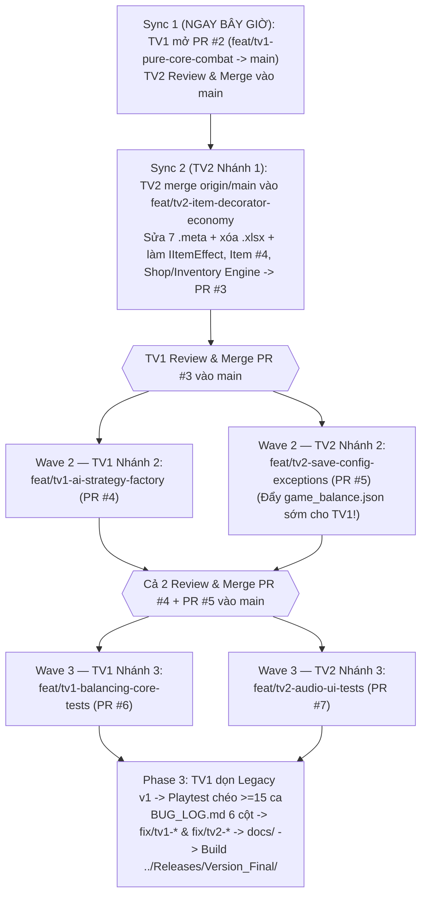
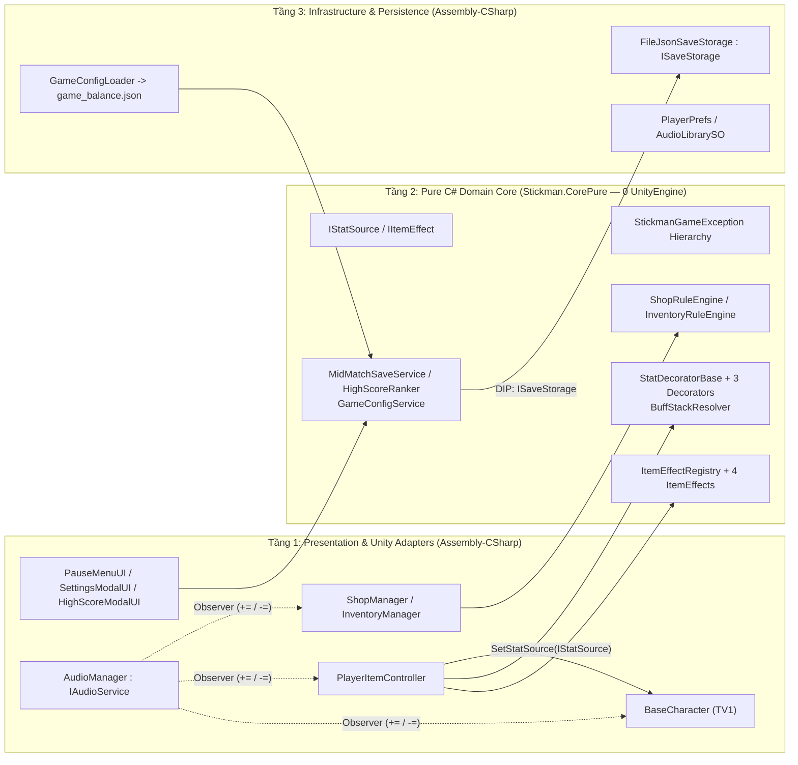

# HƯỚNG DẪN CHI TIẾT THỰC THI, TỰ ĐỘNG HÓA & BẢO VỆ MI4090 — THÀNH VIÊN 2 (TV2)

> **Dự án:** `Stickman game` (**MULTI-DIMENSIONS STICKMAN** — Unity `6000.5.4f1`, Roslyn C# `9.0`, `-warn:4 -nowarn:0649 -warnaserror+`)  
> **Học phần:** MI4090 – Lập trình hướng đối tượng (Nhóm 02 thành viên: TV1 & TV2)  
> **Repository GitHub:** <https://github.com/tienanh2701/Stickman-game-project.git>  
> **Thư mục chuẩn của repo:** `Stickman game` (máy TV1: `c:\Users\Admin\Documents\Tài liệu của TAnh\2026.1\VibeApp\OOP Project\Stickman game`; máy TV2: thư mục `Stickman game` nơi bạn đã `git clone`)  
> **Vai trò TV2:** Phụ trách toàn bộ phân hệ **Vật phẩm tiêu hao / GoF Decorator (`IStatSource`) / Strategy (`IItemEffect`) – Kinh tế (Shop/Inventory) – Save/Load JSON giữa trận & HighScore – Cấu hình ngoài build (`game_balance.json`) – Ngoại lệ miền (`StickmanGameException`) – Hệ thống Âm thanh Observer (`AudioManager : IAudioService`) – UI Settings/HighScore – Pure Unit Tests TV2 – Tài liệu UML tổng thể & Playtest chéo TV1**.

---

## MỤC LỤC

1. [Phần 1 — Phân công lại chi tiết cho TV2 & Đồng bộ với TV1](#phần-1--phân-công-lại-chi-tiết-cho-tv2--đồng-bộ-với-tv1)
2. [Phần 2 — Hướng dẫn thực thi từng nhánh kèm FULL CODE 100% biên dịch được](#phần-2--hướng-dẫn-thực-thi-từng-nhánh-kèm-full-code-100-biên-dịch-được)
   - [2.1. Nhánh 1: `feat/tv2-item-decorator-economy` (Hoàn thiện tiếp từ commit `e03577bc`)](#21-nhánh-1-feattv2-item-decorator-economy-hoàn-thiện-tiếp-từ-commit-e03577bc)
   - [2.2. Nhánh 2: `feat/tv2-save-config-exceptions`](#22-nhánh-2-feattv2-save-config-exceptions)
   - [2.3. Nhánh 3: `feat/tv2-audio-ui-tests`](#23-nhánh-3-feattv2-audio-ui-tests)
   - [2.4. Phase 3 (Phần TV2): Playtest chéo TV1, Bug Log 6 cột, Regression Test & Hồ sơ `docs/`](#24-phase-3-phần-tv2-playtest-chéo-tv1-bug-log-6-cột-regression-test--hồ-sơ-docs)
3. [Phần 3 — Quy trình tự động hóa & Gate kiểm chứng cho TV2 (Hạn chế check lại)](#phần-3--quy-trình-tự-động-hóa--gate-kiểm-chứng-cho-tv2-hạn-chế-check-lại)
4. [Phần 4 — Kiến thức cấu trúc, OOP/SOLID/GoF/Thuật toán & Vấn đáp MI4090 cần nhớ](#phần-4--kiến-thức-cấu-trúc-oopsolidgofthuật-toán--vấn-đáp-mi4090-cần-nhớ)

---

## PHẦN 1 — PHÂN CÔNG LẠI CHI TIẾT CHO TV2 & ĐỒNG BỘ VỚI TV1

### 1.1. Hiện trạng Git thực tế & Kiểm chứng đối chiếu codebase (KHÔNG làm trùng, KHÔNG phá test)

Sau khi kiểm toán trực tiếp toàn bộ nhánh Git (`origin/main`, `origin/feat/tv1-pure-core-combat`, `origin/feat/tv2-item-decorator-economy`) và mã nguồn thực tế, trạng thái hiện tại của hai thành viên như sau:

| Thành viên | ĐÃ HOÀN THÀNH (Verified trên Git) | CÒN LẠI CẦN THỰC HIỆN |
| :--- | :--- | :--- |
| **Nền chung (`main` `8fd665f8`)** | PR #1 (`feat/core-contracts` `256868de`) đã merge: `Stickman.CorePure.asmdef`, `Stickman.Tests.CoreUnit.asmdef`, 7 DIP Interfaces, 5 Custom Exceptions, 13 DTOs, `CoreContractsSmokeTests.cs` (3 tests), `Tools/verify_project.py` dùng `PROJECT_ROOT` động. | Không sửa `Interfaces/`, `Exceptions/`, `Entities/DTOs/` trừ khi cả 2 cùng đồng thuận mở PR riêng. |
| **TV1 (`feat/tv1-pure-core-combat` `ecdc4b7b`)** | **ĐÃ XONG 100% Nhánh 1** (4 commits: `BaseStatSource`, `DamageCalculator`, `RageRuleEngine`, `CombatRuleGuard`, tích hợp `BaseCharacter.SetStatSource`, `InputHandler : IInputProvider`, `RageManager`, xóa downcast `is`/`as`, 27 CoreUnit tests + 2 TestDoubles). Kết quả test hiện tại: **EditMode 89/89 PASS** (30 CoreUnit + 59 E2E), **PlayMode 105/105 PASS**. | Mở PR #2 (`feat/tv1-pure-core-combat` → `main`) để TV2 review & merge → sau đó làm Nhánh 2 (`feat/tv1-ai-strategy-factory`), Nhánh 3 (`feat/tv1-balancing-core-tests`), Phase 3 TV1. |
| **TV2 (`origin/feat/tv2-item-decorator-economy` `e03577bc`, author `chinhdinh2210`)** | **ĐÃ LÀM XONG PHẦN ĐẦU NHÁNH 1** — 6 file thuần C# (`0 using UnityEngine;`) trong `Assets/CorePure/Patterns/Decorators/`:<br/>1. `DefaultStatSource.cs`<br/>2. `StatDecoratorBase.cs`<br/>3. `SpinalFluidShieldDecorator.cs`<br/>4. `UltraDivineWaterDecorator.cs`<br/>5. `RageRegenDecorator.cs`<br/>6. `BuffStackResolver.cs` (240 dòng, đã có sẵn `ExportSnapshots()` và `RestoreSnapshots(...)` cho Nhánh 2!). | **1) Sửa ngay 2 lỗi vệ sinh trên commit `e03577bc`:**<br/>- Thiếu toàn bộ **7 file `.meta`** (`Assets/CorePure/Patterns/Decorators.meta` + 6 file `*.cs.meta`) → phải mở Unity hoặc chạy batchmode để sinh và `git add`.<br/>- Commit nhầm file nhị phân `Checklist_BTL_Game_v2026.xlsx` ở gốc repo → bắt buộc xóa bằng `git rm Checklist_BTL_Game_v2026.xlsx`.<br/>**2) Hoàn thiện phần còn lại Nhánh 1:** Merge `origin/main` (sau khi TV1 merge PR #2) → cài `IItemEffect` strategies + `ItemEffectRegistry` + Item thứ 4 (`RageElixir`) → refactor `PlayerItemController` dùng `BuffStackResolver` → `BaseCharacter.SetStatSource` → tách `ShopRuleEngine` & `InventoryRuleEngine` vào `Assets/CorePure/Rules/Economy/`.<br/>**3) Làm tiếp Nhánh 2** (`feat/tv2-save-config-exceptions`), **Nhánh 3** (`feat/tv2-audio-ui-tests`), và **Phase 3 TV2** (Playtest TV1 + `BUG_LOG.md` + `fix/tv2-*` + `docs/` TV2). |

> [!IMPORTANT]
> **4 kiểm chứng thực tế (Reality Checks) cực kỳ quan trọng so với kế hoạch ban đầu:**
> 1. **Bài test `T5_B12` (`Tier5_AdversarialUiHardeningTests.cs:672–719`) ĐÃ PASS SẴN** (`PlayMode` hiện đạt **105/105 PASS** vì đường dẫn đã dùng `HudItemSlotsPanel/SlotQ/InnerBg/ItemIcon`). TV2 **không cần sửa lại `T5_B12`**, chỉ cần đảm bảo mọi thay đổi của mình giữ nguyên xanh **105/105 PlayMode**.
> 2. **`GameUIManager.BindBoss(BossController)` (`Assets/Scripts/UI/GameUIManager.cs:1181–1227`) ĐÃ ĐƯỢC SỬA SẴN** sang named handlers (`HandleLegacyBossHealthChanged`, `HandleLegacyBossDeath`) kèm `UnbindLegacyBoss()` — toàn bộ 19 phép đăng ký `+=` trong `GameUIManager.cs` hiện đã **0 lambda leak**. TV2 cần kiểm chứng giữ sạch sự đối xứng `+=`/`-=` này, sửa nốt lambda nhỏ ở `PauseMenuUI.cs:557` (`() => SetPaused(false)` → `HandleResumeClicked`) và đảm bảo `AudioManager` hủy `-=` sạch trong `OnDisable`/`OnDestroy`.
> 3. **Khóa tài nguyên R3 (`F11_T1` & `F01_T1`) — BẮT BUỘC TUÂN THỦ:**
>    - `Assets/Sprites/UI/Items/` bị khóa cứng **đúng 5 PNG** (`Icon_CoinXu`, `Icon_LockedSlot`, `Icon_SenzuBean`, `Icon_SpinalFluid`, `Icon_UltraDivineWater`) trong tổng **716 file R3**. **TUYỆT ĐỐI KHÔNG thêm PNG icon của Item thứ 4 vào `Assets/Sprites/UI/Items/`!**
>    - `Assets/Sprites/UI/SlicedUI/01..09/` bị khóa cứng **đúng 107 PNG**. **TUYỆT ĐỐI KHÔNG thêm/xóa PNG tại đây!**
>    - `Tools/` bị khóa cứng **đúng 10 file `.py`** và **0 file `.py`** ở bất kỳ thư mục nào khác; **0 thư mục `__pycache__/`** (hiện trên máy có thể có `Tools/__pycache__/`, nhớ xóa bằng `Remove-Item -Recurse -Force Tools\__pycache__` trước khi chạy EditMode và luôn chạy Python với `-B`).
> 4. **Khóa hình học `PauseBox` (`T5_B16` trong `Tier5_GlassHudBoundaryTests.cs:53–83`):** 3 nút `ResumeButton` (`y = 38f`), `PauseRetryButton` (`y = -46f`), `PauseExitMenuButton` (`y = -130f`) với kích thước `360x66` nằm trong `PauseModalPanel/PauseBox` (tâm `960, 540`) bị kiểm tra nghiêm ngặt ở EditMode. Vì vậy thanh nút **Lưu Trận / Tải Trận / Cài Đặt** của TV2 được tạo **động tại runtime (`Application.isPlaying`)** thành `PauseUtilityBar` nằm dưới `PauseBox` (trực thuộc `PauseModalPanel`), **không sửa `Stickman_DemoScene.unity`** và **không làm xê dịch bất kỳ nút nào trong `PauseBox`**.

---

### 1.2. Bảng ranh giới sở hữu file độc quyền TV1 ↔ TV2 (Cam kết 0 xung đột Merge)

Bảng dưới đây đồng bộ **100%** với `docs/HUONG_DAN_CHI_TIET_TV1.md`:

| Khu vực | Quyền sở hữu độc quyền TV1 | Quyền sở hữu độc quyền TV2 | Giao thức vùng chung / Đóng băng |
| :--- | :--- | :--- | :--- |
| `Assets/CorePure/` | `AI/`, `Entities/Combat/`, `Rules/Combat/` | `Patterns/Decorators/`, `Patterns/Items/`, `Rules/Economy/`, `Rules/Persistence/` | `Interfaces/`, `Exceptions/`, `Entities/DTOs/` **ĐÓNG BĂNG** (cả 2 chỉ đọc, muốn sửa phải thống nhất trước). |
| `Assets/Scripts/` | `Characters/`, `Combat/`, `Core/` *(trừ dòng 39 `Enums.cs`)*, `Enemies/`, `Environment/`, `GameModes/`, `Level/`, `VFX/` | `Auth/`, `Economy/`, `Items/`, `Audio/` *(mới)*, `Persistence/` *(mới)*, `UI/` (`UIManager`, `PauseMenuUI`, `GlassHudTheme`, `MenuBackgroundLoader`, `GameUIManager`, `HudItemSlotsUI`, `SettingsModalUI`, `HighScoreModalUI`, `MenuSpriteLoaderHelper`, `MenuNavigationHelper`) | **`Enums.cs`**: CHỈ TV2 thêm `RageElixir = 4` trên Nhánh 1; TV1 không đụng `Enums.cs`.<br/>**`BaseCharacter.cs`**: TV1 sở hữu độc quyền; TV2 **KHÔNG chỉnh sửa**, chỉ gọi public hooks. |
| `Assets/Scenes/` | `Stickman_DemoScene.unity` | `MainMenu.unity`, `CharacterSelectScene.unity` | Tuyệt đối không sửa scene của người kia. UI Save/Load/Settings trong trận đấu TV2 dựng bằng code trong `PauseMenuUI` khi `Application.isPlaying`. |
| `Assets/Prefabs/` & Assets | `Prefabs/{Characters,Enemies,Combat,Hazards}/`, `Resources/EndlessPrefabs/`, `Data/Levels/Level_W*_S*.asset` | `Resources/Items/`, `Resources/Audio/`, `Audio/{BGM,SFX}/`, `StreamingAssets/Config/` | **R3 LOCK:** Cả 2 không thêm/xóa file trong `Assets/Sprites/{Characters,Combat,Enemies,Maps,VFX,UI/Items}` hoặc `Assets/Sprites/UI/SlicedUI/01..09/`. |
| `Assets/Tests/` | `Tests/CoreUnit/TV1/`, PlayMode combat/boss tests (file mới) | `Tests/CoreUnit/TV2/` | Không sửa các file `Tier1..Tier5` E2E có sẵn. |
| `docs/` | `01_Survey_GDD/GDD_*.md`, `02_Analysis_UML/{Package,Combat_*,Algorithms_TV1}.md`, `03_Design_Patterns/TV1_*.md`, `04_Testing_QA/TestMatrix_TV1.md`, `README.md` | `01_Survey_GDD/{UseCases,SceneMap}.md`, `02_Analysis_UML/{DataDictionary,UML_Master_ClassDiagram,SaveShop_*,Algorithms_TV2}.md`, `03_Design_Patterns/TV2_*.md`, `04_Testing_QA/{TestMatrix_TV2,BUG_LOG}.md` | Ở Phase 3, TV2 tạo file `BUG_LOG.md` với bảng 6 cột trước rồi cả 2 cùng ghi ≥ 3 bug/người. |

---

### 1.3. Điểm ghép nối chính xác với code TV1 & Quy tắc CHỐNG CỘNG DỒN KÉP

TV1 đã hoàn thiện toàn bộ cổng tích hợp công khai trên `BaseCharacter.cs` (1,687 dòng) và `RageManager.cs` (195 dòng) trong nhánh `feat/tv1-pure-core-combat`:

- **`BaseCharacter` (`StickmanBeatEmUp.Characters`):**
  - `SetStatSource(IStatSource source)` (`L156`) và `ResetStatSource()` (`L161`), property `StatSource` (`L135`).
  - `CurrentHealth` (`L130`), `MaxHealth` (`L131`), `VirtualShieldHP` (`L178`), `HasSpinalFluidBuff` (`L176`), `HasUltraWaterBuff` (`L177`), `IsDead` (`L127`), `IsBlocking` (`L166`), `IsTransformed` (`L129`), `CurrentState` (`L128`), `RageManager` (`L132`).
  - `Heal(float amount)` (`L838`), `CleanseDebuffs()` (`L847`), `ActivateSpinalFluidBuff(float duration, float shieldAmount, float reflectDamage)` (`L872`), `ActivateUltraWaterBuff(float duration, float damageMult, float speedMult, float ragePerSecond)` (`L883`).
  - Events cho `AudioManager` (Observer): `OnHealthChanged(float, float)` (`L182`), `OnShieldChanged(float, float)` (`L183`), `OnStateChanged(CharacterState)` (`L184`), `OnTransformedChanged(bool)` (`L185`), `OnEnemyHit(AttackType, IDamageable)` (`L186`).
- **`RageManager` (`StickmanBeatEmUp.Core`):**
  - `RageManager.RuleEngine.SetRageExact(float value, bool notify = true)` (`RageRuleEngine.cs:162`) — dùng để khôi phục chính xác điểm Nộ thực khi Load trận giữa chừng.
  - `RageManager.AddRageFloat(float amount)` (`L126`) — dùng cho phần Nộ tức thì của Item thứ 4 (`RageElixir`).
- **DTO chung (`StickmanBeatEmUp.CorePure.Entities.DTOs`):**
  - `GameStateDTO` (có sẵn `Validate(string storageKey = "save_slot")` ném `SaveCorruptedException`).
  - `GameBalanceConfigDTO` (có sẵn `Validate()` ném `InvalidGameConfigException`).
  - `HighScoreEntryDTO`, `BuffSnapshotDTO`, `EnemySnapshotDTO`, `ItemCountEntryDTO`, `ItemUseContext`, `ItemEffectResult`, `ShopItemBalanceDTO`, `LevelBalanceDTO`.

> [!CAUTION]
> **QUY TẮC CHỐNG CỘNG DỒN KÉP (ANTI-DOUBLE-COUNTING) — BẮT BUỘC ĐỌC KỸ:**
> Trong `BaseCharacter.cs` hiện tại, TV1 giữ tương thích ngược cho các trường buff cũ kết hợp với `StatSource`:
> - Sát thương đầu ra (`L174–175`): `StatSource.AttackDamageMultiplier * (ultraWaterTimer > 0f ? ultraWaterDamageMultiplier : 1f)`
> - Tốc độ di chuyển (`L923`): `StatSource.MoveSpeedMultiplier * ultraWaterSpeedMultiplier * hazardSpeedMultiplier`
> - Hồi Nộ mỗi giây (`L796–814`): cộng cả `ultraWaterRagePerSec` **VÀ** `StatSource.RagePerSecondBonus`
> - Phản sát thương (`DamageCalculator.cs:96–102`): cộng cả `input.BonusReflectDamage` **VÀ** `defenderStatSource.DamageReflectAmount`
>
> **Cách tích hợp chuẩn xác 100% mà KHÔNG sửa một dòng nào trong `BaseCharacter.cs`:**
> 1. **`SpinalFluid`:** Lắp `SpinalFluidShieldDecorator(inner, shieldAmount, reflectDamage)` vào `BuffStackResolver` → gọi `baseCharacter.SetStatSource(...)`, đồng thời gọi `baseCharacter.ActivateSpinalFluidBuff(duration, shieldAmount, 0f)` (**truyền `reflectDamage = 0f`** để phản đòn chỉ tính duy nhất 1 lần từ Decorator, còn giáp ảo `VirtualShieldHP` và thanh `ShieldBar` HUD hoạt động bình thường 100%).
> 2. **`UltraDivineWater`:** Lắp `UltraDivineWaterDecorator(inner, dmgMult, speedMult, ragePerSec)` vào `BuffStackResolver` → gọi `baseCharacter.SetStatSource(...)`, đồng thời gọi `baseCharacter.ActivateUltraWaterBuff(duration, 1f, 1f, 0f)` (**truyền giá trị trung tính `1f, 1f, 0f`** để cờ `HasUltraWaterBuff == true` còn hiệu lực, trong khi `1.5x` sát thương, `1.3x` tốc độ và `+2 Nộ/s` chỉ tính duy nhất 1 lần từ Decorator!).
> 3. **`RageElixir` (Item #4):** Lắp `RageRegenDecorator(inner, ragePerSec)` vào `BuffStackResolver` → gọi `baseCharacter.SetStatSource(...)` + cộng tức thì `RageDelta` qua `baseCharacter.RageManager?.AddRageFloat(result.RageDelta)`.

---

### 1.4. Thứ tự Git Pull / Branch / PR / Merge chính xác (Copy-Paste sẵn)



**Chuỗi lệnh chuẩn cho TV2 ở mỗi mốc đồng bộ:**

```powershell
# ===== SYNC 1: Sau khi TV2 đã bấm Approve & Merge PR #2 của TV1 trên GitHub =====
cd "<đường-dẫn-máy-TV2>\Stickman game"
git fetch origin
git switch feat/tv2-item-decorator-economy
git merge origin/main

# ===== XỬ LÝ 2 LỖI VỆ SINH TRÊN NHÁNH 1 NGAY LẬP TỨC =====
git rm Checklist_BTL_Game_v2026.xlsx
# (Mở Unity Editor 1 lần hoặc chạy Unity batchmode ở Phần 3 để Unity tự sinh 7 file .meta cho Decorators/)
# Sau đó code xong phần còn lại Nhánh 1 -> chạy Gate Phần 3 -> commit & push mở PR #3!

# ===== WAVE 2: Sau khi PR #3 được TV1 merge vào main =====
git switch main
git pull origin main
git switch -c feat/tv2-save-config-exceptions
# (Code Nhánh 2 -> Gate Phần 3 -> commit & push -u origin feat/tv2-save-config-exceptions -> mở PR #5)

# ===== WAVE 3: Sau khi cả PR #4 (TV1) và PR #5 (TV2) đã merge vào main =====
git switch main
git pull origin main
git switch -c feat/tv2-audio-ui-tests
# (Code Nhánh 3 -> Gate Phần 3 -> commit & push -u origin feat/tv2-audio-ui-tests -> mở PR #7)

# ===== PHASE 3: Nhánh sửa bug sau Playtest chéo & nhánh docs =====
git switch main
git pull origin main
git switch -c fix/tv2-bug-001
# (Sửa bug + viết Regression Test 1-1 -> Gate -> PR)
git switch main
git pull origin main
git switch -c docs/tv2-uml-design-qa
# (Hoàn thiện tài liệu docs/ phần TV2 -> PR)
```

---

## PHẦN 2 — HƯỚNG DẪN THỰC THI TỪNG NHÁNH KÈM FULL CODE 100% BIÊN DỊCH ĐƯỢC

> [!TIP]
> **Quy chuẩn biên dịch bắt buộc cho mọi đoạn code bên dưới:**
> - Toàn bộ file trong `Assets/CorePure/` và `Assets/Tests/CoreUnit/` có **0 dòng `using UnityEngine;` / `using UnityEditor;`**.
> - Tuân thủ nghiêm ngặt **C# 9.0** (`namespace X { ... }` dạng khối, không dùng file-scoped namespace, không dùng `required`, không dùng primary constructor cho class, không dùng constructor không tham số trên struct) và **0 cảnh báo với `-warnaserror+`**.
> - Sau mỗi lần tạo file `.cs` hoặc `.asset` mới trong `Assets/`, mở Unity Editor 1 lần (hoặc chạy batchmode) để Unity sinh `.meta`, sau đó kiểm tra `git status --short` và hoàn tác `git checkout -- ProjectSettings/ProjectSettings.asset` nếu Unity tự đổi file này.

---

### 2.1. Nhánh 1: `feat/tv2-item-decorator-economy` (Hoàn thiện tiếp từ commit `e03577bc`)

#### Bước 2.1.0 — Dọn lỗi vệ sinh commit `e03577bc` & kiểm kê 6 file Decorator đã có

Trên nhánh `feat/tv2-item-decorator-economy`, TV2 **đã commit sạch 6 file thuần C#** trong `Assets/CorePure/Patterns/Decorators/` (namespace `StickmanBeatEmUp.CorePure.Patterns.Decorators`). **KHÔNG viết lại hay đổi chữ ký 6 file này:**

| File đã có trên `e03577bc` | Chữ ký / thành phần chính đã kiểm chứng | Trạng thái |
| :--- | :--- | :--- |
| `DefaultStatSource.cs` | `sealed class DefaultStatSource : IStatSource` (`1f, 1f, 0f, 0f, 0f`) | ĐÃ XONG — cần sinh `.meta` |
| `StatDecoratorBase.cs` | `abstract class StatDecoratorBase : IStatSource`, `protected readonly IStatSource Inner`, 5 virtual pass-throughs | ĐÃ XONG — cần sinh `.meta` |
| `SpinalFluidShieldDecorator.cs` | `ctor(IStatSource inner, float shieldCapacityBonus = 40f, float damageReflectBonus = 5f)` | ĐÃ XONG — cần sinh `.meta` |
| `UltraDivineWaterDecorator.cs` | `ctor(IStatSource inner, float damageMultiplier = 1.5f, float speedMultiplier = 1.3f, float ragePerSecondBonus = 2f)` | ĐÃ XONG — cần sinh `.meta` |
| `RageRegenDecorator.cs` | `ctor(IStatSource inner, float ragePerSecondBonus = 3f)` | ĐÃ XONG — cần sinh `.meta` |
| `BuffStackResolver.cs` | `ActiveCount`, `ApplyOrRefresh(string, float, float, bool, Func<IStatSource, IStatSource>)`, `Tick(float)`, `UpdateShield(string, float)`, `HasBuff(string)`, `GetRemainingSeconds(string)`, `RemoveBuff(string)`, `ClearAll()`, `BuildStatChain(IStatSource)`, `ExportSnapshots()`, `RestoreSnapshots(...)` | ĐÃ XONG — cần sinh `.meta` |

Chạy lệnh dọn rác ngay sau khi `git merge origin/main`:

```powershell
git rm Checklist_BTL_Game_v2026.xlsx
if (Test-Path "Tools\__pycache__") { Remove-Item -Recurse -Force "Tools\__pycache__" }
```

---

#### Bước 2.1.1 — Tạo hệ thống `IItemEffect` Strategies & `ItemEffectRegistry` (Điểm neo Live OCP TV2)

Tạo 6 file thuần C# (`0 using UnityEngine;`) trong thư mục mới `Assets/CorePure/Patterns/Items/`:

##### 1) `Assets/CorePure/Patterns/Items/ConsumableItemIds.cs`

```csharp
namespace StickmanBeatEmUp.CorePure.Patterns.Items
{
    /// <summary>
    /// Mã định danh số nguyên thuần C# đồng bộ 1-1 với enum StickmanBeatEmUp.Core.ConsumableItemType.
    /// </summary>
    public static class ConsumableItemIds
    {
        public const int NONE = 0;
        public const int SENZU_BEAN = 1;
        public const int SPINAL_FLUID = 2;
        public const int ULTRA_DIVINE_WATER = 3;
        public const int RAGE_ELIXIR = 4;
    }
}
```

##### 2) `Assets/CorePure/Patterns/Items/SenzuBeanItemEffect.cs`

```csharp
using System;
using StickmanBeatEmUp.CorePure.Entities.DTOs;
using StickmanBeatEmUp.CorePure.Interfaces;

namespace StickmanBeatEmUp.CorePure.Patterns.Items
{
    /// <summary>
    /// Strategy cho Đậu Thần (SenzuBean): hồi HP tức thì và xóa hiệu ứng bất lợi.
    /// </summary>
    public sealed class SenzuBeanItemEffect : IItemEffect
    {
        private readonly float healAmount;

        public int ItemTypeId => ConsumableItemIds.SENZU_BEAN;
        public string ItemName => "Đậu Thần";

        public SenzuBeanItemEffect(float healAmount = 10f)
        {
            this.healAmount = Math.Max(0f, healAmount);
        }

        public bool CanApply(ItemUseContext context)
        {
            return !context.IsPlayerDead && context.QuantityOwned > 0 && context.MaxHp > 0f;
        }

        public ItemEffectResult ApplyEffect(ItemUseContext context)
        {
            if (!CanApply(context))
            {
                return ItemEffectResult.Rejected("Không thể dùng Đậu Thần lúc này.");
            }

            float effectiveHeal = healAmount > 0f ? healAmount : 10f;
            return new ItemEffectResult
            {
                Applied = true,
                HealAmount = effectiveHeal,
                RageDelta = 0f,
                ShieldAmount = 0f,
                ReflectDamage = 0f,
                BuffDuration = 0f,
                DamageMultiplier = 1f,
                SpeedMultiplier = 1f,
                RagePerSecond = 0f,
                ClearNegativeEffects = true,
                FeedbackMessage = $"Hồi {effectiveHeal:0} HP và giải trừ debuff!"
            };
        }
    }
}
```

##### 3) `Assets/CorePure/Patterns/Items/SpinalFluidItemEffect.cs`

```csharp
using System;
using StickmanBeatEmUp.CorePure.Entities.DTOs;
using StickmanBeatEmUp.CorePure.Interfaces;

namespace StickmanBeatEmUp.CorePure.Patterns.Items
{
    /// <summary>
    /// Strategy cho Dịch Tủy Titan (SpinalFluid): cấp giáp ảo và phản sát thương theo thời lượng.
    /// </summary>
    public sealed class SpinalFluidItemEffect : IItemEffect
    {
        private readonly float durationSeconds;
        private readonly float shieldAmount;
        private readonly float reflectDamage;

        public int ItemTypeId => ConsumableItemIds.SPINAL_FLUID;
        public string ItemName => "Dịch Tủy Titan";

        public SpinalFluidItemEffect(
            float durationSeconds = 30f,
            float shieldAmount = 40f,
            float reflectDamage = 5f)
        {
            this.durationSeconds = durationSeconds > 0f ? durationSeconds : 30f;
            this.shieldAmount = Math.Max(0f, shieldAmount);
            this.reflectDamage = Math.Max(0f, reflectDamage);
        }

        public bool CanApply(ItemUseContext context)
        {
            return !context.IsPlayerDead && context.QuantityOwned > 0;
        }

        public ItemEffectResult ApplyEffect(ItemUseContext context)
        {
            if (!CanApply(context))
            {
                return ItemEffectResult.Rejected("Không thể kích hoạt Dịch Tủy Titan.");
            }

            return new ItemEffectResult
            {
                Applied = true,
                HealAmount = 0f,
                RageDelta = 0f,
                ShieldAmount = shieldAmount,
                ReflectDamage = reflectDamage,
                BuffDuration = durationSeconds,
                DamageMultiplier = 1f,
                SpeedMultiplier = 1f,
                RagePerSecond = 0f,
                ClearNegativeEffects = false,
                FeedbackMessage = $"Kích hoạt giáp ảo +{shieldAmount:0} HP và phản {reflectDamage:0} sát thương!"
            };
        }
    }
}
```

##### 4) `Assets/CorePure/Patterns/Items/UltraDivineWaterItemEffect.cs`

```csharp
using System;
using StickmanBeatEmUp.CorePure.Entities.DTOs;
using StickmanBeatEmUp.CorePure.Interfaces;

namespace StickmanBeatEmUp.CorePure.Patterns.Items
{
    /// <summary>
    /// Strategy cho Nước Siêu Thần (UltraDivineWater): tăng sát thương, tốc độ và hồi Nộ mỗi giây.
    /// </summary>
    public sealed class UltraDivineWaterItemEffect : IItemEffect
    {
        private readonly float durationSeconds;
        private readonly float damageMultiplier;
        private readonly float speedMultiplier;
        private readonly float ragePerSecond;

        public int ItemTypeId => ConsumableItemIds.ULTRA_DIVINE_WATER;
        public string ItemName => "Nước Siêu Thần";

        public UltraDivineWaterItemEffect(
            float durationSeconds = 60f,
            float damageMultiplier = 1.5f,
            float speedMultiplier = 1.3f,
            float ragePerSecond = 2f)
        {
            this.durationSeconds = durationSeconds > 0f ? durationSeconds : 60f;
            this.damageMultiplier = damageMultiplier > 0f ? damageMultiplier : 1.5f;
            this.speedMultiplier = speedMultiplier > 0f ? speedMultiplier : 1.3f;
            this.ragePerSecond = Math.Max(0f, ragePerSecond);
        }

        public bool CanApply(ItemUseContext context)
        {
            return !context.IsPlayerDead && context.QuantityOwned > 0;
        }

        public ItemEffectResult ApplyEffect(ItemUseContext context)
        {
            if (!CanApply(context))
            {
                return ItemEffectResult.Rejected("Không thể dùng Nước Siêu Thần.");
            }

            return new ItemEffectResult
            {
                Applied = true,
                HealAmount = 0f,
                RageDelta = 0f,
                ShieldAmount = 0f,
                ReflectDamage = 0f,
                BuffDuration = durationSeconds,
                DamageMultiplier = damageMultiplier,
                SpeedMultiplier = speedMultiplier,
                RagePerSecond = ragePerSecond,
                ClearNegativeEffects = false,
                FeedbackMessage = $"Tăng {damageMultiplier:0.0}x sát thương, {speedMultiplier:0.0}x tốc độ và +{ragePerSecond:0.0} Nộ/s!"
            };
        }
    }
}
```

##### 5) `Assets/CorePure/Patterns/Items/RageElixirItemEffect.cs` *(Vật phẩm thứ 4 — đạt chuẩn ≥ 4 loại Item)*

```csharp
using System;
using StickmanBeatEmUp.CorePure.Entities.DTOs;
using StickmanBeatEmUp.CorePure.Interfaces;

namespace StickmanBeatEmUp.CorePure.Patterns.Items
{
    /// <summary>
    /// Strategy cho Vật phẩm thứ 4 — Tinh Chất Cuồng Nộ (RageElixir):
    /// cộng tức thì +5 Nộ và kích hoạt RageRegenDecorator (+3 Nộ/giây trong 20 giây).
    /// </summary>
    public sealed class RageElixirItemEffect : IItemEffect
    {
        private readonly float instantRageBonus;
        private readonly float durationSeconds;
        private readonly float ragePerSecond;

        public int ItemTypeId => ConsumableItemIds.RAGE_ELIXIR;
        public string ItemName => "Tinh Chất Cuồng Nộ";

        public RageElixirItemEffect(
            float instantRageBonus = 5f,
            float durationSeconds = 20f,
            float ragePerSecond = 3f)
        {
            this.instantRageBonus = Math.Max(0f, instantRageBonus);
            this.durationSeconds = durationSeconds > 0f ? durationSeconds : 20f;
            this.ragePerSecond = Math.Max(0f, ragePerSecond);
        }

        public bool CanApply(ItemUseContext context)
        {
            return !context.IsPlayerDead && context.QuantityOwned > 0;
        }

        public ItemEffectResult ApplyEffect(ItemUseContext context)
        {
            if (!CanApply(context))
            {
                return ItemEffectResult.Rejected("Không thể dùng Tinh Chất Cuồng Nộ.");
            }

            return new ItemEffectResult
            {
                Applied = true,
                HealAmount = 0f,
                RageDelta = instantRageBonus,
                ShieldAmount = 0f,
                ReflectDamage = 0f,
                BuffDuration = durationSeconds,
                DamageMultiplier = 1f,
                SpeedMultiplier = 1f,
                RagePerSecond = ragePerSecond,
                ClearNegativeEffects = false,
                FeedbackMessage = $"+{instantRageBonus:0} Nộ tức thì và +{ragePerSecond:0.0} Nộ/s trong {durationSeconds:0}s!"
            };
        }
    }
}
```

##### 6) `Assets/CorePure/Patterns/Items/ItemEffectRegistry.cs` *(Thay thế hoàn toàn `switch(itemType)` — mở rộng 0 sửa lớp cũ)*

```csharp
using System;
using System.Collections.Generic;
using StickmanBeatEmUp.CorePure.Entities.DTOs;
using StickmanBeatEmUp.CorePure.Interfaces;

namespace StickmanBeatEmUp.CorePure.Patterns.Items
{
    /// <summary>
    /// Sổ đăng ký Strategy IItemEffect theo nguyên lý Open/Closed (OCP).
    /// Khi thêm vật phẩm mới, chỉ cần viết lớp implement IItemEffect và gọi Register(...) mà không sửa lớp cũ.
    /// </summary>
    public sealed class ItemEffectRegistry
    {
        private readonly Dictionary<int, IItemEffect> effectsById = new Dictionary<int, IItemEffect>();

        public int RegisteredCount => effectsById.Count;

        public void Register(IItemEffect effect)
        {
            if (effect == null)
            {
                throw new ArgumentNullException(nameof(effect));
            }

            if (effect.ItemTypeId <= ConsumableItemIds.NONE)
            {
                throw new ArgumentOutOfRangeException(nameof(effect), "ItemTypeId must be > 0.");
            }

            effectsById[effect.ItemTypeId] = effect;
        }

        public bool Contains(int itemTypeId)
        {
            return effectsById.ContainsKey(itemTypeId);
        }

        public bool TryGetEffect(int itemTypeId, out IItemEffect effect)
        {
            return effectsById.TryGetValue(itemTypeId, out effect);
        }

        public ItemEffectResult Execute(int itemTypeId, ItemUseContext context)
        {
            if (!effectsById.TryGetValue(itemTypeId, out IItemEffect effect) || effect == null)
            {
                return ItemEffectResult.Rejected($"Chưa đăng ký hiệu ứng cho vật phẩm mã {itemTypeId}.");
            }

            if (!effect.CanApply(context))
            {
                return ItemEffectResult.Rejected($"Không đủ điều kiện sử dụng {effect.ItemName}.");
            }

            return effect.ApplyEffect(context);
        }

        public static ItemEffectRegistry CreateDefault()
        {
            ItemEffectRegistry registry = new ItemEffectRegistry();
            registry.Register(new SenzuBeanItemEffect());
            registry.Register(new SpinalFluidItemEffect());
            registry.Register(new UltraDivineWaterItemEffect());
            registry.Register(new RageElixirItemEffect());
            return registry;
        }
    }
}
```

---

#### Bước 2.1.2 — Tách `InventoryRuleEngine` & `ShopRuleEngine` thuần C# trong `Assets/CorePure/Rules/Economy/`

Tạo 3 file thuần C# (`0 using UnityEngine;`) trong `Assets/CorePure/Rules/Economy/`:

##### 1) `Assets/CorePure/Rules/Economy/InventoryRuleEngine.cs`

```csharp
using System;
using System.Collections.Generic;
using StickmanBeatEmUp.CorePure.Exceptions;
using StickmanBeatEmUp.CorePure.Patterns.Items;

namespace StickmanBeatEmUp.CorePure.Rules.Economy
{
    /// <summary>
    /// Động cơ quy tắc Kho vật phẩm & 2 ô trang bị Q (0) / E (1) thuần C#.
    /// Bảo toàn bất biến miền: 0 <= số lượng <= MAX_STACK_PER_ITEM (99).
    /// </summary>
    public sealed class InventoryRuleEngine
    {
        public const int SLOT_Q = 0;
        public const int SLOT_E = 1;
        public const int SLOT_COUNT = 2;
        public const int MAX_STACK_PER_ITEM = 99;

        private readonly Dictionary<int, int> ownedCounts = new Dictionary<int, int>();
        private readonly int[] equippedSlots = new int[SLOT_COUNT];

        public InventoryRuleEngine()
        {
            equippedSlots[SLOT_Q] = ConsumableItemIds.SENZU_BEAN;
            equippedSlots[SLOT_E] = ConsumableItemIds.SPINAL_FLUID;
        }

        public static bool IsValidSlotIndex(int slotIndex)
        {
            return slotIndex >= 0 && slotIndex < SLOT_COUNT;
        }

        public int GetOwnedCount(int itemTypeId)
        {
            if (itemTypeId <= ConsumableItemIds.NONE)
            {
                return 0;
            }

            return ownedCounts.TryGetValue(itemTypeId, out int count) ? count : 0;
        }

        /// <summary>
        /// Cộng vật phẩm vào kho, kẹp cứng biên [0, MAX_STACK_PER_ITEM (99)].
        /// Trả về số lượng thực tế đã cộng thêm.
        /// </summary>
        public int AddItem(int itemTypeId, int amount)
        {
            if (itemTypeId <= ConsumableItemIds.NONE || amount <= 0)
            {
                return 0;
            }

            int current = GetOwnedCount(itemTypeId);
            int remainingCapacity = MAX_STACK_PER_ITEM - current;
            if (remainingCapacity <= 0)
            {
                return 0;
            }

            int added = Math.Min(amount, remainingCapacity);
            ownedCounts[itemTypeId] = current + added;
            return added;
        }

        public void SetOwnedCountExact(int itemTypeId, int count)
        {
            if (itemTypeId <= ConsumableItemIds.NONE)
            {
                return;
            }

            int clamped = Math.Max(0, Math.Min(MAX_STACK_PER_ITEM, count));
            ownedCounts[itemTypeId] = clamped;
        }

        public int GetEquippedItem(int slotIndex)
        {
            if (!IsValidSlotIndex(slotIndex))
            {
                return ConsumableItemIds.NONE;
            }

            return equippedSlots[slotIndex];
        }

        public bool TrySetEquippedItem(int slotIndex, int itemTypeId)
        {
            if (!IsValidSlotIndex(slotIndex))
            {
                return false;
            }

            equippedSlots[slotIndex] = itemTypeId < ConsumableItemIds.NONE
                ? ConsumableItemIds.NONE
                : itemTypeId;
            return true;
        }

        public void SetEquippedItemOrThrow(int slotIndex, int itemTypeId)
        {
            if (!TrySetEquippedItem(slotIndex, itemTypeId))
            {
                throw new InvalidPurchaseException(
                    itemTypeId.ToString(),
                    $"Invalid equipment slot index: {slotIndex}. Allowed slots: 0 (Q), 1 (E).");
            }
        }

        public bool CanUseSlot(int slotIndex, bool isFreeUseMode)
        {
            int itemTypeId = GetEquippedItem(slotIndex);
            if (itemTypeId <= ConsumableItemIds.NONE)
            {
                return false;
            }

            return isFreeUseMode || GetOwnedCount(itemTypeId) > 0;
        }

        public bool TryConsumeSlot(int slotIndex, bool isFreeUseMode, out int usedItemTypeId)
        {
            usedItemTypeId = GetEquippedItem(slotIndex);
            if (usedItemTypeId <= ConsumableItemIds.NONE)
            {
                return false;
            }

            if (isFreeUseMode)
            {
                return true;
            }

            int current = GetOwnedCount(usedItemTypeId);
            if (current <= 0)
            {
                return false;
            }

            ownedCounts[usedItemTypeId] = current - 1;
            return true;
        }

        public bool TryAutoEquipIfSlotAvailable(int itemTypeId, out int assignedSlot)
        {
            assignedSlot = -1;
            if (itemTypeId <= ConsumableItemIds.NONE)
            {
                return false;
            }

            int equippedQ = equippedSlots[SLOT_Q];
            int equippedE = equippedSlots[SLOT_E];
            if (equippedQ == itemTypeId || equippedE == itemTypeId)
            {
                return false;
            }

            if (equippedQ == ConsumableItemIds.NONE)
            {
                equippedSlots[SLOT_Q] = itemTypeId;
                assignedSlot = SLOT_Q;
                return true;
            }

            if (equippedE == ConsumableItemIds.NONE)
            {
                equippedSlots[SLOT_E] = itemTypeId;
                assignedSlot = SLOT_E;
                return true;
            }

            if (GetOwnedCount(equippedQ) <= 0)
            {
                equippedSlots[SLOT_Q] = itemTypeId;
                assignedSlot = SLOT_Q;
                return true;
            }

            if (GetOwnedCount(equippedE) <= 0)
            {
                equippedSlots[SLOT_E] = itemTypeId;
                assignedSlot = SLOT_E;
                return true;
            }

            return false;
        }

        public void ResetToDefaults(IReadOnlyList<int> knownItemTypeIds)
        {
            ownedCounts.Clear();
            if (knownItemTypeIds != null)
            {
                for (int i = 0; i < knownItemTypeIds.Count; i++)
                {
                    int id = knownItemTypeIds[i];
                    if (id > ConsumableItemIds.NONE)
                    {
                        ownedCounts[id] = 0;
                    }
                }
            }

            equippedSlots[SLOT_Q] = ConsumableItemIds.SENZU_BEAN;
            equippedSlots[SLOT_E] = ConsumableItemIds.SPINAL_FLUID;
        }
    }
}
```

##### 2) `Assets/CorePure/Rules/Economy/ShopPurchaseResult.cs`

```csharp
namespace StickmanBeatEmUp.CorePure.Rules.Economy
{
    /// <summary>
    /// Kết quả thuần C# của một giao dịch mua vật phẩm tại Cửa hàng.
    /// </summary>
    public readonly struct ShopPurchaseResult
    {
        public bool Succeeded { get; }
        public int RemainingCoins { get; }
        public int NewOwnedCount { get; }
        public string FeedbackMessage { get; }

        public ShopPurchaseResult(bool succeeded, int remainingCoins, int newOwnedCount, string feedbackMessage)
        {
            Succeeded = succeeded;
            RemainingCoins = remainingCoins;
            NewOwnedCount = newOwnedCount;
            FeedbackMessage = feedbackMessage ?? string.Empty;
        }
    }
}
```

##### 3) `Assets/CorePure/Rules/Economy/ShopRuleEngine.cs`

```csharp
using StickmanBeatEmUp.CorePure.Exceptions;
using StickmanBeatEmUp.CorePure.Patterns.Items;

namespace StickmanBeatEmUp.CorePure.Rules.Economy
{
    /// <summary>
    /// Động cơ quy tắc Cửa hàng thuần C# kiểm định BVA số dư Xu, giá âm, mã vật phẩm và giới hạn kho 99.
    /// </summary>
    public sealed class ShopRuleEngine
    {
        /// <summary>
        /// Kiểm tra chặt chẽ điều kiện giao dịch, ném InvalidPurchaseException khi dữ liệu đầu vào bất hợp lệ
        /// (itemId == None, giá âm, số dư âm, hoặc kho đã chạm trần 99).
        /// </summary>
        public void ValidatePurchaseOrThrow(
            int itemTypeId,
            int price,
            int currentCoins,
            int currentOwned,
            int maxStack = InventoryRuleEngine.MAX_STACK_PER_ITEM)
        {
            if (itemTypeId <= ConsumableItemIds.NONE)
            {
                throw new InvalidPurchaseException("None", "Vật phẩm không hợp lệ!");
            }

            if (price < 0)
            {
                throw new InvalidPurchaseException(itemTypeId.ToString(), $"Giá vật phẩm không được âm ({price}).");
            }

            if (currentCoins < 0)
            {
                throw new InvalidPurchaseException(itemTypeId.ToString(), $"Số dư Xu không hợp lệ ({currentCoins}).");
            }

            if (currentOwned >= maxStack)
            {
                throw new InvalidPurchaseException(itemTypeId.ToString(), $"Kho đã đầy tối đa ({maxStack})!");
            }

            if (currentCoins < price)
            {
                throw new InvalidPurchaseException(itemTypeId.ToString(), "Không đủ Xu!");
            }
        }

        /// <summary>
        /// Đánh giá giao dịch theo chuẩn UI Shop (giữ nguyên thông điệp "Không đủ Xu!" cho E2E tests).
        /// </summary>
        public ShopPurchaseResult EvaluatePurchase(
            int itemTypeId,
            string itemDisplayName,
            int price,
            int currentCoins,
            int currentOwned,
            int maxStack = InventoryRuleEngine.MAX_STACK_PER_ITEM)
        {
            if (itemTypeId <= ConsumableItemIds.NONE)
            {
                return new ShopPurchaseResult(false, currentCoins, currentOwned, "Vật phẩm không hợp lệ!");
            }

            if (price < 0)
            {
                return new ShopPurchaseResult(false, currentCoins, currentOwned, "Giá vật phẩm không hợp lệ!");
            }

            if (currentOwned >= maxStack)
            {
                return new ShopPurchaseResult(false, currentCoins, currentOwned, $"Kho đã đạt tối đa ({maxStack})!");
            }

            if (currentCoins < price)
            {
                return new ShopPurchaseResult(false, currentCoins, currentOwned, "Không đủ Xu!");
            }

            int remainingCoins = currentCoins - price;
            int newOwned = currentOwned + 1;
            string label = string.IsNullOrWhiteSpace(itemDisplayName) ? $"Item#{itemTypeId}" : itemDisplayName;
            return new ShopPurchaseResult(
                true,
                remainingCoins,
                newOwned,
                $"Đã mua {label}! (Sở hữu: {newOwned})");
        }
    }
}
```

---

#### Bước 2.1.3 — Cập nhật Unity Adapters trên Nhánh 1 (`Enums`, `ConsumableItemSO`, `PlayerItemController`, `InventoryManager`, `ShopManager`, `UIManager`)

##### 1) `Assets/Scripts/Core/Enums.cs` *(Chỉ thêm `RageElixir = 4` vào `ConsumableItemType` tại dòng 34–41)*

Thay thế trọn vẹn khối `ConsumableItemType` trong `Assets/Scripts/Core/Enums.cs`:

```csharp
    /// <summary>
    /// 4 vật phẩm tiêu hao bán trong Shop và dùng qua phím Q / E
    /// </summary>
    public enum ConsumableItemType
    {
        None = 0,
        SenzuBean = 1,
        SpinalFluid = 2,
        UltraDivineWater = 3,
        RageElixir = 4
    }
```

##### 2) `Assets/Scripts/Items/ConsumableItemSO.cs` *(Full file — hỗ trợ Item thứ 4 `RageElixir`, KHÔNG thêm PNG mới vào `Assets/Sprites/UI/Items/`)*

```csharp
using UnityEngine;

namespace StickmanBeatEmUp.Items
{
    /// <summary>
    /// ScriptableObject cấu hình dữ liệu cho 4 vật phẩm tiêu hao (SenzuBean, SpinalFluid, UltraDivineWater, RageElixir).
    /// </summary>
    [CreateAssetMenu(fileName = "NewConsumableItem", menuName = "Stickman BeatEmUp/Consumable Item SO")]
    public class ConsumableItemSO : ScriptableObject
    {
        [Header("Identity & Shop")]
        public StickmanBeatEmUp.Core.ConsumableItemType itemType = StickmanBeatEmUp.Core.ConsumableItemType.SenzuBean;
        public string itemName;
        [TextArea(2, 4)] public string description;
        public int price = 30;
        public Sprite icon;

        [Header("Visual Effects")]
        public Sprite[] vfxFrames;
        public float vfxFps = 8f;

        [Header("Combat Effects")]
        public float healAmount = 10f;
        public float instantRageAmount = 0f;
        public float buffDuration = 0f;
        public float shieldAmount = 0f;
        public float reflectDamage = 0f;
        public float damageMultiplier = 1f;
        public float speedMultiplier = 1f;
        public float ragePerSecond = 0f;

        /// <summary>
        /// Tạo cấu hình mặc định tại runtime nếu chưa gán asset trong Resources/Items.
        /// </summary>
        public static ConsumableItemSO CreateRuntimeDefault(StickmanBeatEmUp.Core.ConsumableItemType type)
        {
            ConsumableItemSO item = CreateInstance<ConsumableItemSO>();
            item.itemType = type;

            switch (type)
            {
                case StickmanBeatEmUp.Core.ConsumableItemType.SenzuBean:
                    item.name = "Item_SenzuBean";
                    item.itemName = "Đậu Thần";
                    item.description = "Hồi 10 HP và xóa toàn bộ hiệu ứng bất lợi ngay lập tức.";
                    item.price = 30;
                    item.vfxFps = 8f;
                    item.healAmount = 10f;
                    item.instantRageAmount = 0f;
                    item.buffDuration = 0f;
                    item.shieldAmount = 0f;
                    item.reflectDamage = 0f;
                    item.damageMultiplier = 1f;
                    item.speedMultiplier = 1f;
                    item.ragePerSecond = 0f;
                    break;

                case StickmanBeatEmUp.Core.ConsumableItemType.SpinalFluid:
                    item.name = "Item_SpinalFluid";
                    item.itemName = "Dịch Tủy Titan";
                    item.description = "Tạo giáp ảo 40 HP và phản 5 sát thương khi bị đánh trong 30 giây.";
                    item.price = 60;
                    item.vfxFps = 8f;
                    item.healAmount = 0f;
                    item.instantRageAmount = 0f;
                    item.buffDuration = 30f;
                    item.shieldAmount = 40f;
                    item.reflectDamage = 5f;
                    item.damageMultiplier = 1f;
                    item.speedMultiplier = 1f;
                    item.ragePerSecond = 0f;
                    break;

                case StickmanBeatEmUp.Core.ConsumableItemType.UltraDivineWater:
                    item.name = "Item_UltraDivineWater";
                    item.itemName = "Nước Siêu Thần";
                    item.description = "Tăng 50% sát thương, +30% tốc độ và hồi +2 Nộ/giây trong 60 giây.";
                    item.price = 50;
                    item.vfxFps = 8f;
                    item.healAmount = 0f;
                    item.instantRageAmount = 0f;
                    item.buffDuration = 60f;
                    item.shieldAmount = 0f;
                    item.reflectDamage = 0f;
                    item.damageMultiplier = 1.5f;
                    item.speedMultiplier = 1.3f;
                    item.ragePerSecond = 2f;
                    break;

                case StickmanBeatEmUp.Core.ConsumableItemType.RageElixir:
                    item.name = "Item_RageElixir";
                    item.itemName = "Tinh Chất Cuồng Nộ";
                    item.description = "Tăng ngay +5 Nộ và hồi +3 Nộ/giây trong 20 giây.";
                    item.price = 40;
                    item.vfxFps = 8f;
                    item.healAmount = 0f;
                    item.instantRageAmount = 5f;
                    item.buffDuration = 20f;
                    item.shieldAmount = 0f;
                    item.reflectDamage = 0f;
                    item.damageMultiplier = 1f;
                    item.speedMultiplier = 1f;
                    item.ragePerSecond = 3f;
                    break;

                default:
                    item.name = "Item_None";
                    item.itemName = "Trống";
                    item.description = string.Empty;
                    item.price = 0;
                    item.healAmount = 0f;
                    item.instantRageAmount = 0f;
                    break;
            }

            PopulateDefaultSpritesInEditor(item);
            return item;
        }

        /// <summary>
        /// Hỗ trợ nạp sprite mặc định trong Unity Editor khi chưa build asset ScriptableObject.
        /// Lưu ý R3: RageElixir tái sử dụng sprite bảo hộ có sẵn, tuyệt đối không thêm PNG vào Assets/Sprites/UI/Items/.
        /// </summary>
        public static void PopulateDefaultSpritesInEditor(ConsumableItemSO item)
        {
            if (item == null) return;
#if UNITY_EDITOR
            switch (item.itemType)
            {
                case StickmanBeatEmUp.Core.ConsumableItemType.SenzuBean:
                    if (item.icon == null)
                    {
                        item.icon = UnityEditor.AssetDatabase.LoadAssetAtPath<Sprite>("Assets/Sprites/UI/Items/Icon_SenzuBean.png");
                    }
                    if (item.vfxFrames == null || item.vfxFrames.Length == 0)
                    {
                        item.vfxFrames = LoadSpriteSequence(
                            "Assets/Sprites/Combat/Items/VFX_SenzuHeal_0.png",
                            "Assets/Sprites/Combat/Items/VFX_SenzuHeal_1.png",
                            "Assets/Sprites/Combat/Items/VFX_SenzuHeal_2.png");
                    }
                    break;

                case StickmanBeatEmUp.Core.ConsumableItemType.SpinalFluid:
                    if (item.icon == null)
                    {
                        item.icon = UnityEditor.AssetDatabase.LoadAssetAtPath<Sprite>("Assets/Sprites/UI/Items/Icon_SpinalFluid.png");
                    }
                    if (item.vfxFrames == null || item.vfxFrames.Length == 0)
                    {
                        item.vfxFrames = LoadSpriteSequence(
                            "Assets/Sprites/Combat/Items/VFX_SpinalRibcage_0.png",
                            "Assets/Sprites/Combat/Items/VFX_SpinalRibcage_1.png");
                    }
                    break;

                case StickmanBeatEmUp.Core.ConsumableItemType.UltraDivineWater:
                    if (item.icon == null)
                    {
                        item.icon = UnityEditor.AssetDatabase.LoadAssetAtPath<Sprite>("Assets/Sprites/UI/Items/Icon_UltraDivineWater.png");
                    }
                    if (item.vfxFrames == null || item.vfxFrames.Length == 0)
                    {
                        item.vfxFrames = LoadSpriteSequence(
                            "Assets/Sprites/Combat/Items/VFX_UltraWaterAura_0.png",
                            "Assets/Sprites/Combat/Items/VFX_UltraWaterAura_1.png",
                            "Assets/Sprites/Combat/Items/VFX_UltraWaterAura_2.png");
                    }
                    break;

                case StickmanBeatEmUp.Core.ConsumableItemType.RageElixir:
                    if (item.icon == null)
                    {
                        item.icon = UnityEditor.AssetDatabase.LoadAssetAtPath<Sprite>("Assets/Sprites/UI/Items/Icon_UltraDivineWater.png");
                    }
                    if (item.vfxFrames == null || item.vfxFrames.Length == 0)
                    {
                        item.vfxFrames = LoadSpriteSequence(
                            "Assets/Sprites/Combat/Items/VFX_UltraWaterAura_0.png",
                            "Assets/Sprites/Combat/Items/VFX_UltraWaterAura_1.png",
                            "Assets/Sprites/Combat/Items/VFX_UltraWaterAura_2.png");
                    }
                    break;
            }
#endif
        }

#if UNITY_EDITOR
        private static Sprite[] LoadSpriteSequence(params string[] paths)
        {
            if (paths == null || paths.Length == 0) return System.Array.Empty<Sprite>();
            System.Collections.Generic.List<Sprite> loaded = new System.Collections.Generic.List<Sprite>(paths.Length);
            for (int i = 0; i < paths.Length; i++)
            {
                Sprite sp = UnityEditor.AssetDatabase.LoadAssetAtPath<Sprite>(paths[i]);
                if (sp != null)
                {
                    loaded.Add(sp);
                }
            }
            return loaded.ToArray();
        }
#endif
    }
}
```

> **Tạo asset ScriptableObject thứ 4 (`Assets/Resources/Items/RageElixirSO.asset`):**
> Trong Unity Editor: Chuột phải vào thư mục `Assets/Resources/Items/` → **Create → Stickman BeatEmUp → Consumable Item SO** → đặt tên `RageElixirSO` → chỉnh trong Inspector:
> - `Item Type`: `RageElixir`
> - `Item Name`: `Tinh Chất Cuồng Nộ`
> - `Description`: `Tăng ngay +5 Nộ và hồi +3 Nộ/giây trong 20 giây.`
> - `Price`: `40`
> - `Icon`: kéo `Assets/Sprites/UI/Items/Icon_UltraDivineWater.png` có sẵn *(KHÔNG thêm PNG mới vào thư mục này!)*
> - `Instant Rage Amount`: `5`, `Buff Duration`: `20`, `Rage Per Second`: `3`, `Damage Multiplier`: `1`, `Speed Multiplier`: `1`
> - Nhấn `Ctrl + S` để lưu `.asset` và `.asset.meta`.

##### 3) `Assets/Scripts/Items/PlayerItemController.cs` *(Full file — thay hoàn toàn `switch(itemType)` bằng `ItemEffectRegistry` + `BuffStackResolver` → `BaseCharacter.SetStatSource(...)` chống cộng dồn kép)*

```csharp
using System;
using System.Collections;
using System.Collections.Generic;
using UnityEngine;
using StickmanBeatEmUp.Core;
using StickmanBeatEmUp.Characters;
using StickmanBeatEmUp.CorePure.Entities.Combat;
using StickmanBeatEmUp.CorePure.Entities.DTOs;
using StickmanBeatEmUp.CorePure.Interfaces;
using StickmanBeatEmUp.CorePure.Patterns.Decorators;
using StickmanBeatEmUp.CorePure.Patterns.Items;

namespace StickmanBeatEmUp.Items
{
    /// <summary>
    /// Điều khiển vật phẩm tiêu hao qua phím Q (Slot 0) và E (Slot 1) trên nhân vật Player.
    /// Áp dụng Strategy Pattern (ItemEffectRegistry / IItemEffect) và GoF Decorator (BuffStackResolver -> BaseCharacter.SetStatSource).
    /// </summary>
    public class PlayerItemController : MonoBehaviour
    {
        private const float SENZU_VFX_DURATION = 0.8f;
        public const string BUFF_ID_SPINAL = "SpinalFluid";
        public const string BUFF_ID_ULTRA_WATER = "UltraDivineWater";
        public const string BUFF_ID_RAGE_ELIXIR = "RageElixir";

        [Header("Core References")]
        [SerializeField] private BaseCharacter baseCharacter;
        [SerializeField] private InputHandler inputHandler;
        [SerializeField] private SpriteRenderer playerSpriteRenderer;

        [Header("Optional Pre-Wired VFX Animators")]
        [SerializeField] private ItemVfxAnimator senzuVfxAnimator;
        [SerializeField] private ItemVfxAnimator spinalRibcageVfxAnimator;
        [SerializeField] private ItemVfxAnimator ultraWaterVfxAnimator;
        [SerializeField] private ItemVfxAnimator rageElixirVfxAnimator;

        private readonly BuffStackResolver buffResolver = new BuffStackResolver();
        private readonly ItemEffectRegistry effectRegistry = new ItemEffectRegistry();
        private readonly Dictionary<ConsumableItemType, Action<ConsumableItemSO, ItemEffectResult>> vfxHandlers =
            new Dictionary<ConsumableItemType, Action<ConsumableItemSO, ItemEffectResult>>();

        private Coroutine healFlashRoutine;
        private int lastKnownActiveBuffCount;
        private static Sprite cachedHealParticleSprite;

        public BuffStackResolver BuffResolver => buffResolver;
        public ItemEffectRegistry EffectRegistry => effectRegistry;

        public float SpinalBuffRemainingTime => buffResolver.GetRemainingSeconds(BUFF_ID_SPINAL);
        public float UltraWaterBuffRemainingTime => buffResolver.GetRemainingSeconds(BUFF_ID_ULTRA_WATER);
        public float RageElixirBuffRemainingTime => buffResolver.GetRemainingSeconds(BUFF_ID_RAGE_ELIXIR);
        public bool IsSpinalBuffActive => buffResolver.HasBuff(BUFF_ID_SPINAL);
        public bool IsUltraWaterBuffActive => buffResolver.HasBuff(BUFF_ID_ULTRA_WATER);
        public bool IsRageElixirBuffActive => buffResolver.HasBuff(BUFF_ID_RAGE_ELIXIR);

        /// <summary>
        /// Phát ra khi kích hoạt thành công vật phẩm tại slotIndex (0 = Q, 1 = E).
        /// </summary>
        public event Action<int, ConsumableItemType> OnItemActivated;

        /// <summary>
        /// Phát ra khi bấm phím vật phẩm nhưng ô bị khóa hoặc hết số lượng.
        /// </summary>
        public event Action<int> OnItemUseFailed;

        public static PlayerItemController EnsureAttached(BaseCharacter character)
        {
            if (character == null) return null;

            PlayerItemController existing = character.GetComponent<PlayerItemController>();
            if (existing != null) return existing;

            return character.gameObject.AddComponent<PlayerItemController>();
        }

        private void Awake()
        {
            ResolveCoreReferences();
            RegisterDefaultStrategiesAndVfx();
            EnsureVfxChildren();
            RebuildStatSourceChain();
        }

        private void OnEnable()
        {
            ResolveCoreReferences();
            if (inputHandler != null)
            {
                inputHandler.OnItemQEvent -= HandleItemQInput;
                inputHandler.OnItemEEvent -= HandleItemEInput;
                inputHandler.OnItemQEvent += HandleItemQInput;
                inputHandler.OnItemEEvent += HandleItemEInput;
            }
        }

        private void OnDisable()
        {
            if (inputHandler != null)
            {
                inputHandler.OnItemQEvent -= HandleItemQInput;
                inputHandler.OnItemEEvent -= HandleItemEInput;
            }
        }

        private void Update()
        {
            if (baseCharacter != null && baseCharacter.IsDead)
            {
                if (buffResolver.ActiveCount > 0)
                {
                    buffResolver.ClearAll();
                    baseCharacter.ResetStatSource();
                    lastKnownActiveBuffCount = 0;
                }
                StopAllBuffVfx();
                return;
            }

            if (buffResolver.ActiveCount > 0)
            {
                if (buffResolver.HasBuff(BUFF_ID_SPINAL) && baseCharacter != null)
                {
                    buffResolver.UpdateShield(BUFF_ID_SPINAL, baseCharacter.VirtualShieldHP);
                }

                buffResolver.Tick(Time.deltaTime);

                if (buffResolver.ActiveCount != lastKnownActiveBuffCount)
                {
                    RebuildStatSourceChain();
                }

                SyncBuffVfxWithResolver();
            }
        }

        public bool TryUseSlotQ() => TryUseSlot(InventoryManager.SLOT_Q);
        public bool TryUseSlotE() => TryUseSlot(InventoryManager.SLOT_E);

        /// <summary>
        /// Thử tiêu thụ và kích hoạt hiệu ứng vật phẩm ở ô Q (0) hoặc E (1) qua ItemEffectRegistry (OCP).
        /// </summary>
        public bool TryUseSlot(int slotIndex)
        {
            if (baseCharacter == null || baseCharacter.IsDead || baseCharacter.IsBlocking || baseCharacter.CurrentState == CharacterState.Block)
            {
                return false;
            }

            InventoryManager inventory = InventoryManager.Instance;
            if (inventory == null)
            {
                OnItemUseFailed?.Invoke(slotIndex);
                return false;
            }

            ConsumableItemType candidateType = inventory.GetEquippedItem(slotIndex);
            if (candidateType == ConsumableItemType.None)
            {
                OnItemUseFailed?.Invoke(slotIndex);
                return false;
            }

            ConsumableItemSO data = inventory.GetItemData(candidateType) ?? ConsumableItemSO.CreateRuntimeDefault(candidateType);
            SyncStrategyFromData(data);

            int effectiveOwned = inventory.IsTrainingFreeUseMode ? 1 : inventory.GetOwnedCount(candidateType);
            ItemUseContext context = BuildItemUseContext(effectiveOwned);
            ItemEffectResult previewResult = effectRegistry.Execute((int)candidateType, context);
            if (!previewResult.Applied)
            {
                OnItemUseFailed?.Invoke(slotIndex);
                return false;
            }

            if (!inventory.TryConsumeSlot(slotIndex, out ConsumableItemType usedType))
            {
                OnItemUseFailed?.Invoke(slotIndex);
                return false;
            }

            ApplyEffectResultToCharacter(usedType, data, previewResult);
            OnItemActivated?.Invoke(slotIndex, usedType);
            return true;
        }

        /// <summary>
        /// Cho phép đăng ký thêm IItemEffect mới tại runtime (Live OCP) mà không sửa PlayerItemController.
        /// </summary>
        public void RegisterCustomEffect(IItemEffect effect, Action<ConsumableItemSO, ItemEffectResult> vfxCallback = null)
        {
            if (effect == null) return;
            effectRegistry.Register(effect);
            if (vfxCallback != null && Enum.IsDefined(typeof(ConsumableItemType), effect.ItemTypeId))
            {
                vfxHandlers[(ConsumableItemType)effect.ItemTypeId] = vfxCallback;
            }
        }

        /// <summary>
        /// Xuất snapshot toàn bộ buff đang chạy phục vụ Save/Load giữa trận (Nhánh 2).
        /// </summary>
        public List<BuffSnapshotDTO> ExportActiveBuffSnapshots()
        {
            return buffResolver.ExportSnapshots();
        }

        /// <summary>
        /// Khôi phục lại chuỗi Decorator và trạng thái buff từ GameStateDTO khi Load trận.
        /// </summary>
        public void RestoreActiveBuffSnapshots(IReadOnlyList<BuffSnapshotDTO> snapshots, float savedVirtualShield)
        {
            if (baseCharacter == null) return;

            buffResolver.RestoreSnapshots(
                snapshots,
                ResolveDecoratorFactoryFromSnapshot,
                buffId => string.Equals(buffId, BUFF_ID_SPINAL, StringComparison.OrdinalIgnoreCase));

            if (buffResolver.HasBuff(BUFF_ID_SPINAL))
            {
                float shield = savedVirtualShield > 0f ? savedVirtualShield : 40f;
                buffResolver.UpdateShield(BUFF_ID_SPINAL, shield);
                // Truyền reflectDamage = 0f để phản đòn chỉ tính duy nhất 1 lần từ SpinalFluidShieldDecorator.
                baseCharacter.ActivateSpinalFluidBuff(buffResolver.GetRemainingSeconds(BUFF_ID_SPINAL), shield, 0f);
            }

            if (buffResolver.HasBuff(BUFF_ID_ULTRA_WATER))
            {
                // Truyền giá trị trung tính (1f, 1f, 0f) để không cộng dồn kép với UltraDivineWaterDecorator.
                baseCharacter.ActivateUltraWaterBuff(buffResolver.GetRemainingSeconds(BUFF_ID_ULTRA_WATER), 1f, 1f, 0f);
            }

            RebuildStatSourceChain();
            SyncBuffVfxWithResolver();
        }

        private void HandleItemQInput()
        {
            TryUseSlot(InventoryManager.SLOT_Q);
        }

        private void HandleItemEInput()
        {
            TryUseSlot(InventoryManager.SLOT_E);
        }

        private void RegisterDefaultStrategiesAndVfx()
        {
            effectRegistry.Register(new SenzuBeanItemEffect());
            effectRegistry.Register(new SpinalFluidItemEffect());
            effectRegistry.Register(new UltraDivineWaterItemEffect());
            effectRegistry.Register(new RageElixirItemEffect());

            vfxHandlers[ConsumableItemType.SenzuBean] = (data, _) => PlaySenzuHealVfx(data);
            vfxHandlers[ConsumableItemType.SpinalFluid] = (data, res) => PlaySpinalRibcageVfx(data, res.BuffDuration);
            vfxHandlers[ConsumableItemType.UltraDivineWater] = (data, res) => PlayUltraWaterVfx(data, res.BuffDuration);
            vfxHandlers[ConsumableItemType.RageElixir] = (data, res) => PlayRageElixirVfx(data, res.BuffDuration);
        }

        private void SyncStrategyFromData(ConsumableItemSO data)
        {
            if (data == null) return;

            if (data.itemType == ConsumableItemType.SenzuBean)
            {
                effectRegistry.Register(new SenzuBeanItemEffect(data.healAmount));
            }
            else if (data.itemType == ConsumableItemType.SpinalFluid)
            {
                effectRegistry.Register(new SpinalFluidItemEffect(data.buffDuration, data.shieldAmount, data.reflectDamage));
            }
            else if (data.itemType == ConsumableItemType.UltraDivineWater)
            {
                effectRegistry.Register(new UltraDivineWaterItemEffect(data.buffDuration, data.damageMultiplier, data.speedMultiplier, data.ragePerSecond));
            }
            else if (data.itemType == ConsumableItemType.RageElixir)
            {
                float instantRage = data.instantRageAmount > 0f ? data.instantRageAmount : 5f;
                effectRegistry.Register(new RageElixirItemEffect(instantRage, data.buffDuration, data.ragePerSecond));
            }
        }

        private ItemUseContext BuildItemUseContext(int quantityOwned)
        {
            return new ItemUseContext
            {
                CurrentHp = baseCharacter != null ? baseCharacter.CurrentHealth : 0f,
                MaxHp = baseCharacter != null ? baseCharacter.MaxHealth : 100f,
                CurrentRage = baseCharacter != null && baseCharacter.RageManager != null
                    ? baseCharacter.RageManager.CurrentRageFloat
                    : 0f,
                MaxRage = RageManager.MAX_RAGE,
                QuantityOwned = quantityOwned,
                IsPlayerDead = baseCharacter == null || baseCharacter.IsDead,
                HasActiveSpinalBuff = IsSpinalBuffActive,
                HasActiveUltraWaterBuff = IsUltraWaterBuffActive
            };
        }

        private void ApplyEffectResultToCharacter(ConsumableItemType itemType, ConsumableItemSO data, ItemEffectResult result)
        {
            EnsureVfxChildren();

            if (result.HealAmount > 0f)
            {
                baseCharacter.Heal(result.HealAmount);
            }

            if (result.ClearNegativeEffects)
            {
                baseCharacter.CleanseDebuffs();
            }

            if (result.RageDelta > 0f && baseCharacter.RageManager != null)
            {
                baseCharacter.RageManager.AddRageFloat(result.RageDelta);
            }

            if (result.BuffDuration > 0f)
            {
                if (result.ShieldAmount > 0f || result.ReflectDamage > 0f)
                {
                    float shieldCap = result.ShieldAmount;
                    float reflectDmg = result.ReflectDamage;
                    buffResolver.ApplyOrRefresh(
                        BUFF_ID_SPINAL,
                        result.BuffDuration,
                        shieldCap,
                        true,
                        inner => new SpinalFluidShieldDecorator(inner, shieldCap, reflectDmg));

                    // QUAN TRỌNG: truyền reflectDamage = 0f để tránh cộng dồn kép với SpinalFluidShieldDecorator!
                    baseCharacter.ActivateSpinalFluidBuff(result.BuffDuration, shieldCap, 0f);
                }
                else if (result.DamageMultiplier > 1.001f || result.SpeedMultiplier > 1.001f)
                {
                    float dmgMult = result.DamageMultiplier;
                    float spdMult = result.SpeedMultiplier;
                    float rps = result.RagePerSecond;
                    buffResolver.ApplyOrRefresh(
                        BUFF_ID_ULTRA_WATER,
                        result.BuffDuration,
                        0f,
                        false,
                        inner => new UltraDivineWaterDecorator(inner, dmgMult, spdMult, rps));

                    // QUAN TRỌNG: truyền giá trị trung tính (1f, 1f, 0f) để không cộng dồn kép với UltraDivineWaterDecorator!
                    baseCharacter.ActivateUltraWaterBuff(result.BuffDuration, 1f, 1f, 0f);
                }
                else if (result.RagePerSecond > 0f)
                {
                    float rps = result.RagePerSecond;
                    buffResolver.ApplyOrRefresh(
                        BUFF_ID_RAGE_ELIXIR,
                        result.BuffDuration,
                        0f,
                        false,
                        inner => new RageRegenDecorator(inner, rps));
                }

                RebuildStatSourceChain();
            }

            if (vfxHandlers.TryGetValue(itemType, out Action<ConsumableItemSO, ItemEffectResult> handler) && handler != null)
            {
                handler(data, result);
            }
        }

        private Func<IStatSource, IStatSource> ResolveDecoratorFactoryFromSnapshot(BuffSnapshotDTO dto)
        {
            if (dto == null || string.IsNullOrWhiteSpace(dto.buffId)) return null;

            InventoryManager inv = InventoryManager.HasInstance ? InventoryManager.Instance : null;
            if (string.Equals(dto.buffId, BUFF_ID_SPINAL, StringComparison.OrdinalIgnoreCase))
            {
                ConsumableItemSO so = inv != null ? inv.GetItemData(ConsumableItemType.SpinalFluid) : null;
                float shield = dto.remainingShield > 0f ? dto.remainingShield : (so != null ? so.shieldAmount : 40f);
                float reflect = so != null ? so.reflectDamage : 5f;
                return inner => new SpinalFluidShieldDecorator(inner, shield, reflect);
            }

            if (string.Equals(dto.buffId, BUFF_ID_ULTRA_WATER, StringComparison.OrdinalIgnoreCase))
            {
                ConsumableItemSO so = inv != null ? inv.GetItemData(ConsumableItemType.UltraDivineWater) : null;
                float dmg = so != null ? so.damageMultiplier : 1.5f;
                float spd = so != null ? so.speedMultiplier : 1.3f;
                float rps = so != null ? so.ragePerSecond : 2f;
                return inner => new UltraDivineWaterDecorator(inner, dmg, spd, rps);
            }

            if (string.Equals(dto.buffId, BUFF_ID_RAGE_ELIXIR, StringComparison.OrdinalIgnoreCase))
            {
                ConsumableItemSO so = inv != null ? inv.GetItemData(ConsumableItemType.RageElixir) : null;
                float rps = so != null && so.ragePerSecond > 0f ? so.ragePerSecond : 3f;
                return inner => new RageRegenDecorator(inner, rps);
            }

            return null;
        }

        private void RebuildStatSourceChain()
        {
            if (baseCharacter == null) return;

            IStatSource chain = buffResolver.BuildStatChain(BaseStatSource.Default);
            baseCharacter.SetStatSource(chain);
            lastKnownActiveBuffCount = buffResolver.ActiveCount;
        }

        private void SyncBuffVfxWithResolver()
        {
            if (!buffResolver.HasBuff(BUFF_ID_SPINAL))
            {
                StopSpinalRibcageVfx();
            }
            else if (spinalRibcageVfxAnimator != null && playerSpriteRenderer != null)
            {
                spinalRibcageVfxAnimator.SyncSortingOrder(playerSpriteRenderer, 2);
            }

            if (!buffResolver.HasBuff(BUFF_ID_ULTRA_WATER))
            {
                StopUltraWaterVfx();
            }
            else if (ultraWaterVfxAnimator != null && playerSpriteRenderer != null)
            {
                ultraWaterVfxAnimator.SyncSortingOrder(playerSpriteRenderer, -1);
            }

            if (!buffResolver.HasBuff(BUFF_ID_RAGE_ELIXIR))
            {
                StopRageElixirVfx();
            }
            else if (rageElixirVfxAnimator != null && playerSpriteRenderer != null)
            {
                rageElixirVfxAnimator.SyncSortingOrder(playerSpriteRenderer, -1);
            }
        }

        private void PlaySenzuHealVfx(ConsumableItemSO data)
        {
            if (senzuVfxAnimator != null)
            {
                Sprite[] frames = ResolveVfxFrames(ConsumableItemType.SenzuBean, data);
                float fps = data != null && data.vfxFps > 0f ? data.vfxFps : 8f;
                senzuVfxAnimator.Configure(frames, fps, 3, playerSpriteRenderer, new Color(0.45f, 1f, 0.58f, 0.92f));
                senzuVfxAnimator.PlayOneShot(SENZU_VFX_DURATION);
            }

            if (healFlashRoutine != null)
            {
                StopCoroutine(healFlashRoutine);
            }
            healFlashRoutine = StartCoroutine(PlayGreenHealFlashRoutine());
            SpawnSenzuHealParticles();
        }

        private void PlaySpinalRibcageVfx(ConsumableItemSO data, float duration)
        {
            if (spinalRibcageVfxAnimator != null)
            {
                Sprite[] frames = ResolveVfxFrames(ConsumableItemType.SpinalFluid, data);
                float fps = data != null && data.vfxFps > 0f ? data.vfxFps : 8f;
                spinalRibcageVfxAnimator.Configure(frames, fps, 2, playerSpriteRenderer, new Color(1f, 0.96f, 0.88f, 0.68f));
                spinalRibcageVfxAnimator.PlayLoop(duration);
            }
        }

        private void PlayUltraWaterVfx(ConsumableItemSO data, float duration)
        {
            if (ultraWaterVfxAnimator != null)
            {
                Sprite[] frames = ResolveVfxFrames(ConsumableItemType.UltraDivineWater, data);
                float fps = data != null && data.vfxFps > 0f ? data.vfxFps : 8f;
                ultraWaterVfxAnimator.Configure(frames, fps, -1, playerSpriteRenderer, new Color(1f, 1f, 1f, 0.72f));
                ultraWaterVfxAnimator.PlayLoop(duration);
            }
        }

        private void PlayRageElixirVfx(ConsumableItemSO data, float duration)
        {
            if (rageElixirVfxAnimator != null)
            {
                Sprite[] frames = ResolveVfxFrames(ConsumableItemType.RageElixir, data);
                float fps = data != null && data.vfxFps > 0f ? data.vfxFps : 8f;
                rageElixirVfxAnimator.Configure(frames, fps, -1, playerSpriteRenderer, new Color(1f, 0.52f, 0.18f, 0.72f));
                rageElixirVfxAnimator.PlayLoop(duration);
            }
        }

        private void StopSpinalRibcageVfx()
        {
            if (spinalRibcageVfxAnimator != null && spinalRibcageVfxAnimator.IsPlaying)
            {
                spinalRibcageVfxAnimator.StopAndHide();
            }
        }

        private void StopUltraWaterVfx()
        {
            if (ultraWaterVfxAnimator != null && ultraWaterVfxAnimator.IsPlaying)
            {
                ultraWaterVfxAnimator.StopAndHide();
            }
        }

        private void StopRageElixirVfx()
        {
            if (rageElixirVfxAnimator != null && rageElixirVfxAnimator.IsPlaying)
            {
                rageElixirVfxAnimator.StopAndHide();
            }
        }

        private void StopAllBuffVfx()
        {
            StopSpinalRibcageVfx();
            StopUltraWaterVfx();
            StopRageElixirVfx();
        }

        private IEnumerator PlayGreenHealFlashRoutine()
        {
            if (playerSpriteRenderer == null) yield break;

            Color emeraldTint = new Color(0.45f, 1f, 0.55f, 1f);
            float elapsed = 0f;
            const float duration = 0.25f;

            while (elapsed < duration)
            {
                if (baseCharacter == null || baseCharacter.IsDead)
                {
                    yield break;
                }

                if (baseCharacter.CurrentState != CharacterState.Hurt)
                {
                    float t = elapsed / duration;
                    playerSpriteRenderer.color = Color.Lerp(emeraldTint, Color.white, t);
                }

                elapsed += Time.deltaTime;
                yield return null;
            }

            if (baseCharacter != null && !baseCharacter.IsDead && baseCharacter.CurrentState != CharacterState.Hurt)
            {
                playerSpriteRenderer.color = Color.white;
            }

            healFlashRoutine = null;
        }

        private void SpawnSenzuHealParticles()
        {
            Sprite particleSprite = GetHealParticleSprite();
            if (particleSprite == null) return;

            int baseOrder = playerSpriteRenderer != null ? playerSpriteRenderer.sortingOrder + 4 : 9;
            int layerId = playerSpriteRenderer != null ? playerSpriteRenderer.sortingLayerID : 0;

            for (int i = 0; i < 6; i++)
            {
                GameObject pObj = new GameObject("VFX_HealParticle");
                pObj.transform.position = transform.position + new Vector3(
                    UnityEngine.Random.Range(-0.45f, 0.45f),
                    UnityEngine.Random.Range(0.25f, 0.95f),
                    0f);

                float scale = UnityEngine.Random.Range(0.10f, 0.18f);
                pObj.transform.localScale = new Vector3(scale, scale, 1f);

                SpriteRenderer sr = pObj.AddComponent<SpriteRenderer>();
                sr.sprite = particleSprite;
                sr.sortingLayerID = layerId;
                sr.sortingOrder = baseOrder;
                sr.color = new Color(0.32f, 1f, 0.52f, 0.95f);

                StartCoroutine(AnimateHealParticleRoutine(pObj, sr, UnityEngine.Random.Range(0.45f, 0.72f)));
            }
        }

        private static IEnumerator AnimateHealParticleRoutine(GameObject particleObj, SpriteRenderer sr, float lifetime)
        {
            float elapsed = 0f;
            float speedY = UnityEngine.Random.Range(1.2f, 2.0f);
            float driftX = UnityEngine.Random.Range(-0.25f, 0.25f);
            Color startColor = sr != null ? sr.color : Color.green;

            while (elapsed < lifetime && particleObj != null)
            {
                float dt = Time.deltaTime;
                particleObj.transform.position += new Vector3(driftX * dt, speedY * dt, 0f);
                if (sr != null)
                {
                    Color c = startColor;
                    c.a = Mathf.Lerp(startColor.a, 0f, elapsed / lifetime);
                    sr.color = c;
                }

                elapsed += dt;
                yield return null;
            }

            if (particleObj != null)
            {
                Destroy(particleObj);
            }
        }

        private void EnsureVfxChildren()
        {
            InventoryManager inventory = InventoryManager.Instance;

            if (senzuVfxAnimator == null)
            {
                ConsumableItemSO senzu = inventory != null ? inventory.GetItemData(ConsumableItemType.SenzuBean) : null;
                senzuVfxAnimator = FindOrCreateChildVfx(
                    "VFX_SenzuHeal",
                    new Vector3(0f, 0.85f, 0f),
                    new Vector3(1.3f, 1.3f, 1f),
                    3,
                    ResolveVfxFrames(ConsumableItemType.SenzuBean, senzu),
                    senzu != null ? senzu.vfxFps : 8f,
                    new Color(0.45f, 1f, 0.58f, 0.92f));
            }

            if (spinalRibcageVfxAnimator == null)
            {
                ConsumableItemSO spinal = inventory != null ? inventory.GetItemData(ConsumableItemType.SpinalFluid) : null;
                spinalRibcageVfxAnimator = FindOrCreateChildVfx(
                    "VFX_SpinalRibcage",
                    new Vector3(0f, 0.85f, 0f),
                    new Vector3(1.35f, 1.35f, 1f),
                    2,
                    ResolveVfxFrames(ConsumableItemType.SpinalFluid, spinal),
                    spinal != null ? spinal.vfxFps : 8f,
                    new Color(1f, 0.96f, 0.88f, 0.68f));
            }

            if (ultraWaterVfxAnimator == null)
            {
                ConsumableItemSO water = inventory != null ? inventory.GetItemData(ConsumableItemType.UltraDivineWater) : null;
                ultraWaterVfxAnimator = FindOrCreateChildVfx(
                    "VFX_UltraWaterAura",
                    new Vector3(0f, 0.8f, 0f),
                    new Vector3(1.45f, 1.45f, 1f),
                    -1,
                    ResolveVfxFrames(ConsumableItemType.UltraDivineWater, water),
                    water != null ? water.vfxFps : 8f,
                    new Color(1f, 1f, 1f, 0.72f));
            }

            if (rageElixirVfxAnimator == null)
            {
                ConsumableItemSO rage = inventory != null ? inventory.GetItemData(ConsumableItemType.RageElixir) : null;
                rageElixirVfxAnimator = FindOrCreateChildVfx(
                    "VFX_RageElixirAura",
                    new Vector3(0f, 0.8f, 0f),
                    new Vector3(1.42f, 1.42f, 1f),
                    -1,
                    ResolveVfxFrames(ConsumableItemType.RageElixir, rage),
                    rage != null ? rage.vfxFps : 8f,
                    new Color(1f, 0.52f, 0.18f, 0.72f));
            }
        }

        private ItemVfxAnimator FindOrCreateChildVfx(
            string childName,
            Vector3 localPos,
            Vector3 localScale,
            int sortingOffset,
            Sprite[] frames,
            float fps,
            Color tintColor)
        {
            Transform existing = transform.Find(childName);
            GameObject childObj;
            if (existing != null)
            {
                childObj = existing.gameObject;
            }
            else
            {
                childObj = new GameObject(childName);
                childObj.transform.SetParent(transform, false);
                childObj.transform.localPosition = localPos;
                childObj.transform.localScale = localScale;
            }

            ItemVfxAnimator vfx = childObj.GetComponent<ItemVfxAnimator>();
            if (vfx == null)
            {
                vfx = childObj.AddComponent<ItemVfxAnimator>();
            }

            vfx.Configure(frames, fps, sortingOffset, playerSpriteRenderer, tintColor);
            childObj.SetActive(false);
            return vfx;
        }

        private static Sprite[] ResolveVfxFrames(ConsumableItemType type, ConsumableItemSO data)
        {
            if (data != null && data.vfxFrames != null && data.vfxFrames.Length > 0)
            {
                return data.vfxFrames;
            }

            if (data != null)
            {
                ConsumableItemSO.PopulateDefaultSpritesInEditor(data);
                if (data.vfxFrames != null && data.vfxFrames.Length > 0)
                {
                    return data.vfxFrames;
                }
            }

            ConsumableItemSO fallback = ConsumableItemSO.CreateRuntimeDefault(type);
            return fallback.vfxFrames;
        }

        private void ResolveCoreReferences()
        {
            if (baseCharacter == null)
            {
                baseCharacter = GetComponent<BaseCharacter>();
            }

            if (inputHandler == null)
            {
                inputHandler = GetComponent<InputHandler>();
            }

            if (playerSpriteRenderer == null && baseCharacter != null)
            {
                playerSpriteRenderer = baseCharacter.GetComponentInChildren<SpriteRenderer>();
            }
        }

        private static Sprite GetHealParticleSprite()
        {
            if (cachedHealParticleSprite != null) return cachedHealParticleSprite;

            Texture2D tex = new Texture2D(4, 4, TextureFormat.RGBA32, false);
            Color[] pixels = new Color[16];
            for (int y = 0; y < 4; y++)
            {
                for (int x = 0; x < 4; x++)
                {
                    bool corner = (x == 0 || x == 3) && (y == 0 || y == 3);
                    pixels[y * 4 + x] = corner ? new Color(1f, 1f, 1f, 0.25f) : Color.white;
                }
            }
            tex.SetPixels(pixels);
            tex.Apply();

            cachedHealParticleSprite = Sprite.Create(tex, new Rect(0f, 0f, 4f, 4f), new Vector2(0.5f, 0.5f), 16f);
            return cachedHealParticleSprite;
        }
    }
}
```

##### 4) `Assets/Scripts/Items/InventoryManager.cs` *(Full file — Unity Adapter mỏng ủy quyền `InventoryRuleEngine`, giữ nguyên `private static InventoryManager instance;` & 100% public API/events)*

```csharp
using System;
using System.Collections.Generic;
using UnityEngine;
using StickmanBeatEmUp.Core;
using StickmanBeatEmUp.CorePure.Entities.DTOs;
using StickmanBeatEmUp.CorePure.Rules.Economy;

namespace StickmanBeatEmUp.Items
{
    /// <summary>
    /// Unity Adapter quản lý kho vật phẩm dùng chung (Shared Quantities) và 2 ô trang bị (Slot Q = 0, Slot E = 1).
    /// Ủy quyền toàn bộ quy tắc miền (kẹp trần 99, kiểm tra slot, tiêu thụ) sang InventoryRuleEngine thuần C#.
    /// </summary>
    public class InventoryManager : MonoBehaviour
    {
        public const string OWNED_PREF_PREFIX = "MDS_ItemOwned_";
        public const string EQUIPPED_SLOT_PREFIX = "MDS_EquippedSlot_";
        public const int SLOT_Q = InventoryRuleEngine.SLOT_Q;
        public const int SLOT_E = InventoryRuleEngine.SLOT_E;
        public const int SLOT_COUNT = InventoryRuleEngine.SLOT_COUNT;
        public const int MAX_STACK_PER_ITEM = InventoryRuleEngine.MAX_STACK_PER_ITEM;

        private static readonly ConsumableItemType[] DefaultCatalogOrder =
        {
            ConsumableItemType.SenzuBean,
            ConsumableItemType.SpinalFluid,
            ConsumableItemType.UltraDivineWater,
            ConsumableItemType.RageElixir
        };

        private static InventoryManager instance;
        private static bool isApplicationQuitting;

        [Header("Catalog (Tự động nạp Resources/Items nếu để trống)")]
        [SerializeField] private ConsumableItemSO[] itemCatalog;

        private readonly InventoryRuleEngine ruleEngine = new InventoryRuleEngine();
        private readonly Dictionary<ConsumableItemType, ConsumableItemSO> itemDataMap = new Dictionary<ConsumableItemType, ConsumableItemSO>();
        private readonly List<ConsumableItemSO> orderedCatalog = new List<ConsumableItemSO>(4);

        private bool isInitialized;

        public static bool HasInstance => !isApplicationQuitting && instance != null;

        public static InventoryManager Instance
        {
            get
            {
                if (isApplicationQuitting) return null;

                if (instance == null)
                {
                    instance = FindAnyObjectByType<InventoryManager>();
                    if (instance == null)
                    {
                        GameObject go = new GameObject(nameof(InventoryManager));
                        instance = go.AddComponent<InventoryManager>();
                    }
                }
                return instance;
            }
        }

        public InventoryRuleEngine RuleEngine
        {
            get
            {
                EnsureInitialized();
                return ruleEngine;
            }
        }

        public bool IsTrainingFreeUseMode { get; set; }

        public event Action OnInventoryChanged;
        public event Action<int, ConsumableItemType> OnSlotConsumed;

        [RuntimeInitializeOnLoadMethod(RuntimeInitializeLoadType.SubsystemRegistration)]
        private static void ResetStatics()
        {
            instance = null;
            isApplicationQuitting = false;
        }

        [RuntimeInitializeOnLoadMethod(RuntimeInitializeLoadType.BeforeSceneLoad)]
        private static void EnsureExistsOnLoad()
        {
            _ = Instance;
        }

        private void Awake()
        {
            if (instance != null && instance != this)
            {
                Destroy(gameObject);
                return;
            }

            instance = this;
            DontDestroyOnLoad(gameObject);
            EnsureInitialized();
        }

        private void OnApplicationQuit()
        {
            isApplicationQuitting = true;
        }

        private void OnDestroy()
        {
            if (instance == this)
            {
                instance = null;
            }
        }

        private void EnsureInitialized()
        {
            if (isInitialized) return;

            BuildCatalog();
            LoadInventoryAndSlots();
            isInitialized = true;
        }

        private void BuildCatalog()
        {
            itemDataMap.Clear();
            orderedCatalog.Clear();

            if (itemCatalog == null || itemCatalog.Length == 0)
            {
                itemCatalog = Resources.LoadAll<ConsumableItemSO>("Items");
            }

            if (itemCatalog != null)
            {
                for (int i = 0; i < itemCatalog.Length; i++)
                {
                    ConsumableItemSO item = itemCatalog[i];
                    if (item == null || item.itemType == ConsumableItemType.None) continue;
                    if (!itemDataMap.ContainsKey(item.itemType))
                    {
                        itemDataMap[item.itemType] = item;
                    }
                }
            }

            for (int i = 0; i < DefaultCatalogOrder.Length; i++)
            {
                ConsumableItemType type = DefaultCatalogOrder[i];
                if (!itemDataMap.TryGetValue(type, out ConsumableItemSO item) || item == null)
                {
                    item = ConsumableItemSO.CreateRuntimeDefault(type);
                    itemDataMap[type] = item;
                }
                orderedCatalog.Add(item);
            }

            foreach (KeyValuePair<ConsumableItemType, ConsumableItemSO> kvp in itemDataMap)
            {
                if (kvp.Value != null && !orderedCatalog.Contains(kvp.Value))
                {
                    orderedCatalog.Add(kvp.Value);
                }
            }
        }

        private void LoadInventoryAndSlots()
        {
            for (int i = 0; i < DefaultCatalogOrder.Length; i++)
            {
                ConsumableItemType type = DefaultCatalogOrder[i];
                int savedCount = Mathf.Max(0, PlayerPrefs.GetInt(GetOwnedPrefKey(type), 0));
                ruleEngine.SetOwnedCountExact((int)type, savedCount);
            }

            foreach (ConsumableItemType key in itemDataMap.Keys)
            {
                int savedCount = Mathf.Max(0, PlayerPrefs.GetInt(GetOwnedPrefKey(key), 0));
                ruleEngine.SetOwnedCountExact((int)key, savedCount);
            }

            ruleEngine.TrySetEquippedItem(SLOT_Q, (int)LoadEquippedSlot(SLOT_Q, ConsumableItemType.SenzuBean));
            ruleEngine.TrySetEquippedItem(SLOT_E, (int)LoadEquippedSlot(SLOT_E, ConsumableItemType.SpinalFluid));
        }

        private static ConsumableItemType LoadEquippedSlot(int slotIndex, ConsumableItemType defaultType)
        {
            int raw = PlayerPrefs.GetInt(GetSlotPrefKey(slotIndex), (int)defaultType);
            if (!Enum.IsDefined(typeof(ConsumableItemType), raw))
            {
                return defaultType;
            }
            return (ConsumableItemType)raw;
        }

        public int GetOwnedCount(ConsumableItemType type)
        {
            EnsureInitialized();
            if (type == ConsumableItemType.None) return 0;
            return ruleEngine.GetOwnedCount((int)type);
        }

        public void AddOwnedItem(ConsumableItemType type, int amount = 1)
        {
            EnsureInitialized();
            if (type == ConsumableItemType.None || amount <= 0) return;

            int added = ruleEngine.AddItem((int)type, amount);
            if (added <= 0) return;

            int updated = ruleEngine.GetOwnedCount((int)type);
            PlayerPrefs.SetInt(GetOwnedPrefKey(type), updated);
            PlayerPrefs.Save();

            OnInventoryChanged?.Invoke();
        }

        public void SetOwnedCountExact(ConsumableItemType type, int count)
        {
            EnsureInitialized();
            if (type == ConsumableItemType.None) return;

            ruleEngine.SetOwnedCountExact((int)type, count);
            PlayerPrefs.SetInt(GetOwnedPrefKey(type), ruleEngine.GetOwnedCount((int)type));
            PlayerPrefs.Save();

            OnInventoryChanged?.Invoke();
        }

        public ConsumableItemType GetEquippedItem(int slotIndex)
        {
            EnsureInitialized();
            int raw = ruleEngine.GetEquippedItem(slotIndex);
            return Enum.IsDefined(typeof(ConsumableItemType), raw)
                ? (ConsumableItemType)raw
                : ConsumableItemType.None;
        }

        public void SetEquippedItem(int slotIndex, ConsumableItemType type)
        {
            EnsureInitialized();
            if (!InventoryRuleEngine.IsValidSlotIndex(slotIndex)) return;

            if (!Enum.IsDefined(typeof(ConsumableItemType), type))
            {
                type = ConsumableItemType.None;
            }

            ruleEngine.TrySetEquippedItem(slotIndex, (int)type);
            PlayerPrefs.SetInt(GetSlotPrefKey(slotIndex), (int)type);
            PlayerPrefs.Save();

            OnInventoryChanged?.Invoke();
        }

        public bool CanUseSlot(int slotIndex)
        {
            EnsureInitialized();
            return ruleEngine.CanUseSlot(slotIndex, IsTrainingFreeUseMode);
        }

        public int GetSlotQuantity(int slotIndex)
        {
            return GetOwnedCount(GetEquippedItem(slotIndex));
        }

        public bool TryConsumeSlot(int slotIndex, out ConsumableItemType usedType)
        {
            EnsureInitialized();

            if (!ruleEngine.TryConsumeSlot(slotIndex, IsTrainingFreeUseMode, out int usedId) ||
                !Enum.IsDefined(typeof(ConsumableItemType), usedId))
            {
                usedType = ConsumableItemType.None;
                return false;
            }

            usedType = (ConsumableItemType)usedId;
            if (!IsTrainingFreeUseMode)
            {
                int remaining = ruleEngine.GetOwnedCount(usedId);
                PlayerPrefs.SetInt(GetOwnedPrefKey(usedType), remaining);
                PlayerPrefs.Save();
                OnInventoryChanged?.Invoke();
            }

            OnSlotConsumed?.Invoke(slotIndex, usedType);
            return true;
        }

        public ConsumableItemSO GetItemData(ConsumableItemType type)
        {
            EnsureInitialized();
            if (type == ConsumableItemType.None) return null;

            return itemDataMap.TryGetValue(type, out ConsumableItemSO data) ? data : null;
        }

        public ConsumableItemSO[] GetAllItems()
        {
            EnsureInitialized();
            return orderedCatalog.ToArray();
        }

        public void ApplySnapshot(GameStateDTO state)
        {
            EnsureInitialized();
            if (state == null) return;

            ruleEngine.SetOwnedCountExact((int)ConsumableItemType.SenzuBean, state.senzuCount);
            ruleEngine.SetOwnedCountExact((int)ConsumableItemType.SpinalFluid, state.spinalFluidCount);
            ruleEngine.SetOwnedCountExact((int)ConsumableItemType.UltraDivineWater, state.ultraWaterCount);
            ruleEngine.SetOwnedCountExact((int)ConsumableItemType.RageElixir, 0);

            if (state.extraItemCounts != null)
            {
                for (int i = 0; i < state.extraItemCounts.Count; i++)
                {
                    ItemCountEntryDTO entry = state.extraItemCounts[i];
                    if (entry != null && entry.itemTypeId > 0)
                    {
                        ruleEngine.SetOwnedCountExact(entry.itemTypeId, entry.count);
                    }
                }
            }

            ConsumableItemType slotQ = Enum.IsDefined(typeof(ConsumableItemType), state.equippedSlotQ)
                ? (ConsumableItemType)state.equippedSlotQ
                : ConsumableItemType.SenzuBean;
            ConsumableItemType slotE = Enum.IsDefined(typeof(ConsumableItemType), state.equippedSlotE)
                ? (ConsumableItemType)state.equippedSlotE
                : ConsumableItemType.SpinalFluid;

            ruleEngine.TrySetEquippedItem(SLOT_Q, (int)slotQ);
            ruleEngine.TrySetEquippedItem(SLOT_E, (int)slotE);

            for (int i = 0; i < DefaultCatalogOrder.Length; i++)
            {
                ConsumableItemType type = DefaultCatalogOrder[i];
                PlayerPrefs.SetInt(GetOwnedPrefKey(type), ruleEngine.GetOwnedCount((int)type));
            }
            PlayerPrefs.SetInt(GetSlotPrefKey(SLOT_Q), (int)slotQ);
            PlayerPrefs.SetInt(GetSlotPrefKey(SLOT_E), (int)slotE);
            PlayerPrefs.Save();

            OnInventoryChanged?.Invoke();
        }

        public void ResetInventory()
        {
            EnsureInitialized();

            int[] knownIds = new int[DefaultCatalogOrder.Length];
            for (int i = 0; i < DefaultCatalogOrder.Length; i++)
            {
                knownIds[i] = (int)DefaultCatalogOrder[i];
                PlayerPrefs.SetInt(GetOwnedPrefKey(DefaultCatalogOrder[i]), 0);
            }

            ruleEngine.ResetToDefaults(knownIds);
            PlayerPrefs.SetInt(GetSlotPrefKey(SLOT_Q), (int)ConsumableItemType.SenzuBean);
            PlayerPrefs.SetInt(GetSlotPrefKey(SLOT_E), (int)ConsumableItemType.SpinalFluid);
            PlayerPrefs.Save();

            OnInventoryChanged?.Invoke();
        }

        public void ReloadProfileState()
        {
            if (!isInitialized)
            {
                BuildCatalog();
                isInitialized = true;
            }
            LoadInventoryAndSlots();
            OnInventoryChanged?.Invoke();
        }

        private static string GetOwnedPrefKey(ConsumableItemType type) => OWNED_PREF_PREFIX + type;
        private static string GetSlotPrefKey(int slotIndex) => EQUIPPED_SLOT_PREFIX + slotIndex;
    }
}
```

##### 5) Cập nhật `Assets/Scripts/Economy/ShopManager.cs` *(Ủy quyền `ShopRuleEngine`, thêm `PurchaseRageElixir()`, giữ nguyên 100% thông điệp `"Không đủ Xu!"` & bảo toàn layout EditMode 3 hàng chuẩn)*

Thêm `using StickmanBeatEmUp.CorePure.Rules.Economy;` ở đầu file `ShopManager.cs`, thêm trường `private readonly ShopRuleEngine ruleEngine = new ShopRuleEngine();` và property `public ShopRuleEngine RuleEngine => ruleEngine;` bên trong lớp `ShopManager`, sau đó thay thế trọn vẹn khối `TryPurchaseItem` → `PurchaseUltraWater` (dòng 208–269) và `GetFallbackItemIcon` (dòng 840–849) bằng đúng đoạn code hoàn chỉnh sau:

```csharp
        /// <summary>
        /// Thử mua 1 vật phẩm bằng Xu thông qua ShopRuleEngine (CorePure).
        /// Giữ nguyên thông điệp "Không đủ Xu!" theo hợp đồng E2E (F05_T2, T5_B03).
        /// </summary>
        public bool TryPurchaseItem(ConsumableItemType type, out string feedbackMessage)
        {
            if (type == ConsumableItemType.None)
            {
                feedbackMessage = "Vật phẩm không hợp lệ!";
                ShowFeedback(feedbackMessage, false);
                OnPurchaseResult?.Invoke(type, false, feedbackMessage);
                return false;
            }

            InventoryManager inventory = InventoryManager.Instance;
            CurrencyManager currency = CurrencyManager.Instance;
            ConsumableItemSO itemData = inventory != null ? inventory.GetItemData(type) : null;

            if (inventory == null || itemData == null)
            {
                feedbackMessage = "Không tìm thấy thông tin vật phẩm!";
                ShowFeedback(feedbackMessage, false);
                OnPurchaseResult?.Invoke(type, false, feedbackMessage);
                return false;
            }

            int currentCoins = currency != null ? currency.CurrentCoins : 0;
            int currentOwned = inventory.GetOwnedCount(type);
            string displayName = string.IsNullOrEmpty(itemData.itemName) ? type.ToString() : itemData.itemName;
            int price = Mathf.Max(0, itemData.price);

            ShopPurchaseResult eval = ruleEngine.EvaluatePurchase(
                (int)type,
                displayName,
                price,
                currentCoins,
                currentOwned,
                InventoryManager.MAX_STACK_PER_ITEM);

            if (!eval.Succeeded || currency == null || !currency.TrySpendCoins(price))
            {
                feedbackMessage = eval.Succeeded ? "Không đủ Xu!" : eval.FeedbackMessage;
                ShowFeedback(feedbackMessage, false);
                OnPurchaseResult?.Invoke(type, false, feedbackMessage);
                return false;
            }

            inventory.AddOwnedItem(type, 1);
            AutoEquipIfSlotAvailable(inventory, type);
            int newCount = inventory.GetOwnedCount(type);
            feedbackMessage = $"Đã mua {displayName}! (Sở hữu: {newCount})";

            ShowFeedback(feedbackMessage, true);
            RefreshShopUI();
            OnPurchaseResult?.Invoke(type, true, feedbackMessage);
            return true;
        }

        public void PurchaseItem(ConsumableItemType type)
        {
            TryPurchaseItem(type, out _);
        }

        public void PurchaseSenzu()
        {
            PurchaseItem(ConsumableItemType.SenzuBean);
        }

        public void PurchaseSpinalFluid()
        {
            PurchaseItem(ConsumableItemType.SpinalFluid);
        }

        public void PurchaseUltraWater()
        {
            PurchaseItem(ConsumableItemType.UltraDivineWater);
        }

        public void PurchaseRageElixir()
        {
            PurchaseItem(ConsumableItemType.RageElixir);
        }
```

Và cập nhật `GetFallbackItemIcon` (dòng 840–849 của `ShopManager.cs`):

```csharp
        private static Sprite GetFallbackItemIcon(ConsumableItemType itemType)
        {
            return itemType switch
            {
                ConsumableItemType.SenzuBean => UIManager.LoadItemIconSprite("Icon_SenzuBean.png"),
                ConsumableItemType.SpinalFluid => UIManager.LoadItemIconSprite("Icon_SpinalFluid.png"),
                ConsumableItemType.UltraDivineWater => UIManager.LoadItemIconSprite("Icon_UltraDivineWater.png"),
                ConsumableItemType.RageElixir => UIManager.LoadItemIconSprite("Icon_UltraDivineWater.png"),
                _ => null
            };
        }
```

> **Lưu ý về hàng vật phẩm thứ 4 trên Shop UI:**
> - **KHÔNG** thay đổi vị trí/kích thước 3 hàng serialized (`ShopRow_SenzuBean`, `ShopRow_SpinalFluid`, `ShopRow_UltraDivineWater`) trong `MainMenu.unity` để bảo toàn 100% bài test EditMode `F05_T1` & `F05_T2`.
> - Nếu muốn hiển thị nút mua nhanh Item #4 (`Tinh Chất Cuồng Nộ — 40 Xu`) trên giao diện Shop lúc chạy thật, thêm một phương thức `EnsureRuntimeRageElixirRow()` chỉ chạy khi `Application.isPlaying` trong `ShopManager.OnEnable()` tạo một thanh mua gọn ở góc dưới khung Shop (không chạm vào `ShopRowsContainer`).

##### 6) Cập nhật `Assets/Scripts/UI/UIManager.cs` *(Dòng 77–82 — thêm `RageElixir` vào vòng chọn Loadout Q/E)*

Thay thế trọn vẹn mảng `LoadoutCycleOrder` tại dòng 77–82:

```csharp
        private static readonly ConsumableItemType[] LoadoutCycleOrder =
        {
            ConsumableItemType.SenzuBean,
            ConsumableItemType.SpinalFluid,
            ConsumableItemType.UltraDivineWater,
            ConsumableItemType.RageElixir
        };
```

*(Kiểm chứng an toàn `T5_B04`: `CycleLoadoutSlot` chỉ đưa vào danh sách xoay các vật phẩm có `GetOwnedCount > 0`, nên khi chưa mua `RageElixir`, bài test `T5_B04` vẫn xoay đúng 3 trạng thái `SpinalFluid → None → SenzuBean` và PASS 100%!)*

#### Checklist hoàn tất & Commit Nhánh 1

```powershell
# 1. Mở Unity 1 lần (hoặc chạy Gate batchmode Phần 3) để sinh .meta cho 6 file Decorator cũ + các file mới
# 2. Chạy Gate kiểm chứng Phần 3 -> đảm bảo 0 lỗi biên dịch, EditMode & PlayMode 100% PASS
git checkout -- ProjectSettings/ProjectSettings.asset
git status --short
git add Assets/CorePure/Patterns/Decorators/ Assets/CorePure/Patterns/Decorators.meta
git add Assets/CorePure/Patterns/Items/ Assets/CorePure/Patterns/Items.meta
git add Assets/CorePure/Rules/Economy/ Assets/CorePure/Rules/Economy.meta
git add Assets/Scripts/Core/Enums.cs Assets/Scripts/Items/ Assets/Scripts/Economy/ShopManager.cs Assets/Scripts/UI/UIManager.cs
git add Assets/Resources/Items/RageElixirSO.asset Assets/Resources/Items/RageElixirSO.asset.meta
git commit -m "feat(items-economy): finish Decorator metas, add IItemEffect OCP strategies, Item #4 and Economy RuleEngines"
git push -u origin feat/tv2-item-decorator-economy
```
→ Lên GitHub mở **PR #3 (`feat/tv2-item-decorator-economy` → `main`)** để TV1 review & merge!

---
### 2.2. Nhánh 2: `feat/tv2-save-config-exceptions`

> **Mục tiêu Nhánh 2:**
> 1. Hoàn thiện toàn bộ tầng lưu trữ thuần C# (`ISaveStorage`, `MidMatchSaveService`, `HighScoreRanker`, `HighScoreService`, `GameConfigService`) trong `Assets/CorePure/Rules/Persistence/` (`0 using UnityEngine;`).
> 2. Tạo file cấu hình ngoài build `Assets/StreamingAssets/Config/game_balance.json` + `GameConfigLoader` (sửa bằng Notepad bên ngoài bản `.exe` vẫn đổi chỉ số ngay, không cần biên dịch lại; TV1 sẽ đọc file này ở Wave 3!).
> 3. Tạo `FileJsonSaveStorage`, `MidMatchSaveManager`, `HighScoreManager` và gắn thanh nút **[LƯU TRẬN] / [TẢI TRẬN]** động tại runtime vào `PauseMenuUI` (không sửa `Stickman_DemoScene.unity`, không phá `T5_B16`).
> 4. Sửa triệt để **6 khối `catch` nuốt lỗi** đúng dòng thực tế tại `AccountManager.cs` (`L591`, `L602`, `L629` + chuẩn hóa `L560`), `GlassHudTheme.cs` (`L990`), `UIManager.cs` (`L815`), `MenuBackgroundLoader.cs` (`L224`) bằng cây `CustomException` & log có cấu trúc, không vi phạm `ScopedLogCapture` trong PlayMode tests.

---

#### Bước 2.2.1 — Tầng thuần C# `Assets/CorePure/Rules/Persistence/` (`0 using UnityEngine;`)

Tạo 7 file thuần C# trong `Assets/CorePure/Rules/Persistence/`:

##### 1) `Assets/CorePure/Rules/Persistence/IGameClock.cs`

```csharp
using System;

namespace StickmanBeatEmUp.CorePure.Rules.Persistence
{
    /// <summary>
    /// Hợp đồng đồng hồ trừu tượng (DIP) cho phép bơm FakeClock vào Unit Tests xác định (deterministic).
    /// </summary>
    public interface IGameClock
    {
        string UtcNowIso { get; }
        float ElapsedSeconds { get; }
    }

    public sealed class SystemGameClock : IGameClock
    {
        private readonly DateTime startedUtc;

        public SystemGameClock()
        {
            startedUtc = DateTime.UtcNow;
        }

        public string UtcNowIso => DateTime.UtcNow.ToString("o");
        public float ElapsedSeconds => (float)Math.Max(0.0, (DateTime.UtcNow - startedUtc).TotalSeconds);
    }
}
```

##### 2) `Assets/CorePure/Rules/Persistence/SimpleJsonCodec.cs` *(Bộ đọc/ghi JSON thuần C# 9.0, 0 phụ thuộc Unity/Newtonsoft, bắt chặt lỗi cú pháp JSON)*

```csharp
using System;
using System.Collections.Generic;
using System.Globalization;
using System.Text;

namespace StickmanBeatEmUp.CorePure.Rules.Persistence
{
    /// <summary>
    /// Bộ phân tích và xuất JSON gọn nhẹ thuần C# (0 phụ thuộc UnityEngine/Newtonsoft),
    /// đảm bảo kiểm tra cú pháp chặt chẽ cho cả Unit Test CoreUnit lẫn Runtime.
    /// </summary>
    public static class SimpleJsonCodec
    {
        public static Dictionary<string, object> ParseObject(string json)
        {
            if (string.IsNullOrWhiteSpace(json))
            {
                throw new FormatException("JSON content is empty or whitespace.");
            }

            Parser parser = new Parser(json);
            object root = parser.ParseRoot();
            Dictionary<string, object> obj = root as Dictionary<string, object>;
            if (obj == null)
            {
                throw new FormatException("Expected JSON root to be an object '{...}'.");
            }

            return obj;
        }

        public static List<object> ParseArray(string json)
        {
            if (string.IsNullOrWhiteSpace(json))
            {
                throw new FormatException("JSON content is empty or whitespace.");
            }

            Parser parser = new Parser(json);
            object root = parser.ParseRoot();
            List<object> arr = root as List<object>;
            if (arr == null)
            {
                throw new FormatException("Expected JSON root to be an array '[...]'.");
            }

            return arr;
        }

        public static string EscapeString(string value)
        {
            if (string.IsNullOrEmpty(value))
            {
                return string.Empty;
            }

            StringBuilder sb = new StringBuilder(value.Length + 8);
            for (int i = 0; i < value.Length; i++)
            {
                char c = value[i];
                switch (c)
                {
                    case '"': sb.Append("\\\""); break;
                    case '\\': sb.Append("\\\\"); break;
                    case '\b': sb.Append("\\b"); break;
                    case '\f': sb.Append("\\f"); break;
                    case '\n': sb.Append("\\n"); break;
                    case '\r': sb.Append("\\r"); break;
                    case '\t': sb.Append("\\t"); break;
                    default:
                        if (c < 0x20)
                        {
                            sb.Append("\\u");
                            sb.Append(((int)c).ToString("x4", CultureInfo.InvariantCulture));
                        }
                        else
                        {
                            sb.Append(c);
                        }
                        break;
                }
            }
            return sb.ToString();
        }

        public static string FormatFloat(float value)
        {
            if (float.IsNaN(value) || float.IsInfinity(value))
            {
                return "0";
            }
            return value.ToString("R", CultureInfo.InvariantCulture);
        }

        public static string ReadString(Dictionary<string, object> map, string key, string defaultValue = "")
        {
            if (map == null || !map.TryGetValue(key, out object raw) || raw == null)
            {
                return defaultValue;
            }
            if (raw is string str)
            {
                return str;
            }
            throw new FormatException($"Field '{key}' must be a string.");
        }

        public static int ReadInt(Dictionary<string, object> map, string key, int defaultValue = 0)
        {
            if (map == null || !map.TryGetValue(key, out object raw) || raw == null)
            {
                return defaultValue;
            }
            if (raw is double num)
            {
                return (int)Math.Round(num);
            }
            throw new FormatException($"Field '{key}' must be an integer.");
        }

        public static float ReadFloat(Dictionary<string, object> map, string key, float defaultValue = 0f)
        {
            if (map == null || !map.TryGetValue(key, out object raw) || raw == null)
            {
                return defaultValue;
            }
            if (raw is double num)
            {
                return (float)num;
            }
            throw new FormatException($"Field '{key}' must be a number.");
        }

        public static bool ReadBool(Dictionary<string, object> map, string key, bool defaultValue = false)
        {
            if (map == null || !map.TryGetValue(key, out object raw) || raw == null)
            {
                return defaultValue;
            }
            if (raw is bool b)
            {
                return b;
            }
            throw new FormatException($"Field '{key}' must be a boolean.");
        }

        public static List<object> ReadArray(Dictionary<string, object> map, string key)
        {
            if (map == null || !map.TryGetValue(key, out object raw) || raw == null)
            {
                return new List<object>();
            }
            if (raw is List<object> list)
            {
                return list;
            }
            throw new FormatException($"Field '{key}' must be an array.");
        }

        private sealed class Parser
        {
            private readonly string text;
            private int pos;

            public Parser(string json)
            {
                text = json;
                pos = 0;
            }

            public object ParseRoot()
            {
                SkipWhitespace();
                object value = ParseValue();
                SkipWhitespace();
                if (pos != text.Length)
                {
                    throw new FormatException($"Unexpected trailing character at index {pos}.");
                }
                return value;
            }

            private object ParseValue()
            {
                SkipWhitespace();
                if (pos >= text.Length)
                {
                    throw new FormatException("Unexpected end of JSON input.");
                }

                char c = text[pos];
                if (c == '{') return ParseObjectInternal();
                if (c == '[') return ParseArrayInternal();
                if (c == '"') return ParseStringInternal();
                if (c == 't') return ParseLiteral("true", true);
                if (c == 'f') return ParseLiteral("false", false);
                if (c == 'n') return ParseLiteral("null", null);
                if (c == '-' || (c >= '0' && c <= '9')) return ParseNumberInternal();

                throw new FormatException($"Unexpected token '{c}' at index {pos}.");
            }

            private Dictionary<string, object> ParseObjectInternal()
            {
                Dictionary<string, object> result = new Dictionary<string, object>(StringComparer.Ordinal);
                pos++; // consume '{'
                SkipWhitespace();

                if (pos < text.Length && text[pos] == '}')
                {
                    pos++;
                    return result;
                }

                while (true)
                {
                    SkipWhitespace();
                    if (pos >= text.Length || text[pos] != '"')
                    {
                        throw new FormatException($"Expected property name string at index {pos}.");
                    }

                    string key = ParseStringInternal();
                    SkipWhitespace();
                    if (pos >= text.Length || text[pos] != ':')
                    {
                        throw new FormatException($"Expected ':' after property '{key}' at index {pos}.");
                    }

                    pos++; // consume ':'
                    object value = ParseValue();
                    result[key] = value;

                    SkipWhitespace();
                    if (pos >= text.Length)
                    {
                        throw new FormatException("Unterminated JSON object.");
                    }

                    if (text[pos] == '}')
                    {
                        pos++;
                        return result;
                    }

                    if (text[pos] != ',')
                    {
                        throw new FormatException($"Expected ',' or '}}' at index {pos}.");
                    }
                    pos++; // consume ','
                }
            }

            private List<object> ParseArrayInternal()
            {
                List<object> list = new List<object>();
                pos++; // consume '['
                SkipWhitespace();

                if (pos < text.Length && text[pos] == ']')
                {
                    pos++;
                    return list;
                }

                while (true)
                {
                    object item = ParseValue();
                    list.Add(item);

                    SkipWhitespace();
                    if (pos >= text.Length)
                    {
                        throw new FormatException("Unterminated JSON array.");
                    }

                    if (text[pos] == ']')
                    {
                        pos++;
                        return list;
                    }

                    if (text[pos] != ',')
                    {
                        throw new FormatException($"Expected ',' or ']' at index {pos}.");
                    }
                    pos++; // consume ','
                }
            }

            private string ParseStringInternal()
            {
                if (pos >= text.Length || text[pos] != '"')
                {
                    throw new FormatException($"Expected '\"' at index {pos}.");
                }
                pos++; // consume opening '"'

                StringBuilder sb = new StringBuilder();
                while (pos < text.Length)
                {
                    char c = text[pos++];
                    if (c == '"')
                    {
                        return sb.ToString();
                    }

                    if (c == '\\')
                    {
                        if (pos >= text.Length)
                        {
                            throw new FormatException("Unterminated escape sequence in JSON string.");
                        }

                        char esc = text[pos++];
                        switch (esc)
                        {
                            case '"': sb.Append('"'); break;
                            case '\\': sb.Append('\\'); break;
                            case '/': sb.Append('/'); break;
                            case 'b': sb.Append('\b'); break;
                            case 'f': sb.Append('\f'); break;
                            case 'n': sb.Append('\n'); break;
                            case 'r': sb.Append('\r'); break;
                            case 't': sb.Append('\t'); break;
                            case 'u':
                                if (pos + 4 > text.Length)
                                {
                                    throw new FormatException("Invalid unicode escape in JSON string.");
                                }
                                string hex = text.Substring(pos, 4);
                                if (!int.TryParse(hex, NumberStyles.HexNumber, CultureInfo.InvariantCulture, out int codePoint))
                                {
                                    throw new FormatException($"Invalid unicode hex '{hex}'.");
                                }
                                sb.Append((char)codePoint);
                                pos += 4;
                                break;
                            default:
                                throw new FormatException($"Unsupported escape '\\{esc}'.");
                        }
                    }
                    else
                    {
                        sb.Append(c);
                    }
                }

                throw new FormatException("Unterminated JSON string.");
            }

            private object ParseLiteral(string literal, object value)
            {
                if (pos + literal.Length > text.Length ||
                    string.Compare(text, pos, literal, 0, literal.Length, StringComparison.Ordinal) != 0)
                {
                    throw new FormatException($"Expected '{literal}' at index {pos}.");
                }
                pos += literal.Length;
                return value;
            }

            private double ParseNumberInternal()
            {
                int start = pos;
                if (text[pos] == '-') pos++;
                if (pos >= text.Length || text[pos] < '0' || text[pos] > '9')
                {
                    throw new FormatException($"Invalid number at index {start}.");
                }

                while (pos < text.Length && text[pos] >= '0' && text[pos] <= '9') pos++;

                if (pos < text.Length && text[pos] == '.')
                {
                    pos++;
                    if (pos >= text.Length || text[pos] < '0' || text[pos] > '9')
                    {
                        throw new FormatException($"Invalid decimal fraction at index {start}.");
                    }
                    while (pos < text.Length && text[pos] >= '0' && text[pos] <= '9') pos++;
                }

                if (pos < text.Length && (text[pos] == 'e' || text[pos] == 'E'))
                {
                    pos++;
                    if (pos < text.Length && (text[pos] == '+' || text[pos] == '-')) pos++;
                    if (pos >= text.Length || text[pos] < '0' || text[pos] > '9')
                    {
                        throw new FormatException($"Invalid exponent at index {start}.");
                    }
                    while (pos < text.Length && text[pos] >= '0' && text[pos] <= '9') pos++;
                }

                string raw = text.Substring(start, pos - start);
                if (!double.TryParse(raw, NumberStyles.Float, CultureInfo.InvariantCulture, out double value))
                {
                    throw new FormatException($"Could not parse number '{raw}'.");
                }
                return value;
            }

            private void SkipWhitespace()
            {
                while (pos < text.Length && char.IsWhiteSpace(text[pos]))
                {
                    pos++;
                }
            }
        }
    }
}
```

##### 3) `Assets/CorePure/Rules/Persistence/GameStateJsonCodec.cs`

```csharp
using System;
using System.Collections.Generic;
using System.Text;
using StickmanBeatEmUp.CorePure.Entities.DTOs;
using StickmanBeatEmUp.CorePure.Exceptions;

namespace StickmanBeatEmUp.CorePure.Rules.Persistence
{
    /// <summary>
    /// Tuần tự hóa và giải mã GameStateDTO thuần C# với kiểm định schema chặt chẽ (ném SaveCorruptedException).
    /// </summary>
    public static class GameStateJsonCodec
    {
        public static string Serialize(GameStateDTO state)
        {
            if (state == null)
            {
                throw new ArgumentNullException(nameof(state));
            }

            StringBuilder sb = new StringBuilder(1024);
            sb.Append("{\n");
            sb.Append("  \"schemaVersion\": ").Append(state.schemaVersion).Append(",\n");
            sb.Append("  \"accountUsername\": \"").Append(SimpleJsonCodec.EscapeString(state.accountUsername)).Append("\",\n");
            sb.Append("  \"gameMode\": ").Append(state.gameMode).Append(",\n");
            sb.Append("  \"worldIndex\": ").Append(state.worldIndex).Append(",\n");
            sb.Append("  \"stageIndex\": ").Append(state.stageIndex).Append(",\n");
            sb.Append("  \"currentWaveIndex\": ").Append(state.currentWaveIndex).Append(",\n");
            sb.Append("  \"playerCharacterIndex\": ").Append(state.playerCharacterIndex).Append(",\n");
            sb.Append("  \"playerHp\": ").Append(SimpleJsonCodec.FormatFloat(state.playerHp)).Append(",\n");
            sb.Append("  \"playerMaxHp\": ").Append(SimpleJsonCodec.FormatFloat(state.playerMaxHp)).Append(",\n");
            sb.Append("  \"playerPosX\": ").Append(SimpleJsonCodec.FormatFloat(state.playerPosX)).Append(",\n");
            sb.Append("  \"playerPosY\": ").Append(SimpleJsonCodec.FormatFloat(state.playerPosY)).Append(",\n");
            sb.Append("  \"playerRage\": ").Append(SimpleJsonCodec.FormatFloat(state.playerRage)).Append(",\n");
            sb.Append("  \"isTransformed\": ").Append(state.isTransformed ? "true" : "false").Append(",\n");
            sb.Append("  \"virtualShieldHp\": ").Append(SimpleJsonCodec.FormatFloat(state.virtualShieldHp)).Append(",\n");
            sb.Append("  \"coins\": ").Append(state.coins).Append(",\n");
            sb.Append("  \"senzuCount\": ").Append(state.senzuCount).Append(",\n");
            sb.Append("  \"spinalFluidCount\": ").Append(state.spinalFluidCount).Append(",\n");
            sb.Append("  \"ultraWaterCount\": ").Append(state.ultraWaterCount).Append(",\n");
            sb.Append("  \"equippedSlotQ\": ").Append(state.equippedSlotQ).Append(",\n");
            sb.Append("  \"equippedSlotE\": ").Append(state.equippedSlotE).Append(",\n");
            sb.Append("  \"score\": ").Append(state.score).Append(",\n");
            sb.Append("  \"elapsedSeconds\": ").Append(SimpleJsonCodec.FormatFloat(state.elapsedSeconds)).Append(",\n");
            sb.Append("  \"savedAtUtc\": \"").Append(SimpleJsonCodec.EscapeString(state.savedAtUtc)).Append("\",\n");

            sb.Append("  \"extraItemCounts\": [");
            List<ItemCountEntryDTO> extras = state.extraItemCounts ?? new List<ItemCountEntryDTO>();
            for (int i = 0; i < extras.Count; i++)
            {
                ItemCountEntryDTO e = extras[i];
                if (e == null) continue;
                if (i > 0) sb.Append(',');
                sb.Append("{\"itemTypeId\":").Append(e.itemTypeId).Append(",\"count\":").Append(e.count).Append('}');
            }
            sb.Append("],\n");

            sb.Append("  \"activeBuffs\": [");
            List<BuffSnapshotDTO> buffs = state.activeBuffs ?? new List<BuffSnapshotDTO>();
            for (int i = 0; i < buffs.Count; i++)
            {
                BuffSnapshotDTO b = buffs[i];
                if (b == null) continue;
                if (i > 0) sb.Append(',');
                sb.Append("{\"buffId\":\"").Append(SimpleJsonCodec.EscapeString(b.buffId))
                  .Append("\",\"remainingSeconds\":").Append(SimpleJsonCodec.FormatFloat(b.remainingSeconds))
                  .Append(",\"remainingShield\":").Append(SimpleJsonCodec.FormatFloat(b.remainingShield)).Append('}');
            }
            sb.Append("],\n");

            sb.Append("  \"activeEnemies\": [");
            List<EnemySnapshotDTO> enemies = state.activeEnemies ?? new List<EnemySnapshotDTO>();
            for (int i = 0; i < enemies.Count; i++)
            {
                EnemySnapshotDTO en = enemies[i];
                if (en == null) continue;
                if (i > 0) sb.Append(',');
                sb.Append("{\"enemyId\":\"").Append(SimpleJsonCodec.EscapeString(en.enemyId))
                  .Append("\",\"hp\":").Append(SimpleJsonCodec.FormatFloat(en.hp))
                  .Append(",\"maxHp\":").Append(SimpleJsonCodec.FormatFloat(en.maxHp))
                  .Append(",\"posX\":").Append(SimpleJsonCodec.FormatFloat(en.posX))
                  .Append(",\"posY\":").Append(SimpleJsonCodec.FormatFloat(en.posY))
                  .Append(",\"phase\":").Append(en.phase)
                  .Append(",\"isEnraged\":").Append(en.isEnraged ? "true" : "false").Append('}');
            }
            sb.Append("]\n}");
            return sb.ToString();
        }

        public static GameStateDTO DeserializeOrThrow(string json, string storageKey = "save_slot")
        {
            if (string.IsNullOrWhiteSpace(json))
            {
                throw new SaveCorruptedException(storageKey, "Save file content is empty.");
            }

            try
            {
                Dictionary<string, object> root = SimpleJsonCodec.ParseObject(json);
                GameStateDTO dto = new GameStateDTO
                {
                    schemaVersion = SimpleJsonCodec.ReadInt(root, "schemaVersion", 0),
                    accountUsername = SimpleJsonCodec.ReadString(root, "accountUsername", string.Empty),
                    gameMode = SimpleJsonCodec.ReadInt(root, "gameMode", 0),
                    worldIndex = SimpleJsonCodec.ReadInt(root, "worldIndex", 0),
                    stageIndex = SimpleJsonCodec.ReadInt(root, "stageIndex", 0),
                    currentWaveIndex = SimpleJsonCodec.ReadInt(root, "currentWaveIndex", 0),
                    playerCharacterIndex = SimpleJsonCodec.ReadInt(root, "playerCharacterIndex", 0),
                    playerHp = SimpleJsonCodec.ReadFloat(root, "playerHp", -1f),
                    playerMaxHp = SimpleJsonCodec.ReadFloat(root, "playerMaxHp", 0f),
                    playerPosX = SimpleJsonCodec.ReadFloat(root, "playerPosX", 0f),
                    playerPosY = SimpleJsonCodec.ReadFloat(root, "playerPosY", -2.5f),
                    playerRage = SimpleJsonCodec.ReadFloat(root, "playerRage", 0f),
                    isTransformed = SimpleJsonCodec.ReadBool(root, "isTransformed", false),
                    virtualShieldHp = SimpleJsonCodec.ReadFloat(root, "virtualShieldHp", 0f),
                    coins = SimpleJsonCodec.ReadInt(root, "coins", 0),
                    senzuCount = SimpleJsonCodec.ReadInt(root, "senzuCount", 0),
                    spinalFluidCount = SimpleJsonCodec.ReadInt(root, "spinalFluidCount", 0),
                    ultraWaterCount = SimpleJsonCodec.ReadInt(root, "ultraWaterCount", 0),
                    equippedSlotQ = SimpleJsonCodec.ReadInt(root, "equippedSlotQ", 1),
                    equippedSlotE = SimpleJsonCodec.ReadInt(root, "equippedSlotE", 2),
                    score = SimpleJsonCodec.ReadInt(root, "score", 0),
                    elapsedSeconds = SimpleJsonCodec.ReadFloat(root, "elapsedSeconds", 0f),
                    savedAtUtc = SimpleJsonCodec.ReadString(root, "savedAtUtc", string.Empty),
                    extraItemCounts = ParseExtraItems(SimpleJsonCodec.ReadArray(root, "extraItemCounts")),
                    activeBuffs = ParseBuffs(SimpleJsonCodec.ReadArray(root, "activeBuffs")),
                    activeEnemies = ParseEnemies(SimpleJsonCodec.ReadArray(root, "activeEnemies"))
                };

                dto.Validate(storageKey);
                return dto;
            }
            catch (SaveCorruptedException)
            {
                throw;
            }
            catch (FormatException ex)
            {
                throw new SaveCorruptedException(storageKey, $"Malformed JSON in save data: {ex.Message}", ex);
            }
        }

        private static List<ItemCountEntryDTO> ParseExtraItems(List<object> rawList)
        {
            List<ItemCountEntryDTO> list = new List<ItemCountEntryDTO>(rawList.Count);
            for (int i = 0; i < rawList.Count; i++)
            {
                Dictionary<string, object> obj = rawList[i] as Dictionary<string, object>;
                if (obj == null) continue;
                list.Add(new ItemCountEntryDTO
                {
                    itemTypeId = SimpleJsonCodec.ReadInt(obj, "itemTypeId", 0),
                    count = Math.Max(0, SimpleJsonCodec.ReadInt(obj, "count", 0))
                });
            }
            return list;
        }

        private static List<BuffSnapshotDTO> ParseBuffs(List<object> rawList)
        {
            List<BuffSnapshotDTO> list = new List<BuffSnapshotDTO>(rawList.Count);
            for (int i = 0; i < rawList.Count; i++)
            {
                Dictionary<string, object> obj = rawList[i] as Dictionary<string, object>;
                if (obj == null) continue;
                list.Add(new BuffSnapshotDTO
                {
                    buffId = SimpleJsonCodec.ReadString(obj, "buffId", string.Empty),
                    remainingSeconds = SimpleJsonCodec.ReadFloat(obj, "remainingSeconds", 0f),
                    remainingShield = SimpleJsonCodec.ReadFloat(obj, "remainingShield", 0f)
                });
            }
            return list;
        }

        private static List<EnemySnapshotDTO> ParseEnemies(List<object> rawList)
        {
            List<EnemySnapshotDTO> list = new List<EnemySnapshotDTO>(rawList.Count);
            for (int i = 0; i < rawList.Count; i++)
            {
                Dictionary<string, object> obj = rawList[i] as Dictionary<string, object>;
                if (obj == null) continue;
                list.Add(new EnemySnapshotDTO
                {
                    enemyId = SimpleJsonCodec.ReadString(obj, "enemyId", string.Empty),
                    hp = SimpleJsonCodec.ReadFloat(obj, "hp", 0f),
                    maxHp = SimpleJsonCodec.ReadFloat(obj, "maxHp", 0f),
                    posX = SimpleJsonCodec.ReadFloat(obj, "posX", 0f),
                    posY = SimpleJsonCodec.ReadFloat(obj, "posY", -2.5f),
                    phase = SimpleJsonCodec.ReadInt(obj, "phase", 1),
                    isEnraged = SimpleJsonCodec.ReadBool(obj, "isEnraged", false)
                });
            }
            return list;
        }
    }
}
```

##### 4) `Assets/CorePure/Rules/Persistence/MidMatchSaveService.cs`

```csharp
using System;
using StickmanBeatEmUp.CorePure.Entities.DTOs;
using StickmanBeatEmUp.CorePure.Exceptions;
using StickmanBeatEmUp.CorePure.Interfaces;

namespace StickmanBeatEmUp.CorePure.Rules.Persistence
{
    /// <summary>
    /// Dịch vụ Save/Load trạng thái giữa trận thuần C# (DIP qua ISaveStorage và IGameClock).
    /// </summary>
    public sealed class MidMatchSaveService
    {
        public const string DEFAULT_SAVE_KEY = "midmatch_save";

        private readonly ISaveStorage storage;
        private readonly IGameClock clock;

        public MidMatchSaveService(ISaveStorage storage, IGameClock clock = null)
        {
            this.storage = storage ?? throw new ArgumentNullException(nameof(storage));
            this.clock = clock ?? new SystemGameClock();
        }

        public void SaveState(GameStateDTO state, string storageKey = DEFAULT_SAVE_KEY)
        {
            if (state == null)
            {
                throw new ArgumentNullException(nameof(state));
            }

            string key = string.IsNullOrWhiteSpace(storageKey) ? DEFAULT_SAVE_KEY : storageKey;
            if (string.IsNullOrWhiteSpace(state.savedAtUtc))
            {
                state.savedAtUtc = clock.UtcNowIso;
            }
            if (state.elapsedSeconds <= 0f)
            {
                state.elapsedSeconds = clock.ElapsedSeconds;
            }

            state.Validate(key);
            string json = GameStateJsonCodec.Serialize(state);
            storage.SaveText(key, json);
        }

        public GameStateDTO LoadState(string storageKey = DEFAULT_SAVE_KEY)
        {
            string key = string.IsNullOrWhiteSpace(storageKey) ? DEFAULT_SAVE_KEY : storageKey;
            if (!storage.Exists(key))
            {
                throw new SaveCorruptedException(key, $"Save slot '{key}' does not exist.");
            }

            string json = storage.LoadText(key);
            return GameStateJsonCodec.DeserializeOrThrow(json, key);
        }

        public bool HasSave(string storageKey = DEFAULT_SAVE_KEY)
        {
            string key = string.IsNullOrWhiteSpace(storageKey) ? DEFAULT_SAVE_KEY : storageKey;
            return storage.Exists(key);
        }

        public void DeleteSave(string storageKey = DEFAULT_SAVE_KEY)
        {
            string key = string.IsNullOrWhiteSpace(storageKey) ? DEFAULT_SAVE_KEY : storageKey;
            storage.Delete(key);
        }
    }
}
```

##### 5) `Assets/CorePure/Rules/Persistence/HighScoreRanker.cs` *(Thuật toán TV2 #2 — Top-K Sorting & Deduplication $O(n \log n)$)*

```csharp
using System;
using System.Collections.Generic;
using StickmanBeatEmUp.CorePure.Entities.DTOs;

namespace StickmanBeatEmUp.CorePure.Rules.Persistence
{
    /// <summary>
    /// Thuật toán xếp hạng Top-K và khử trùng lặp (Deduplication) cho bảng HighScore.
    /// Độ phức tạp thời gian: O(n log n); bộ nhớ phụ: O(n).
    /// </summary>
    public static class HighScoreRanker
    {
        public const int DEFAULT_TOP_K = 10;

        /// <summary>
        /// Khử trùng theo cặp (username, gameMode) giữ kỷ lục cao nhất, sau đó sắp xếp giảm dần theo score,
        /// hòa điểm ưu tiên clearTimeSeconds nhỏ hơn, rồi cắt đúng Top-K phần tử.
        /// </summary>
        public static List<HighScoreEntryDTO> RankTopK(
            IReadOnlyList<HighScoreEntryDTO> rawEntries,
            int topK = DEFAULT_TOP_K,
            int? gameModeFilter = null)
        {
            List<HighScoreEntryDTO> result = new List<HighScoreEntryDTO>();
            if (rawEntries == null || rawEntries.Count == 0 || topK <= 0)
            {
                return result;
            }

            Dictionary<string, HighScoreEntryDTO> bestByUserAndMode =
                new Dictionary<string, HighScoreEntryDTO>(StringComparer.OrdinalIgnoreCase);

            for (int i = 0; i < rawEntries.Count; i++)
            {
                HighScoreEntryDTO candidate = rawEntries[i];
                if (candidate == null || candidate.score < 0 || candidate.clearTimeSeconds < 0f)
                {
                    continue;
                }

                if (gameModeFilter.HasValue && candidate.gameMode != gameModeFilter.Value)
                {
                    continue;
                }

                string normalizedUser = string.IsNullOrWhiteSpace(candidate.username)
                    ? "Guest"
                    : candidate.username.Trim();

                HighScoreEntryDTO sanitized = new HighScoreEntryDTO
                {
                    username = normalizedUser,
                    gameMode = candidate.gameMode,
                    worldOrWaveReached = Math.Max(1, candidate.worldOrWaveReached),
                    score = candidate.score,
                    clearTimeSeconds = candidate.clearTimeSeconds,
                    achievedAtUtc = candidate.achievedAtUtc ?? string.Empty
                };

                string dedupKey = normalizedUser + "|" + sanitized.gameMode;
                if (!bestByUserAndMode.TryGetValue(dedupKey, out HighScoreEntryDTO existing) ||
                    CompareEntries(sanitized, existing) < 0)
                {
                    bestByUserAndMode[dedupKey] = sanitized;
                }
            }

            List<HighScoreEntryDTO> uniqueEntries = new List<HighScoreEntryDTO>(bestByUserAndMode.Values);
            uniqueEntries.Sort(CompareEntries);

            int takeCount = Math.Min(topK, uniqueEntries.Count);
            for (int i = 0; i < takeCount; i++)
            {
                result.Add(uniqueEntries[i]);
            }
            return result;
        }

        public static int CompareEntries(HighScoreEntryDTO a, HighScoreEntryDTO b)
        {
            if (ReferenceEquals(a, b)) return 0;
            if (a == null) return 1;
            if (b == null) return -1;

            int scoreCmp = b.score.CompareTo(a.score); // Điểm cao hơn xếp trước
            if (scoreCmp != 0) return scoreCmp;

            int timeCmp = a.clearTimeSeconds.CompareTo(b.clearTimeSeconds); // Thời gian ngắn hơn xếp trước
            if (timeCmp != 0) return timeCmp;

            int waveCmp = b.worldOrWaveReached.CompareTo(a.worldOrWaveReached);
            if (waveCmp != 0) return waveCmp;

            return string.Compare(a.username, b.username, StringComparison.OrdinalIgnoreCase);
        }
    }
}
```

##### 6) `Assets/CorePure/Rules/Persistence/HighScoreService.cs`

```csharp
using System;
using System.Collections.Generic;
using System.Text;
using StickmanBeatEmUp.CorePure.Entities.DTOs;
using StickmanBeatEmUp.CorePure.Exceptions;
using StickmanBeatEmUp.CorePure.Interfaces;

namespace StickmanBeatEmUp.CorePure.Rules.Persistence
{
    /// <summary>
    /// Dịch vụ lưu trữ và truy vấn bảng xếp hạng HighScore thuần C# thông qua ISaveStorage.
    /// </summary>
    public sealed class HighScoreService
    {
        public const string HIGHSCORE_STORAGE_KEY = "highscore_board";

        private readonly ISaveStorage storage;
        private readonly IGameClock clock;
        private readonly int maxEntries;

        public HighScoreService(
            ISaveStorage storage,
            IGameClock clock = null,
            int maxEntries = HighScoreRanker.DEFAULT_TOP_K)
        {
            this.storage = storage ?? throw new ArgumentNullException(nameof(storage));
            this.clock = clock ?? new SystemGameClock();
            this.maxEntries = maxEntries > 0 ? maxEntries : HighScoreRanker.DEFAULT_TOP_K;
        }

        public List<HighScoreEntryDTO> LoadTopScores(int? gameModeFilter = null)
        {
            if (!storage.Exists(HIGHSCORE_STORAGE_KEY))
            {
                return new List<HighScoreEntryDTO>();
            }

            string json = storage.LoadText(HIGHSCORE_STORAGE_KEY);
            List<HighScoreEntryDTO> raw = DeserializeEntriesOrThrow(json);
            return HighScoreRanker.RankTopK(raw, maxEntries, gameModeFilter);
        }

        public List<HighScoreEntryDTO> RecordScore(HighScoreEntryDTO newEntry)
        {
            if (newEntry == null)
            {
                throw new ArgumentNullException(nameof(newEntry));
            }

            if (string.IsNullOrWhiteSpace(newEntry.achievedAtUtc))
            {
                newEntry.achievedAtUtc = clock.UtcNowIso;
            }

            List<HighScoreEntryDTO> all = storage.Exists(HIGHSCORE_STORAGE_KEY)
                ? DeserializeEntriesOrThrow(storage.LoadText(HIGHSCORE_STORAGE_KEY))
                : new List<HighScoreEntryDTO>();

            all.Add(newEntry);
            List<HighScoreEntryDTO> ranked = HighScoreRanker.RankTopK(all, maxEntries);
            storage.SaveText(HIGHSCORE_STORAGE_KEY, SerializeEntries(ranked));
            return ranked;
        }

        public static string SerializeEntries(IReadOnlyList<HighScoreEntryDTO> entries)
        {
            StringBuilder sb = new StringBuilder(512);
            sb.Append("{\n  \"entries\": [");
            if (entries != null)
            {
                for (int i = 0; i < entries.Count; i++)
                {
                    HighScoreEntryDTO e = entries[i];
                    if (e == null) continue;
                    if (i > 0) sb.Append(',');
                    sb.Append("\n    {")
                      .Append("\"username\":\"").Append(SimpleJsonCodec.EscapeString(e.username)).Append("\",")
                      .Append("\"gameMode\":").Append(e.gameMode).Append(',')
                      .Append("\"worldOrWaveReached\":").Append(e.worldOrWaveReached).Append(',')
                      .Append("\"score\":").Append(e.score).Append(',')
                      .Append("\"clearTimeSeconds\":").Append(SimpleJsonCodec.FormatFloat(e.clearTimeSeconds)).Append(',')
                      .Append("\"achievedAtUtc\":\"").Append(SimpleJsonCodec.EscapeString(e.achievedAtUtc)).Append("\"")
                      .Append('}');
                }
            }
            sb.Append("\n  ]\n}");
            return sb.ToString();
        }

        public static List<HighScoreEntryDTO> DeserializeEntriesOrThrow(string json)
        {
            if (string.IsNullOrWhiteSpace(json))
            {
                throw new SaveCorruptedException(HIGHSCORE_STORAGE_KEY, "HighScore JSON is empty.");
            }

            try
            {
                Dictionary<string, object> root = SimpleJsonCodec.ParseObject(json);
                List<object> rawArray = SimpleJsonCodec.ReadArray(root, "entries");
                List<HighScoreEntryDTO> entries = new List<HighScoreEntryDTO>(rawArray.Count);
                for (int i = 0; i < rawArray.Count; i++)
                {
                    Dictionary<string, object> obj = rawArray[i] as Dictionary<string, object>;
                    if (obj == null)
                    {
                        throw new SaveCorruptedException(HIGHSCORE_STORAGE_KEY, $"HighScore entry #{i} is not an object.");
                    }

                    entries.Add(new HighScoreEntryDTO
                    {
                        username = SimpleJsonCodec.ReadString(obj, "username", "Guest"),
                        gameMode = SimpleJsonCodec.ReadInt(obj, "gameMode", 0),
                        worldOrWaveReached = SimpleJsonCodec.ReadInt(obj, "worldOrWaveReached", 1),
                        score = SimpleJsonCodec.ReadInt(obj, "score", 0),
                        clearTimeSeconds = SimpleJsonCodec.ReadFloat(obj, "clearTimeSeconds", 0f),
                        achievedAtUtc = SimpleJsonCodec.ReadString(obj, "achievedAtUtc", string.Empty)
                    });
                }
                return entries;
            }
            catch (SaveCorruptedException)
            {
                throw;
            }
            catch (FormatException ex)
            {
                throw new SaveCorruptedException(HIGHSCORE_STORAGE_KEY, $"Malformed HighScore JSON: {ex.Message}", ex);
            }
        }
    }
}
```

##### 7) `Assets/CorePure/Rules/Persistence/GameConfigService.cs`

```csharp
using System;
using System.Collections.Generic;
using StickmanBeatEmUp.CorePure.Entities.DTOs;
using StickmanBeatEmUp.CorePure.Exceptions;

namespace StickmanBeatEmUp.CorePure.Rules.Persistence
{
    /// <summary>
    /// Phân tích và kiểm định tệp cấu hình cân bằng ngoài build (game_balance.json) thuần C#.
    /// Ném InvalidGameConfigException nếu thiếu trường, lỗi JSON hoặc chỉ số vượt biên hợp lệ.
    /// </summary>
    public static class GameConfigService
    {
        public static GameBalanceConfigDTO ParseAndValidate(string json, string configKey = "game_balance.json")
        {
            if (string.IsNullOrWhiteSpace(json))
            {
                throw new InvalidGameConfigException(configKey, "Game balance config JSON is empty.");
            }

            try
            {
                Dictionary<string, object> root = SimpleJsonCodec.ParseObject(json);
                GameBalanceConfigDTO cfg = new GameBalanceConfigDTO
                {
                    version = SimpleJsonCodec.ReadInt(root, "version", 0),
                    playerBaseMaxHp = SimpleJsonCodec.ReadFloat(root, "playerBaseMaxHp", 0f),
                    maxRage = SimpleJsonCodec.ReadInt(root, "maxRage", 0),
                    blockDamageMultiplier = SimpleJsonCodec.ReadFloat(root, "blockDamageMultiplier", -1f),
                    endlessWaveHpGrowth = SimpleJsonCodec.ReadFloat(root, "endlessWaveHpGrowth", -1f),
                    endlessMaxDamageMultiplier = SimpleJsonCodec.ReadFloat(root, "endlessMaxDamageMultiplier", 0f),
                    shopItems = ParseShopItems(SimpleJsonCodec.ReadArray(root, "shopItems")),
                    levels = ParseLevels(SimpleJsonCodec.ReadArray(root, "levels"))
                };

                ValidateFull(cfg);
                return cfg;
            }
            catch (InvalidGameConfigException)
            {
                throw;
            }
            catch (FormatException ex)
            {
                throw new InvalidGameConfigException(configKey, $"Malformed config JSON: {ex.Message}", ex);
            }
        }

        public static void ValidateFull(GameBalanceConfigDTO config)
        {
            if (config == null)
            {
                throw new InvalidGameConfigException("root", "GameBalanceConfigDTO cannot be null.");
            }

            if (config.version <= 0)
            {
                throw new InvalidGameConfigException(nameof(config.version), "Config version must be > 0.");
            }

            config.Validate();

            if (config.shopItems != null)
            {
                for (int i = 0; i < config.shopItems.Count; i++)
                {
                    ShopItemBalanceDTO item = config.shopItems[i];
                    if (item == null || item.itemTypeId <= 0)
                    {
                        throw new InvalidGameConfigException($"shopItems[{i}].itemTypeId", "Shop itemTypeId must be > 0.");
                    }
                    if (item.price < 0)
                    {
                        throw new InvalidGameConfigException($"shopItems[{i}].price", "Shop item price cannot be negative.");
                    }
                    if (item.damageMultiplier <= 0f || item.speedMultiplier <= 0f)
                    {
                        throw new InvalidGameConfigException($"shopItems[{i}].multipliers", "Item multipliers must be > 0.");
                    }
                }
            }

            if (config.levels != null)
            {
                for (int i = 0; i < config.levels.Count; i++)
                {
                    LevelBalanceDTO lvl = config.levels[i];
                    if (lvl == null || lvl.worldIndex < 1 || lvl.stageIndex < 1)
                    {
                        throw new InvalidGameConfigException($"levels[{i}]", "Level worldIndex and stageIndex must be >= 1.");
                    }
                    if (lvl.enemyHpMultiplier <= 0f || lvl.enemyDamageMultiplier <= 0f)
                    {
                        throw new InvalidGameConfigException($"levels[{i}].multipliers", "Enemy multipliers must be > 0.");
                    }
                    if (lvl.bonusClearCoins < 0)
                    {
                        throw new InvalidGameConfigException($"levels[{i}].bonusClearCoins", "bonusClearCoins cannot be negative.");
                    }
                }
            }
        }

        private static List<ShopItemBalanceDTO> ParseShopItems(List<object> rawList)
        {
            List<ShopItemBalanceDTO> list = new List<ShopItemBalanceDTO>(rawList.Count);
            for (int i = 0; i < rawList.Count; i++)
            {
                Dictionary<string, object> obj = rawList[i] as Dictionary<string, object>;
                if (obj == null)
                {
                    throw new InvalidGameConfigException($"shopItems[{i}]", "Shop item entry must be a JSON object.");
                }
                list.Add(new ShopItemBalanceDTO
                {
                    itemTypeId = SimpleJsonCodec.ReadInt(obj, "itemTypeId", 0),
                    itemName = SimpleJsonCodec.ReadString(obj, "itemName", string.Empty),
                    price = SimpleJsonCodec.ReadInt(obj, "price", -1),
                    healAmount = SimpleJsonCodec.ReadFloat(obj, "healAmount", 0f),
                    buffDuration = SimpleJsonCodec.ReadFloat(obj, "buffDuration", 0f),
                    shieldAmount = SimpleJsonCodec.ReadFloat(obj, "shieldAmount", 0f),
                    reflectDamage = SimpleJsonCodec.ReadFloat(obj, "reflectDamage", 0f),
                    damageMultiplier = SimpleJsonCodec.ReadFloat(obj, "damageMultiplier", 1f),
                    speedMultiplier = SimpleJsonCodec.ReadFloat(obj, "speedMultiplier", 1f),
                    ragePerSecond = SimpleJsonCodec.ReadFloat(obj, "ragePerSecond", 0f)
                });
            }
            return list;
        }

        private static List<LevelBalanceDTO> ParseLevels(List<object> rawList)
        {
            List<LevelBalanceDTO> list = new List<LevelBalanceDTO>(rawList.Count);
            for (int i = 0; i < rawList.Count; i++)
            {
                Dictionary<string, object> obj = rawList[i] as Dictionary<string, object>;
                if (obj == null)
                {
                    throw new InvalidGameConfigException($"levels[{i}]", "Level entry must be a JSON object.");
                }
                list.Add(new LevelBalanceDTO
                {
                    worldIndex = SimpleJsonCodec.ReadInt(obj, "worldIndex", 0),
                    stageIndex = SimpleJsonCodec.ReadInt(obj, "stageIndex", 0),
                    enemyHpMultiplier = SimpleJsonCodec.ReadFloat(obj, "enemyHpMultiplier", 0f),
                    enemyDamageMultiplier = SimpleJsonCodec.ReadFloat(obj, "enemyDamageMultiplier", 0f),
                    bonusClearCoins = SimpleJsonCodec.ReadInt(obj, "bonusClearCoins", 0)
                });
            }
            return list;
        }
    }
}
```

---

#### Bước 2.2.2 — Tạo file cấu hình ngoài build `Assets/StreamingAssets/Config/game_balance.json`

Tạo file `Assets/StreamingAssets/Config/game_balance.json` (đảm bảo TV1 sẽ đồng bộ 12 `Level_W*_S*.asset` theo đúng hệ số này ở Wave 3, còn 3 vật phẩm gốc giữ đúng giá chuẩn `30 / 60 / 50` khớp `F05_T1`):

```json
{
  "version": 1,
  "playerBaseMaxHp": 100.0,
  "maxRage": 30,
  "blockDamageMultiplier": 0.2,
  "endlessWaveHpGrowth": 0.03,
  "endlessMaxDamageMultiplier": 1.75,
  "shopItems": [
    {
      "itemTypeId": 1,
      "itemName": "Đậu Thần",
      "price": 30,
      "healAmount": 10.0,
      "buffDuration": 0.0,
      "shieldAmount": 0.0,
      "reflectDamage": 0.0,
      "damageMultiplier": 1.0,
      "speedMultiplier": 1.0,
      "ragePerSecond": 0.0
    },
    {
      "itemTypeId": 2,
      "itemName": "Dịch Tủy Titan",
      "price": 60,
      "healAmount": 0.0,
      "buffDuration": 30.0,
      "shieldAmount": 40.0,
      "reflectDamage": 5.0,
      "damageMultiplier": 1.0,
      "speedMultiplier": 1.0,
      "ragePerSecond": 0.0
    },
    {
      "itemTypeId": 3,
      "itemName": "Nước Siêu Thần",
      "price": 50,
      "healAmount": 0.0,
      "buffDuration": 60.0,
      "shieldAmount": 0.0,
      "reflectDamage": 0.0,
      "damageMultiplier": 1.5,
      "speedMultiplier": 1.3,
      "ragePerSecond": 2.0
    },
    {
      "itemTypeId": 4,
      "itemName": "Tinh Chất Cuồng Nộ",
      "price": 40,
      "healAmount": 0.0,
      "buffDuration": 20.0,
      "shieldAmount": 0.0,
      "reflectDamage": 0.0,
      "damageMultiplier": 1.0,
      "speedMultiplier": 1.0,
      "ragePerSecond": 3.0
    }
  ],
  "levels": [
    { "worldIndex": 1, "stageIndex": 1, "enemyHpMultiplier": 1.00, "enemyDamageMultiplier": 1.00, "bonusClearCoins": 20 },
    { "worldIndex": 1, "stageIndex": 2, "enemyHpMultiplier": 1.08, "enemyDamageMultiplier": 1.05, "bonusClearCoins": 25 },
    { "worldIndex": 1, "stageIndex": 3, "enemyHpMultiplier": 1.16, "enemyDamageMultiplier": 1.10, "bonusClearCoins": 30 },
    { "worldIndex": 1, "stageIndex": 4, "enemyHpMultiplier": 1.25, "enemyDamageMultiplier": 1.15, "bonusClearCoins": 50 },
    { "worldIndex": 2, "stageIndex": 1, "enemyHpMultiplier": 1.30, "enemyDamageMultiplier": 1.20, "bonusClearCoins": 35 },
    { "worldIndex": 2, "stageIndex": 2, "enemyHpMultiplier": 1.38, "enemyDamageMultiplier": 1.25, "bonusClearCoins": 40 },
    { "worldIndex": 2, "stageIndex": 3, "enemyHpMultiplier": 1.46, "enemyDamageMultiplier": 1.30, "bonusClearCoins": 45 },
    { "worldIndex": 2, "stageIndex": 4, "enemyHpMultiplier": 1.55, "enemyDamageMultiplier": 1.35, "bonusClearCoins": 75 },
    { "worldIndex": 3, "stageIndex": 1, "enemyHpMultiplier": 1.60, "enemyDamageMultiplier": 1.40, "bonusClearCoins": 50 },
    { "worldIndex": 3, "stageIndex": 2, "enemyHpMultiplier": 1.68, "enemyDamageMultiplier": 1.45, "bonusClearCoins": 60 },
    { "worldIndex": 3, "stageIndex": 3, "enemyHpMultiplier": 1.76, "enemyDamageMultiplier": 1.50, "bonusClearCoins": 70 },
    { "worldIndex": 3, "stageIndex": 4, "enemyHpMultiplier": 1.85, "enemyDamageMultiplier": 1.55, "bonusClearCoins": 100 }
  ]
}
```

---

#### Bước 2.2.3 — Tạo tầng Unity Persistence Adapters trong `Assets/Scripts/Persistence/`

Tạo 4 file trong thư mục mới `Assets/Scripts/Persistence/`:

##### 1) `Assets/Scripts/Persistence/FileJsonSaveStorage.cs`

```csharp
using System;
using System.IO;
using System.Text;
using UnityEngine;
using StickmanBeatEmUp.CorePure.Exceptions;
using StickmanBeatEmUp.CorePure.Interfaces;

namespace StickmanBeatEmUp.Persistence
{
    /// <summary>
    /// Triển khai cụ thể ISaveStorage ghi/đọc tệp JSON UTF-8 an toàn theo kiểu atomic (.tmp -> Replace/Copy).
    /// </summary>
    public sealed class FileJsonSaveStorage : ISaveStorage
    {
        private readonly string rootDirectory;

        public string RootDirectory => rootDirectory;

        public FileJsonSaveStorage(string customRootDirectory = null)
        {
            rootDirectory = string.IsNullOrWhiteSpace(customRootDirectory)
                ? Path.Combine(Application.persistentDataPath, "Saves")
                : customRootDirectory;
        }

        public string GetFilePath(string key)
        {
            string safeKey = SanitizeKey(key);
            return Path.Combine(rootDirectory, safeKey + ".json");
        }

        public void SaveText(string key, string content)
        {
            if (string.IsNullOrWhiteSpace(key))
            {
                throw new SaveCorruptedException(key ?? string.Empty, "Storage key cannot be empty.");
            }

            string targetPath = GetFilePath(key);
            string tmpPath = targetPath + ".tmp";
            string bakPath = targetPath + ".bak";

            try
            {
                if (!Directory.Exists(rootDirectory))
                {
                    Directory.CreateDirectory(rootDirectory);
                }

                File.WriteAllText(tmpPath, content ?? string.Empty, new UTF8Encoding(false));

                if (File.Exists(targetPath))
                {
                    try
                    {
                        File.Replace(tmpPath, targetPath, bakPath, ignoreMetadataErrors: true);
                    }
                    catch (IOException)
                    {
                        File.Copy(tmpPath, targetPath, overwrite: true);
                    }
                }
                else
                {
                    File.Move(tmpPath, targetPath);
                }
            }
            catch (IOException ex)
            {
                throw new SaveCorruptedException(key, $"I/O error writing save '{key}': {ex.Message}", ex);
            }
            catch (UnauthorizedAccessException ex)
            {
                throw new SaveCorruptedException(key, $"Access denied writing save '{key}': {ex.Message}", ex);
            }
            finally
            {
                SafeDeleteTransient(tmpPath);
                SafeDeleteTransient(bakPath);
            }
        }

        public string LoadText(string key)
        {
            string targetPath = GetFilePath(key);
            if (!File.Exists(targetPath))
            {
                throw new SaveCorruptedException(key, $"Save file not found at '{targetPath}'.");
            }

            try
            {
                return File.ReadAllText(targetPath, Encoding.UTF8);
            }
            catch (IOException ex)
            {
                throw new SaveCorruptedException(key, $"I/O error reading save '{key}': {ex.Message}", ex);
            }
            catch (UnauthorizedAccessException ex)
            {
                throw new SaveCorruptedException(key, $"Access denied reading save '{key}': {ex.Message}", ex);
            }
        }

        public bool Exists(string key)
        {
            if (string.IsNullOrWhiteSpace(key)) return false;
            return File.Exists(GetFilePath(key));
        }

        public void Delete(string key)
        {
            if (string.IsNullOrWhiteSpace(key)) return;
            string targetPath = GetFilePath(key);
            SafeDeleteTransient(targetPath);
        }

        private static string SanitizeKey(string key)
        {
            if (string.IsNullOrWhiteSpace(key)) return "default";
            StringBuilder sb = new StringBuilder(key.Length);
            for (int i = 0; i < key.Length; i++)
            {
                char c = key[i];
                bool valid = (c >= 'a' && c <= 'z') || (c >= 'A' && c <= 'Z') || (c >= '0' && c <= '9') || c == '_' || c == '-';
                sb.Append(valid ? c : '_');
            }
            return sb.ToString();
        }

        private static void SafeDeleteTransient(string path)
        {
            if (string.IsNullOrEmpty(path) || !File.Exists(path)) return;
            try
            {
                File.Delete(path);
            }
            catch (IOException ex)
            {
                Debug.Log($"[FileJsonSaveStorage][CLEANUP_IO] Skipped transient delete '{path}': {ex.Message}");
            }
            catch (UnauthorizedAccessException ex)
            {
                Debug.Log($"[FileJsonSaveStorage][CLEANUP_PERM] Skipped transient delete '{path}': {ex.Message}");
            }
        }
    }
}
```

##### 2) `Assets/Scripts/Persistence/GameConfigLoader.cs`

```csharp
using System;
using System.IO;
using System.Text;
using UnityEngine;
using StickmanBeatEmUp.CorePure.Entities.DTOs;
using StickmanBeatEmUp.CorePure.Exceptions;
using StickmanBeatEmUp.CorePure.Rules.Persistence;

namespace StickmanBeatEmUp.Persistence
{
    /// <summary>
    /// Nạp tệp cấu hình cân bằng ngoài build (StreamingAssets/Config/game_balance.json).
    /// Cho phép sửa chỉ số bằng Notepad ngoài bản build .exe và kiểm định qua InvalidGameConfigException.
    /// </summary>
    public static class GameConfigLoader
    {
        public const string CONFIG_FILE_NAME = "game_balance.json";

        private static GameBalanceConfigDTO cachedConfig;

        [RuntimeInitializeOnLoadMethod(RuntimeInitializeLoadType.SubsystemRegistration)]
        private static void ResetStatics()
        {
            cachedConfig = null;
        }

        public static string GetConfigFilePath()
        {
            return Path.Combine(Application.streamingAssetsPath, "Config", CONFIG_FILE_NAME);
        }

        /// <summary>
        /// Đọc và kiểm định nghiêm ngặt game_balance.json — ném InvalidGameConfigException khi hỏng (dùng cho Live Fault-Injection).
        /// </summary>
        public static GameBalanceConfigDTO LoadOrThrow(string overridePath = null)
        {
            string path = string.IsNullOrWhiteSpace(overridePath) ? GetConfigFilePath() : overridePath;
            if (!File.Exists(path))
            {
                throw new InvalidGameConfigException(CONFIG_FILE_NAME, $"Config file missing at '{path}'.");
            }

            try
            {
                string json = File.ReadAllText(path, Encoding.UTF8);
                GameBalanceConfigDTO parsed = GameConfigService.ParseAndValidate(json, CONFIG_FILE_NAME);
                cachedConfig = parsed;
                return parsed;
            }
            catch (InvalidGameConfigException)
            {
                throw;
            }
            catch (IOException ex)
            {
                throw new InvalidGameConfigException(CONFIG_FILE_NAME, $"I/O failure loading config: {ex.Message}", ex);
            }
            catch (UnauthorizedAccessException ex)
            {
                throw new InvalidGameConfigException(CONFIG_FILE_NAME, $"Access denied loading config: {ex.Message}", ex);
            }
        }

        /// <summary>
        /// Đọc an toàn cho runtime: nếu tệp bị người dùng sửa hỏng, ghi log có cấu trúc và quay về cấu hình mặc định.
        /// </summary>
        public static GameBalanceConfigDTO LoadOrDefault(bool forceReload = false)
        {
            if (!forceReload && cachedConfig != null)
            {
                return cachedConfig;
            }

            try
            {
                return LoadOrThrow();
            }
            catch (InvalidGameConfigException ex)
            {
                Debug.Log($"[GameConfigLoader][{ex.ErrorCode}] Key='{ex.ConfigKey}': {ex.Message}. Falling back to defaults.");
                cachedConfig = new GameBalanceConfigDTO();
                return cachedConfig;
            }
        }

        public static LevelBalanceDTO GetLevelBalance(int worldIndex, int stageIndex)
        {
            GameBalanceConfigDTO cfg = LoadOrDefault();
            if (cfg != null && cfg.levels != null)
            {
                for (int i = 0; i < cfg.levels.Count; i++)
                {
                    LevelBalanceDTO lvl = cfg.levels[i];
                    if (lvl != null && lvl.worldIndex == worldIndex && lvl.stageIndex == stageIndex)
                    {
                        return lvl;
                    }
                }
            }
            return new LevelBalanceDTO { worldIndex = worldIndex, stageIndex = stageIndex };
        }
    }
}
```

##### 3) `Assets/Scripts/Persistence/MidMatchSaveManager.cs`

```csharp
using System;
using System.Collections;
using System.Collections.Generic;
using UnityEngine;
using UnityEngine.SceneManagement;
using StickmanBeatEmUp.Auth;
using StickmanBeatEmUp.Characters;
using StickmanBeatEmUp.Core;
using StickmanBeatEmUp.CorePure.Entities.DTOs;
using StickmanBeatEmUp.CorePure.Exceptions;
using StickmanBeatEmUp.CorePure.Rules.Persistence;
using StickmanBeatEmUp.Economy;
using StickmanBeatEmUp.Enemies;
using StickmanBeatEmUp.GameModes;
using StickmanBeatEmUp.Items;
using StickmanBeatEmUp.Level;

namespace StickmanBeatEmUp.Persistence
{
    /// <summary>
    /// Quản lý lưu và khôi phục 100% trạng thái giữa trận (GameStateDTO) xuyên phiên thoát app -> mở lại.
    /// KHÔNG sửa BaseCharacter.cs — sử dụng 100% public hooks của TV1 (Heal, TakeDamage+CleanseDebuffs, RageManager.RuleEngine.SetRageExact, SetStatSource).
    /// </summary>
    public class MidMatchSaveManager : MonoBehaviour
    {
        private const string BATTLE_SCENE_NAME = "Stickman_DemoScene";

        private static MidMatchSaveManager instance;
        private static bool isApplicationQuitting;

        private MidMatchSaveService saveService;
        private GameStateDTO pendingRestoreState;
        private float matchStartUnscaledTime;

        public static bool HasInstance => !isApplicationQuitting && instance != null;

        public static MidMatchSaveManager Instance
        {
            get
            {
                if (isApplicationQuitting) return null;
                if (instance == null)
                {
                    instance = FindAnyObjectByType<MidMatchSaveManager>();
                    if (instance == null)
                    {
                        GameObject go = new GameObject(nameof(MidMatchSaveManager));
                        instance = go.AddComponent<MidMatchSaveManager>();
                    }
                }
                return instance;
            }
        }

        [RuntimeInitializeOnLoadMethod(RuntimeInitializeLoadType.SubsystemRegistration)]
        private static void ResetStatics()
        {
            instance = null;
            isApplicationQuitting = false;
        }

        private void Awake()
        {
            if (instance != null && instance != this)
            {
                Destroy(gameObject);
                return;
            }

            instance = this;
            DontDestroyOnLoad(gameObject);
            EnsureService();
            SceneManager.sceneLoaded -= HandleSceneLoaded;
            SceneManager.sceneLoaded += HandleSceneLoaded;
            matchStartUnscaledTime = Time.unscaledTime;
        }

        private void OnApplicationQuit()
        {
            isApplicationQuitting = true;
        }

        private void OnDestroy()
        {
            SceneManager.sceneLoaded -= HandleSceneLoaded;
            if (instance == this)
            {
                instance = null;
            }
        }

        private void EnsureService()
        {
            if (saveService == null)
            {
                saveService = new MidMatchSaveService(new FileJsonSaveStorage(), new SystemGameClock());
            }
        }

        public string GetActiveSlotKey()
        {
            string user = AccountManager.HasInstance && AccountManager.Instance.HasActiveSession
                ? AccountManager.Instance.ActiveAccount.username
                : "guest";
            return "midmatch_" + user;
        }

        public bool HasSavedMatch()
        {
            EnsureService();
            return saveService.HasSave(GetActiveSlotKey());
        }

        public bool SaveCurrentMatch(out string feedbackMessage)
        {
            EnsureService();
            LevelManager levelMgr = LevelManager.Instance;
            BaseCharacter player = levelMgr != null && levelMgr.ActivePlayer != null
                ? levelMgr.ActivePlayer
                : FindAnyObjectByType<BaseCharacter>();

            if (player == null || player.IsDead)
            {
                feedbackMessage = "Không thể lưu khi nhân vật chưa sẵn sàng hoặc đã ngã xuống!";
                return false;
            }

            try
            {
                GameStateDTO dto = CaptureCurrentGameState(levelMgr, player);
                saveService.SaveState(dto, GetActiveSlotKey());
                feedbackMessage = $"Đã lưu trận đấu! (HP {dto.playerHp:0}/{dto.playerMaxHp:0}, Xu {dto.coins})";
                return true;
            }
            catch (StickmanGameException ex)
            {
                Debug.Log($"[MidMatchSaveManager][{ex.ErrorCode}] Save failed: {ex.Message}");
                feedbackMessage = $"Lỗi lưu trận [{ex.ErrorCode}]: {ex.Message}";
                return false;
            }
        }

        public bool TryLoadSavedMatch(out string feedbackMessage)
        {
            EnsureService();
            string key = GetActiveSlotKey();
            if (!saveService.HasSave(key))
            {
                feedbackMessage = "Chưa có bản lưu trận đấu nào!";
                return false;
            }

            try
            {
                GameStateDTO loaded = saveService.LoadState(key);
                ApplyPreSceneSelectionPrefs(loaded);
                pendingRestoreState = loaded;
                Time.timeScale = 1f;
                SceneManager.LoadScene(BATTLE_SCENE_NAME);
                feedbackMessage = "Đang khôi phục trận đấu đã lưu...";
                return true;
            }
            catch (SaveCorruptedException ex)
            {
                Debug.Log($"[MidMatchSaveManager][{ex.ErrorCode}] Key='{ex.StorageKey}': {ex.Message}");
                feedbackMessage = "Tệp lưu trận bị hỏng hoặc sai định dạng!";
                return false;
            }
        }

        public GameStateDTO LoadStateOrThrow()
        {
            EnsureService();
            return saveService.LoadState(GetActiveSlotKey());
        }

        public void DeleteSavedMatch()
        {
            EnsureService();
            saveService.DeleteSave(GetActiveSlotKey());
        }

        private GameStateDTO CaptureCurrentGameState(LevelManager levelMgr, BaseCharacter player)
        {
            StageDataSO stageData = levelMgr != null ? levelMgr.CurrentStageData : null;
            EndlessModeManager endlessMgr = FindAnyObjectByType<EndlessModeManager>();
            PlayerItemController itemCtrl = player.GetComponent<PlayerItemController>();
            InventoryManager inv = InventoryManager.Instance;
            CurrencyManager cm = CurrencyManager.Instance;

            int worldIndex = stageData != null ? ((int)stageData.worldType + 1) : (PlayerPrefs.GetInt("SelectedWorld", 0) + 1);
            int stageIndex = stageData != null ? Mathf.Max(1, stageData.stageNumber) : 1;
            int waveIndex = endlessMgr != null && endlessMgr.IsRunning ? Mathf.Max(1, endlessMgr.CurrentWave) : 1;

            List<ItemCountEntryDTO> extraItems = new List<ItemCountEntryDTO>();
            if (inv != null)
            {
                extraItems.Add(new ItemCountEntryDTO
                {
                    itemTypeId = (int)ConsumableItemType.RageElixir,
                    count = inv.GetOwnedCount(ConsumableItemType.RageElixir)
                });
            }

            List<EnemySnapshotDTO> enemySnapshots = new List<EnemySnapshotDTO>();
            EnemyBase[] enemies = FindObjectsByType<EnemyBase>();
            for (int i = 0; i < enemies.Length; i++)
            {
                EnemyBase e = enemies[i];
                if (e == null || e.IsDead) continue;
                enemySnapshots.Add(new EnemySnapshotDTO
                {
                    enemyId = e.Data != null ? e.Data.enemyName : e.gameObject.name.Replace("(Clone)", string.Empty).Trim(),
                    hp = e.CurrentHealth,
                    maxHp = e.MaxHealth,
                    posX = e.transform.position.x,
                    posY = e.transform.position.y,
                    phase = 1,
                    isEnraged = e.IsEndlessEnraged
                });
            }

            BossBase[] bosses = FindObjectsByType<BossBase>();
            for (int i = 0; i < bosses.Length; i++)
            {
                BossBase b = bosses[i];
                if (b == null || b.IsDead) continue;
                enemySnapshots.Add(new EnemySnapshotDTO
                {
                    enemyId = b.BossName,
                    hp = b.CurrentHealth,
                    maxHp = b.MaxHealth,
                    posX = b.transform.position.x,
                    posY = b.transform.position.y,
                    phase = b.CurrentHealth <= b.MaxHealth * 0.5f ? 2 : 1,
                    isEnraged = b.IsEndlessEnraged
                });
            }

            int coins = cm != null ? cm.CurrentCoins : 0;
            int score = (worldIndex * 1000) + (stageIndex * 250) + (waveIndex * 150) + (coins * 5);

            return new GameStateDTO
            {
                schemaVersion = 1,
                accountUsername = AccountManager.HasInstance && AccountManager.Instance.HasActiveSession
                    ? AccountManager.Instance.ActiveAccount.username
                    : "Guest",
                gameMode = (int)(levelMgr != null ? levelMgr.CurrentGameMode : StageManager.CurrentGameMode),
                worldIndex = Mathf.Max(1, worldIndex),
                stageIndex = Mathf.Max(1, stageIndex),
                currentWaveIndex = Mathf.Max(1, waveIndex),
                playerCharacterIndex = Mathf.Clamp(PlayerPrefs.GetInt("SelectedCharacter", 0), 0, 2),
                playerHp = Mathf.Clamp(player.CurrentHealth, 0f, player.MaxHealth),
                playerMaxHp = Mathf.Max(1f, player.MaxHealth),
                playerPosX = player.transform.position.x,
                playerPosY = player.transform.position.y,
                playerRage = player.RageManager != null ? player.RageManager.CurrentRageFloat : 0f,
                isTransformed = player.IsTransformed,
                virtualShieldHp = Mathf.Max(0f, player.VirtualShieldHP),
                activeEnemies = enemySnapshots,
                coins = coins,
                senzuCount = inv != null ? inv.GetOwnedCount(ConsumableItemType.SenzuBean) : 0,
                spinalFluidCount = inv != null ? inv.GetOwnedCount(ConsumableItemType.SpinalFluid) : 0,
                ultraWaterCount = inv != null ? inv.GetOwnedCount(ConsumableItemType.UltraDivineWater) : 0,
                extraItemCounts = extraItems,
                equippedSlotQ = inv != null ? (int)inv.GetEquippedItem(InventoryManager.SLOT_Q) : (int)ConsumableItemType.SenzuBean,
                equippedSlotE = inv != null ? (int)inv.GetEquippedItem(InventoryManager.SLOT_E) : (int)ConsumableItemType.SpinalFluid,
                activeBuffs = itemCtrl != null ? itemCtrl.ExportActiveBuffSnapshots() : new List<BuffSnapshotDTO>(),
                score = Mathf.Max(0, score),
                elapsedSeconds = Mathf.Max(0f, Time.unscaledTime - matchStartUnscaledTime),
                savedAtUtc = DateTime.UtcNow.ToString("o")
            };
        }

        private static void ApplyPreSceneSelectionPrefs(GameStateDTO dto)
        {
            GameMode mode = Enum.IsDefined(typeof(GameMode), dto.gameMode) ? (GameMode)dto.gameMode : GameMode.Campaign;
            StageManager.SetSelectedGameMode(mode);

            int worldZeroBased = Mathf.Clamp(dto.worldIndex - 1, 0, 2);
            int stageZeroBased = Mathf.Clamp(dto.stageIndex - 1, 0, 3);
            int globalStageIndex = (worldZeroBased * 4) + stageZeroBased;

            PlayerPrefs.SetInt("SelectedCharacter", Mathf.Clamp(dto.playerCharacterIndex, 0, 2));
            PlayerPrefs.SetInt("SelectedWorld", worldZeroBased);
            PlayerPrefs.SetInt("SelectedStageIndex", globalStageIndex);
            PlayerPrefs.Save();
        }

        private void HandleSceneLoaded(Scene scene, LoadSceneMode _)
        {
            matchStartUnscaledTime = Time.unscaledTime;
            if (pendingRestoreState == null) return;
            if (!string.Equals(scene.name, BATTLE_SCENE_NAME, StringComparison.OrdinalIgnoreCase)) return;

            GameStateDTO toRestore = pendingRestoreState;
            pendingRestoreState = null;
            StartCoroutine(ApplyRestoredStateNextFrame(toRestore));
        }

        private IEnumerator ApplyRestoredStateNextFrame(GameStateDTO dto)
        {
            yield return null;
            yield return null;

            CurrencyManager cm = CurrencyManager.Instance;
            if (cm != null)
            {
                int diff = dto.coins - cm.CurrentCoins;
                if (diff > 0) cm.AddCoins(diff);
                else if (diff < 0) cm.TrySpendCoins(-diff);
            }

            InventoryManager inv = InventoryManager.Instance;
            if (inv != null)
            {
                inv.ApplySnapshot(dto);
            }

            LevelManager levelMgr = LevelManager.Instance;
            BaseCharacter player = levelMgr != null && levelMgr.ActivePlayer != null
                ? levelMgr.ActivePlayer
                : FindAnyObjectByType<BaseCharacter>();

            if (player == null) yield break;

            player.transform.position = new Vector3(dto.playerPosX, dto.playerPosY, 0f);

            // Khôi phục chính xác HP qua public API BaseCharacter (không sửa BaseCharacter.cs)
            float targetHp = Mathf.Clamp(dto.playerHp, 1f, player.MaxHealth);
            if (targetHp > player.CurrentHealth)
            {
                player.Heal(targetHp - player.CurrentHealth);
            }
            else if (targetHp < player.CurrentHealth)
            {
                float delta = player.CurrentHealth - targetHp;
                player.TakeDamage(new DamageData(delta, Vector2.zero, AttackType.NormalAttack_J, false, null));
                player.CleanseDebuffs();
            }

            if (player.RageManager != null)
            {
                player.RageManager.RuleEngine.SetRageExact(dto.playerRage, notify: true);
            }

            PlayerItemController itemCtrl = PlayerItemController.EnsureAttached(player);
            if (itemCtrl != null)
            {
                itemCtrl.RestoreActiveBuffSnapshots(dto.activeBuffs, dto.virtualShieldHp);
            }

            Debug.Log($"[MidMatchSaveManager] Restored match state (W{dto.worldIndex}-S{dto.stageIndex} Wave {dto.currentWaveIndex}, HP {player.CurrentHealth:0}, Rage {dto.playerRage:0.0}, Coins {dto.coins}).");
        }
    }
}
```

##### 4) `Assets/Scripts/Persistence/HighScoreManager.cs`

```csharp
using System;
using System.Collections.Generic;
using UnityEngine;
using UnityEngine.SceneManagement;
using StickmanBeatEmUp.Auth;
using StickmanBeatEmUp.Core;
using StickmanBeatEmUp.CorePure.Entities.DTOs;
using StickmanBeatEmUp.CorePure.Exceptions;
using StickmanBeatEmUp.CorePure.Rules.Persistence;
using StickmanBeatEmUp.Economy;
using StickmanBeatEmUp.GameModes;
using StickmanBeatEmUp.Level;

namespace StickmanBeatEmUp.Persistence
{
    /// <summary>
    /// Quản lý bảng xếp hạng Top-10 HighScore bền vững (JSON) và tự ghi nhận điểm sau mỗi trận đấu.
    /// </summary>
    public class HighScoreManager : MonoBehaviour
    {
        private static HighScoreManager instance;
        private static bool isApplicationQuitting;

        private HighScoreService scoreService;
        private LevelManager subscribedLevelManager;
        private float matchStartTime;

        public static bool HasInstance => !isApplicationQuitting && instance != null;

        public static HighScoreManager Instance
        {
            get
            {
                if (isApplicationQuitting) return null;
                if (instance == null)
                {
                    instance = FindAnyObjectByType<HighScoreManager>();
                    if (instance == null)
                    {
                        GameObject go = new GameObject(nameof(HighScoreManager));
                        instance = go.AddComponent<HighScoreManager>();
                    }
                }
                return instance;
            }
        }

        [RuntimeInitializeOnLoadMethod(RuntimeInitializeLoadType.SubsystemRegistration)]
        private static void ResetStatics()
        {
            instance = null;
            isApplicationQuitting = false;
        }

        private void Awake()
        {
            if (instance != null && instance != this)
            {
                Destroy(gameObject);
                return;
            }

            instance = this;
            DontDestroyOnLoad(gameObject);
            EnsureService();
            SceneManager.sceneLoaded -= HandleSceneLoaded;
            SceneManager.sceneLoaded += HandleSceneLoaded;
            TrySubscribeLevelManager();
        }

        private void OnApplicationQuit()
        {
            isApplicationQuitting = true;
        }

        private void OnDestroy()
        {
            SceneManager.sceneLoaded -= HandleSceneLoaded;
            UnsubscribeLevelManager();
            if (instance == this)
            {
                instance = null;
            }
        }

        private void EnsureService()
        {
            if (scoreService == null)
            {
                scoreService = new HighScoreService(new FileJsonSaveStorage(), new SystemGameClock(), HighScoreRanker.DEFAULT_TOP_K);
            }
        }

        public List<HighScoreEntryDTO> GetTopScores(int? gameModeFilter = null)
        {
            EnsureService();
            try
            {
                return scoreService.LoadTopScores(gameModeFilter);
            }
            catch (SaveCorruptedException ex)
            {
                Debug.Log($"[HighScoreManager][{ex.ErrorCode}] HighScore file corrupted: {ex.Message}");
                return new List<HighScoreEntryDTO>();
            }
        }

        public void SubmitScore(int gameMode, int worldOrWaveReached, int score, float clearTimeSeconds)
        {
            EnsureService();
            string user = AccountManager.HasInstance && AccountManager.Instance.HasActiveSession
                ? AccountManager.Instance.ActiveAccount.username
                : "Guest";

            HighScoreEntryDTO entry = new HighScoreEntryDTO
            {
                username = user,
                gameMode = gameMode,
                worldOrWaveReached = Mathf.Max(1, worldOrWaveReached),
                score = Mathf.Max(0, score),
                clearTimeSeconds = Mathf.Max(0f, clearTimeSeconds),
                achievedAtUtc = DateTime.UtcNow.ToString("o")
            };

            try
            {
                scoreService.RecordScore(entry);
            }
            catch (SaveCorruptedException ex)
            {
                Debug.Log($"[HighScoreManager][{ex.ErrorCode}] Resetting corrupted highscore board: {ex.Message}");
                new FileJsonSaveStorage().Delete(HighScoreService.HIGHSCORE_STORAGE_KEY);
                scoreService.RecordScore(entry);
            }
        }

        private void HandleSceneLoaded(Scene _, LoadSceneMode __)
        {
            matchStartTime = Time.unscaledTime;
            TrySubscribeLevelManager();
        }

        private void TrySubscribeLevelManager()
        {
            LevelManager current = LevelManager.Instance;
            if (current == subscribedLevelManager) return;

            UnsubscribeLevelManager();
            if (current != null)
            {
                subscribedLevelManager = current;
                subscribedLevelManager.OnStageCompleted += HandleStageCompleted;
                subscribedLevelManager.OnStageFailed += HandleStageFailed;
            }
        }

        private void UnsubscribeLevelManager()
        {
            if (subscribedLevelManager != null)
            {
                subscribedLevelManager.OnStageCompleted -= HandleStageCompleted;
                subscribedLevelManager.OnStageFailed -= HandleStageFailed;
                subscribedLevelManager = null;
            }
        }

        private void HandleStageCompleted()
        {
            RecordFromActiveMatch(victoryBonus: 500);
        }

        private void HandleStageFailed()
        {
            RecordFromActiveMatch(victoryBonus: 0);
        }

        private void RecordFromActiveMatch(int victoryBonus)
        {
            LevelManager lm = LevelManager.Instance;
            if (lm == null || lm.CurrentGameMode == GameMode.Training) return;

            float elapsed = Mathf.Max(1f, Time.unscaledTime - matchStartTime);
            int coins = CurrencyManager.HasInstance ? CurrencyManager.Instance.CurrentCoins : 0;
            int worldOrWave = 1;

            if (lm.CurrentGameMode == GameMode.Endless)
            {
                EndlessModeManager em = FindAnyObjectByType<EndlessModeManager>();
                worldOrWave = em != null ? Mathf.Max(1, em.CurrentWave) : 1;
            }
            else if (lm.CurrentStageData != null)
            {
                worldOrWave = ((int)lm.CurrentStageData.worldType * 4) + Mathf.Max(1, lm.CurrentStageData.stageNumber);
            }

            int score = victoryBonus + (worldOrWave * 250) + (coins * 4);
            SubmitScore((int)lm.CurrentGameMode, worldOrWave, score, elapsed);
        }
    }
}
```

---

#### Bước 2.2.4 — Gắn thanh nút **[LƯU TRẬN] / [TẢI TRẬN]** động tại runtime vào `PauseMenuUI.cs` (0 sửa Scene, PASS 100% `T5_B16`)

Mở `Assets/Scripts/UI/PauseMenuUI.cs`:
1. Thêm `using StickmanBeatEmUp.Persistence;` ở đầu file.
2. Thêm các trường private sau bên trong lớp `PauseMenuUI`:
   - `private GameObject runtimeUtilityBar;`
   - `private Button runtimeSaveButton;`
   - `private Button runtimeLoadButton;`
   - `private TMP_Text runtimeSaveFeedbackText;`
3. Trong `SetPaused(bool paused)` (ngay bên trong nhánh `if (isPaused)` tại dòng 115–126), gọi `EnsureRuntimeUtilityBar();` và `RefreshUtilityBarState();` (CHỈ chạy khi `Application.isPlaying`, **tuyệt đối KHÔNG gọi trong `ApplyGlassModalTheme()`** để bài test EditMode `T5_B16` không bị ảnh hưởng!).
4. Thêm các phương thức hoàn chỉnh sau vào cuối lớp `PauseMenuUI`:

```csharp
        private void EnsureRuntimeUtilityBar()
        {
            if (!Application.isPlaying || pauseModalPanel == null || runtimeUtilityBar != null) return;

            runtimeUtilityBar = new GameObject("PauseUtilityBar", typeof(RectTransform), typeof(Image));
            runtimeUtilityBar.transform.SetParent(pauseModalPanel.transform, false);

            RectTransform barRt = runtimeUtilityBar.GetComponent<RectTransform>();
            barRt.anchorMin = new Vector2(0.5f, 0.5f);
            barRt.anchorMax = new Vector2(0.5f, 0.5f);
            barRt.pivot = new Vector2(0.5f, 0.5f);
            barRt.anchoredPosition = new Vector2(0f, -262f);
            barRt.sizeDelta = new Vector2(540f, 88f);

            Image barImg = runtimeUtilityBar.GetComponent<Image>();
            barImg.color = new Color(0.05f, 0.09f, 0.16f, 0.88f);
            barImg.raycastTarget = true;

            runtimeSaveButton = CreateRuntimeUtilityButton(runtimeUtilityBar.transform, "PauseSaveMatchButton", "LƯU TRẬN", new Vector2(-175f, 12f), new Vector2(165f, 44f), new Color(0.14f, 0.55f, 0.36f, 1f));
            runtimeLoadButton = CreateRuntimeUtilityButton(runtimeUtilityBar.transform, "PauseLoadMatchButton", "TẢI TRẬN", new Vector2(0f, 12f), new Vector2(165f, 44f), new Color(0.16f, 0.44f, 0.72f, 1f));

            runtimeSaveButton.onClick.AddListener(HandleSaveMatchClicked);
            runtimeLoadButton.onClick.AddListener(HandleLoadMatchClicked);

            GameObject fbObj = new GameObject("SaveFeedbackText", typeof(RectTransform), typeof(TextMeshProUGUI));
            fbObj.transform.SetParent(runtimeUtilityBar.transform, false);
            RectTransform fbRt = fbObj.GetComponent<RectTransform>();
            fbRt.anchorMin = new Vector2(0.5f, 0f);
            fbRt.anchorMax = new Vector2(0.5f, 0f);
            fbRt.pivot = new Vector2(0.5f, 0f);
            fbRt.anchoredPosition = new Vector2(0f, 4f);
            fbRt.sizeDelta = new Vector2(520f, 24f);

            runtimeSaveFeedbackText = fbObj.GetComponent<TextMeshProUGUI>();
            runtimeSaveFeedbackText.alignment = TextAlignmentOptions.Center;
            runtimeSaveFeedbackText.text = string.Empty;
            runtimeSaveFeedbackText.raycastTarget = false;
            GlassHudTheme.StyleTmpText(runtimeSaveFeedbackText, 16f, new Color(0.75f, 0.96f, 1f, 1f), true, true);
        }

        private static Button CreateRuntimeUtilityButton(
            Transform parent,
            string objName,
            string label,
            Vector2 anchoredPos,
            Vector2 size,
            Color tintColor)
        {
            GameObject btnObj = new GameObject(objName, typeof(RectTransform), typeof(Image), typeof(Button));
            btnObj.transform.SetParent(parent, false);

            RectTransform rt = btnObj.GetComponent<RectTransform>();
            rt.anchorMin = new Vector2(0.5f, 0.5f);
            rt.anchorMax = new Vector2(0.5f, 0.5f);
            rt.pivot = new Vector2(0.5f, 0.5f);
            rt.anchoredPosition = anchoredPos;
            rt.sizeDelta = size;

            Image img = btnObj.GetComponent<Image>();
            Sprite pill = GlassHudTheme.LoadSprite("PillBtn_GlassNeutral.png");
            if (pill != null)
            {
                GlassHudTheme.ApplySlicedSprite(img, pill, size.x, size.y, tintColor);
            }
            else
            {
                img.color = tintColor;
            }

            GameObject txtObj = new GameObject("Label", typeof(RectTransform), typeof(TextMeshProUGUI));
            txtObj.transform.SetParent(btnObj.transform, false);
            RectTransform txtRt = txtObj.GetComponent<RectTransform>();
            txtRt.anchorMin = Vector2.zero;
            txtRt.anchorMax = Vector2.one;
            txtRt.offsetMin = Vector2.zero;
            txtRt.offsetMax = Vector2.zero;

            TMP_Text tmp = txtObj.GetComponent<TextMeshProUGUI>();
            tmp.text = label;
            tmp.alignment = TextAlignmentOptions.Center;
            tmp.raycastTarget = false;
            GlassHudTheme.StyleTmpText(tmp, 18f, Color.white, true, true);

            return btnObj.GetComponent<Button>();
        }

        private void RefreshUtilityBarState()
        {
            if (runtimeLoadButton != null && MidMatchSaveManager.Instance != null)
            {
                runtimeLoadButton.interactable = MidMatchSaveManager.Instance.HasSavedMatch();
            }
        }

        private void HandleSaveMatchClicked()
        {
            MidMatchSaveManager mgr = MidMatchSaveManager.Instance;
            if (mgr == null) return;

            bool ok = mgr.SaveCurrentMatch(out string msg);
            if (runtimeSaveFeedbackText != null)
            {
                runtimeSaveFeedbackText.text = msg;
                runtimeSaveFeedbackText.color = ok
                    ? new Color(0.45f, 1f, 0.62f, 1f)
                    : new Color(1f, 0.42f, 0.42f, 1f);
            }
            RefreshUtilityBarState();
        }

        private void HandleLoadMatchClicked()
        {
            MidMatchSaveManager mgr = MidMatchSaveManager.Instance;
            if (mgr == null) return;

            bool ok = mgr.TryLoadSavedMatch(out string msg);
            if (!ok && runtimeSaveFeedbackText != null)
            {
                runtimeSaveFeedbackText.text = msg;
                runtimeSaveFeedbackText.color = new Color(1f, 0.42f, 0.42f, 1f);
            }
        }
```

---

#### Bước 2.2.5 — Sửa triệt để 6 khối `catch` nuốt lỗi / trả `null` (Đúng dòng thực tế, giữ 100% PASS `ScopedLogCapture` & `T5_A06`)

> [!IMPORTANT]
> **Nguyên tắc sống còn khi sửa 6 khối `catch` này:**
> - Các bài test PlayMode `T5_B02`, `T5_B10` dùng `ScopedLogCapture` (`E2ETestHelpers.cs:349–367`) sẽ **FAIL** nếu có bất kỳ `Debug.LogWarning` / `Debug.LogError` nào phát ra trong luồng bình thường, nhưng **cho phép `Debug.Log` (`LogType.Log`)** để ghi nhật ký chẩn đoán có cấu trúc!
> - Bài test `T5_A06` (`Tier5_AuthAdversarialTests.cs:386–415`) cố tình ghi JSON hỏng vào `stickman_accounts.json` và đòi `AccountManager` không crash, `HasActiveSession == false`, `Accounts.Count == 0`.
> - Vì vậy: tách tầng phân tích/kiểm định thuần để **ném `SaveCorruptedException`**, sau đó bắt đúng ngoại lệ miền/I/O cụ thể (`SaveCorruptedException`, `IOException`, `UnauthorizedAccessException`, `ArgumentException`), **KHÔNG BAO GIỜ dùng `catch { }` hoặc `catch (Exception) { }`** nuốt lỗi trống!

##### 1) `Assets/Scripts/Auth/AccountManager.cs` *(Sửa các khối tại dòng 508–564, 591, 602, 629)*

Thêm `using StickmanBeatEmUp.CorePure.Exceptions;` ở đầu `AccountManager.cs`, sau đó thay thế trọn vẹn 3 phương thức `LoadDatabaseFromDisk`, `SaveDatabaseToDisk`, `TryDeleteFile` (dòng 499–633) bằng phiên bản chuẩn sau:

```csharp
        /// <summary>
        /// Phân tích tệp tài khoản và ném SaveCorruptedException nếu JSON sai cú pháp hoặc rỗng cấu trúc (hỗ trợ kiểm thử Fault-Injection).
        /// </summary>
        public static AccountSaveDatabase ParseAccountDatabaseOrThrow(string json, string storageKey = ACCOUNTS_FILE_NAME)
        {
            if (string.IsNullOrWhiteSpace(json))
            {
                throw new SaveCorruptedException(storageKey, "Accounts JSON payload is empty.");
            }

            string trimmed = json.Trim();
            if (!trimmed.StartsWith("{", StringComparison.Ordinal) || !trimmed.EndsWith("}", StringComparison.Ordinal))
            {
                throw new SaveCorruptedException(storageKey, "Accounts JSON root must be an object.");
            }

            try
            {
                AccountSaveDatabase loaded = JsonUtility.FromJson<AccountSaveDatabase>(trimmed);
                if (loaded == null)
                {
                    throw new SaveCorruptedException(storageKey, "Deserialized AccountSaveDatabase is null.");
                }
                return loaded;
            }
            catch (ArgumentException ex)
            {
                throw new SaveCorruptedException(storageKey, $"Invalid accounts JSON format: {ex.Message}", ex);
            }
        }

        private void LoadDatabaseFromDisk()
        {
            string filePath = GetAccountsFilePath();
            if (!File.Exists(filePath))
            {
                database = new AccountSaveDatabase();
                return;
            }

            try
            {
                string json = File.ReadAllText(filePath, Encoding.UTF8);
                AccountSaveDatabase loaded = ParseAccountDatabaseOrThrow(json, ACCOUNTS_FILE_NAME);
                database = loaded;
                EnsureDatabaseInitialized();

                HashSet<string> seenUsernames = new HashSet<string>(StringComparer.OrdinalIgnoreCase);
                List<UserAccountRecord> validAccounts = new List<UserAccountRecord>(database.accounts.Count);
                for (int i = 0; i < database.accounts.Count; i++)
                {
                    UserAccountRecord rec = database.accounts[i];
                    if (rec == null || string.IsNullOrWhiteSpace(rec.username))
                    {
                        continue;
                    }

                    string trimmedUsername = rec.username.Trim();
                    if (!ValidateUsernameFormat(trimmedUsername, out _) ||
                        string.IsNullOrWhiteSpace(rec.passwordHashHex) ||
                        string.IsNullOrWhiteSpace(rec.saltBase64))
                    {
                        continue;
                    }

                    if (!seenUsernames.Add(trimmedUsername))
                    {
                        continue;
                    }

                    rec.username = trimmedUsername;
                    rec.coins = Mathf.Max(0, rec.coins);
                    rec.senzuCount = Mathf.Max(0, rec.senzuCount);
                    rec.spinalFluidCount = Mathf.Max(0, rec.spinalFluidCount);
                    rec.ultraWaterCount = Mathf.Max(0, rec.ultraWaterCount);
                    rec.equippedSlotQ = ValidateConsumableRaw(rec.equippedSlotQ, (int)ConsumableItemType.SenzuBean);
                    rec.equippedSlotE = ValidateConsumableRaw(rec.equippedSlotE, (int)ConsumableItemType.SpinalFluid);
                    rec.unlockedStage = Mathf.Max(1, rec.unlockedStage);
                    rec.selectedCharacter = Mathf.Clamp(rec.selectedCharacter, 0, 2);
                    rec.selectedWorld = Mathf.Clamp(rec.selectedWorld, 0, 2);
                    rec.selectedStageIndex = Mathf.Max(0, rec.selectedStageIndex);
                    rec.selectedGameMode = Mathf.Clamp(rec.selectedGameMode, 0, 2);
                    validAccounts.Add(rec);
                }
                database.accounts = validAccounts;
            }
            catch (SaveCorruptedException ex)
            {
                Debug.Log($"[AccountManager][{ex.ErrorCode}] Key='{ex.StorageKey}': {ex.Message}. Resetting local account cache.");
                database = new AccountSaveDatabase();
            }
            catch (IOException ex)
            {
                Debug.Log($"[AccountManager][IO_READ_FAIL] Failed to read accounts file: {ex.Message}");
                database = new AccountSaveDatabase();
            }
            catch (UnauthorizedAccessException ex)
            {
                Debug.Log($"[AccountManager][PERM_READ_FAIL] Access denied reading accounts file: {ex.Message}");
                database = new AccountSaveDatabase();
            }
        }

        private void SaveDatabaseToDisk()
        {
            EnsureDatabaseInitialized();
            string targetPath = GetAccountsFilePath();
            string directory = Path.GetDirectoryName(targetPath);
            string tmpPath = targetPath + ".tmp";
            string bakPath = targetPath + ".bak";

            try
            {
                if (!string.IsNullOrEmpty(directory) && !Directory.Exists(directory))
                {
                    Directory.CreateDirectory(directory);
                }

                string json = JsonUtility.ToJson(database, true);
                File.WriteAllText(tmpPath, json, new UTF8Encoding(false));

                if (File.Exists(targetPath))
                {
                    try
                    {
                        File.Replace(tmpPath, targetPath, bakPath, ignoreMetadataErrors: true);
                    }
                    catch (IOException ex)
                    {
                        Debug.Log($"[AccountManager][IO_REPLACE_FALLBACK] File.Replace fallback to Copy: {ex.Message}");
                        File.Copy(tmpPath, targetPath, overwrite: true);
                    }
                    catch (UnauthorizedAccessException ex)
                    {
                        Debug.Log($"[AccountManager][PERM_REPLACE_FALLBACK] File.Replace access fallback to Copy: {ex.Message}");
                        File.Copy(tmpPath, targetPath, overwrite: true);
                    }
                }
                else
                {
                    try
                    {
                        File.Move(tmpPath, targetPath);
                    }
                    catch (IOException ex)
                    {
                        Debug.Log($"[AccountManager][IO_MOVE_FALLBACK] File.Move fallback to Copy: {ex.Message}");
                        File.Copy(tmpPath, targetPath, overwrite: true);
                    }
                    catch (UnauthorizedAccessException ex)
                    {
                        Debug.Log($"[AccountManager][PERM_MOVE_FALLBACK] File.Move access fallback to Copy: {ex.Message}");
                        File.Copy(tmpPath, targetPath, overwrite: true);
                    }
                }
            }
            catch (IOException ex)
            {
                Debug.Log($"[AccountManager][IO_SAVE_FAIL] Failed to save accounts file: {ex.Message}");
            }
            catch (UnauthorizedAccessException ex)
            {
                Debug.Log($"[AccountManager][PERM_SAVE_FAIL] Access denied saving accounts file: {ex.Message}");
            }
            finally
            {
                TryDeleteFile(tmpPath);
                TryDeleteFile(bakPath);
            }
        }

        private static void TryDeleteFile(string path)
        {
            if (string.IsNullOrEmpty(path)) return;
            try
            {
                if (File.Exists(path))
                {
                    File.Delete(path);
                }
            }
            catch (IOException ex)
            {
                Debug.Log($"[AccountManager][CLEANUP_IO] Could not remove transient file '{path}': {ex.Message}");
            }
            catch (UnauthorizedAccessException ex)
            {
                Debug.Log($"[AccountManager][CLEANUP_PERM] Access denied removing transient file '{path}': {ex.Message}");
            }
        }
```

##### 2) `Assets/Scripts/UI/GlassHudTheme.cs` *(Sửa khối `catch` trống tại dòng 990)*

Thay thế trọn vẹn khối `catch` (dòng 990–993 trong `TryCreateSpriteFromDisk`):

```csharp
            catch (IOException ex)
            {
                Debug.Log($"[GlassHudTheme][SPRITE_IO_ERROR] Failed reading sprite '{diskPath}': {ex.Message}");
                return null;
            }
            catch (UnauthorizedAccessException ex)
            {
                Debug.Log($"[GlassHudTheme][SPRITE_PERM_ERROR] Access denied reading sprite '{diskPath}': {ex.Message}");
                return null;
            }
            catch (ArgumentException ex)
            {
                Debug.Log($"[GlassHudTheme][SPRITE_ARG_ERROR] Invalid sprite data '{diskPath}': {ex.Message}");
                return null;
            }
```

##### 3) `Assets/Scripts/UI/UIManager.cs` *(Sửa khối `catch (Exception)` nuốt lỗi tại dòng 815)*

Thay thế trọn vẹn khối `catch (Exception)` (dòng 815–818 trong `TryCreateSpriteFromDisk`):

```csharp
            catch (IOException ex)
            {
                Debug.Log($"[UIManager][SPRITE_IO_ERROR] Failed reading sprite '{diskPath}': {ex.Message}");
                return null;
            }
            catch (UnauthorizedAccessException ex)
            {
                Debug.Log($"[UIManager][SPRITE_PERM_ERROR] Access denied reading sprite '{diskPath}': {ex.Message}");
                return null;
            }
            catch (ArgumentException ex)
            {
                Debug.Log($"[UIManager][SPRITE_ARG_ERROR] Invalid sprite data '{diskPath}': {ex.Message}");
                return null;
            }
```

##### 4) `Assets/Scripts/UI/MenuBackgroundLoader.cs` *(Sửa khối `catch (Exception)` nuốt lỗi tại dòng 224)*

Thay thế trọn vẹn khối `catch (Exception)` (dòng 224–227 trong `TryLoadGlobalBackgroundFromDisk`):

```csharp
                catch (IOException ex)
                {
                    Debug.Log($"[MenuBackgroundLoader][BG_IO_ERROR] Unreadable background candidate '{candidate}': {ex.Message}");
                }
                catch (UnauthorizedAccessException ex)
                {
                    Debug.Log($"[MenuBackgroundLoader][BG_PERM_ERROR] Access denied for background '{candidate}': {ex.Message}");
                }
                catch (ArgumentException ex)
                {
                    Debug.Log($"[MenuBackgroundLoader][BG_ARG_ERROR] Invalid background image '{candidate}': {ex.Message}");
                }
```

#### Checklist hoàn tất & Commit Nhánh 2

```powershell
# Chạy Gate kiểm chứng Phần 3 -> đảm bảo 0 lỗi biên dịch, EditMode & PlayMode 100% PASS
git checkout -- ProjectSettings/ProjectSettings.asset
git add Assets/CorePure/Rules/Persistence/ Assets/CorePure/Rules/Persistence.meta
git add Assets/Scripts/Persistence/ Assets/Scripts/Persistence.meta
git add Assets/StreamingAssets/Config/game_balance.json Assets/StreamingAssets/Config/game_balance.json.meta
git add Assets/Scripts/UI/PauseMenuUI.cs Assets/Scripts/Auth/AccountManager.cs Assets/Scripts/UI/GlassHudTheme.cs Assets/Scripts/UI/UIManager.cs Assets/Scripts/UI/MenuBackgroundLoader.cs
git commit -m "feat(save-config): add MidMatchSaveService, HighScoreRanker, external game_balance.json and fix 6 catch blocks"
git push -u origin feat/tv2-save-config-exceptions
```
→ Lên GitHub mở **PR #5 (`feat/tv2-save-config-exceptions` → `main`)** để TV1 review & merge (nhớ báo TV1 kéo `game_balance.json` trước Wave 3)!

---
### 2.3. Nhánh 3: `feat/tv2-audio-ui-tests`

> **Mục tiêu Nhánh 3:**
> 1. Thêm nhạc nền (4 BGM: Menu + 3 Worlds) và ≥ 5 SFX thật (6 file `.wav` 16-bit PCM) vào `Assets/Audio/{BGM,SFX}/` kèm `AudioLibrarySO` tại `Assets/Resources/Audio/AudioLibrarySO.asset` (đảm bảo đóng gói được vào Clean-room Build `.exe`).
> 2. Cài đặt `AudioManager : IAudioService` áp dụng **Observer Pattern** đăng ký sự kiện chiến đấu/vật phẩm/cửa hàng/màn chơi và hủy `-=` sạch trong `OnDisable()`/`OnDestroy()`.
> 3. Tạo panel **Settings** (Master/BGM/SFX Slider + Mute lưu `PlayerPrefs`) và panel **HighScore / Thống kê** phong cách Glassmorphism, mở được từ cả `MainMenu` và `PauseMenuUI` mà không đụng `Stickman_DemoScene.unity` hay phá bất kỳ E2E test nào.
> 4. Sửa nốt lambda `PauseMenuUI.cs:557`, xác nhận `GameUIManager.BindBoss` (`L1181–1227`) đã sạch lambda, và tách bớt `MenuSpriteLoaderHelper` + `MenuNavigationHelper` khỏi `UIManager.cs`.
> 5. Viết **20 Pure Logic Unit Tests (≥ 12)** + **3 Test Doubles** (`InMemorySaveStorage`, `FakeClock`, `SpyAudioService`) tại `Assets/Tests/CoreUnit/TV2/` (`0 using UnityEngine;`, chạy `< 1s`).

---

#### Bước 2.3.1 — Tạo 4 file BGM + 6 file SFX `.wav` thật vào `Assets/Audio/{BGM,SFX}/`

Chạy đúng script PowerShell dưới đây tại thư mục gốc `Stickman game` để tổng hợp 10 file `.wav` 16-bit PCM chuẩn (có giai điệu nền cho Menu/3 Worlds và hiệu ứng tiếng chém, trúng đòn, nhảy, dùng item, mua đồ, bấm nút — **không tạo file `.py` nào nên tuyệt đối không vi phạm `F11_T2`**). Nếu TV2 có sẵn file nhạc CC0 (`.wav`/`.ogg`) từ OpenGameArt/Kenney/Freesound thì có thể chép đè trực tiếp theo đúng tên file này:

```powershell
$ErrorActionPreference = "Stop"

function Write-SynthWav {
    param(
        [string]$Path,
        [double[]]$Freqs,
        [double]$NoteSeconds,
        [double]$Volume = 0.25,
        [bool]$DecayEnvelope = $true
    )
    $sampleRate = 22050
    $totalSamples = [int]($Freqs.Length * $NoteSeconds * $sampleRate)
    $dataSize = $totalSamples * 2
    $dir = Split-Path -Parent $Path
    if (-not (Test-Path $dir)) { New-Item -ItemType Directory -Path $dir -Force | Out-Null }

    $fs = [System.IO.File]::Open($Path, [System.IO.FileMode]::Create)
    $bw = New-Object System.IO.BinaryWriter($fs)
    try {
        $bw.Write([System.Text.Encoding]::ASCII.GetBytes("RIFF"))
        $bw.Write([int](36 + $dataSize))
        $bw.Write([System.Text.Encoding]::ASCII.GetBytes("WAVE"))
        $bw.Write([System.Text.Encoding]::ASCII.GetBytes("fmt "))
        $bw.Write([int]16)
        $bw.Write([Int16]1)
        $bw.Write([Int16]1)
        $bw.Write([int]$sampleRate)
        $bw.Write([int]($sampleRate * 2))
        $bw.Write([Int16]2)
        $bw.Write([Int16]16)
        $bw.Write([System.Text.Encoding]::ASCII.GetBytes("data"))
        $bw.Write([int]$dataSize)

        $samplesPerNote = [int]($NoteSeconds * $sampleRate)
        for ($i = 0; $i -lt $totalSamples; $i++) {
            $noteIdx = [Math]::Min($Freqs.Length - 1, [int]($i / $samplesPerNote))
            $localPos = ($i % $samplesPerNote) / [double]$samplesPerNote
            $freq = $Freqs[$noteIdx]
            $t = $i / [double]$sampleRate
            $env = if ($DecayEnvelope) { [Math]::Pow(1.0 - $localPos, 1.4) } else { [Math]::Sin([Math]::PI * [Math]::Min(1.0, $localPos * 6.0)) }
            $wave = [Math]::Sin(2.0 * [Math]::PI * $freq * $t) + 0.3 * [Math]::Sin(4.0 * [Math]::PI * $freq * $t)
            $sample = [Int16]([Math]::Max(-32767, [Math]::Min(32767, [int]($wave * $env * $Volume * 32767))))
            $bw.Write($sample)
        }
    }
    finally {
        $bw.Close()
        $fs.Close()
    }
}

# 4 BGM tracks (Menu + 3 Worlds)
Write-SynthWav "Assets\Audio\BGM\bgm_menu.wav"   @(220, 261.63, 329.63, 392, 329.63, 293.66, 261.63, 246.94) 0.45 0.18 $false
Write-SynthWav "Assets\Audio\BGM\bgm_world1.wav" @(196, 220, 261.63, 220, 174.61, 196, 246.94, 196) 0.35 0.20 $false
Write-SynthWav "Assets\Audio\BGM\bgm_world2.wav" @(246.94, 293.66, 369.99, 329.63, 293.66, 246.94, 220, 246.94) 0.30 0.20 $false
Write-SynthWav "Assets\Audio\BGM\bgm_world3.wav" @(261.63, 311.13, 392, 466.16, 392, 311.13, 293.66, 261.63) 0.28 0.20 $false

# 6 SFX clips (>= 5 SFX theo yêu cầu MI4090)
Write-SynthWav "Assets\Audio\SFX\sfx_attack.wav"   @(520, 310) 0.06 0.35 $true
Write-SynthWav "Assets\Audio\SFX\sfx_hit.wav"      @(180, 110) 0.07 0.42 $true
Write-SynthWav "Assets\Audio\SFX\sfx_jump.wav"     @(320, 560) 0.08 0.30 $true
Write-SynthWav "Assets\Audio\SFX\sfx_item_use.wav" @(523.25, 659.25, 783.99) 0.09 0.32 $true
Write-SynthWav "Assets\Audio\SFX\sfx_shop_buy.wav" @(659.25, 880, 1046.5) 0.08 0.32 $true
Write-SynthWav "Assets\Audio\SFX\sfx_ui_click.wav" @(740) 0.05 0.28 $true

Write-Host "Generated 4 BGM + 6 SFX WAV files in Assets\Audio\."
```

---

#### Bước 2.3.2 — Tạo `AudioLibrarySO` & `AudioManager : IAudioService` (Observer Pattern) trong `Assets/Scripts/Audio/`

##### 1) `Assets/Scripts/Audio/AudioLibrarySO.cs`

```csharp
using System;
using UnityEngine;

namespace StickmanBeatEmUp.Audio
{
    [Serializable]
    public class NamedAudioClip
    {
        public string id;
        public AudioClip clip;
    }

    /// <summary>
    /// Kho ánh xạ trackId/sfxId -> AudioClip đặt tại Assets/Resources/Audio/AudioLibrarySO.asset
    /// để Unity đóng gói sạch toàn bộ tệp Assets/Audio/{BGM,SFX}/ vào bản build độc lập.
    /// </summary>
    [CreateAssetMenu(fileName = "AudioLibrarySO", menuName = "Stickman BeatEmUp/Audio Library SO")]
    public class AudioLibrarySO : ScriptableObject
    {
        [Header("Background Music Tracks")]
        public NamedAudioClip[] bgmTracks;

        [Header("Sound Effects (SFX)")]
        public NamedAudioClip[] sfxClips;

        public AudioClip FindBgm(string trackId)
        {
            return FindClip(bgmTracks, trackId);
        }

        public AudioClip FindSfx(string sfxId)
        {
            return FindClip(sfxClips, sfxId);
        }

        private static AudioClip FindClip(NamedAudioClip[] entries, string id)
        {
            if (entries == null || string.IsNullOrWhiteSpace(id)) return null;
            for (int i = 0; i < entries.Length; i++)
            {
                if (entries[i] != null &&
                    string.Equals(entries[i].id, id, StringComparison.OrdinalIgnoreCase))
                {
                    return entries[i].clip;
                }
            }
            return null;
        }
    }
}
```

> **Tạo `Assets/Resources/Audio/AudioLibrarySO.asset` trong Unity Editor:**
> Chuột phải thư mục `Assets/Resources/Audio/` (tạo thư mục nếu chưa có) → **Create → Stickman BeatEmUp → Audio Library SO** → đặt tên `AudioLibrarySO` → điền 4 BGM (`bgm_menu`, `bgm_world1`, `bgm_world2`, `bgm_world3`) và 6 SFX (`sfx_attack`, `sfx_hit`, `sfx_jump`, `sfx_item_use`, `sfx_shop_buy`, `sfx_ui_click`) kéo từ `Assets/Audio/{BGM,SFX}/` → `Ctrl + S`.

##### 2) `Assets/Scripts/Audio/AudioManager.cs` *(Full file — triển khai `IAudioService` + Observer Pattern đăng ký/hủy `-=` sạch)*

```csharp
using System;
using System.Collections.Generic;
using UnityEngine;
using UnityEngine.SceneManagement;
using StickmanBeatEmUp.Characters;
using StickmanBeatEmUp.Core;
using StickmanBeatEmUp.CorePure.Interfaces;
using StickmanBeatEmUp.Economy;
using StickmanBeatEmUp.Items;
using StickmanBeatEmUp.Level;

namespace StickmanBeatEmUp.Audio
{
    /// <summary>
    /// Quản lý âm thanh toàn cục triển khai IAudioService (DIP) và Observer Pattern.
    /// Tự động đăng ký sự kiện từ LevelManager, BaseCharacter, InputHandler, PlayerItemController, ShopManager
    /// và luôn hủy đăng ký (-=) đối xứng trong OnDisable/OnDestroy để chống rò rỉ bộ nhớ.
    /// </summary>
    public class AudioManager : MonoBehaviour, IAudioService
    {
        public const string MASTER_VOL_KEY = "MDS_Audio_MasterVol";
        public const string BGM_VOL_KEY = "MDS_Audio_BgmVol";
        public const string SFX_VOL_KEY = "MDS_Audio_SfxVol";
        public const string MUTED_KEY = "MDS_Audio_Muted";

        public const string BGM_MENU = "bgm_menu";
        public const string BGM_WORLD1 = "bgm_world1";
        public const string BGM_WORLD2 = "bgm_world2";
        public const string BGM_WORLD3 = "bgm_world3";

        public const string SFX_ATTACK = "sfx_attack";
        public const string SFX_HIT = "sfx_hit";
        public const string SFX_JUMP = "sfx_jump";
        public const string SFX_ITEM_USE = "sfx_item_use";
        public const string SFX_SHOP_BUY = "sfx_shop_buy";
        public const string SFX_UI_CLICK = "sfx_ui_click";

        private static AudioManager instance;
        private static bool isApplicationQuitting;

        [SerializeField] private AudioLibrarySO audioLibrary;

        private AudioSource bgmSource;
        private AudioSource sfxSource;
        private readonly Dictionary<string, AudioClip> bgmCache = new Dictionary<string, AudioClip>(StringComparer.OrdinalIgnoreCase);
        private readonly Dictionary<string, AudioClip> sfxCache = new Dictionary<string, AudioClip>(StringComparer.OrdinalIgnoreCase);

        private float masterVolume = 1f;
        private float bgmVolume = 0.65f;
        private float sfxVolume = 0.85f;
        private bool isMuted;
        private string currentBgmId = string.Empty;

        private bool isSceneSubscribed;
        private LevelManager subscribedLevelManager;
        private BaseCharacter subscribedPlayer;
        private InputHandler subscribedInput;
        private PlayerItemController subscribedItemController;
        private ShopManager subscribedShopManager;

        public static bool HasInstance => !isApplicationQuitting && instance != null;

        public static AudioManager Instance
        {
            get
            {
                if (isApplicationQuitting) return null;
                if (instance == null)
                {
                    instance = FindAnyObjectByType<AudioManager>();
                    if (instance == null)
                    {
                        GameObject go = new GameObject(nameof(AudioManager));
                        instance = go.AddComponent<AudioManager>();
                    }
                }
                return instance;
            }
        }

        public float MasterVolume => masterVolume;
        public float BgmVolume => bgmVolume;
        public float SfxVolume => sfxVolume;
        public bool IsMuted => isMuted;
        public string CurrentBgmId => currentBgmId;

        [RuntimeInitializeOnLoadMethod(RuntimeInitializeLoadType.SubsystemRegistration)]
        private static void ResetStatics()
        {
            instance = null;
            isApplicationQuitting = false;
        }

        [RuntimeInitializeOnLoadMethod(RuntimeInitializeLoadType.BeforeSceneLoad)]
        private static void EnsureExistsOnLoad()
        {
            _ = Instance;
        }

        private void Awake()
        {
            if (instance != null && instance != this)
            {
                Destroy(gameObject);
                return;
            }

            instance = this;
            DontDestroyOnLoad(gameObject);

            EnsureAudioSources();
            LoadLibrary();
            LoadSavedAudioSettings();
            ApplyVolumesToSources();
        }

        private void OnEnable()
        {
            SubscribeGlobalEvents();
            BindActiveScenePublishers();
        }

        private void OnDisable()
        {
            UnsubscribeAll();
        }

        private void OnApplicationQuit()
        {
            isApplicationQuitting = true;
        }

        private void OnDestroy()
        {
            UnsubscribeAll();
            if (instance == this)
            {
                instance = null;
            }
        }

        public void PlayBgm(string trackId)
        {
            if (string.IsNullOrWhiteSpace(trackId)) return;
            EnsureAudioSources();

            if (string.Equals(currentBgmId, trackId, StringComparison.OrdinalIgnoreCase) && bgmSource.isPlaying)
            {
                return;
            }

            AudioClip clip = ResolveBgmClip(trackId);
            currentBgmId = trackId;
            if (clip == null) return;

            bgmSource.clip = clip;
            bgmSource.loop = true;
            ApplyVolumesToSources();
            bgmSource.Play();
        }

        public void StopBgm()
        {
            currentBgmId = string.Empty;
            if (bgmSource != null && bgmSource.isPlaying)
            {
                bgmSource.Stop();
            }
        }

        public void PlaySfx(string sfxId)
        {
            if (isMuted || string.IsNullOrWhiteSpace(sfxId)) return;
            EnsureAudioSources();

            AudioClip clip = ResolveSfxClip(sfxId);
            if (clip == null) return;

            float effectiveVolume = Mathf.Clamp01(masterVolume * sfxVolume);
            if (effectiveVolume <= 0.001f) return;

            sfxSource.PlayOneShot(clip, effectiveVolume);
        }

        public void SetMasterVolume(float volume)
        {
            masterVolume = Mathf.Clamp01(volume);
            PlayerPrefs.SetFloat(MASTER_VOL_KEY, masterVolume);
            PlayerPrefs.Save();
            ApplyVolumesToSources();
        }

        public void SetBgmVolume(float volume)
        {
            bgmVolume = Mathf.Clamp01(volume);
            PlayerPrefs.SetFloat(BGM_VOL_KEY, bgmVolume);
            PlayerPrefs.Save();
            ApplyVolumesToSources();
        }

        public void SetSfxVolume(float volume)
        {
            sfxVolume = Mathf.Clamp01(volume);
            PlayerPrefs.SetFloat(SFX_VOL_KEY, sfxVolume);
            PlayerPrefs.Save();
            ApplyVolumesToSources();
        }

        public void SetMuted(bool muted)
        {
            isMuted = muted;
            PlayerPrefs.SetInt(MUTED_KEY, isMuted ? 1 : 0);
            PlayerPrefs.Save();
            ApplyVolumesToSources();
        }

        private void EnsureAudioSources()
        {
            if (bgmSource == null)
            {
                bgmSource = gameObject.AddComponent<AudioSource>();
                bgmSource.playOnAwake = false;
                bgmSource.loop = true;
                bgmSource.spatialBlend = 0f;
            }

            if (sfxSource == null)
            {
                sfxSource = gameObject.AddComponent<AudioSource>();
                sfxSource.playOnAwake = false;
                sfxSource.loop = false;
                sfxSource.spatialBlend = 0f;
            }
        }

        private void LoadLibrary()
        {
            if (audioLibrary == null)
            {
                audioLibrary = Resources.Load<AudioLibrarySO>("Audio/AudioLibrarySO");
            }
        }

        private void LoadSavedAudioSettings()
        {
            masterVolume = Mathf.Clamp01(PlayerPrefs.GetFloat(MASTER_VOL_KEY, 1f));
            bgmVolume = Mathf.Clamp01(PlayerPrefs.GetFloat(BGM_VOL_KEY, 0.65f));
            sfxVolume = Mathf.Clamp01(PlayerPrefs.GetFloat(SFX_VOL_KEY, 0.85f));
            isMuted = PlayerPrefs.GetInt(MUTED_KEY, 0) != 0;
        }

        private void ApplyVolumesToSources()
        {
            if (bgmSource != null)
            {
                bgmSource.mute = isMuted;
                bgmSource.volume = Mathf.Clamp01(masterVolume * bgmVolume);
            }
            if (sfxSource != null)
            {
                sfxSource.mute = isMuted;
                sfxSource.volume = Mathf.Clamp01(masterVolume * sfxVolume);
            }
        }

        private AudioClip ResolveBgmClip(string trackId)
        {
            if (bgmCache.TryGetValue(trackId, out AudioClip cached) && cached != null) return cached;

            AudioClip clip = audioLibrary != null ? audioLibrary.FindBgm(trackId) : null;
#if UNITY_EDITOR
            if (clip == null)
            {
                clip = UnityEditor.AssetDatabase.LoadAssetAtPath<AudioClip>($"Assets/Audio/BGM/{trackId}.wav")
                    ?? UnityEditor.AssetDatabase.LoadAssetAtPath<AudioClip>($"Assets/Audio/BGM/{trackId}.ogg");
            }
#endif
            if (clip != null)
            {
                bgmCache[trackId] = clip;
            }
            return clip;
        }

        private AudioClip ResolveSfxClip(string sfxId)
        {
            if (sfxCache.TryGetValue(sfxId, out AudioClip cached) && cached != null) return cached;

            AudioClip clip = audioLibrary != null ? audioLibrary.FindSfx(sfxId) : null;
#if UNITY_EDITOR
            if (clip == null)
            {
                clip = UnityEditor.AssetDatabase.LoadAssetAtPath<AudioClip>($"Assets/Audio/SFX/{sfxId}.wav")
                    ?? UnityEditor.AssetDatabase.LoadAssetAtPath<AudioClip>($"Assets/Audio/SFX/{sfxId}.ogg");
            }
#endif
            if (clip != null)
            {
                sfxCache[sfxId] = clip;
            }
            return clip;
        }

        private void SubscribeGlobalEvents()
        {
            if (!isSceneSubscribed)
            {
                SceneManager.sceneLoaded -= HandleSceneLoaded;
                SceneManager.sceneLoaded += HandleSceneLoaded;
                isSceneSubscribed = true;
            }
        }

        private void UnsubscribeAll()
        {
            if (isSceneSubscribed)
            {
                SceneManager.sceneLoaded -= HandleSceneLoaded;
                isSceneSubscribed = false;
            }

            UnbindLevelManager();
            UnbindPlayer();
            UnbindShopManager();
        }

        private void HandleSceneLoaded(Scene scene, LoadSceneMode _)
        {
            BindActiveScenePublishers();
            PlaySceneBgm(scene.name);
        }

        private void BindActiveScenePublishers()
        {
            BindLevelManager(LevelManager.Instance != null ? LevelManager.Instance : FindAnyObjectByType<LevelManager>());
            BindShopManager(ShopManager.Instance != null ? ShopManager.Instance : FindAnyObjectByType<ShopManager>());

            BaseCharacter activePlayer = subscribedLevelManager != null && subscribedLevelManager.ActivePlayer != null
                ? subscribedLevelManager.ActivePlayer
                : FindAnyObjectByType<BaseCharacter>();
            BindPlayer(activePlayer);
        }

        private void PlaySceneBgm(string sceneName)
        {
            if (string.Equals(sceneName, "Stickman_DemoScene", StringComparison.OrdinalIgnoreCase))
            {
                int world = Mathf.Clamp(PlayerPrefs.GetInt("SelectedWorld", 0), 0, 2);
                string track = world == 1 ? BGM_WORLD2 : (world == 2 ? BGM_WORLD3 : BGM_WORLD1);
                PlayBgm(track);
            }
            else
            {
                PlayBgm(BGM_MENU);
            }
        }

        private void BindLevelManager(LevelManager lm)
        {
            if (subscribedLevelManager == lm) return;
            UnbindLevelManager();
            subscribedLevelManager = lm;
            if (subscribedLevelManager != null)
            {
                subscribedLevelManager.OnPlayerSpawned += HandlePlayerSpawned;
                subscribedLevelManager.OnStageCompleted += HandleStageCompleted;
                subscribedLevelManager.OnStageFailed += HandleStageFailed;
            }
        }

        private void UnbindLevelManager()
        {
            if (subscribedLevelManager != null)
            {
                subscribedLevelManager.OnPlayerSpawned -= HandlePlayerSpawned;
                subscribedLevelManager.OnStageCompleted -= HandleStageCompleted;
                subscribedLevelManager.OnStageFailed -= HandleStageFailed;
                subscribedLevelManager = null;
            }
        }

        private void BindPlayer(BaseCharacter player)
        {
            if (subscribedPlayer == player) return;
            UnbindPlayer();
            subscribedPlayer = player;
            if (subscribedPlayer == null) return;

            subscribedPlayer.OnEnemyHit += HandleEnemyHit;
            subscribedPlayer.OnTransformedChanged += HandleTransformedChanged;

            subscribedInput = subscribedPlayer.GetComponent<InputHandler>();
            if (subscribedInput != null)
            {
                subscribedInput.OnAttackEvent += HandleAttackInput;
                subscribedInput.OnJumpEvent += HandleJumpInput;
            }

            subscribedItemController = subscribedPlayer.GetComponent<PlayerItemController>();
            if (subscribedItemController != null)
            {
                subscribedItemController.OnItemActivated += HandleItemActivated;
            }
        }

        private void UnbindPlayer()
        {
            if (subscribedPlayer != null)
            {
                subscribedPlayer.OnEnemyHit -= HandleEnemyHit;
                subscribedPlayer.OnTransformedChanged -= HandleTransformedChanged;
                subscribedPlayer = null;
            }
            if (subscribedInput != null)
            {
                subscribedInput.OnAttackEvent -= HandleAttackInput;
                subscribedInput.OnJumpEvent -= HandleJumpInput;
                subscribedInput = null;
            }
            if (subscribedItemController != null)
            {
                subscribedItemController.OnItemActivated -= HandleItemActivated;
                subscribedItemController = null;
            }
        }

        private void BindShopManager(ShopManager shop)
        {
            if (subscribedShopManager == shop) return;
            UnbindShopManager();
            subscribedShopManager = shop;
            if (subscribedShopManager != null)
            {
                subscribedShopManager.OnPurchaseResult += HandlePurchaseResult;
            }
        }

        private void UnbindShopManager()
        {
            if (subscribedShopManager != null)
            {
                subscribedShopManager.OnPurchaseResult -= HandlePurchaseResult;
                subscribedShopManager = null;
            }
        }

        private void HandlePlayerSpawned(BaseCharacter player) => BindPlayer(player);
        private void HandleAttackInput() => PlaySfx(SFX_ATTACK);
        private void HandleJumpInput() => PlaySfx(SFX_JUMP);
        private void HandleEnemyHit(AttackType _, IDamageable __) => PlaySfx(SFX_HIT);
        private void HandleTransformedChanged(bool transformed) { if (transformed) PlaySfx(SFX_ITEM_USE); }
        private void HandleItemActivated(int _, ConsumableItemType __) => PlaySfx(SFX_ITEM_USE);
        private void HandleStageCompleted() => PlaySfx(SFX_SHOP_BUY);
        private void HandleStageFailed() => PlaySfx(SFX_HIT);

        private void HandlePurchaseResult(ConsumableItemType _, bool succeeded, string __)
        {
            PlaySfx(succeeded ? SFX_SHOP_BUY : SFX_UI_CLICK);
        }
    }
}
```

---

#### Bước 2.3.3 — Panel Settings & Panel HighScore Glassmorphism + Tách Helper khỏi `UIManager.cs`

##### 1) `Assets/Scripts/UI/SettingsModalUI.cs` *(Full file — dùng chung cho MainMenu và PauseMenuUI)*

```csharp
using TMPro;
using UnityEngine;
using UnityEngine.UI;
using StickmanBeatEmUp.Audio;

namespace StickmanBeatEmUp.UI
{
    /// <summary>
    /// Hộp thoại Cài Đặt Âm Thanh (Master / BGM / SFX Volume & Mute) đồng bộ phong cách Dark Glassmorphism.
    /// Lưu bền vững qua AudioManager -> PlayerPrefs; tự dựng động tại runtime không sửa file .unity.
    /// </summary>
    public class SettingsModalUI : MonoBehaviour
    {
        private Slider masterSlider;
        private Slider bgmSlider;
        private Slider sfxSlider;
        private Toggle muteToggle;
        private TMP_Text masterValueText;
        private TMP_Text bgmValueText;
        private TMP_Text sfxValueText;
        private Button closeButton;

        public static SettingsModalUI ShowOnCanvas(Canvas rootCanvas)
        {
            if (rootCanvas == null) return null;

            Transform existing = rootCanvas.transform.Find("RuntimeSettingsModal");
            if (existing != null)
            {
                existing.gameObject.SetActive(true);
                existing.SetAsLastSibling();
                SettingsModalUI comp = existing.GetComponent<SettingsModalUI>();
                if (comp != null) comp.SyncFromAudioManager();
                return comp;
            }

            GameObject overlay = new GameObject("RuntimeSettingsModal", typeof(RectTransform), typeof(Image), typeof(SettingsModalUI));
            overlay.transform.SetParent(rootCanvas.transform, false);
            RectTransform overlayRt = overlay.GetComponent<RectTransform>();
            overlayRt.anchorMin = Vector2.zero;
            overlayRt.anchorMax = Vector2.one;
            overlayRt.offsetMin = Vector2.zero;
            overlayRt.offsetMax = Vector2.zero;

            Image dim = overlay.GetComponent<Image>();
            dim.color = new Color(0.02f, 0.03f, 0.07f, 0.72f);
            dim.raycastTarget = true;

            SettingsModalUI modal = overlay.GetComponent<SettingsModalUI>();
            modal.BuildLayout();
            modal.SyncFromAudioManager();
            overlay.transform.SetAsLastSibling();
            return modal;
        }

        private void OnDestroy()
        {
            if (masterSlider != null) masterSlider.onValueChanged.RemoveListener(HandleMasterChanged);
            if (bgmSlider != null) bgmSlider.onValueChanged.RemoveListener(HandleBgmChanged);
            if (sfxSlider != null) sfxSlider.onValueChanged.RemoveListener(HandleSfxChanged);
            if (muteToggle != null) muteToggle.onValueChanged.RemoveListener(HandleMuteChanged);
            if (closeButton != null) closeButton.onClick.RemoveListener(HandleCloseClicked);
        }

        private void BuildLayout()
        {
            GameObject card = new GameObject("SettingsCard", typeof(RectTransform), typeof(Image));
            card.transform.SetParent(transform, false);
            RectTransform cardRt = card.GetComponent<RectTransform>();
            cardRt.anchorMin = new Vector2(0.5f, 0.5f);
            cardRt.anchorMax = new Vector2(0.5f, 0.5f);
            cardRt.pivot = new Vector2(0.5f, 0.5f);
            cardRt.sizeDelta = new Vector2(620f, 440f);

            Image cardImg = card.GetComponent<Image>();
            Sprite frame = GlassHudTheme.LoadSprite("ModalCard_DarkGlass_Cyan.png");
            if (frame != null)
            {
                GlassHudTheme.ApplySlicedSprite(cardImg, frame, 620f, 440f, Color.white);
            }
            else
            {
                cardImg.color = new Color(0.06f, 0.10f, 0.18f, 0.96f);
            }

            CreateLabel(card.transform, "Title", "CÀI ĐẶT ÂM THANH", new Vector2(0f, 165f), new Vector2(540f, 52f), 34f, GlassHudTheme.SciFiGoldPrimary, TextAlignmentOptions.Center);

            masterSlider = CreateSliderRow(card.transform, "MasterRow", "Âm lượng tổng", 80f, out masterValueText);
            bgmSlider = CreateSliderRow(card.transform, "BgmRow", "Nhạc nền (BGM)", 10f, out bgmValueText);
            sfxSlider = CreateSliderRow(card.transform, "SfxRow", "Hiệu ứng (SFX)", -60f, out sfxValueText);
            muteToggle = CreateMuteRow(card.transform, -120f);

            closeButton = CreateCloseButton(card.transform, -172f);

            masterSlider.onValueChanged.AddListener(HandleMasterChanged);
            bgmSlider.onValueChanged.AddListener(HandleBgmChanged);
            sfxSlider.onValueChanged.AddListener(HandleSfxChanged);
            muteToggle.onValueChanged.AddListener(HandleMuteChanged);
            closeButton.onClick.AddListener(HandleCloseClicked);
        }

        public void SyncFromAudioManager()
        {
            AudioManager audio = AudioManager.Instance;
            if (audio == null) return;

            if (masterSlider != null) masterSlider.SetValueWithoutNotify(audio.MasterVolume);
            if (bgmSlider != null) bgmSlider.SetValueWithoutNotify(audio.BgmVolume);
            if (sfxSlider != null) sfxSlider.SetValueWithoutNotify(audio.SfxVolume);
            if (muteToggle != null) muteToggle.SetIsOnWithoutNotify(audio.IsMuted);
            UpdateValueLabels();
        }

        private void HandleMasterChanged(float val)
        {
            AudioManager.Instance?.SetMasterVolume(val);
            UpdateValueLabels();
        }

        private void HandleBgmChanged(float val)
        {
            AudioManager.Instance?.SetBgmVolume(val);
            UpdateValueLabels();
        }

        private void HandleSfxChanged(float val)
        {
            AudioManager.Instance?.SetSfxVolume(val);
            UpdateValueLabels();
        }

        private void HandleMuteChanged(bool muted)
        {
            AudioManager.Instance?.SetMuted(muted);
        }

        private void HandleCloseClicked()
        {
            AudioManager.Instance?.PlaySfx(AudioManager.SFX_UI_CLICK);
            gameObject.SetActive(false);
        }

        private void UpdateValueLabels()
        {
            if (masterValueText != null && masterSlider != null) masterValueText.text = $"{Mathf.RoundToInt(masterSlider.value * 100f)}%";
            if (bgmValueText != null && bgmSlider != null) bgmValueText.text = $"{Mathf.RoundToInt(bgmSlider.value * 100f)}%";
            if (sfxValueText != null && sfxSlider != null) sfxValueText.text = $"{Mathf.RoundToInt(sfxSlider.value * 100f)}%";
        }

        private static TMP_Text CreateLabel(
            Transform parent,
            string objName,
            string text,
            Vector2 pos,
            Vector2 size,
            float fontSize,
            Color color,
            TextAlignmentOptions align)
        {
            GameObject go = new GameObject(objName, typeof(RectTransform), typeof(TextMeshProUGUI));
            go.transform.SetParent(parent, false);
            RectTransform rt = go.GetComponent<RectTransform>();
            rt.anchorMin = new Vector2(0.5f, 0.5f);
            rt.anchorMax = new Vector2(0.5f, 0.5f);
            rt.pivot = new Vector2(0.5f, 0.5f);
            rt.anchoredPosition = pos;
            rt.sizeDelta = size;

            TMP_Text tmp = go.GetComponent<TextMeshProUGUI>();
            tmp.text = text;
            tmp.alignment = align;
            tmp.raycastTarget = false;
            GlassHudTheme.StyleTmpText(tmp, fontSize, color, true, true);
            return tmp;
        }

        private static Slider CreateSliderRow(Transform parent, string rowName, string title, float yPos, out TMP_Text valueText)
        {
            CreateLabel(parent, rowName + "_Label", title, new Vector2(-175f, yPos), new Vector2(210f, 38f), 20f, Color.white, TextAlignmentOptions.Left);
            valueText = CreateLabel(parent, rowName + "_Value", "100%", new Vector2(235f, yPos), new Vector2(80f, 38f), 20f, GlassHudTheme.SciFiCyanRim, TextAlignmentOptions.Right);

            GameObject sliderGo = new GameObject(rowName + "_Slider", typeof(RectTransform), typeof(Slider));
            sliderGo.transform.SetParent(parent, false);
            RectTransform srt = sliderGo.GetComponent<RectTransform>();
            srt.anchorMin = new Vector2(0.5f, 0.5f);
            srt.anchorMax = new Vector2(0.5f, 0.5f);
            srt.anchoredPosition = new Vector2(45f, yPos);
            srt.sizeDelta = new Vector2(260f, 24f);

            GameObject bg = new GameObject("Background", typeof(RectTransform), typeof(Image));
            bg.transform.SetParent(sliderGo.transform, false);
            RectTransform bgRt = bg.GetComponent<RectTransform>();
            bgRt.anchorMin = new Vector2(0f, 0.35f);
            bgRt.anchorMax = new Vector2(1f, 0.65f);
            bgRt.offsetMin = Vector2.zero;
            bgRt.offsetMax = Vector2.zero;
            bg.GetComponent<Image>().color = new Color(0.18f, 0.24f, 0.34f, 1f);

            GameObject fillArea = new GameObject("Fill Area", typeof(RectTransform));
            fillArea.transform.SetParent(sliderGo.transform, false);
            RectTransform faRt = fillArea.GetComponent<RectTransform>();
            faRt.anchorMin = new Vector2(0f, 0.35f);
            faRt.anchorMax = new Vector2(1f, 0.65f);
            faRt.offsetMin = Vector2.zero;
            faRt.offsetMax = Vector2.zero;

            GameObject fill = new GameObject("Fill", typeof(RectTransform), typeof(Image));
            fill.transform.SetParent(fillArea.transform, false);
            RectTransform fRt = fill.GetComponent<RectTransform>();
            fRt.anchorMin = Vector2.zero;
            fRt.anchorMax = Vector2.one;
            fRt.offsetMin = Vector2.zero;
            fRt.offsetMax = Vector2.zero;
            fill.GetComponent<Image>().color = GlassHudTheme.SciFiCyanRim;

            GameObject handleArea = new GameObject("Handle Slide Area", typeof(RectTransform));
            handleArea.transform.SetParent(sliderGo.transform, false);
            RectTransform haRt = handleArea.GetComponent<RectTransform>();
            haRt.anchorMin = Vector2.zero;
            haRt.anchorMax = Vector2.one;
            haRt.offsetMin = Vector2.zero;
            haRt.offsetMax = Vector2.zero;

            GameObject handle = new GameObject("Handle", typeof(RectTransform), typeof(Image));
            handle.transform.SetParent(handleArea.transform, false);
            RectTransform hRt = handle.GetComponent<RectTransform>();
            hRt.sizeDelta = new Vector2(20f, 24f);
            Image hImg = handle.GetComponent<Image>();
            hImg.color = GlassHudTheme.SciFiGoldPrimary;

            Slider slider = sliderGo.GetComponent<Slider>();
            slider.minValue = 0f;
            slider.maxValue = 1f;
            slider.fillRect = fRt;
            slider.handleRect = hRt;
            slider.targetGraphic = hImg;
            return slider;
        }

        private static Toggle CreateMuteRow(Transform parent, float yPos)
        {
            CreateLabel(parent, "MuteLabel", "Tắt toàn bộ âm thanh (Mute)", new Vector2(-80f, yPos), new Vector2(360f, 36f), 20f, Color.white, TextAlignmentOptions.Left);

            GameObject toggleGo = new GameObject("MuteToggle", typeof(RectTransform), typeof(Toggle));
            toggleGo.transform.SetParent(parent, false);
            RectTransform trt = toggleGo.GetComponent<RectTransform>();
            trt.anchorMin = new Vector2(0.5f, 0.5f);
            trt.anchorMax = new Vector2(0.5f, 0.5f);
            trt.anchoredPosition = new Vector2(230f, yPos);
            trt.sizeDelta = new Vector2(34f, 34f);

            GameObject bg = new GameObject("Bg", typeof(RectTransform), typeof(Image));
            bg.transform.SetParent(toggleGo.transform, false);
            RectTransform bgRt = bg.GetComponent<RectTransform>();
            bgRt.anchorMin = Vector2.zero;
            bgRt.anchorMax = Vector2.one;
            bgRt.offsetMin = Vector2.zero;
            bgRt.offsetMax = Vector2.zero;
            Image bgImg = bg.GetComponent<Image>();
            bgImg.color = new Color(0.18f, 0.25f, 0.36f, 1f);

            GameObject check = new GameObject("Checkmark", typeof(RectTransform), typeof(Image));
            check.transform.SetParent(bg.transform, false);
            RectTransform cRt = check.GetComponent<RectTransform>();
            cRt.anchorMin = new Vector2(0.18f, 0.18f);
            cRt.anchorMax = new Vector2(0.82f, 0.82f);
            cRt.offsetMin = Vector2.zero;
            cRt.offsetMax = Vector2.zero;
            Image cImg = check.GetComponent<Image>();
            cImg.color = GlassHudTheme.SciFiCrimsonDanger;

            Toggle toggle = toggleGo.GetComponent<Toggle>();
            toggle.targetGraphic = bgImg;
            toggle.graphic = cImg;
            return toggle;
        }

        private static Button CreateCloseButton(Transform parent, float yPos)
        {
            GameObject go = new GameObject("CloseSettingsButton", typeof(RectTransform), typeof(Image), typeof(Button));
            go.transform.SetParent(parent, false);
            RectTransform rt = go.GetComponent<RectTransform>();
            rt.anchorMin = new Vector2(0.5f, 0.5f);
            rt.anchorMax = new Vector2(0.5f, 0.5f);
            rt.anchoredPosition = new Vector2(0f, yPos);
            rt.sizeDelta = new Vector2(220f, 54f);

            Image img = go.GetComponent<Image>();
            Sprite sp = GlassHudTheme.LoadSprite("PillBtn_OrangePrimary.png");
            if (sp != null) GlassHudTheme.ApplySlicedSprite(img, sp, 220f, 54f, Color.white);
            else img.color = GlassHudTheme.SciFiGoldPrimary;

            CreateLabel(go.transform, "Text", "ĐÓNG", Vector2.zero, new Vector2(200f, 44f), 22f, Color.white, TextAlignmentOptions.Center);
            return go.GetComponent<Button>();
        }
    }
}
```

##### 2) `Assets/Scripts/UI/HighScoreModalUI.cs` *(Full file — Bảng xếp hạng Top-10 phong cách Glassmorphism)*

```csharp
using System.Collections.Generic;
using System.Text;
using TMPro;
using UnityEngine;
using UnityEngine.UI;
using StickmanBeatEmUp.Audio;
using StickmanBeatEmUp.Core;
using StickmanBeatEmUp.CorePure.Entities.DTOs;
using StickmanBeatEmUp.Persistence;

namespace StickmanBeatEmUp.UI
{
    /// <summary>
    /// Hộp thoại Bảng Xếp Hạng / Thống Kê Top-10 HighScore đồng bộ phong cách Dark Glassmorphism.
    /// </summary>
    public class HighScoreModalUI : MonoBehaviour
    {
        private TMP_Text boardBodyText;
        private Button filterAllBtn;
        private Button filterCampaignBtn;
        private Button filterEndlessBtn;
        private Button closeButton;

        public static HighScoreModalUI ShowOnCanvas(Canvas rootCanvas)
        {
            if (rootCanvas == null) return null;

            Transform existing = rootCanvas.transform.Find("RuntimeHighScoreModal");
            if (existing != null)
            {
                existing.gameObject.SetActive(true);
                existing.SetAsLastSibling();
                HighScoreModalUI comp = existing.GetComponent<HighScoreModalUI>();
                if (comp != null) comp.RefreshScores(null);
                return comp;
            }

            GameObject overlay = new GameObject("RuntimeHighScoreModal", typeof(RectTransform), typeof(Image), typeof(HighScoreModalUI));
            overlay.transform.SetParent(rootCanvas.transform, false);
            RectTransform overlayRt = overlay.GetComponent<RectTransform>();
            overlayRt.anchorMin = Vector2.zero;
            overlayRt.anchorMax = Vector2.one;
            overlayRt.offsetMin = Vector2.zero;
            overlayRt.offsetMax = Vector2.zero;

            Image dim = overlay.GetComponent<Image>();
            dim.color = new Color(0.02f, 0.03f, 0.07f, 0.72f);
            dim.raycastTarget = true;

            HighScoreModalUI modal = overlay.GetComponent<HighScoreModalUI>();
            modal.BuildLayout();
            modal.RefreshScores(null);
            overlay.transform.SetAsLastSibling();
            return modal;
        }

        private void OnDestroy()
        {
            if (filterAllBtn != null) filterAllBtn.onClick.RemoveListener(HandleFilterAll);
            if (filterCampaignBtn != null) filterCampaignBtn.onClick.RemoveListener(HandleFilterCampaign);
            if (filterEndlessBtn != null) filterEndlessBtn.onClick.RemoveListener(HandleFilterEndless);
            if (closeButton != null) closeButton.onClick.RemoveListener(HandleCloseClicked);
        }

        private void BuildLayout()
        {
            GameObject card = new GameObject("HighScoreCard", typeof(RectTransform), typeof(Image));
            card.transform.SetParent(transform, false);
            RectTransform cardRt = card.GetComponent<RectTransform>();
            cardRt.anchorMin = new Vector2(0.5f, 0.5f);
            cardRt.anchorMax = new Vector2(0.5f, 0.5f);
            cardRt.sizeDelta = new Vector2(780f, 560f);

            Image cardImg = card.GetComponent<Image>();
            Sprite frame = GlassHudTheme.LoadSprite("ModalCard_DarkGlass_Cyan.png");
            if (frame != null) GlassHudTheme.ApplySlicedSprite(cardImg, frame, 780f, 560f, Color.white);
            else cardImg.color = new Color(0.06f, 0.10f, 0.18f, 0.96f);

            CreateLabel(card.transform, "Title", "BẢNG XẾP HẠNG TOP 10", new Vector2(0f, 225f), new Vector2(700f, 52f), 34f, GlassHudTheme.SciFiGoldPrimary, TextAlignmentOptions.Center);

            filterAllBtn = CreateSmallButton(card.transform, "FilterAllBtn", "TẤT CẢ", new Vector2(-190f, 162f));
            filterCampaignBtn = CreateSmallButton(card.transform, "FilterCampaignBtn", "CHIẾN DỊCH", new Vector2(0f, 162f));
            filterEndlessBtn = CreateSmallButton(card.transform, "FilterEndlessBtn", "VÔ TẬN", new Vector2(190f, 162f));

            filterAllBtn.onClick.AddListener(HandleFilterAll);
            filterCampaignBtn.onClick.AddListener(HandleFilterCampaign);
            filterEndlessBtn.onClick.AddListener(HandleFilterEndless);

            boardBodyText = CreateLabel(card.transform, "BoardBody", string.Empty, new Vector2(0f, -20f), new Vector2(700f, 320f), 20f, Color.white, TextAlignmentOptions.TopLeft);

            closeButton = CreateSmallButton(card.transform, "CloseHighScoreButton", "ĐÓNG", new Vector2(0f, -225f));
            closeButton.onClick.AddListener(HandleCloseClicked);
        }

        public void RefreshScores(int? modeFilter)
        {
            if (boardBodyText == null) return;

            List<HighScoreEntryDTO> scores = HighScoreManager.Instance != null
                ? HighScoreManager.Instance.GetTopScores(modeFilter)
                : new List<HighScoreEntryDTO>();

            if (scores.Count == 0)
            {
                boardBodyText.alignment = TextAlignmentOptions.Center;
                boardBodyText.text = "Chưa có thành tích nào được ghi nhận.\nHãy hoàn thành 1 màn Campaign hoặc Wave Endless!";
                return;
            }

            boardBodyText.alignment = TextAlignmentOptions.TopLeft;
            StringBuilder sb = new StringBuilder(512);
            sb.AppendLine("HẠNG  | NGƯỜI CHƠI       | CHẾ ĐỘ     | MỐC    | ĐIỂM    | THỜI GIAN");
            sb.AppendLine("--------------------------------------------------------------------");
            for (int i = 0; i < scores.Count; i++)
            {
                HighScoreEntryDTO e = scores[i];
                string modeName = e.gameMode == (int)GameMode.Endless ? "Vô tận" : "Chiến dịch";
                string milestone = e.gameMode == (int)GameMode.Endless ? $"W{e.worldOrWaveReached}" : $"M{e.worldOrWaveReached}";
                sb.AppendFormat("#{0,-4} | {1,-16} | {2,-10} | {3,-6} | {4,-7} | {5:0.0}s\n",
                    i + 1,
                    e.username.Length > 16 ? e.username.Substring(0, 16) : e.username,
                    modeName,
                    milestone,
                    e.score,
                    e.clearTimeSeconds);
            }
            boardBodyText.text = sb.ToString();
        }

        private void HandleFilterAll()
        {
            AudioManager.Instance?.PlaySfx(AudioManager.SFX_UI_CLICK);
            RefreshScores(null);
        }

        private void HandleFilterCampaign()
        {
            AudioManager.Instance?.PlaySfx(AudioManager.SFX_UI_CLICK);
            RefreshScores((int)GameMode.Campaign);
        }

        private void HandleFilterEndless()
        {
            AudioManager.Instance?.PlaySfx(AudioManager.SFX_UI_CLICK);
            RefreshScores((int)GameMode.Endless);
        }

        private void HandleCloseClicked()
        {
            AudioManager.Instance?.PlaySfx(AudioManager.SFX_UI_CLICK);
            gameObject.SetActive(false);
        }

        private static TMP_Text CreateLabel(
            Transform parent,
            string objName,
            string text,
            Vector2 pos,
            Vector2 size,
            float fontSize,
            Color color,
            TextAlignmentOptions align)
        {
            GameObject go = new GameObject(objName, typeof(RectTransform), typeof(TextMeshProUGUI));
            go.transform.SetParent(parent, false);
            RectTransform rt = go.GetComponent<RectTransform>();
            rt.anchorMin = new Vector2(0.5f, 0.5f);
            rt.anchorMax = new Vector2(0.5f, 0.5f);
            rt.anchoredPosition = pos;
            rt.sizeDelta = size;

            TMP_Text tmp = go.GetComponent<TextMeshProUGUI>();
            tmp.text = text;
            tmp.alignment = align;
            tmp.raycastTarget = false;
            GlassHudTheme.StyleTmpText(tmp, fontSize, color, true, true);
            return tmp;
        }

        private static Button CreateSmallButton(Transform parent, string objName, string label, Vector2 pos)
        {
            GameObject go = new GameObject(objName, typeof(RectTransform), typeof(Image), typeof(Button));
            go.transform.SetParent(parent, false);
            RectTransform rt = go.GetComponent<RectTransform>();
            rt.anchorMin = new Vector2(0.5f, 0.5f);
            rt.anchorMax = new Vector2(0.5f, 0.5f);
            rt.anchoredPosition = pos;
            rt.sizeDelta = new Vector2(170f, 46f);

            Image img = go.GetComponent<Image>();
            Sprite sp = GlassHudTheme.LoadSprite("PillBtn_GlassNeutral.png");
            if (sp != null) GlassHudTheme.ApplySlicedSprite(img, sp, 170f, 46f, Color.white);
            else img.color = new Color(0.16f, 0.28f, 0.44f, 0.95f);

            CreateLabel(go.transform, "Label", label, Vector2.zero, new Vector2(160f, 40f), 18f, Color.white, TextAlignmentOptions.Center);
            return go.GetComponent<Button>();
        }
    }
}
```

##### 3) Tách `MenuSpriteLoaderHelper.cs` & `MenuNavigationHelper.cs` khỏi `UIManager.cs` + gắn nút Settings/HighScore & sửa nốt lambda `PauseMenuUI.cs:557`

- **Xác nhận `GameUIManager.BindBoss(BossController)` (`Assets/Scripts/UI/GameUIManager.cs:1181–1227`):** Đã kiểm chứng toàn bộ 19 phép `+=` trong `GameUIManager.cs` đều dùng named handlers (`HandleLegacyBossHealthChanged`, `HandleLegacyBossDeath` + `UnbindLegacyBoss()`), không còn lambda leak!

- **Cập nhật hoàn chỉnh `Assets/Scripts/UI/PauseMenuUI.cs` (sửa lambda dòng 557 + gắn nút `[CÀI ĐẶT]` vào `PauseUtilityBar` + dọn listener trong `OnDestroy`):**
  1. Thêm trường `private Button runtimeSettingsButton;` cạnh các trường `runtimeSaveButton` / `runtimeLoadButton`.
  2. Tại dòng 554–558 trong `WireButtons()`, thay `resumeButton.onClick.AddListener(() => SetPaused(false));` bằng `resumeButton.onClick.AddListener(HandleResumeClicked);`.
  3. Gọi `CleanupRuntimeUtilityListeners();` bên trong `OnDestroy()` (`L267`).
  4. Thay thế phương thức `EnsureRuntimeUtilityBar()` (từ Nhánh 2) và bổ sung các handler hoàn chỉnh sau vào cuối lớp `PauseMenuUI`:

```csharp
        private void HandleResumeClicked()
        {
            SetPaused(false);
        }

        private void EnsureRuntimeUtilityBar()
        {
            if (!Application.isPlaying || pauseModalPanel == null || runtimeUtilityBar != null) return;

            runtimeUtilityBar = new GameObject("PauseUtilityBar", typeof(RectTransform), typeof(Image));
            runtimeUtilityBar.transform.SetParent(pauseModalPanel.transform, false);

            RectTransform barRt = runtimeUtilityBar.GetComponent<RectTransform>();
            barRt.anchorMin = new Vector2(0.5f, 0.5f);
            barRt.anchorMax = new Vector2(0.5f, 0.5f);
            barRt.pivot = new Vector2(0.5f, 0.5f);
            barRt.anchoredPosition = new Vector2(0f, -262f);
            barRt.sizeDelta = new Vector2(540f, 88f);

            Image barImg = runtimeUtilityBar.GetComponent<Image>();
            barImg.color = new Color(0.05f, 0.09f, 0.16f, 0.88f);
            barImg.raycastTarget = true;

            runtimeSaveButton = CreateRuntimeUtilityButton(runtimeUtilityBar.transform, "PauseSaveMatchButton", "LƯU TRẬN", new Vector2(-175f, 12f), new Vector2(165f, 44f), new Color(0.14f, 0.55f, 0.36f, 1f));
            runtimeLoadButton = CreateRuntimeUtilityButton(runtimeUtilityBar.transform, "PauseLoadMatchButton", "TẢI TRẬN", new Vector2(0f, 12f), new Vector2(165f, 44f), new Color(0.16f, 0.44f, 0.72f, 1f));
            runtimeSettingsButton = CreateRuntimeUtilityButton(runtimeUtilityBar.transform, "PauseSettingsButton", "CÀI ĐẶT", new Vector2(175f, 12f), new Vector2(165f, 44f), new Color(0.46f, 0.32f, 0.72f, 1f));

            runtimeSaveButton.onClick.AddListener(HandleSaveMatchClicked);
            runtimeLoadButton.onClick.AddListener(HandleLoadMatchClicked);
            runtimeSettingsButton.onClick.AddListener(HandleOpenSettingsClicked);

            GameObject fbObj = new GameObject("SaveFeedbackText", typeof(RectTransform), typeof(TextMeshProUGUI));
            fbObj.transform.SetParent(runtimeUtilityBar.transform, false);
            RectTransform fbRt = fbObj.GetComponent<RectTransform>();
            fbRt.anchorMin = new Vector2(0.5f, 0f);
            fbRt.anchorMax = new Vector2(0.5f, 0f);
            fbRt.pivot = new Vector2(0.5f, 0f);
            fbRt.anchoredPosition = new Vector2(0f, 4f);
            fbRt.sizeDelta = new Vector2(520f, 24f);

            runtimeSaveFeedbackText = fbObj.GetComponent<TextMeshProUGUI>();
            runtimeSaveFeedbackText.alignment = TextAlignmentOptions.Center;
            runtimeSaveFeedbackText.text = string.Empty;
            runtimeSaveFeedbackText.raycastTarget = false;
            GlassHudTheme.StyleTmpText(runtimeSaveFeedbackText, 16f, new Color(0.75f, 0.96f, 1f, 1f), true, true);
        }

        private void HandleOpenSettingsClicked()
        {
            Canvas rootCanvas = GetComponentInParent<Canvas>();
            if (rootCanvas == null)
            {
                rootCanvas = FindAnyObjectByType<Canvas>();
            }
            SettingsModalUI.ShowOnCanvas(rootCanvas);
        }

        private void CleanupRuntimeUtilityListeners()
        {
            if (runtimeSaveButton != null)
            {
                runtimeSaveButton.onClick.RemoveListener(HandleSaveMatchClicked);
            }
            if (runtimeLoadButton != null)
            {
                runtimeLoadButton.onClick.RemoveListener(HandleLoadMatchClicked);
            }
            if (runtimeSettingsButton != null)
            {
                runtimeSettingsButton.onClick.RemoveListener(HandleOpenSettingsClicked);
            }
        }
```

- **Tạo 2 file Helper mới trong `Assets/Scripts/UI/` để giảm tải cho `UIManager.cs` (3,551 dòng) mà vẫn giữ nguyên 100% public API & 107 SlicedUI/E2E tests:**

###### `Assets/Scripts/UI/MenuNavigationHelper.cs`

```csharp
namespace StickmanBeatEmUp.UI
{
    /// <summary>
    /// Bảng luật điều hướng quay lại (Back) tách từ UIManager.HandleBackClicked() để giảm tải cho UIManager.
    /// </summary>
    public static class MenuNavigationHelper
    {
        public static MainMenuScreen ResolveBackScreen(MainMenuScreen current, bool hasModeSelectPanel)
        {
            switch (current)
            {
                case MainMenuScreen.ModeSelect:
                case MainMenuScreen.Instructions:
                    return MainMenuScreen.MainMenu;
                case MainMenuScreen.Shop:
                case MainMenuScreen.CharacterSelect:
                    return hasModeSelectPanel ? MainMenuScreen.ModeSelect : MainMenuScreen.MainMenu;
                case MainMenuScreen.WorldSelect:
                    return MainMenuScreen.CharacterSelect;
                case MainMenuScreen.StageSelect:
                    return MainMenuScreen.WorldSelect;
                default:
                    return MainMenuScreen.MainMenu;
            }
        }
    }
}
```

###### `Assets/Scripts/UI/MenuSpriteLoaderHelper.cs`

```csharp
using System;
using System.Collections.Generic;
using System.IO;
using UnityEngine;

namespace StickmanBeatEmUp.UI
{
    /// <summary>
    /// Helper chuyên trách chuẩn hóa đường dẫn và nạp Sprite từ đĩa/Resources tách ra từ UIManager.cs.
    /// Xử lý ngoại lệ I/O cụ thể, không nuốt lỗi trống.
    /// </summary>
    public static class MenuSpriteLoaderHelper
    {
        public static string NormalizePngFileName(string fileName)
        {
            if (string.IsNullOrWhiteSpace(fileName)) return string.Empty;

            string trimmed = fileName.Trim().Replace('\\', '/');
            string[] prefixes =
            {
                "Assets/Sprites/UI/GlassHUD/",
                "Assets/Sprites/UI/Glassmorphism/",
                "Assets/Sprites/UI/Glass/",
                "Assets/Sprites/UI/Items/",
                "Assets/Sprites/UI/",
                "GlassHUD/",
                "Glassmorphism/",
                "Glass/"
            };
            for (int i = 0; i < prefixes.Length; i++)
            {
                if (trimmed.StartsWith(prefixes[i], StringComparison.OrdinalIgnoreCase))
                {
                    trimmed = trimmed.Substring(prefixes[i].Length);
                    break;
                }
            }

            if (!Path.HasExtension(trimmed))
            {
                trimmed += ".png";
            }
            return trimmed;
        }

        public static Sprite TryCreateSpriteFromDisk(
            string diskPath,
            Vector4 sliceBorder,
            List<UnityEngine.Object> runtimeAssetRegistry)
        {
            if (string.IsNullOrEmpty(diskPath) || !File.Exists(diskPath)) return null;

            try
            {
                byte[] bytes = File.ReadAllBytes(diskPath);
                if (bytes == null || bytes.Length == 0) return null;

                Texture2D tex = new Texture2D(2, 2, TextureFormat.RGBA32, false);
                tex.wrapMode = TextureWrapMode.Clamp;
                tex.filterMode = FilterMode.Bilinear;
                if (!tex.LoadImage(bytes, false))
                {
                    UnityEngine.Object.DestroyImmediate(tex);
                    return null;
                }

                tex.hideFlags = HideFlags.DontSave;
                Sprite created = Sprite.Create(
                    tex,
                    new Rect(0f, 0f, tex.width, tex.height),
                    new Vector2(0.5f, 0.5f),
                    100f,
                    0,
                    SpriteMeshType.FullRect,
                    sliceBorder);
                created.name = Path.GetFileNameWithoutExtension(diskPath);
                created.hideFlags = HideFlags.DontSave;

                if (runtimeAssetRegistry != null)
                {
                    runtimeAssetRegistry.Add(tex);
                    runtimeAssetRegistry.Add(created);
                }
                return created;
            }
            catch (IOException ex)
            {
                Debug.Log($"[MenuSpriteLoaderHelper][SPRITE_IO_ERROR] Failed reading '{diskPath}': {ex.Message}");
                return null;
            }
            catch (UnauthorizedAccessException ex)
            {
                Debug.Log($"[MenuSpriteLoaderHelper][SPRITE_PERM_ERROR] Access denied '{diskPath}': {ex.Message}");
                return null;
            }
            catch (ArgumentException ex)
            {
                Debug.Log($"[MenuSpriteLoaderHelper][SPRITE_ARG_ERROR] Invalid image '{diskPath}': {ex.Message}");
                return null;
            }
        }
    }
}
```

- **Cập nhật hoàn chỉnh `Assets/Scripts/UI/UIManager.cs` (ủy quyền Helper + gắn 2 nút runtime `[CÀI ĐẶT]` & `[XẾP HẠNG]` góc dưới-phải `Screen1_MainMenu`, 0 ảnh hưởng EditMode/PlayMode E2E):**
  1. Thêm `using StickmanBeatEmUp.Audio;` ở đầu `UIManager.cs` và 2 trường `private Button runtimeSettingsButton;` và `private Button runtimeHighScoreButton;` trong lớp `UIManager`.
  2. Cho `NormalizePngFileName` (`L673`) gọi `MenuSpriteLoaderHelper.NormalizePngFileName(fileName);` và `TryCreateSpriteFromDisk` (`L781`) gọi `MenuSpriteLoaderHelper.TryCreateSpriteFromDisk(diskPath, sliceBorder, createdRuntimeSpriteAssets);`.
  3. Trong `HandleBackClicked()` (`L1998`), giữ nhánh `MainMenuScreen.Auth` gọi `HandleAuthBackClicked();`, còn các màn khác gọi `ShowScreen(MenuNavigationHelper.ResolveBackScreen(currentScreen, modeSelectPanel != null));`.
  4. Trong `Start()` (`L913–917`, ngay bên trong `if (Application.isPlaying)` sau `EnsureAuthUIInitialized();`), gọi `EnsureRuntimeMainMenuUtilityButtons();`; và trong `OnDestroy()` (`L995`), gọi `CleanupRuntimeUtilityButtons();`.
  5. Dán trọn vẹn 5 phương thức sau vào cuối lớp `UIManager`:

```csharp
        private void EnsureRuntimeMainMenuUtilityButtons()
        {
            if (!Application.isPlaying || mainMenuPanel == null) return;

            if (runtimeSettingsButton == null)
            {
                runtimeSettingsButton = CreateMainMenuUtilityButton(
                    mainMenuPanel.transform,
                    "MainMenuSettingsButton",
                    "CÀI ĐẶT",
                    new Vector2(-140f, 68f),
                    new Vector2(190f, 52f));
                runtimeSettingsButton.onClick.AddListener(HandleOpenSettingsClicked);
            }

            if (runtimeHighScoreButton == null)
            {
                runtimeHighScoreButton = CreateMainMenuUtilityButton(
                    mainMenuPanel.transform,
                    "MainMenuHighScoreButton",
                    "XẾP HẠNG",
                    new Vector2(-350f, 68f),
                    new Vector2(190f, 52f));
                runtimeHighScoreButton.onClick.AddListener(HandleOpenHighScoreClicked);
            }
        }

        private static Button CreateMainMenuUtilityButton(
            Transform parent,
            string objName,
            string label,
            Vector2 anchoredPos,
            Vector2 size)
        {
            Transform existing = parent.Find(objName);
            if (existing != null && existing.TryGetComponent(out Button existingBtn))
            {
                existingBtn.onClick.RemoveAllListeners();
                return existingBtn;
            }

            GameObject go = new GameObject(objName, typeof(RectTransform), typeof(Image), typeof(Button));
            go.transform.SetParent(parent, false);

            RectTransform rt = go.GetComponent<RectTransform>();
            rt.anchorMin = new Vector2(1f, 0f);
            rt.anchorMax = new Vector2(1f, 0f);
            rt.pivot = new Vector2(0.5f, 0.5f);
            rt.anchoredPosition = anchoredPos;
            rt.sizeDelta = size;

            Image img = go.GetComponent<Image>();
            Sprite pill = GlassHudTheme.LoadSprite("PillBtn_GlassNeutral.png");
            if (pill != null)
            {
                GlassHudTheme.ApplySlicedSprite(img, pill, size.x, size.y, Color.white);
            }
            else
            {
                img.color = new Color(0.10f, 0.16f, 0.28f, 0.90f);
            }

            GameObject txtObj = new GameObject("Label", typeof(RectTransform), typeof(TextMeshProUGUI));
            txtObj.transform.SetParent(go.transform, false);
            RectTransform txtRt = txtObj.GetComponent<RectTransform>();
            txtRt.anchorMin = Vector2.zero;
            txtRt.anchorMax = Vector2.one;
            txtRt.offsetMin = Vector2.zero;
            txtRt.offsetMax = Vector2.zero;

            TMP_Text tmp = txtObj.GetComponent<TextMeshProUGUI>();
            tmp.text = label;
            tmp.alignment = TextAlignmentOptions.Center;
            tmp.raycastTarget = false;
            GlassHudTheme.StyleTmpText(tmp, 20f, Color.white, true, true);

            return go.GetComponent<Button>();
        }

        private void HandleOpenSettingsClicked()
        {
            AudioManager.Instance?.PlaySfx(AudioManager.SFX_UI_CLICK);
            Canvas rootCanvas = GetComponentInParent<Canvas>();
            if (rootCanvas == null)
            {
                rootCanvas = FindAnyObjectByType<Canvas>();
            }
            SettingsModalUI.ShowOnCanvas(rootCanvas);
        }

        private void HandleOpenHighScoreClicked()
        {
            AudioManager.Instance?.PlaySfx(AudioManager.SFX_UI_CLICK);
            Canvas rootCanvas = GetComponentInParent<Canvas>();
            if (rootCanvas == null)
            {
                rootCanvas = FindAnyObjectByType<Canvas>();
            }
            HighScoreModalUI.ShowOnCanvas(rootCanvas);
        }

        private void CleanupRuntimeUtilityButtons()
        {
            if (runtimeSettingsButton != null)
            {
                runtimeSettingsButton.onClick.RemoveListener(HandleOpenSettingsClicked);
            }
            if (runtimeHighScoreButton != null)
            {
                runtimeHighScoreButton.onClick.RemoveListener(HandleOpenHighScoreClicked);
            }
        }
```

---

#### Bước 2.3.4 — Bộ Pure Logic Unit Tests TV2 tại `Assets/Tests/CoreUnit/TV2/` (**20 Tests + 3 Test Doubles**, `0 using UnityEngine;`, chạy `< 1s`)

##### Nhóm A — 3 Test Doubles (`Assets/Tests/CoreUnit/TV2/TestDoubles/`)

###### 1) `Assets/Tests/CoreUnit/TV2/TestDoubles/InMemorySaveStorage.cs`

```csharp
using System;
using System.Collections.Generic;
using StickmanBeatEmUp.CorePure.Interfaces;

namespace StickmanBeatEmUp.Tests.CoreUnit.TV2.TestDoubles
{
    /// <summary>
    /// Fake ISaveStorage lưu dữ liệu trong RAM để test Save/Load Round-Trip và Fault-Injection không đụng ổ đĩa.
    /// </summary>
    public sealed class InMemorySaveStorage : ISaveStorage
    {
        private readonly Dictionary<string, string> store = new Dictionary<string, string>(StringComparer.OrdinalIgnoreCase);

        public int SaveCallCount { get; private set; }
        public int LoadCallCount { get; private set; }
        public int DeleteCallCount { get; private set; }

        public void SaveText(string key, string content)
        {
            SaveCallCount++;
            store[key] = content ?? string.Empty;
        }

        public string LoadText(string key)
        {
            LoadCallCount++;
            return store.TryGetValue(key, out string value) ? value : string.Empty;
        }

        public bool Exists(string key)
        {
            return !string.IsNullOrWhiteSpace(key) && store.ContainsKey(key);
        }

        public void Delete(string key)
        {
            DeleteCallCount++;
            if (!string.IsNullOrWhiteSpace(key))
            {
                store.Remove(key);
            }
        }

        public void SeedRaw(string key, string rawContent)
        {
            store[key] = rawContent;
        }
    }
}
```

###### 2) `Assets/Tests/CoreUnit/TV2/TestDoubles/FakeClock.cs`

```csharp
using StickmanBeatEmUp.CorePure.Rules.Persistence;

namespace StickmanBeatEmUp.Tests.CoreUnit.TV2.TestDoubles
{
    /// <summary>
    /// Stub/Fake đồng hồ cố định thời gian để kiểm thử xác định (deterministic) không phụ thuộc đồng hồ hệ thống.
    /// </summary>
    public sealed class FakeClock : IGameClock
    {
        public string UtcNowIso { get; set; }
        public float ElapsedSeconds { get; set; }

        public FakeClock(string utcNowIso = "2026-11-22T10:00:00Z", float elapsedSeconds = 42.5f)
        {
            UtcNowIso = utcNowIso;
            ElapsedSeconds = elapsedSeconds;
        }

        public void Advance(float seconds)
        {
            ElapsedSeconds += seconds;
        }
    }
}
```

###### 3) `Assets/Tests/CoreUnit/TV2/TestDoubles/SpyAudioService.cs`

```csharp
using System;
using System.Collections.Generic;
using StickmanBeatEmUp.CorePure.Interfaces;

namespace StickmanBeatEmUp.Tests.CoreUnit.TV2.TestDoubles
{
    /// <summary>
    /// Spy ghi nhận mọi cuộc gọi BGM/SFX/Volume/Mute để xác minh luồng phát âm thanh không cần AudioSource Unity.
    /// </summary>
    public sealed class SpyAudioService : IAudioService
    {
        private readonly List<string> playedBgms = new List<string>();
        private readonly List<string> playedSfx = new List<string>();

        public float MasterVolume { get; private set; } = 1f;
        public bool IsMuted { get; private set; }
        public int StopBgmCallCount { get; private set; }
        public IReadOnlyList<string> PlayedBgms => playedBgms;
        public IReadOnlyList<string> PlayedSfx => playedSfx;

        public void PlayBgm(string trackId)
        {
            playedBgms.Add(trackId ?? string.Empty);
        }

        public void StopBgm()
        {
            StopBgmCallCount++;
        }

        public void PlaySfx(string sfxId)
        {
            if (!IsMuted)
            {
                playedSfx.Add(sfxId ?? string.Empty);
            }
        }

        public void SetMasterVolume(float volume)
        {
            MasterVolume = Math.Max(0f, Math.Min(1f, volume));
        }

        public void SetMuted(bool muted)
        {
            IsMuted = muted;
        }
    }
}
```

##### Nhóm B — 4 File Test chuẩn AAA (**20 Pure Unit Tests**)

###### 1) `Assets/Tests/CoreUnit/TV2/BuffDecoratorAndResolverTests.cs` *(5 Tests)*

```csharp
using System.Collections.Generic;
using NUnit.Framework;
using StickmanBeatEmUp.CorePure.Entities.Combat;
using StickmanBeatEmUp.CorePure.Entities.DTOs;
using StickmanBeatEmUp.CorePure.Interfaces;
using StickmanBeatEmUp.CorePure.Patterns.Decorators;

namespace StickmanBeatEmUp.Tests.CoreUnit.TV2
{
    [TestFixture]
    public class BuffDecoratorAndResolverTests
    {
        [Test]
        public void DecoratorStack_ThreeDecoratorsCombined_ComputesExactCumulativeStats()
        {
            // Arrange
            IStatSource chain = BaseStatSource.Default;
            chain = new SpinalFluidShieldDecorator(chain, 40f, 5f);
            chain = new UltraDivineWaterDecorator(chain, 1.5f, 1.3f, 2f);
            chain = new RageRegenDecorator(chain, 3f);

            // Act & Assert
            Assert.AreEqual(1.5f, chain.AttackDamageMultiplier, 0.001f);
            Assert.AreEqual(1.3f, chain.MoveSpeedMultiplier, 0.001f);
            Assert.AreEqual(40f, chain.MaxShieldCapacity, 0.001f);
            Assert.AreEqual(5f, chain.DamageReflectAmount, 0.001f);
            Assert.AreEqual(5f, chain.RagePerSecondBonus, 0.001f);
        }

        [Test]
        public void BuffStackResolver_ApplyDuplicateBuff_RefreshesDurationWithoutDoublingStats()
        {
            // Arrange
            BuffStackResolver resolver = new BuffStackResolver();
            resolver.ApplyOrRefresh("UltraDivineWater", 20f, 0f, false, inner => new UltraDivineWaterDecorator(inner, 1.5f, 1.3f, 2f));
            resolver.Tick(10f);

            // Act
            resolver.ApplyOrRefresh("UltraDivineWater", 60f, 0f, false, inner => new UltraDivineWaterDecorator(inner, 1.5f, 1.3f, 2f));
            IStatSource stats = resolver.BuildStatChain(BaseStatSource.Default);

            // Assert
            Assert.AreEqual(1, resolver.ActiveCount);
            Assert.AreEqual(60f, resolver.GetRemainingSeconds("UltraDivineWater"), 0.001f);
            Assert.AreEqual(1.5f, stats.AttackDamageMultiplier, 0.001f);
        }

        [Test]
        public void BuffStackResolver_TickPastExpiration_RemovesExpiredBuffAndRestoresBaseStats()
        {
            // Arrange
            BuffStackResolver resolver = new BuffStackResolver();
            resolver.ApplyOrRefresh("RageElixir", 10f, 0f, false, inner => new RageRegenDecorator(inner, 3f));

            // Act
            resolver.Tick(10.5f);
            IStatSource stats = resolver.BuildStatChain(BaseStatSource.Default);

            // Assert
            Assert.AreEqual(0, resolver.ActiveCount);
            Assert.IsFalse(resolver.HasBuff("RageElixir"));
            Assert.AreEqual(0f, stats.RagePerSecondBonus, 0.001f);
        }

        [Test]
        public void BuffStackResolver_UpdateShieldToZero_ExpiresShieldDependentBuffImmediately()
        {
            // Arrange
            BuffStackResolver resolver = new BuffStackResolver();
            resolver.ApplyOrRefresh("SpinalFluid", 30f, 40f, true, inner => new SpinalFluidShieldDecorator(inner, 40f, 5f));

            // Act
            resolver.UpdateShield("SpinalFluid", 0f);
            IStatSource stats = resolver.BuildStatChain(BaseStatSource.Default);

            // Assert
            Assert.IsFalse(resolver.HasBuff("SpinalFluid"));
            Assert.AreEqual(0f, stats.MaxShieldCapacity, 0.001f);
            Assert.AreEqual(0f, stats.DamageReflectAmount, 0.001f);
        }

        [Test]
        public void BuffStackResolver_ExportAndRestoreSnapshots_PreservesRemainingDurationsAndStats()
        {
            // Arrange
            BuffStackResolver original = new BuffStackResolver();
            original.ApplyOrRefresh("SpinalFluid", 30f, 40f, true, inner => new SpinalFluidShieldDecorator(inner, 40f, 5f));
            original.ApplyOrRefresh("UltraDivineWater", 60f, 0f, false, inner => new UltraDivineWaterDecorator(inner, 1.5f, 1.3f, 2f));
            original.Tick(5f);
            List<BuffSnapshotDTO> snapshots = original.ExportSnapshots();

            // Act
            BuffStackResolver restored = new BuffStackResolver();
            restored.RestoreSnapshots(
                snapshots,
                dto => dto.buffId == "SpinalFluid"
                    ? (System.Func<IStatSource, IStatSource>)(inner => new SpinalFluidShieldDecorator(inner, dto.remainingShield, 5f))
                    : (inner => new UltraDivineWaterDecorator(inner, 1.5f, 1.3f, 2f)),
                id => id == "SpinalFluid");
            IStatSource stats = restored.BuildStatChain(BaseStatSource.Default);

            // Assert
            Assert.AreEqual(2, restored.ActiveCount);
            Assert.AreEqual(25f, restored.GetRemainingSeconds("SpinalFluid"), 0.001f);
            Assert.AreEqual(55f, restored.GetRemainingSeconds("UltraDivineWater"), 0.001f);
            Assert.AreEqual(1.5f, stats.AttackDamageMultiplier, 0.001f);
            Assert.AreEqual(5f, stats.DamageReflectAmount, 0.001f);
        }
    }
}
```

###### 2) `Assets/Tests/CoreUnit/TV2/ItemEffectStrategyTests.cs` *(4 Tests)*

```csharp
using NUnit.Framework;
using StickmanBeatEmUp.CorePure.Entities.DTOs;
using StickmanBeatEmUp.CorePure.Interfaces;
using StickmanBeatEmUp.CorePure.Patterns.Items;

namespace StickmanBeatEmUp.Tests.CoreUnit.TV2
{
    [TestFixture]
    public class ItemEffectStrategyTests
    {
        private sealed class CustomTestAegisEffect : IItemEffect
        {
            public int ItemTypeId => 99;
            public string ItemName => "Aegis Test";

            public bool CanApply(ItemUseContext context) => !context.IsPlayerDead && context.QuantityOwned > 0;

            public ItemEffectResult ApplyEffect(ItemUseContext context)
            {
                return new ItemEffectResult
                {
                    Applied = true,
                    ShieldAmount = 80f,
                    BuffDuration = 15f,
                    DamageMultiplier = 1f,
                    SpeedMultiplier = 1f,
                    FeedbackMessage = "Aegis Activated!"
                };
            }
        }

        [Test]
        public void SenzuBeanEffect_AlivePlayerWithStock_HealsAndCleansesDebuffs()
        {
            // Arrange
            ItemEffectRegistry registry = ItemEffectRegistry.CreateDefault();
            ItemUseContext ctx = new ItemUseContext { CurrentHp = 50f, MaxHp = 100f, QuantityOwned = 2, IsPlayerDead = false };

            // Act
            ItemEffectResult result = registry.Execute(ConsumableItemIds.SENZU_BEAN, ctx);

            // Assert
            Assert.IsTrue(result.Applied);
            Assert.AreEqual(10f, result.HealAmount, 0.001f);
            Assert.IsTrue(result.ClearNegativeEffects);
        }

        [Test]
        public void SenzuBeanEffect_DeadOrZeroQuantity_IsRejected()
        {
            // Arrange
            ItemEffectRegistry registry = ItemEffectRegistry.CreateDefault();
            ItemUseContext deadCtx = new ItemUseContext { CurrentHp = 0f, MaxHp = 100f, QuantityOwned = 3, IsPlayerDead = true };
            ItemUseContext emptyCtx = new ItemUseContext { CurrentHp = 50f, MaxHp = 100f, QuantityOwned = 0, IsPlayerDead = false };

            // Act
            ItemEffectResult deadRes = registry.Execute(ConsumableItemIds.SENZU_BEAN, deadCtx);
            ItemEffectResult emptyRes = registry.Execute(ConsumableItemIds.SENZU_BEAN, emptyCtx);

            // Assert
            Assert.IsFalse(deadRes.Applied);
            Assert.IsFalse(emptyRes.Applied);
        }

        [Test]
        public void RageElixirEffect_FourthItem_GrantsInstantRageAndRegenDuration()
        {
            // Arrange
            ItemEffectRegistry registry = ItemEffectRegistry.CreateDefault();
            ItemUseContext ctx = new ItemUseContext { CurrentHp = 100f, MaxHp = 100f, CurrentRage = 10f, MaxRage = 30f, QuantityOwned = 1, IsPlayerDead = false };

            // Act
            ItemEffectResult result = registry.Execute(ConsumableItemIds.RAGE_ELIXIR, ctx);

            // Assert
            Assert.IsTrue(result.Applied);
            Assert.AreEqual(5f, result.RageDelta, 0.001f);
            Assert.AreEqual(3f, result.RagePerSecond, 0.001f);
            Assert.AreEqual(20f, result.BuffDuration, 0.001f);
        }

        [Test]
        public void ItemEffectRegistry_RegisterNewEffectAtRuntime_FollowsOpenClosedPrinciple()
        {
            // Arrange
            ItemEffectRegistry registry = ItemEffectRegistry.CreateDefault();
            registry.Register(new CustomTestAegisEffect());
            ItemUseContext ctx = new ItemUseContext { CurrentHp = 80f, MaxHp = 100f, QuantityOwned = 1, IsPlayerDead = false };

            // Act
            ItemEffectResult result = registry.Execute(99, ctx);

            // Assert
            Assert.AreEqual(5, registry.RegisteredCount);
            Assert.IsTrue(result.Applied);
            Assert.AreEqual(80f, result.ShieldAmount, 0.001f);
        }
    }
}
```

###### 3) `Assets/Tests/CoreUnit/TV2/EconomyRuleEngineTests.cs` *(5 Tests)*

```csharp
using NUnit.Framework;
using StickmanBeatEmUp.CorePure.Exceptions;
using StickmanBeatEmUp.CorePure.Patterns.Items;
using StickmanBeatEmUp.CorePure.Rules.Economy;

namespace StickmanBeatEmUp.Tests.CoreUnit.TV2
{
    [TestFixture]
    public class EconomyRuleEngineTests
    {
        [Test]
        public void ShopRuleEngine_CoinsEqualExactPrice_SucceedsWithZeroRemainder()
        {
            // Arrange
            ShopRuleEngine shop = new ShopRuleEngine();

            // Act
            ShopPurchaseResult res = shop.EvaluatePurchase(ConsumableItemIds.SENZU_BEAN, "Đậu Thần", 30, 30, 0);

            // Assert
            Assert.IsTrue(res.Succeeded);
            Assert.AreEqual(0, res.RemainingCoins);
            Assert.AreEqual(1, res.NewOwnedCount);
        }

        [Test]
        public void ShopRuleEngine_CoinsOneBelowPrice_FailsWithExactVietnameseFeedback()
        {
            // Arrange
            ShopRuleEngine shop = new ShopRuleEngine();

            // Act
            ShopPurchaseResult res = shop.EvaluatePurchase(ConsumableItemIds.SENZU_BEAN, "Đậu Thần", 30, 29, 0);

            // Assert
            Assert.IsFalse(res.Succeeded);
            Assert.AreEqual(29, res.RemainingCoins);
            Assert.AreEqual(0, res.NewOwnedCount);
            Assert.AreEqual("Không đủ Xu!", res.FeedbackMessage);
        }

        [Test]
        public void ShopRuleEngine_NegativePriceOrInvalidItem_ThrowsInvalidPurchaseException()
        {
            // Arrange
            ShopRuleEngine shop = new ShopRuleEngine();

            // Act & Assert
            InvalidPurchaseException exNeg = Assert.Throws<InvalidPurchaseException>(
                () => shop.ValidatePurchaseOrThrow(ConsumableItemIds.SENZU_BEAN, -10, 100, 0));
            InvalidPurchaseException exNone = Assert.Throws<InvalidPurchaseException>(
                () => shop.ValidatePurchaseOrThrow(ConsumableItemIds.NONE, 30, 100, 0));

            Assert.AreEqual("INVALID_PURCHASE", exNeg.ErrorCode);
            Assert.AreEqual("INVALID_PURCHASE", exNone.ErrorCode);
        }

        [Test]
        public void InventoryRuleEngine_AddItemsAtStackBoundary99_ClampsExactlyAt99()
        {
            // Arrange
            InventoryRuleEngine inv = new InventoryRuleEngine();
            inv.SetOwnedCountExact(ConsumableItemIds.SENZU_BEAN, 98);

            // Act
            int addedFirst = inv.AddItem(ConsumableItemIds.SENZU_BEAN, 5);
            int addedWhenFull = inv.AddItem(ConsumableItemIds.SENZU_BEAN, 1);

            // Assert
            Assert.AreEqual(1, addedFirst);
            Assert.AreEqual(0, addedWhenFull);
            Assert.AreEqual(InventoryRuleEngine.MAX_STACK_PER_ITEM, inv.GetOwnedCount(ConsumableItemIds.SENZU_BEAN));
        }

        [Test]
        public void InventoryRuleEngine_ConsumeSlot_NormalVsTrainingAndInvalidSlot99()
        {
            // Arrange
            InventoryRuleEngine inv = new InventoryRuleEngine();
            inv.AddItem(ConsumableItemIds.SENZU_BEAN, 1);
            inv.TrySetEquippedItem(InventoryRuleEngine.SLOT_Q, ConsumableItemIds.SENZU_BEAN);

            // Act
            bool freeUseOk = inv.TryConsumeSlot(InventoryRuleEngine.SLOT_Q, isFreeUseMode: true, out int freeUsedId);
            int afterFreeCount = inv.GetOwnedCount(ConsumableItemIds.SENZU_BEAN);
            bool normalOk = inv.TryConsumeSlot(InventoryRuleEngine.SLOT_Q, isFreeUseMode: false, out int normalUsedId);
            bool emptyFail = inv.TryConsumeSlot(InventoryRuleEngine.SLOT_Q, isFreeUseMode: false, out _);
            bool invalidSlotSet = inv.TrySetEquippedItem(99, ConsumableItemIds.SENZU_BEAN);

            // Assert
            Assert.IsTrue(freeUseOk);
            Assert.AreEqual(ConsumableItemIds.SENZU_BEAN, freeUsedId);
            Assert.AreEqual(1, afterFreeCount);
            Assert.IsTrue(normalOk);
            Assert.AreEqual(ConsumableItemIds.SENZU_BEAN, normalUsedId);
            Assert.IsFalse(emptyFail);
            Assert.IsFalse(invalidSlotSet);
        }
    }
}
```

###### 4) `Assets/Tests/CoreUnit/TV2/PersistenceAndConfigTests.cs` *(6 Tests)*

```csharp
using System.Collections.Generic;
using NUnit.Framework;
using StickmanBeatEmUp.CorePure.Entities.DTOs;
using StickmanBeatEmUp.CorePure.Exceptions;
using StickmanBeatEmUp.CorePure.Rules.Persistence;
using StickmanBeatEmUp.Tests.CoreUnit.TV2.TestDoubles;

namespace StickmanBeatEmUp.Tests.CoreUnit.TV2
{
    [TestFixture]
    public class PersistenceAndConfigTests
    {
        [Test]
        public void MidMatchSaveService_SaveAndLoadRoundTrip_RestoresAllFieldsExactly()
        {
            // Arrange
            InMemorySaveStorage storage = new InMemorySaveStorage();
            FakeClock clock = new FakeClock("2026-11-22T12:30:00Z", 95.5f);
            MidMatchSaveService service = new MidMatchSaveService(storage, clock);

            GameStateDTO original = new GameStateDTO
            {
                schemaVersion = 1,
                accountUsername = "tv2_tester",
                gameMode = 1,
                worldIndex = 2,
                stageIndex = 3,
                currentWaveIndex = 7,
                playerCharacterIndex = 1,
                playerHp = 64.5f,
                playerMaxHp = 100f,
                playerPosX = 12.25f,
                playerPosY = -2.5f,
                playerRage = 18.5f,
                isTransformed = true,
                virtualShieldHp = 22f,
                coins = 185,
                senzuCount = 3,
                spinalFluidCount = 2,
                ultraWaterCount = 1,
                equippedSlotQ = 1,
                equippedSlotE = 4,
                score = 4200,
                extraItemCounts = new List<ItemCountEntryDTO> { new ItemCountEntryDTO { itemTypeId = 4, count = 2 } },
                activeBuffs = new List<BuffSnapshotDTO> { new BuffSnapshotDTO { buffId = "SpinalFluid", remainingSeconds = 19.5f, remainingShield = 22f } }
            };

            // Act
            service.SaveState(original, "slot_roundtrip");
            GameStateDTO loaded = service.LoadState("slot_roundtrip");

            // Assert
            Assert.AreEqual(1, storage.SaveCallCount);
            Assert.AreEqual(1, storage.LoadCallCount);
            Assert.AreEqual("tv2_tester", loaded.accountUsername);
            Assert.AreEqual(7, loaded.currentWaveIndex);
            Assert.AreEqual(64.5f, loaded.playerHp, 0.001f);
            Assert.AreEqual(18.5f, loaded.playerRage, 0.001f);
            Assert.AreEqual(185, loaded.coins);
            Assert.AreEqual(4, loaded.equippedSlotE);
            Assert.AreEqual(1, loaded.extraItemCounts.Count);
            Assert.AreEqual(2, loaded.extraItemCounts[0].count);
            Assert.AreEqual(1, loaded.activeBuffs.Count);
            Assert.AreEqual("SpinalFluid", loaded.activeBuffs[0].buffId);
            Assert.AreEqual("2026-11-22T12:30:00Z", loaded.savedAtUtc);
        }

        [Test]
        public void MidMatchSaveService_CorruptedJson_ThrowsSaveCorruptedException()
        {
            // Arrange
            InMemorySaveStorage storage = new InMemorySaveStorage();
            storage.SeedRaw("broken_slot", "{ \"schemaVersion\": 1, \"coins\": BROKEN ");
            MidMatchSaveService service = new MidMatchSaveService(storage, new FakeClock());

            // Act & Assert
            SaveCorruptedException ex = Assert.Throws<SaveCorruptedException>(() => service.LoadState("broken_slot"));
            Assert.AreEqual("SAVE_CORRUPTED", ex.ErrorCode);
            Assert.AreEqual("broken_slot", ex.StorageKey);
        }

        [Test]
        public void GameConfigService_ValidJson_ParsesAllShopItemsAndLevels()
        {
            // Arrange
            const string json =
                "{\"version\":1,\"playerBaseMaxHp\":120,\"maxRage\":30,\"blockDamageMultiplier\":0.2," +
                "\"endlessWaveHpGrowth\":0.03,\"endlessMaxDamageMultiplier\":1.75," +
                "\"shopItems\":[{\"itemTypeId\":1,\"itemName\":\"Đậu Thần\",\"price\":30,\"healAmount\":10,\"damageMultiplier\":1,\"speedMultiplier\":1}]," +
                "\"levels\":[{\"worldIndex\":1,\"stageIndex\":1,\"enemyHpMultiplier\":1.0,\"enemyDamageMultiplier\":1.0,\"bonusClearCoins\":20}]}";

            // Act
            GameBalanceConfigDTO cfg = GameConfigService.ParseAndValidate(json);

            // Assert
            Assert.AreEqual(120f, cfg.playerBaseMaxHp, 0.001f);
            Assert.AreEqual(1, cfg.shopItems.Count);
            Assert.AreEqual(30, cfg.shopItems[0].price);
            Assert.AreEqual(1, cfg.levels.Count);
        }

        [Test]
        public void GameConfigService_OutOfRangeParameter_ThrowsInvalidGameConfigException()
        {
            // Arrange
            const string invalidJson =
                "{\"version\":1,\"playerBaseMaxHp\":-50,\"maxRage\":30,\"blockDamageMultiplier\":0.2," +
                "\"endlessWaveHpGrowth\":0.03,\"endlessMaxDamageMultiplier\":1.75,\"shopItems\":[],\"levels\":[]}";

            // Act & Assert
            InvalidGameConfigException ex = Assert.Throws<InvalidGameConfigException>(
                () => GameConfigService.ParseAndValidate(invalidJson));
            Assert.AreEqual("INVALID_CONFIG", ex.ErrorCode);
            Assert.AreEqual("playerBaseMaxHp", ex.ConfigKey);
        }

        [Test]
        public void HighScoreRanker_DeduplicatesUsersAndReturnsSortedTopKWithTimeTieBreak()
        {
            // Arrange
            List<HighScoreEntryDTO> raw = new List<HighScoreEntryDTO>
            {
                new HighScoreEntryDTO { username = "Alice", gameMode = 1, worldOrWaveReached = 5, score = 1000, clearTimeSeconds = 90f },
                new HighScoreEntryDTO { username = "alice", gameMode = 1, worldOrWaveReached = 8, score = 1500, clearTimeSeconds = 110f },
                new HighScoreEntryDTO { username = "Bob", gameMode = 1, worldOrWaveReached = 7, score = 1500, clearTimeSeconds = 85f },
                new HighScoreEntryDTO { username = "Carol", gameMode = 1, worldOrWaveReached = 4, score = 800, clearTimeSeconds = 60f },
                new HighScoreEntryDTO { username = "Dave", gameMode = 1, worldOrWaveReached = 2, score = 400, clearTimeSeconds = 40f }
            };

            // Act
            List<HighScoreEntryDTO> top3 = HighScoreRanker.RankTopK(raw, topK: 3);

            // Assert
            Assert.AreEqual(3, top3.Count);
            Assert.AreEqual("Bob", top3[0].username);   // Hòa 1500 điểm nhưng thời gian 85s < 110s
            Assert.AreEqual("alice", top3[1].username); // Chỉ giữ bản 1500, loại bản trùng 1000
            Assert.AreEqual("Carol", top3[2].username);
        }

        [Test]
        public void SpyAudioService_RecordsBgmAndRespectsMuteForSfx()
        {
            // Arrange
            SpyAudioService spy = new SpyAudioService();

            // Act
            spy.PlayBgm("bgm_world1");
            spy.PlaySfx("sfx_attack");
            spy.SetMuted(true);
            spy.PlaySfx("sfx_hit");
            spy.SetMasterVolume(1.5f);
            spy.StopBgm();

            // Assert
            Assert.AreEqual(1, spy.PlayedBgms.Count);
            Assert.AreEqual("bgm_world1", spy.PlayedBgms[0]);
            Assert.AreEqual(1, spy.PlayedSfx.Count);
            Assert.AreEqual("sfx_attack", spy.PlayedSfx[0]);
            Assert.AreEqual(1f, spy.MasterVolume, 0.001f);
            Assert.AreEqual(1, spy.StopBgmCallCount);
        }
    }
}
```

#### Checklist hoàn tất & Commit Nhánh 3

```powershell
# Chạy Gate kiểm chứng Phần 3 -> đảm bảo CoreUnit = 50+ PASS (3 smoke + 27 TV1 + 20 TV2), EditMode >= 109 PASS, PlayMode 105/105 PASS!
git checkout -- ProjectSettings/ProjectSettings.asset
git add Assets/Audio/ Assets/Resources/Audio/ Assets/Scripts/Audio/ Assets/Scripts/UI/ Assets/Tests/CoreUnit/TV2/
git commit -m "feat(audio-ui-tests): add Observer AudioManager, Settings/HighScore modals, UIManager helpers and 20 TV2 CoreUnit tests"
git push -u origin feat/tv2-audio-ui-tests
```
→ Lên GitHub mở **PR #7 (`feat/tv2-audio-ui-tests` → `main`)** để TV1 review & merge!

---

### 2.4. Phase 3 (Phần TV2): Playtest chéo TV1, Bug Log 6 cột, Regression Test & Hồ sơ `docs/`

Sau khi cả 7 PR Phase 2 đã merge vào `main`:

#### A. Playtest chéo toàn bộ phân hệ TV1 & Khởi tạo `docs/04_Testing_QA/BUG_LOG.md` (Chuẩn 6 cột)

1. Kéo `main` mới nhất, mở Unity Play Mode và chạy **tối thiểu 8 kịch bản** trên phân hệ của TV1 (gộp với ≥ 7 kịch bản của TV1 thành **≥ 15 ca toàn nhóm**):
   - Campaign World 1–3, Stage 1–4 (kiểm tra hệ số `enemyHpMultiplier` / `enemyDamageMultiplier` đọc từ `game_balance.json` và Boss 2 Phase).
   - Endless Wave 1 → 5+ (kiểm tra Boss Wave 5, hồi +10 HP giữa wave, Object Pool không để sót đạn/hiệu ứng).
   - Training Mode (kiểm tra bất tử, hồi sinh `RespawnPlayerFullState`, thử đổi nhân vật Goku/Eren/Diend).
   - Kẹp biên map (`[-22, 42]`, `GROUND_Y = -2.5`), thử bấm kỹ năng khi đang `Dead`/`Stunned`/`Block` hoặc thiếu Nộ (`9/10`, `29/30`).
2. TV2 tạo trước file `docs/04_Testing_QA/BUG_LOG.md` với **đúng 6 cột bắt buộc** và ghi **≥ 3 bug thực tế** tìm thấy khi playtest:

```markdown
# NHẬT KÝ LỖI KIỂM THỬ CHÉO (BUG LOG — MI4090)

| Bug ID | Mô tả & Bước tái hiện | Mức độ | Người báo / Phân hệ | Trạng thái & Commit Fix | Regression Test |
| :--- | :--- | :---: | :--- | :--- | :--- |
| `BUG-001` | *(TV2 ghi lỗi thực tế tìm thấy ở phân hệ TV1 + bước tái hiện 1-2-3)* | High | TV2 → TV1 (Combat/AI) | Fixed (`fix/tv1-bug-001`, commit `...`) | `Assets/Tests/CoreUnit/TV1/...Tests.cs` |
| `BUG-002` | *(TV2 ghi lỗi thực tế #2)* | Medium | TV2 → TV1 (Endless/Pool) | Fixed (`fix/tv1-bug-002`, commit `...`) | `...` |
| `BUG-003` | *(TV2 ghi lỗi thực tế #3)* | Low | TV2 → TV1 (Boss/Stage) | Fixed (`fix/tv1-bug-003`, commit `...`) | `...` |
| `BUG-004` | *(TV1 ghi lỗi thực tế tìm thấy ở phân hệ TV2)* | High | TV1 → TV2 (Save/Shop) | Fixed (`fix/tv2-bug-004`, commit `...`) | `Assets/Tests/CoreUnit/TV2/...Tests.cs` |
```

3. Với mỗi bug mà TV1 báo về phân hệ của TV2, TV2 mở nhánh riêng `fix/tv2-<bug-id>` → sửa lỗi → **viết thêm ít nhất 1 Regression Test 1-1** vào `Assets/Tests/CoreUnit/TV2/` để tái hiện và khóa lỗi đó vĩnh viễn → chạy Gate Phần 3 → mở PR.

#### B. Hồ sơ `docs/` độc quyền của TV2 (Mở nhánh `docs/tv2-uml-design-qa`)

TV2 chịu trách nhiệm hoàn thiện 5 nhóm tài liệu sau trong `docs/`:

1. **`docs/01_Survey_GDD/UseCases.md` & `SceneMap.md`:**
   - Sơ đồ Use Case gồm **≥ 8 Use Case** chia rõ 2 phân hệ:
     * Phân hệ TV1: `UC-01 Điều khiển & Combo chiến đấu`, `UC-02 Tích Nộ & Biến hình`, `UC-03 Chơi Campaign 3 World / 12 Stage & Đấu Boss`, `UC-04 Sinh tồn Endless & Luyện tập Training`.
     * Phân hệ TV2: `UC-05 Đăng ký / Đăng nhập tài khoản cục bộ`, `UC-06 Mua & Trang bị vật phẩm Q/E tại Shop`, `UC-07 Kích hoạt vật phẩm & Buff Decorator trong trận`, `UC-08 Lưu / Tải trạng thái trận đấu JSON`, `UC-09 Xem Bảng xếp hạng Top-10 & Cài đặt âm thanh`.
   - Bảng ánh xạ 3 Scene (`MainMenu.unity`, `CharacterSelectScene.unity`, `Stickman_DemoScene.unity`) và danh sách prefab/script tương ứng.
2. **`docs/02_Analysis_UML/DataDictionary.md`:** Bảng Từ điển Thực thể (13 DTO + `ConsumableItemSO` + `UserAccountRecord` + `BaseStatSource`) ghi rõ kiểu dữ liệu và **bất biến miền** (ví dụ: `0 <= HP <= MaxHP`, `0 <= Rage <= 30`, `0 <= ItemCount <= 99`, `coins >= 0`, `blockDamageMultiplier ∈ [0, 1]`, `version > 0`).
3. **`docs/02_Analysis_UML/UML_Master_ClassDiagram.md` (BẮT BUỘC: 01 UML Class Diagram tổng thể duy nhất ≥ 20 lớp, đủ 6 quan hệ UML ghép cả TV1 & TV2):**

Dưới đây là sơ đồ Mermaid chuẩn **26 lớp** đủ cả **6 loại quan hệ UML** (`<|--` Kế thừa, `<|..` Hiện thực, `*--` Hợp thành, `o--` Tụ hợp, `-->` Liên kết, `..>` Phụ thuộc) để TV2 đưa thẳng vào `docs/02_Analysis_UML/UML_Master_ClassDiagram.md`:

```mermaid
classDiagram
    %% === 1. INTERFACES (DIP - FROZEN CORE CONTRACTS) ===
    class IInputProvider {
        <<interface>>
    }
    class IStatSource {
        <<interface>>
    }
    class IItemEffect {
        <<interface>>
    }
    class IAIStrategy {
        <<interface>>
    }
    class IEnemyFactory {
        <<interface>>
    }
    class ISaveStorage {
        <<interface>>
    }
    class IAudioService {
        <<interface>>
    }

    %% === 2. EXCEPTIONS HIERARCHY (INHERITANCE <|-- ) ===
    class StickmanGameException
    class SaveCorruptedException
    class InvalidGameConfigException
    class InvalidPurchaseException
    class InvalidCombatStateException
    StickmanGameException <|-- SaveCorruptedException
    StickmanGameException <|-- InvalidGameConfigException
    StickmanGameException <|-- InvalidPurchaseException
    StickmanGameException <|-- InvalidCombatStateException

    %% === 3. TV1 COMBAT & AI SUBSYSTEM ===
    class BaseCharacter {
        <<abstract>>
    }
    class InputHandler
    class BaseStatSource
    class DamageCalculator
    class RageRuleEngine
    class EnemyBase {
        <<abstract>>
    }
    class BossBase {
        <<abstract>>
    }
    class MeleeChaseStrategy
    class WorldEnemyFactory

    IInputProvider <|.. InputHandler : Realization
    IStatSource <|.. BaseStatSource : Realization
    IAIStrategy <|.. MeleeChaseStrategy : Realization
    IEnemyFactory <|.. WorldEnemyFactory : Realization
    BaseCharacter o-- IInputProvider : Aggregation
    BaseCharacter o-- IStatSource : Aggregation
    BaseCharacter *-- RageRuleEngine : Composition (via RageManager)
    BaseCharacter ..> DamageCalculator : Dependency
    EnemyBase o-- IAIStrategy : Aggregation
    BossBase o-- IAIStrategy : Aggregation
    WorldEnemyFactory ..> EnemyBase : Dependency

    %% === 4. TV2 DECORATOR, ITEM STRATEGY, ECONOMY, SAVE, AUDIO ===
    class StatDecoratorBase {
        <<abstract>>
    }
    class SpinalFluidShieldDecorator
    class UltraDivineWaterDecorator
    class RageRegenDecorator
    class BuffStackResolver
    class SenzuBeanItemEffect
    class RageElixirItemEffect
    class ItemEffectRegistry
    class PlayerItemController
    class ShopRuleEngine
    class InventoryRuleEngine
    class MidMatchSaveService
    class HighScoreService
    class HighScoreRanker
    class FileJsonSaveStorage
    class AudioManager

    IStatSource <|.. StatDecoratorBase : Realization
    StatDecoratorBase o-- IStatSource : Wraps (Aggregation)
    StatDecoratorBase <|-- SpinalFluidShieldDecorator : Inheritance
    StatDecoratorBase <|-- UltraDivineWaterDecorator : Inheritance
    StatDecoratorBase <|-- RageRegenDecorator : Inheritance
    BuffStackResolver ..> StatDecoratorBase : Builds Chain

    IItemEffect <|.. SenzuBeanItemEffect : Realization
    IItemEffect <|.. RageElixirItemEffect : Realization
    ItemEffectRegistry o-- IItemEffect : Aggregation
    PlayerItemController *-- BuffStackResolver : Composition
    PlayerItemController *-- ItemEffectRegistry : Composition
    PlayerItemController --> BaseCharacter : Calls SetStatSource

    ShopRuleEngine ..> InvalidPurchaseException : Throws
    ShopRuleEngine ..> InventoryRuleEngine : Uses MaxStack
    ISaveStorage <|.. FileJsonSaveStorage : Realization
    MidMatchSaveService o-- ISaveStorage : Aggregation
    MidMatchSaveService ..> SaveCorruptedException : Throws
    HighScoreService o-- ISaveStorage : Aggregation
    HighScoreService ..> HighScoreRanker : Dependency
    IAudioService <|.. AudioManager : Realization
    AudioManager --> BaseCharacter : Observes Events
```



4. **`docs/02_Analysis_UML/Algorithms_TV2.md` & `SaveShop_Sequence.md`:** Đưa bảng giả mã, độ phức tạp $O(\cdot)$ và trường hợp biên của `BuffStackResolver` và `HighScoreRanker` (tham khảo chi tiết ở Phần 4.3 bên dưới) cùng Sequence Diagram luồng Save/Load giữa trận và Mua vật phẩm Shop.
5. **`docs/03_Design_Patterns/TV2_Decorator_Strategy_Observer.md` & `docs/04_Testing_QA/TestMatrix_TV2.md`:** Phân tích Decorator, Strategy (`IItemEffect`), Observer (`AudioManager`) kèm bảng đánh đổi **W** (tham khảo Phần 4.2) và Ma trận Truy vết 20 Unit Test TV2 ↔ Yêu cầu chức năng & Ca biên.

---
## PHẦN 3 — QUY TRÌNH TỰ ĐỘNG HÓA & GATE KIỂM CHỨNG CHO TV2 (HẠN CHẾ CHECK LẠI)

### 3.1. Script PowerShell One-Shot Verification Gate (Chạy 1 lần kiểm tra toàn bộ trước khi commit/PR)

Đứng tại thư mục gốc `Stickman game` (đóng Unity Editor trước khi chạy batchmode), copy-paste toàn bộ khối PowerShell sau. Script sẽ tự kiểm tra **7 cổng an toàn liên tiếp** và dừng ngay nếu có bất kỳ sai sót nào:

```powershell
$ErrorActionPreference = "Stop"
$ProjectPath = (Get-Location).Path
$UnityExe = "C:\Program Files\Unity\Hub\Editor\6000.5.4f1\Editor\Unity.exe"

Write-Host "=== [GATE 1/7] Don __pycache__ & kiem tra file rac ===" -ForegroundColor Cyan
Get-ChildItem -Path $ProjectPath -Directory -Recurse -Filter "__pycache__" -ErrorAction SilentlyContinue | Remove-Item -Recurse -Force
if (Test-Path (Join-Path $ProjectPath "Checklist_BTL_Game_v2026.xlsx")) {
    throw "FAIL: Con ton tai file rac Checklist_BTL_Game_v2026.xlsx tai goc repo! Hay chay: git rm Checklist_BTL_Game_v2026.xlsx"
}
if (Test-Path (Join-Path $ProjectPath "Releases")) {
    throw "FAIL (F11_T1): Khong duoc de thu muc/file Releases/ ben trong Stickman game!"
}

Write-Host "=== [GATE 2/7] Kiem tra F11_T1 / F11_T2 / R3 Asset Lock ===" -ForegroundColor Cyan
$badAsmdef = Get-ChildItem -Path "Assets\Scripts", "Assets\Editor" -Filter "*.asmdef" -Recurse -ErrorAction SilentlyContinue
if ($badAsmdef.Count -gt 0) { throw "FAIL (F11_T1): Phat hien .asmdef trong Assets/Scripts hoac Assets/Editor!" }

$itemPngs = (Get-ChildItem -Path "Assets\Sprites\UI\Items" -Filter "*.png" -File).Count
if ($itemPngs -ne 5) { throw "FAIL (F11_T1 R3): Assets/Sprites/UI/Items phai co DUNG 5 PNG (hien co $itemPngs)!" }

$slicedPngs = (Get-ChildItem -Path "Assets\Sprites\UI\SlicedUI" -Filter "*.png" -Recurse -File).Count
if ($slicedPngs -ne 107) { throw "FAIL (F01_T1): Assets/Sprites/UI/SlicedUI phai co DUNG 107 PNG (hien co $slicedPngs)!" }

$pyInTools = (Get-ChildItem -Path "Tools" -Filter "*.py" -File).Count
$pyTotal = (Get-ChildItem -Path $ProjectPath -Filter "*.py" -Recurse -File | Where-Object { $_.FullName -notmatch "\\Library\\|\\Temp\\" }).Count
if ($pyInTools -ne 10 -or $pyTotal -ne 10) { throw "FAIL (F11_T2): Phai co DUNG 10 file .py trong Tools/ va 0 file .py o noi khac!" }

Write-Host "=== [GATE 3/7] Kiem tra 0 using UnityEngine/UnityEditor trong CorePure & CoreUnit ===" -ForegroundColor Cyan
$unityLeak = Get-ChildItem -Path "Assets\CorePure", "Assets\Tests\CoreUnit" -Recurse -Filter "*.cs" -File -ErrorAction SilentlyContinue | Select-String -Pattern "^\s*using\s+Unity(?:Engine|Editor)\b"
if ($unityLeak) {
    $unityLeak | ForEach-Object { Write-Host $_.ToString() -ForegroundColor Red }
    throw "FAIL: Phat hien using UnityEngine/UnityEditor trong CorePure hoac CoreUnit!"
}

Write-Host "=== [GATE 4/7] Chay Roslyn static gate: python -B Tools/verify_project.py ===" -ForegroundColor Cyan
python -B Tools/verify_project.py
if ($LASTEXITCODE -ne 0) { throw "FAIL: Tools/verify_project.py tra ve exit code $LASTEXITCODE!" }

Write-Host "=== [GATE 5/7] Chay Unity 6000.5.4f1 Batchmode EditMode Tests (dong thoi sinh .meta) ===" -ForegroundColor Cyan
$editXml = Join-Path $env:TEMP "tv2-editmode-results.xml"
$editLog = Join-Path $env:TEMP "tv2-editmode.log"
$pEdit = Start-Process -FilePath $UnityExe -ArgumentList "-batchmode -projectPath `"$ProjectPath`" -runTests -testPlatform EditMode -testResults `"$editXml`" -logFile `"$editLog`"" -Wait -PassThru
[xml]$editReport = Get-Content $editXml
$editRun = $editReport.'test-run'
Write-Host ("EditMode Result: total={0}, passed={1}, failed={2}, exit={3}" -f $editRun.total, $editRun.passed, $editRun.failed, $pEdit.ExitCode) -ForegroundColor Green
if ([int]$editRun.failed -gt 0 -or $pEdit.ExitCode -ne 0) { throw "FAIL: EditMode tests co loi! Xem $editXml va $editLog" }

Write-Host "=== [GATE 6/7] Chay Unity 6000.5.4f1 Batchmode PlayMode Tests ===" -ForegroundColor Cyan
$playXml = Join-Path $env:TEMP "tv2-playmode-results.xml"
$playLog = Join-Path $env:TEMP "tv2-playmode.log"
$pPlay = Start-Process -FilePath $UnityExe -ArgumentList "-batchmode -projectPath `"$ProjectPath`" -runTests -testPlatform PlayMode -testResults `"$playXml`" -logFile `"$playLog`"" -Wait -PassThru
[xml]$playReport = Get-Content $playXml
$playRun = $playReport.'test-run'
Write-Host ("PlayMode Result: total={0}, passed={1}, failed={2}, exit={3}" -f $playRun.total, $playRun.passed, $playRun.failed, $pPlay.ExitCode) -ForegroundColor Green
if ([int]$playRun.failed -gt 0 -or $pPlay.ExitCode -ne 0) { throw "FAIL: PlayMode tests co loi! Xem $playXml va $playLog" }

Write-Host "=== [GATE 7/7] Kiem tra ghep cap .meta & hoan tac ProjectSettings.asset ===" -ForegroundColor Cyan
$missingMeta = Get-ChildItem -Path "Assets\CorePure", "Assets\Scripts", "Assets\Tests\CoreUnit", "Assets\Audio", "Assets\Resources", "Assets\StreamingAssets" -Recurse -File -ErrorAction SilentlyContinue |
    Where-Object { $_.Extension -ne ".meta" -and $_.Name -ne ".gitkeep" -and -not (Test-Path ($_.FullName + ".meta")) }
if ($missingMeta.Count -gt 0) {
    $missingMeta | ForEach-Object { Write-Host "THIEU .meta: $($_.FullName)" -ForegroundColor Red }
    throw "FAIL: Con $($missingMeta.Count) file thieu .meta!"
}

git checkout -- ProjectSettings/ProjectSettings.asset
Write-Host "`nALL 7 GATES PASSED 100%! Trang thai git:" -ForegroundColor Green
git status --short
```

> **Ghi chú đường dẫn máy TV1 vs máy TV2:**
> - Trên máy TV1: `cd "c:\Users\Admin\Documents\Tài liệu của TAnh\2026.1\VibeApp\OOP Project\Stickman game"` rồi chạy khối lệnh trên.
> - Trên máy TV2: `cd "<thu-muc-clone>\Stickman game"` rồi chạy đúng khối lệnh trên (biến `$ProjectPath = (Get-Location).Path` tự động lấy đúng đường dẫn máy bạn!).

---

### 3.2. Bộ 4 Prompt Tự động hóa chuẩn cho AI của TV2 (Copy-Paste thẳng cho từng nhánh)

Khi TV2 dùng AI coding agent hỗ trợ thực thi từng nhánh, hãy copy-paste nguyên khối Prompt tương ứng dưới đây để AI **không viết lệch thiết kế, không đụng file TV1, không sinh lỗi C# 9.0 / `-warnaserror+` / `F11_T1`**:

#### Prompt chuẩn 1 — Hoàn thiện Nhánh 1 (`feat/tv2-item-decorator-economy`)

```text
Bạn đang làm việc trên repo Unity 6000.5.4f1 "Stickman game" (MI4090), nhánh hiện tại là `feat/tv2-item-decorator-economy`.
Đọc kỹ và tuân thủ TUYỆT ĐỐI tài liệu `docs/HUONG_DAN_CHI_TIET_TV2.md` (Phần 1 và Mục 2.1):
1. KHÔNG sửa `BaseCharacter.cs`, `RageManager.cs`, `Stickman_DemoScene.unity`, `Assets/CorePure/Interfaces/*`, `Assets/CorePure/Exceptions/*`, `Assets/CorePure/Entities/DTOs/*`, hay bất kỳ file nào thuộc sở hữu TV1.
2. Giữ nguyên 6 file Decorator đã có trong `Assets/CorePure/Patterns/Decorators/`; xóa file rác `Checklist_BTL_Game_v2026.xlsx` (`git rm`) và đảm bảo sinh đủ 7 file `.meta`.
3. Tạo trọn vẹn các file thuần C# 9.0 (0 `using UnityEngine;`, 0 warning với `-warnaserror+`):
   - `Assets/CorePure/Patterns/Items/`: `ConsumableItemIds.cs`, `SenzuBeanItemEffect.cs`, `SpinalFluidItemEffect.cs`, `UltraDivineWaterItemEffect.cs`, `RageElixirItemEffect.cs`, `ItemEffectRegistry.cs`.
   - `Assets/CorePure/Rules/Economy/`: `InventoryRuleEngine.cs`, `ShopPurchaseResult.cs`, `ShopRuleEngine.cs`.
4. Cập nhật `Enums.cs` (chỉ thêm `RageElixir = 4`), `ConsumableItemSO.cs`, `PlayerItemController.cs` (TUÂN THỦ quy tắc chống cộng dồn kép: SpinalFluid gọi `ActivateSpinalFluidBuff(dur, shield, 0f)`, UltraWater gọi `ActivateUltraWaterBuff(dur, 1f, 1f, 0f)`), `InventoryManager.cs` (giữ nguyên `private static InventoryManager instance;`), `ShopManager.cs` (giữ nguyên thông điệp `"Không đủ Xu!"`), `UIManager.cs` (chỉ cập nhật `LoadoutCycleOrder`).
5. TUYỆT ĐỐI KHÔNG thêm file PNG vào `Assets/Sprites/UI/Items/` hay `Assets/Sprites/UI/SlicedUI/`.
6. Chạy đầy đủ Script One-Shot Verification Gate 7 bước ở Phần 3.1 (bao gồm `python -B Tools/verify_project.py`, Unity batchmode EditMode & PlayMode, `git checkout -- ProjectSettings/ProjectSettings.asset`) và báo kết quả exact total/passed/failed trước khi dừng.
```

#### Prompt chuẩn 2 — Thực thi Nhánh 2 (`feat/tv2-save-config-exceptions`)

```text
Bạn đang làm việc trên repo Unity 6000.5.4f1 "Stickman game", nhánh mới `feat/tv2-save-config-exceptions` tách từ `main`.
Thực thi chính xác theo `docs/HUONG_DAN_CHI_TIET_TV2.md` (Mục 2.2):
1. Tạo 7 file thuần C# 9.0 (0 `using UnityEngine;`, 0 warning `-warnaserror+`) trong `Assets/CorePure/Rules/Persistence/`: `IGameClock.cs`, `SimpleJsonCodec.cs`, `GameStateJsonCodec.cs`, `MidMatchSaveService.cs`, `HighScoreRanker.cs`, `HighScoreService.cs`, `GameConfigService.cs`.
2. Tạo file JSON ngoài build `Assets/StreamingAssets/Config/game_balance.json` (đủ 4 `shopItems` giữ giá chuẩn 30/60/50/40 và 12 `levels`).
3. Tạo 4 Unity Adapters trong `Assets/Scripts/Persistence/`: `FileJsonSaveStorage.cs`, `GameConfigLoader.cs`, `MidMatchSaveManager.cs` (KHÔNG sửa `BaseCharacter.cs`!), `HighScoreManager.cs`.
4. Thêm `EnsureRuntimeUtilityBar()` vào `PauseMenuUI.cs` (CHỈ chạy khi `Application.isPlaying`, tạo `PauseUtilityBar` dưới `PauseBox`, KHÔNG chạm vị trí `Resume/Retry/Exit` để `T5_B16` PASS 100%, KHÔNG sửa `Stickman_DemoScene.unity`).
5. Sửa đủ 6 khối `catch` nuốt lỗi tại `AccountManager.cs` (L560, L591, L602, L629), `GlassHudTheme.cs` (L990), `UIManager.cs` (L815), `MenuBackgroundLoader.cs` (L224) dùng `SaveCorruptedException` và ngoại lệ I/O cụ thể; dùng `Debug.Log` có cấu trúc để không vi phạm `ScopedLogCapture` (`T5_B02`, `T5_B10`) và giữ `T5_A06` PASS.
6. Chạy đầy đủ One-Shot Verification Gate 7 bước ở Phần 3.1 đến khi EditMode & PlayMode 100% PASS.
```

#### Prompt chuẩn 3 — Thực thi Nhánh 3 (`feat/tv2-audio-ui-tests`)

```text
Bạn đang làm việc trên repo Unity 6000.5.4f1 "Stickman game", nhánh mới `feat/tv2-audio-ui-tests` tách từ `main`.
Thực thi chính xác theo `docs/HUONG_DAN_CHI_TIET_TV2.md` (Mục 2.3):
1. Chạy script PowerShell tạo 4 BGM + 6 SFX `.wav` vào `Assets/Audio/{BGM,SFX}/` (KHÔNG tạo file `.py` nào mới trong repo).
2. Tạo `Assets/Scripts/Audio/AudioLibrarySO.cs` và `AudioManager.cs` (`: IAudioService`, Observer Pattern với `-=` đối xứng trong `OnDisable`/`OnDestroy`).
3. Tạo `SettingsModalUI.cs`, `HighScoreModalUI.cs`, `MenuNavigationHelper.cs`, `MenuSpriteLoaderHelper.cs`; sửa lambda `PauseMenuUI.cs:557` thành `HandleResumeClicked`; nối nút `[CÀI ĐẶT]` vào `PauseUtilityBar` và 2 nút runtime `[CÀI ĐẶT]`/`[XẾP HẠNG]` ở góc dưới-phải `Screen1_MainMenu` (chỉ chạy khi `Application.isPlaying`, không ảnh hưởng layout EditMode).
4. Tạo trọn bộ 3 Test Doubles (`InMemorySaveStorage`, `FakeClock`, `SpyAudioService`) + 4 file test = 20 Pure Unit Tests AAA trong `Assets/Tests/CoreUnit/TV2/` (0 `using UnityEngine;`, 0 `using UnityEditor;`).
5. Chạy đầy đủ One-Shot Verification Gate 7 bước ở Phần 3.1 và xác nhận CoreUnit >= 50 PASS, EditMode 100% PASS, PlayMode 105/105 PASS.
```

#### Prompt chuẩn 4 — Phase 3 Hồ sơ `docs/` phần TV2

```text
Bạn đang làm việc trên nhánh `docs/tv2-uml-design-qa` của repo "Stickman game" (MI4090).
Chỉ tạo/sửa các file tài liệu thuộc quyền sở hữu TV2 trong `docs/`:
- `docs/01_Survey_GDD/UseCases.md` (>= 8 UC chia 2 phân hệ TV1/TV2) và `SceneMap.md`.
- `docs/02_Analysis_UML/DataDictionary.md`, `UML_Master_ClassDiagram.md` (01 sơ đồ Mermaid `classDiagram` duy nhất >= 20 lớp ghép TV1+TV2, đủ 6 quan hệ UML), `Algorithms_TV2.md` (`BuffStackResolver` + `HighScoreRanker`), `SaveShop_Sequence.md`.
- `docs/03_Design_Patterns/TV2_Decorator_Strategy_Observer.md` (kèm phân tích đánh đổi W).
- `docs/04_Testing_QA/TestMatrix_TV2.md` và khởi tạo `BUG_LOG.md` chuẩn 6 cột.
Đối chiếu mọi tên lớp, phương thức và số lượng test thực tế trong repo trước khi hoàn tất; không sửa bất kỳ file `.cs`, `.unity`, `.prefab` nào.
```

---

## PHẦN 4 — KIẾN THỨC CẤU TRÚC, OOP/SOLID/GoF/THUẬT TOÁN & VẤN ĐÁP MI4090 CẦN NHỚ

### 4.1. Kiến trúc 3 tầng & Cơ chế ghép nối không xâm lấn giữa TV2 và TV1

Hệ thống **MULTI-DIMENSIONS STICKMAN** tuân thủ nghiêm ngặt kiến trúc 3 tầng phân tách bởi Assembly Definition (`Stickman.CorePure.asmdef` có `noEngineReferences: true`):



**Câu chốt khi giảng viên hỏi *"TV2 gắn buff vật phẩm vào nhân vật của TV1 thế nào mà không gây xung đột Git?"*:**
> *"Cả hai phân hệ giao tiếp qua hợp đồng đóng băng `IStatSource` trong `Stickman.CorePure`. TV1 sở hữu `BaseCharacter.cs` và chỉ đọc 5 chỉ số qua `StatSource` (`AttackDamageMultiplier`, `MoveSpeedMultiplier`, `MaxShieldCapacity`, `DamageReflectAmount`, `RagePerSecondBonus`) cùng hook công khai `SetStatSource(IStatSource)`. TV2 xây chuỗi GoF Decorator qua `BuffStackResolver.BuildStatChain(BaseStatSource.Default)` rồi tiêm vào `BaseCharacter.SetStatSource(...)` mà **không sửa một dòng nào trong `BaseCharacter.cs`**. Đồng thời, khi gọi `ActivateSpinalFluidBuff`/`ActivateUltraWaterBuff` để giữ đồng bộ thanh khiên HUD, TV2 truyền tham số trung tính (`reflect=0f` và `1f, 1f, 0f`) để tuyệt đối không cộng dồn kép chỉ số."*

---

### 4.2. Tổng hợp 3 GoF Pattern TV2, Cây Ngoại lệ & Bảng phân tích đánh đổi (Trade-off **W**)

| Mẫu / Cơ chế | Thành phần cụ thể trong code TV2 | Nguyên lý SOLID thể hiện | Ưu điểm chính | Nhược điểm & Phân tích đánh đổi (**W** — Khi nào KHÔNG dùng) |
| :--- | :--- | :--- | :--- | :--- |
| **GoF Decorator** | `IStatSource` (Component) → `BaseStatSource` / `DefaultStatSource` (ConcreteComponent) → `StatDecoratorBase` → `SpinalFluidShieldDecorator`, `UltraDivineWaterDecorator`, `RageRegenDecorator` + `BuffStackResolver` | **OCP**, **SRP**, **LSP**, **DIP** | Cộng dồn linh hoạt bất kỳ tổ hợp $k$ buff nào tại runtime mà không gây bùng nổ $2^k$ lớp con; không sửa `BaseCharacter`. | **Nhược:** Khó xóa 1 mắt xích nằm giữa chuỗi Decorator; chuỗi quá sâu tăng chi phí gọi ảo và khó debug.<br/>**Cách giảm thiểu:** Dùng `BuffStackResolver` giữ danh sách phẳng active buffs và tái dựng chuỗi sạch $O(n)$ khi có buff hết hạn.<br/>**Không dùng khi:** Hệ số chỉ cần 1 công thức tuyến tính cố định không bao giờ thay đổi cách tính (khi đó 1 `struct` cộng tổng đơn giản hơn). |
| **GoF Strategy** | `IItemEffect` (`CanApply`, `ApplyEffect`) → 4 lớp cụ thể (`SenzuBeanItemEffect`, `SpinalFluidItemEffect`, `UltraDivineWaterItemEffect`, `RageElixirItemEffect`) + `ItemEffectRegistry` | **OCP**, **SRP**, **DIP** | Xóa bỏ hoàn toàn `switch(itemType)` cứng trong `PlayerItemController`; thêm vật phẩm thứ 5 chỉ cần viết 1 lớp mới và `Register(...)`. | **Nhược:** Tăng số lượng file/lớp nhỏ; cần sổ đăng ký `ItemEffectRegistry` để quản lý ánh xạ `itemTypeId`.<br/>**Không dùng khi:** Chỉ có 1–2 nhánh tĩnh vĩnh viễn không mở rộng. |
| **GoF Observer** | Publishers (`BaseCharacter`, `InputHandler`, `PlayerItemController`, `ShopManager`, `LevelManager`) phát `event Action<...>` → Subscriber `AudioManager : IAudioService` đăng ký `+=` và hủy `-=` trong `OnDisable`/`OnDestroy` | **OCP**, **DIP**, **ISP** | Các lớp chiến đấu và cửa hàng hoàn toàn không biết đến `AudioManager` hay `AudioSource`; dễ thay bằng `SpyAudioService` trong Unit Test. | **Nhược:** Nếu quên `-=` sẽ gây rò rỉ bộ nhớ và `MissingReferenceException` khi đổi Scene (bắt chặt bằng `T5_B02`); khó đoán thứ tự thực thi nếu có nhiều subscriber phụ thuộc nhau.<br/>**Không dùng khi:** Cần giá trị trả về trực tiếp hoặc thứ tự thực thi đồng bộ nghiêm ngặt. |
| **Cây Ngoại lệ `StickmanGameException`** | `StickmanGameException` (`ErrorCode`) → `SaveCorruptedException` (`StorageKey`), `InvalidGameConfigException` (`ConfigKey`), `InvalidPurchaseException` (`ItemId`), `InvalidCombatStateException` (`CurrentStateName`) | **SRP**, Fail-Fast ở Domain & Graceful Recovery ở Boundary | Phân biệt rõ lỗi miền (dữ liệu save hỏng, config sai, giao dịch trái luật) với lỗi hệ thống; không nuốt lỗi trống ở 6 khối `catch`; cung cấp ngữ cảnh rõ trong Call Stack. | **Nhược:** Không được lạm dụng `throw` trong vòng lặp `Update()` 60 FPS vì tạo rác GC (chỉ ném ở các sự kiện rời rạc như Save/Load, Parse Config, Mua hàng bất hợp lệ). |

---

### 4.3. Giả mã, Độ phức tạp $O(\cdot)$ & Ca biên cho 2 thuật toán lõi TV2

#### Thuật toán 1 — `BuffStackResolver` (Quản lý cộng dồn, làm mới & hết hạn chuỗi Buff Decorator)

**Giả mã:**
```text
FUNCTION ApplyOrRefresh(buffId, duration, shield, expiresOnShieldZero, factory):
    IF buffId is empty OR factory is null THEN THROW ArgumentException / ArgumentNullException
    IF duration <= 0 OR (expiresOnShieldZero AND shield <= 0) THEN RETURN
    idx <- FindBuffIndex(buffId)   // duyệt tuyến tính O(n)
    IF idx >= 0 THEN
        activeBuffs[idx].RemainingSeconds <- MAX(existing, duration)  // làm mới, KHÔNG nhân đôi
        activeBuffs[idx].RemainingShield  <- MAX(existing, shield)
        activeBuffs[idx].DecoratorFactory <- factory
    ELSE
        APPEND new ActiveBuffEntry to activeBuffs

FUNCTION Tick(deltaTime):
    IF deltaTime <= 0 OR activeBuffs.Count == 0 THEN RETURN
    FOR i FROM activeBuffs.Count - 1 DOWNTO 0:   // duyệt ngược để xóa an toàn O(1) không lệch chỉ số
        entry <- activeBuffs[i]
        entry.RemainingSeconds <- entry.RemainingSeconds - deltaTime
        IF entry.RemainingSeconds <= 0 OR (entry.ExpiresWhenShieldDepleted AND entry.RemainingShield <= 0) THEN
            REMOVE activeBuffs[i]

FUNCTION BuildStatChain(baseSource):
    current <- baseSource ?? DefaultStatSource
    FOR i FROM 0 TO activeBuffs.Count - 1:
        current <- activeBuffs[i].DecoratorFactory(current)
    RETURN current
```

- **Độ phức tạp (với $n$ là số buff đang kích hoạt):**
  - `ApplyOrRefresh`: thời gian $O(n)$, bộ nhớ phụ $O(1)$.
  - `Tick(deltaTime)`: thời gian $O(n)$ trung bình (trường hợp xấu nhất $O(n^2)$ nếu xóa liên tiếp từ đầu mảng, nhưng với $n \le 4\text{--}10$ buff trong game thực tế thì luôn tính bằng nano-giây và **0 cấp phát bộ nhớ trên Heap**).
  - `BuildStatChain`: thời gian $O(n)$, bộ nhớ $O(n)$ cho $n$ đối tượng Decorator bọc nhau.
- **5 ca biên đã khóa bằng Unit Test:** (1) `durationSeconds <= 0` bị bỏ qua; (2) `deltaTime <= 0` không trừ thời gian; (3) gọi lại cùng `buffId` (kể cả khác chữ hoa/thường) làm mới thời lượng mà không cộng dồn hệ số thành $1.5 \times 1.5 = 2.25$; (4) `UpdateShield(0)` gỡ ngay `SpinalFluid` trước khi hết 30s; (5) `BuildStatChain(null)` tự rơi về `DefaultStatSource` an toàn.

#### Thuật toán 2 — `HighScoreRanker.RankTopK` (Khử trùng lặp & Xếp hạng Top-K đa tiêu chí)

**Giả mã:**
```text
FUNCTION RankTopK(rawEntries, topK, gameModeFilter):
    IF rawEntries is empty OR topK <= 0 THEN RETURN []
    bestMap <- empty HashMap<string, HighScoreEntryDTO> (case-insensitive)

    // Bước 1: Lọc dữ liệu hợp lệ & Khử trùng lặp theo (username, gameMode) — O(n)
    FOR EACH candidate IN rawEntries:
        IF candidate is null OR candidate.score < 0 OR candidate.clearTimeSeconds < 0 THEN CONTINUE
        IF gameModeFilter has value AND candidate.gameMode != gameModeFilter THEN CONTINUE
        key <- Normalize(candidate.username) + "|" + candidate.gameMode
        IF key NOT IN bestMap OR CompareEntries(candidate, bestMap[key]) < 0 THEN
            bestMap[key] <- Sanitize(candidate)

    // Bước 2: Sắp xếp danh sách duy nhất (m <= n) bằng IntroSort — O(m log m)
    uniqueList <- Values(bestMap)
    SORT uniqueList BY (score DESC, clearTimeSeconds ASC, worldOrWaveReached DESC, username ASC)

    // Bước 3: Cắt lấy đúng Top-K — O(K)
    RETURN uniqueList[0 .. MIN(topK, uniqueList.Count) - 1]
```

- **Độ phức tạp (với $n$ bản ghi đầu vào, $m \le n$ bản ghi sau khử trùng, $K$ là kích thước bảng):**
  - Thời gian: $O(n)$ khử trùng qua `Dictionary` + $O(m \log m)$ sắp xếp bằng `List<T>.Sort` (IntroSort) + $O(K)$ cắt lát → **Tổng $O(n \log n)$**.
  - Bộ nhớ phụ: **$O(n)$** cho bảng băm `bestByUserAndMode` và danh sách kết quả.
  - **Đánh đổi (W):** Với luồng dữ liệu khổng lồ ($n \gg 10^6, K = 10$), dùng Min-Heap kích thước $K$ cho độ phức tạp $O(n \log K)$; tuy nhiên trong game offline $n$ nhỏ (vài chục đến vài trăm bản ghi), dùng `Dictionary + IntroSort` nhanh tương đương, mã nguồn trong sáng và dễ bảo trì hơn nhiều.
- **5 ca biên đã khóa bằng Unit Test:** (1) Danh sách rỗng hoặc `null` trả về danh sách rỗng; (2) `topK <= 0` trả về rỗng; (3) Bản ghi lỗi có `score < 0` hoặc `clearTimeSeconds < 0` bị loại bỏ an toàn; (4) Hai bản ghi cùng người chơi khác chữ hoa/thường (`"Alice"` và `"alice"`) trong cùng `gameMode` chỉ giữ duy nhất kỷ lục tốt nhất; (5) Hòa điểm (`score == 1500`) ưu tiên người có `clearTimeSeconds` nhỏ hơn (`85s` xếp trên `110s`).

---

### 4.4. Kịch bản thực hành Live OCP (2–3 phút, KHÔNG dùng AI trên phòng bảo vệ)

Giảng viên có thể yêu cầu TV2 tắt AI và **thêm nóng 1 Buff Decorator hoặc 1 Vật phẩm mới trong 2–3 phút mà KHÔNG sửa bất kỳ lớp cũ nào**. TV2 luyện trước 2 bài mẫu dưới đây (mỗi bài chỉ 20–30 dòng, 100% biên dịch sạch):

#### Kịch bản Live OCP A — Thêm `StatDecorator` mới (`TitanBerserkDecorator`, ~90 giây)

1. Tạo file mới `Assets/CorePure/Patterns/Decorators/TitanBerserkDecorator.cs` (**0 dòng sửa** trong `BaseCharacter`, `StatDecoratorBase`, `BuffStackResolver`):

```csharp
using System;
using StickmanBeatEmUp.CorePure.Interfaces;

namespace StickmanBeatEmUp.CorePure.Patterns.Decorators
{
    /// <summary>
    /// Demo Live OCP: thêm Decorator cộng dồn sát thương và phản đòn mà không sửa bất kỳ lớp cũ nào.
    /// </summary>
    public sealed class TitanBerserkDecorator : StatDecoratorBase
    {
        private readonly float damageMultiplier;
        private readonly float reflectBonus;

        public TitanBerserkDecorator(IStatSource inner, float damageMultiplier = 1.8f, float reflectBonus = 8f)
            : base(inner)
        {
            this.damageMultiplier = damageMultiplier > 0f ? damageMultiplier : 1f;
            this.reflectBonus = Math.Max(0f, reflectBonus);
        }

        public override float AttackDamageMultiplier => Inner.AttackDamageMultiplier * damageMultiplier;
        public override float DamageReflectAmount => Inner.DamageReflectAmount + reflectBonus;
    }
}
```

2. Thêm nhanh 1 `[Test]` vào `BuffDecoratorAndResolverTests.cs` kiểm chứng `new TitanBerserkDecorator(BaseStatSource.Default, 1.8f, 8f)` → chạy Test Runner (CoreUnit) xanh trong `< 1s`!

#### Kịch bản Live OCP B — Thêm `IItemEffect` mới (`TitanAegisItemEffect`, ~120 giây)

1. Tạo file mới `Assets/CorePure/Patterns/Items/TitanAegisItemEffect.cs` (**0 dòng sửa** trong `ItemEffectRegistry` hay `PlayerItemController`):

```csharp
using StickmanBeatEmUp.CorePure.Entities.DTOs;
using StickmanBeatEmUp.CorePure.Interfaces;

namespace StickmanBeatEmUp.CorePure.Patterns.Items
{
    /// <summary>
    /// Demo Live OCP: thêm chiến lược vật phẩm thứ 5 mà không chạm vào switch-case hay lớp cũ.
    /// </summary>
    public sealed class TitanAegisItemEffect : IItemEffect
    {
        public int ItemTypeId => 5;
        public string ItemName => "Khiên Cổ Đại";

        public bool CanApply(ItemUseContext context)
        {
            return !context.IsPlayerDead && context.QuantityOwned > 0;
        }

        public ItemEffectResult ApplyEffect(ItemUseContext context)
        {
            if (!CanApply(context))
            {
                return ItemEffectResult.Rejected("Không thể dùng Khiên Cổ Đại.");
            }

            return new ItemEffectResult
            {
                Applied = true,
                HealAmount = 15f,
                ShieldAmount = 60f,
                ReflectDamage = 10f,
                BuffDuration = 25f,
                DamageMultiplier = 1f,
                SpeedMultiplier = 1f,
                ClearNegativeEffects = true,
                FeedbackMessage = "Kích hoạt Khiên Cổ Đại (+15 HP, +60 Giáp, phản 10 sát thương)!"
            };
        }
    }
}
```

2. Đăng ký trực tiếp `registry.Register(new TitanAegisItemEffect())` và chạy test `registry.Execute(5, ctx)` → xanh ngay lập tức!

---

### 4.5. Kịch bản thực hành Live Fault-Injection & Giải thích Debugger Call Stack

#### Kịch bản Fault-Injection 1 — Làm hỏng tệp Save JSON giữa trận (`SaveCorruptedException`)

1. **Chuẩn bị:** Chơi 1 trận → nhấn `Esc` → bấm `[LƯU TRẬN]` → mở file `%USERPROFILE%\AppData\LocalLow\<CompanyName>\Stickman game\Saves\midmatch_<user>.json` bằng Notepad.
2. **Tiêm lỗi (Fault Injection):** Sửa `"coins": 120` thành `"coins": -999` (hoặc xóa dấu `}` cuối file để làm gãy cú pháp JSON) → lưu lại.
3. **Gắn Breakpoint trong Visual Studio / Rider:** Đặt 2 Breakpoint tại:
   - `GameStateDTO.cs:69–71` (điều kiện `if (coins < 0 ...)` và lệnh `throw new SaveCorruptedException(...)`) hoặc `GameStateJsonCodec.cs` (khối `catch (FormatException)`).
   - `MidMatchSaveManager.cs` (khối `catch (SaveCorruptedException ex)` trong `TryLoadSavedMatch`).
4. **Chạy & Giải thích Call Stack cho giảng viên:** Bấm `[TẢI TRẬN]` → Debugger dừng tại Breakpoint → mở cửa sổ **Call Stack** và đọc từ trên xuống dưới:
   - Frame 1 (Domain Validation): `GameStateDTO.Validate("midmatch_...")` phát hiện bất biến miền `coins < 0` → ném `SaveCorruptedException` với `ErrorCode = "SAVE_CORRUPTED"` và `StorageKey = "midmatch_..."`.
   - Frame 2 (Codec): `GameStateJsonCodec.DeserializeOrThrow(...)` giữ nguyên ngoại lệ miền không nuốt lỗi.
   - Frame 3 (Pure Service): `MidMatchSaveService.LoadState(...)` lan truyền lên ranh giới ứng dụng.
   - Frame 4 (Unity Boundary): `MidMatchSaveManager.TryLoadSavedMatch(...)` bắt đúng `SaveCorruptedException`, ghi log có cấu trúc `[MidMatchSaveManager][SAVE_CORRUPTED]` và trả thông báo đỏ lên UI (`PauseMenuUI.HandleLoadMatchClicked`) mà **game không hề crash**.

#### Kịch bản Fault-Injection 2 — Làm hỏng tệp cấu hình ngoài build `game_balance.json` (`InvalidGameConfigException`)

1. **Tiêm lỗi:** Mở `Assets/StreamingAssets/Config/game_balance.json` (hoặc bản đã build tại `../Releases/Version_Final/MultiDimensionsStickman_Data/StreamingAssets/Config/game_balance.json`) bằng Notepad → đổi `"playerBaseMaxHp": 100.0` thành `"playerBaseMaxHp": -50.0` → lưu lại.
2. **Đặt Breakpoint:** Tại `GameBalanceConfigDTO.cs:29` (`throw new InvalidGameConfigException(nameof(playerBaseMaxHp), ...)`) và `GameConfigLoader.cs` (`catch (InvalidGameConfigException ex)`).
3. **Chạy & Giải thích Call Stack:** Khi `GameConfigLoader.LoadOrDefault(forceReload: true)` gọi `LoadOrThrow()` → `GameConfigService.ParseAndValidate(...)` → `GameConfigService.ValidateFull(...)` → `GameBalanceConfigDTO.Validate()` ném `InvalidGameConfigException` (`ErrorCode = "INVALID_CONFIG"`, `ConfigKey = "playerBaseMaxHp"`). Ở biên Unity, `LoadOrDefault` ghi log cấu trúc và quay về cấu hình mặc định an toàn; còn trong Unit Test (`GameConfigService_OutOfRangeParameter_ThrowsInvalidGameConfigException`), lỗi bị bắt chính xác bằng `Assert.Throws<InvalidGameConfigException>`.

---

### 4.6. Bảng Hỏi-Đáp nhanh phần TV1 (Để TV2 trả lời mượt 100% vòng Vấn đáp chéo)

| # | Câu hỏi giảng viên hay hỏi chéo về phần TV1 | Trả lời ngắn gọn, chính xác (đúng tên lớp thật trong repo) |
| :-: | :--- | :--- |
| **1** | *Phần lõi chiến đấu (Combat) của TV1 tách khỏi Unity như thế nào?* | TV1 tách 3 động cơ thuần C# vào `Assets/CorePure/Rules/Combat/`: **`DamageCalculator`** (tính sát thương đầu ra, Block giảm 80%, hấp thụ khiên ảo, kẹp HP `[0, MaxHP]`, phản sát thương), **`RageRuleEngine`** (bất biến Nộ `[0, 30]`, 3 mốc x10, `+1.5/hit`, `+2.0/kill`, Skill I tốn 10, Transform/Dash+I tốn 30), và **`CombatRuleGuard`** (chặn mọi hành động khi `Dead`/`Stunned`/`Block`). `BaseCharacter` và `RageManager` chỉ làm Adapter mỏng gọi vào. |
| **2** | *TV1 áp dụng DIP cho Input như thế nào?* | TV1 khai báo `IInputProvider` trong `CorePure/Interfaces/`, biến `InputHandler` thành Adapter triển khai `IInputProvider`, và bơm vào `BaseCharacter.SetInputProvider(IInputProvider)`. Nhờ vậy xóa được `Keyboard.current` đọc trực tiếp trong `BaseCharacter.IsDropModifierHeld()` và có thể dùng **`StubInputProvider`** để test không cần bàn phím thật. |
| **3** | *TV1 đã xử lý lỗi LSP và ép kiểu `is`/`as` downcast ở đâu?* | TV1 bảo toàn LSP bằng cách **gỡ `: IDamageable` và phương thức rỗng `TakeDamage()`** khỏi `TetherCableHitbox` (giữ đúng vai trò neo hình ảnh không thể phá hủy vì chỉ `CrystalCore` 500 HP mới phá được dây xích), đồng thời tạo 2 interface đa hình **`ICombatTargetProfile`** (1 property `bool IsEliteOrBoss { get; }`) và **`IFreezable`** để xóa sạch 7 lần downcast `is`/`as` trong `Projectile.cs`, `EnemyBase.cs` và `LordKivaAI.cs`. |
| **4** | *GoF Strategy & điểm neo Live OCP của TV1 là gì?* | Là **`IAIStrategy`** (`ComputeAction(EnemyAIContext) -> AIActionDecision`) trong `CorePure/AI/` với các chiến lược rời (`MeleeChaseStrategy`, `RangedKiteStrategy`, `KamikazeRushStrategy`, `BossPhaseStrategy`). Khi giảng viên yêu cầu Live OCP, TV1 chỉ cần viết thêm 1 lớp implement `IAIStrategy` mới mà không sửa `EnemyBase` hay `BossBase`. |
| **5** | *GoF Factory Method và Object Pooling TV1 dùng cho mục đích gì?* | **`WorldEnemyFactory : IEnemyFactory`** tạo `EnemyBlueprint` và ánh xạ prefab theo thế giới (xóa đường dẫn cứng `"Assets/Prefabs/..."` trong `EndlessModeManager.cs`). **`ObjectPool<T>`** tái sử dụng `Projectile`, `BeamAttack`, `Explosion` thay cho `Instantiate`/`Destroy` liên tục nhằm giảm GC spike trong vòng lặp trận đấu. |
| **6** | *Thuật toán chống tunneling trên `Projectile.cs` hoạt động ra sao?* | Giữa vị trí khung hình cũ `prevPos` và vị trí mới `nextPos`, `Projectile` quét tia/hình tròn (`Physics2D.CircleCastAll` / `RaycastAll`) theo vector dịch chuyển $\Delta p$ để bắt va chạm liên tục (CCD), tránh trường hợp đạn bay nhanh nhảy xuyên qua collider mỏng của mục tiêu hay tường. |
| **7** | *Thuật toán sinh đợt quái Endless (`WaveCompositionCalculator`) tính gì?* | Tách thuần C# từ `EndlessModeManager`: tính số creep (`3 + floor(w * 1.2)`), elite (từ Wave 3 mỗi 2 wave), boss (mỗi 5 wave: 5, 10, 15... giảm creep về 2–3 và không spawn elite) kèm hệ số mở rộng HP (`+3%/wave`), sát thương (trần `1.75x`), tốc độ (trần `1.25x`), giảm khựng từ Wave 10, Enraged từ Wave 15 và Giáp thích ứng từ Wave 20. |
| **8** | *Bộ Unit Test và Test Doubles của TV1 gồm những gì?* | Đặt trong `Assets/Tests/CoreUnit/TV1/` (0 `using UnityEngine;`, chạy `< 1s`): đã có sẵn **27 tests** (`CombatRuleGuardTests`, `DamageCalculatorTests`, `RageRuleEngineTests`) + mở rộng thêm tests cho AI Strategy & `WaveCompositionCalculator`, dùng các Test Doubles `StubInputProvider`, `MockStatSource`, `SpyAudioService`. |
