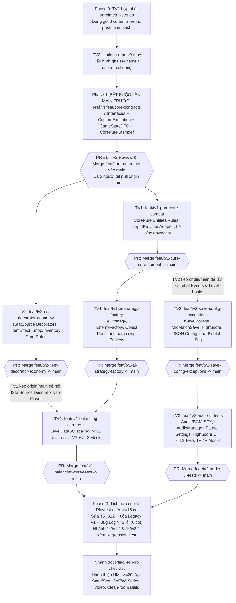

# HƯỚNG DẪN PHÂN CÔNG (TV1 & TV2) VÀ QUY TRÌNH GIT — MULTI-DIMENSIONS STICKMAN

> **Học phần:** MI4090 – Lập trình hướng đối tượng (Nhóm 02 người)  
> **Dự án:** `Stickman game` (`MULTI-DIMENSIONS STICKMAN` — Nhánh 1: Action Beat 'em up 2D Real-time)  
> **Repository GitHub:** <https://github.com/tienanh2701/Stickman-game-project.git>  
> **Unity Editor:** `6000.5.4f1` (`ProjectSettings/ProjectVersion.txt`)  
> **Mục tiêu chất lượng:** Đạt chuẩn Checklist 1.4 (`≥ 24 commits` thực chất qua Branch/PR/Merge, tỷ lệ đóng góp logic **TV1 ~55–60% / TV2 ~40–45%**), tránh tuyệt đối **Khóa 3 (Free-riding / Commit laundering)**, đảm bảo mỗi thành viên giữ **Hệ số cá nhân `0.85–1.00`** và đủ cả 4 mảng **Domain – Pattern – Test – UI**.

---

## MỤC LỤC NHANH

1. [Phần 1: Xử lý hiện trạng Git lệch gốc & Đẩy cấu trúc chuẩn lên GitHub (Phase 0)](#phần-1-xử-lý-hiện-trạng-git-lệch-gốc--đẩy-cấu-trúc-chuẩn-lên-github-phase-0)
2. [Phần 2: Thứ tự ưu tiên — "Phần nào cần làm trước để lên trước" (Dependency & Merge Order)](#phần-2-thứ-tự-ưu-tiên--phần-nào-cần-làm-trước-để-lên-trước-dependency--merge-order)
3. [Phần 3: Phân công chi tiết TV1 ("Tôi") vs TV2 (Bạn cùng nhóm) & Quy tắc chống Conflict Unity](#phần-3-phân-công-chi-tiết-tv1-tôi-vs-tv2-bạn-cùng-nhóm--quy-tắc-chống-conflict-unity)
4. [Phần 4: Chiến lược Commit, PR & Review đạt chuẩn Checklist 1.4 & tránh Khóa 3](#phần-4-chiến-lược-commit-pr--review-đạt-chuẩn-checklist-14--tránh-khóa-3)
5. [Phần 5: Bộ lệnh Git Copy-Paste sẵn cho TV1 & TV2 (kèm xử lý sự cố)](#phần-5-bộ-lệnh-git-copy-paste-sẵn-cho-tv1--tv2-kèm-xử-lý-sự-cố)

---

## PHẦN 1: XỬ LÝ HIỆN TRẠNG GIT LỆCH GỐC & ĐẨY CẤU TRÚC CHUẨN LÊN GITHUB (PHASE 0)

### 1.1. Chẩn đoán hiện trạng thực tế của Repository

Qua kiểm tra trực tiếp lịch sử Git tại thư mục `Stickman game/`, kho mã nguồn đang ở trạng thái như sau:

| Vị trí | Branch / Commit | Ngày & Tác giả | Nội dung thực tế |
| :--- | :--- | :--- | :--- |
| **Remote (`origin/main`)** | `b8005f3b` (`first commit`) | `Tue Nov 17 2026` — `tienanh2701` | Chỉ có duy nhất tệp `README.md` rỗng (`0 bytes`). |
| **Local (`main`)** | `c00ab169` (`Backup truoc khi sua animation`) | `Sun Nov 15 2026` — `tienanh2701` | Snapshot dự án cũ (`Assets/` + `ProjectSettings/`, 1793 files). |
| **Working Tree Local** | *(Chưa commit)* | Tính tới `19/11/2026` | ~185 thay đổi trước khi có `.gitignore`; sau khi có `.gitignore`, `README.md` và khung thư mục chuẩn, `git status --short` còn **180 mục** (`125 M` + `55 ??`): `Assets/Scripts/Auth/`, `Assets/Tests/E2E/`, `Assets/Editor/`, Glassmorphism/SlicedUI, 12 Maps, Prefabs, Scenes, `Packages/`, `Tools/`, `Assets/CorePure/`, `Assets/Audio/`, `Assets/StreamingAssets/`, `Assets/Tests/CoreUnit/`, `docs/`. |

**Vì sao 2 lịch sử không push/pull bình thường được?**
- Local `main` (`c00ab169`) được khởi tạo cục bộ từ `15/11/2026`, còn `origin/main` (`b8005f3b`) được tạo mới trên GitHub ngày `17/11/2026`. Hai nhánh **không có commit gốc chung (unrelated histories)**.
- Nếu chạy thẳng `git pull` hoặc `git push`, Git sẽ chặn bằng lỗi `fatal: refusing to merge unrelated histories` hoặc `rejected (non-fast-forward)`.
- Ngoài ra, nếu gõ `git merge origin/main --allow-unrelated-histories` ngay lúc `README.md` mới đang là *untracked file* ở local, Git sẽ báo lỗi `The following untracked working tree files would be overwritten by merge: README.md` vì `origin/main` cũng có file `README.md`.

### 1.2. Nguyên tắc trung thực lịch sử trước khi đóng gói Phase 0

1. **KHÔNG dồn 180 thay đổi vào 1 commit khổng lồ duy nhất** (kiểu `"upload full project"`), vì làm mất khả năng truy vết lịch sử module. Hãy tách thành **8 commits theo module** ngay trong Phase 0.
2. **TRUNG THỰC TÁC GIẢ (tránh Khóa 3 — Rửa commit):**
   - Toàn bộ phần nền hiện hữu trước ngày `19/11/2026` do `tienanh2701` (TV1) xây dựng thì **đứng tên 100% `tienanh2701`**.
   - **TUYỆT ĐỐI KHÔNG** gán tên TV2 vào những commit nền mà TV2 không trực tiếp viết.
   - *Ngoại lệ duy nhất:* Chỉ dùng cờ `--author="TenTV2 <emailTV2>"` cho một module nền (ví dụ `Auth` hoặc `Shop/UI`) **NẾU VÀ CHỈ NẾU** TV2 thực sự đã code module đó từ trước và nắm vững 100% logic để trả lời vấn đáp `B → A` & Debug trên IDE. Nếu TV2 mới bắt đầu code từ Phase 1–2 trở đi, TV1 giữ nguyên tên cho cả Phase 0; TV2 vẫn đạt đủ ~40–45% khối lượng code mới trong Phase 1–3!

### 1.3. Quy trình từng bước Phase 0 (Thực hiện trên máy TV1)

#### Bước 0a — Kiểm tra `.gitignore`, dọn rác Unity & kiểm tra biên dịch tĩnh
Chạy tại thư mục `Stickman game/`:

```powershell
# 1. Xác nhận các thư mục build/IDE nặng đã bị chặn hoàn toàn bởi .gitignore
git check-ignore -v Library/ Temp/ obj/ Logs/ .vs/ UserSettings/ Assembly-CSharp.csproj "Stickman game.sln"

# 2. Xem danh sách các mục còn lại sẽ được Git theo dõi (kỳ vọng ~180 mục, KHÔNG có Library/obj/Temp/Releases/__pycache__)
git status --short

# 3. Kiểm tra quy tắc hygiene F11_T1 (bắt buộc ra kết quả trống/0)
Get-ChildItem Assets/Scripts, Assets/Editor -Recurse -Filter "*.asmdef"
Get-ChildItem . -Recurse -Directory -Filter "__pycache__"
Test-Path Releases

# 4. Xóa thư mục recovery autosave tạm của Unity (tránh commit file rác Assets/_Recovery/0.unity)
if (Test-Path Assets/_Recovery) { Remove-Item -Recurse -Force Assets/_Recovery, Assets/_Recovery.meta }

# 5. Chạy kiểm tra tĩnh với cờ -B (ngăn Python tạo __pycache__/)
python -B Tools/verify_project.py
```

> **Lưu ý về `Tools/verify_project.py`:** File này hiện có đường dẫn `PROJECT_ROOT = r"c:\Users\Admin\...\Stickman game"` (dòng 10). Khi đẩy lên Git, nên ghi chú hoặc sửa sang đường dẫn động trong một PR đầu Phase 1 để máy TV2 chạy được `python -B Tools/verify_project.py` ngay.

#### Bước 0b — Hợp nhất `origin/main` (`b8005f3b`) không làm mất `README.md` mới

```powershell
# 1. Cất tạm README.md mới để tránh xung đột với README.md (0 byte) trên origin/main
Move-Item -Force README.md README.local.md

# 2. Kéo metadata từ GitHub và hợp nhất 2 lịch sử không chung gốc
git fetch origin
git merge origin/main --allow-unrelated-histories -m "chore(git): unify local main (c00ab169) with origin/main (b8005f3b)"

# 3. Khôi phục bản README.md đầy đủ của dự án (ghi đè bản 0 byte từ remote)
Move-Item -Force README.local.md README.md
```

#### Bước 0c — Đóng gói 180 mục nền thành 8 commits sạch theo module

Chạy tuần tự từng nhóm lệnh sau (kiểm tra `git diff --cached --stat` trước khi commit nếu muốn chắc chắn):

```powershell
# Commit 1: Cấu hình repo, .gitignore, Packages & ProjectSettings
git add .gitignore .vsconfig README.md Packages/ ProjectSettings/ProjectSettings.asset
git commit -m "chore(repo): add Unity .gitignore, .vsconfig, Packages and project README"

# Commit 2: Khung thư mục chuẩn MI4090 (focus Unity 1 lần trước để sinh .meta nếu chưa có)
git add Assets/CorePure* Assets/Audio* Assets/StreamingAssets* Assets/Tests/CoreUnit* docs/
git commit -m "chore(structure): scaffold CorePure, Audio, StreamingAssets, CoreUnit and docs folders"

# Commit 3: Module Auth (đăng ký, đăng nhập, lưu tài khoản JSON SHA-256)
git add Assets/Scripts/Auth.meta Assets/Scripts/Auth/
git commit -m "feat(auth): add local JSON account registration, login and profile sync"

# Commit 4: Module Combat, Nhân vật, Quái/Boss, Environment, GameModes, Level, VFX & Data
git add Assets/Scripts/Characters/ Assets/Scripts/Combat/ Assets/Scripts/Enemies/ Assets/Scripts/Environment/ Assets/Scripts/GameModes/ Assets/Scripts/Level/ Assets/Scripts/VFX.meta Assets/Scripts/VFX/ Assets/Data/
git commit -m "feat(combat): update characters, enemies, bosses, GenkiDama, level flow and ScriptableObjects"

# Commit 5: Module Economy, Items & Glassmorphism HUD/UI
git add Assets/Scripts/Economy/ Assets/Scripts/Items/ Assets/Scripts/UI/
git commit -m "feat(economy-ui): add Glassmorphism HUD, Shop, Inventory and UI controllers"

# Commit 6: Tài nguyên Art, 12 Maps, SlicedUI, GlassHUD, VFX Animations & Font tiếng Việt
git add Assets/Animations/ Assets/Resources/ Assets/Sprites/ "Assets/TextMesh Pro/"
git commit -m "art(assets): update 12-stage maps, SlicedUI, GlassHUD, VFX sprites and Vietnamese fonts"

# Commit 7: Prefabs, 3 Scenes chính & bộ Editor Builders
git add Assets/Editor/ Assets/Prefabs/ Assets/Scenes/
git commit -m "build(scenes): update prefabs, MainMenu/CharacterSelect/Demo scenes and Editor builders"

# Commit 8: Bộ test tự động E2E (EditMode/PlayMode) & Tools
git add Assets/Tests.meta Assets/Tests/E2E.meta Assets/Tests/E2E/ Tools/
git commit -m "test(e2e): add Tier1-Tier5 EditMode and PlayMode automated test suites"
```

#### Bước 0d — Kiểm tra sạch & Push `main` lên GitHub

```powershell
# Kiểm tra phải ra rỗng (clean working tree) và không chứa file nặng Library/Temp/obj
git status --short
git log --oneline -n 10

# Push main sạch lên GitHub
git push -u origin main
```

**Thiết lập bảo vệ `main` trên GitHub ngay sau khi push:**
1. Vào GitHub Repo → **Settings** → **Branches** → **Add branch ruleset / Add branch protection rule**.
2. Branch name pattern: `main`.
3. Bật **Require a pull request before merging** (tối thiểu **1 approval**).
4. Từ sau Phase 0, **cả TV1 lẫn TV2 không push trực tiếp lên `main`**, mọi thay đổi đều đi qua nhánh riêng + PR.
5. Nhắn TV2 chạy `git clone https://github.com/tienanh2701/Stickman-game-project.git "Stickman game"` về máy.

---

## PHẦN 2: THỨ TỰ ƯU TIÊN — "PHẦN NÀO CẦN LÀM TRƯỚC ĐỂ LÊN TRƯỚC" (DEPENDENCY & MERGE ORDER)

### 2.1. Sơ đồ luồng phụ thuộc & thứ tự lên Git (Phase 0 → Phase 3)



### 2.2. Phase 1 — Bắt buộc lên `main` TRƯỚC TIÊN (Nhánh `feat/core-contracts`)

**Tại sao Phase 1 phải merge vào `main` trước khi chia việc Phase 2?**
- Theo Checklist MI4090 (tiêu chí **4.3**, **4.5**, **5.1**): `CorePure` phải **0% `using UnityEngine;`**, giao tiếp giữa TV1 và TV2 qua **Interface/Event** (DIP) để TV1 có thể chạy Unit Test không cần code thật của TV2 (và ngược lại, thông qua **Mock/Stub**).
- Nếu chưa có hợp đồng chung trên `main`, TV1 viết code chiến đấu sẽ gọi cứng class của TV2 (hoặc TV2 viết Decorator/Save không khớp kiểu dữ liệu của TV1), gây **lỗi biên dịch dây chuyền, phụ thuộc vòng (Circular Dependency)** và tắc cả 2 nhánh.

**Nội dung bắt buộc hoàn thành trong nhánh `feat/core-contracts`:**

1. **Thiết lập ranh giới biên dịch thuần C# (không vi phạm `F11_T1`):**
   - `Tier1_AssetAndHygieneTests.F11_T1` chỉ cấm `*.asmdef` trong `Assets/Scripts/` và `Assets/Editor/`.
   - Đặt `Assets/CorePure/Stickman.CorePure.asmdef` với `"noEngineReferences": true` và `"autoReferenced": true` → Unity tự ép toàn bộ mã trong `Assets/CorePure/` **không được phép `using UnityEngine;`** ngay ở mức trình biên dịch!
   - Đặt `Assets/Tests/CoreUnit/Stickman.Tests.CoreUnit.asmdef` với `"includePlatforms": ["Editor"]`, `"noEngineReferences": true`, `"references": ["Stickman.CorePure"]`, `"precompiledReferences": ["nunit.framework.dll"]`, `"defineConstraints": ["UNITY_INCLUDE_TESTS"]` → Bộ Unit Test Pure Logic chạy độc lập hoàn toàn, không mở Scene!
2. **Bộ 7 Interface hợp đồng trong `Assets/CorePure/Interfaces/`:**
   - `IInputProvider.cs`: trừu tượng hóa hướng di chuyển (`Horizontal`), `JumpPressed`, `DashDirection`, `AttackPressed`, `Skill1Pressed`, `Skill2Pressed`, `TransformPressed`, `BlockPressed`, `ItemQPressed`, `ItemEPressed`, `PausePressed`.
   - `IAIStrategy.cs`: quyết định hành động AI thuần tọa độ/khoảng cách/HP (`ComputeAction(EnemyAIContext ctx)` trả về `AIActionDecision`), giúp tách AI khỏi `MonoBehaviour`.
   - `IEnemyFactory.cs`: tạo cấu hình/biến thể kẻ địch từ dữ liệu config (`CreateEnemyBlueprint(string enemyId, int worldIndex, int wave)`).
   - `IItemEffect.cs`: hợp đồng kích hoạt vật phẩm tiêu hao lên `IPlayerEffectTarget` / `IStatSource` (`ApplyEffect(...)`, `CanApply(...)`).
   - `IStatSource.cs`: hợp đồng đọc chỉ số chiến đấu cuối cùng (`AttackDamageMultiplier`, `MoveSpeedMultiplier`, `MaxShieldCapacity`, `DamageReflect`, `RagePerSecondBonus`) — **cầu nối Decorator Pattern của TV2 vào Combat Engine của TV1**.
   - `ISaveStorage.cs`: hợp đồng đọc/ghi JSON thuần (`SaveText(string key, string content)`, `LoadText(string key)`, `Exists(string key)`, `Delete(string key)`).
   - `IAudioService.cs`: hợp đồng phát âm thanh (`PlayBgm(string trackId)`, `PlaySfx(string sfxId)`, `SetMasterVolume(float v)`, `SetMuted(bool muted)`).
3. **Cây `CustomException` thống nhất trong `Assets/CorePure/Exceptions/`:**
   - `StickmanGameException.cs` (base class kế thừa `System.Exception`)
   - `InvalidGameConfigException.cs` (lỗi đọc/validate file JSON trong `StreamingAssets/Config/`)
   - `SaveCorruptedException.cs` (lỗi parse hoặc thiếu trường bắt buộc trong file Save / HighScore / Account JSON)
   - `InvalidCombatStateException.cs` (hành động bị chặn do đang `Dead` / `Stunned` / không đủ Rage)
   - `InvalidPurchaseException.cs` (mua thiếu Xu, item không tồn tại hoặc slot Q/E ngoài phạm vi `0..1`)
4. **Bộ DTO dùng chung (`Assets/CorePure/Entities/DTOs/`):**
   - `GameStateDTO.cs`: gói trạng thái đầy đủ của **cả 2 phân hệ** để Save/Load giữa trận khôi phục 100%:
     - *Phân hệ TV1:* `gameMode`, `worldIndex`, `stageIndex`, `currentWaveIndex`, `playerCharacterIndex`, `playerHp`, `playerMaxHp`, `playerPosX`, `playerPosY`, `playerRage`, `isTransformed`, `activeEnemies` (danh sách `EnemySnapshotDTO`: `enemyId`, `hp`, `maxHp`, `posX`, `posY`, `phase`).
     - *Phân hệ TV2:* `coins`, `senzuCount`, `spinalFluidCount`, `ultraWaterCount`, `extraItemCounts`, `equippedSlotQ`, `equippedSlotE`, `activeBuffs` (`BuffSnapshotDTO`: `buffId`, `remainingSeconds`, `remainingShield`), `score`, `elapsedSeconds`, `savedAtUtc`.
   - `HighScoreEntryDTO.cs`: lưu bảng xếp hạng (`username`, `gameMode`, `worldOrWaveReached`, `score`, `clearTimeSeconds`, `achievedAtUtc`).
   - `GameBalanceConfigDTO.cs`: schema JSON cho `Assets/StreamingAssets/Config/game_balance.json` (chứa tham số cân bằng cho cả Campaign/Endless của TV1 lẫn giá/hệ số Item của TV2).

> **Chốt Phase 1:** TV1 tạo nhánh `feat/core-contracts`, mở PR. TV2 đọc kỹ toàn bộ 7 Interface + DTO + Exception, góp ý nếu thiếu trường, Approve & Merge vào `main`. **Chỉ sau bước này mới bắt đầu Phase 2!**

---

### 2.3. Phase 2 — Làm SONG SONG ĐỘC LẬP & Thứ tự Merge vào `main`

Sau khi kéo `feat/core-contracts` về `main`, TV1 và TV2 làm song song trên 2 cụm nhánh độc lập. Dưới đây là **thứ tự merge chuẩn** và **3 mốc đồng bộ (`git merge origin/main`)**:

| Thứ tự | Nhánh của TV1 (~58–60%) | Nhánh của TV2 (~40–42%) | Điểm đồng bộ (`git merge origin/main`) |
| :---: | :--- | :--- | :--- |
| **Bước 1 (Song song)** | **`feat/tv1-pure-core-combat`**<br/>- Viết thực thể & luật chiến đấu thuần C# trong `Assets/CorePure/` (`CombatSessionState`, `DamageCalculator`, `RageRuleEngine`, `BaseStatSource : IStatSource`, `PlayerRuleGuard`).<br/>- Tách dần logic thuần ra khỏi `BaseCharacter.cs` (1566 dòng) và `InputHandler.cs` (Adapter triển khai `IInputProvider`).<br/>- Khử `is`/`as` downcast trong `Projectile.cs` (226–237), `EnemyBase.cs` (687–696), `LordKivaAI.cs` (358–362) bằng đa hình chuẩn LSP.<br/>→ **Merge vào `main` trước tiên ở Phase 2.** | **`feat/tv2-item-decorator-economy`**<br/>- Viết **Decorator Pattern** trên `IStatSource` (`StatDecoratorBase`, `SpinalFluidShieldDecorator`, `UltraDivineWaterDecorator`, `RageRegenDecorator`) + `BuffStackResolver` (thuật toán giải quyết chuỗi buff theo thời gian).<br/>- Viết `IItemEffect` + bổ sung **vật phẩm thứ 4** (đạt `≥ 4` item có cơ chế riêng cho tiêu chí 1.3).<br/>- Tách `ShopRuleEngine` & `InventoryRuleEngine` thuần C# khỏi `ShopManager.cs` và `InventoryManager.cs`.<br/>→ **Merge vào `main` song song với nhánh 1 của TV1.** | **Mốc đồng bộ A:**<br/>- Ngay sau khi TV1 merge `feat/tv1-pure-core-combat`, **TV2 kéo `origin/main`** để lấy event chiến đấu & interface `BaseCharacter`/Adapter.<br/>- Ngay sau khi TV2 merge `feat/tv2-item-decorator-economy`, **TV1 kéo `origin/main`** để lấy bộ `IStatSource` Decorator lắp vào `BaseCharacter` & `PlayerItemController`. |
| **Bước 2 (Song song)** | **`feat/tv1-ai-strategy-factory`**<br/>- Cài **Strategy Pattern** (`IAIStrategy`: `MeleeChaseStrategy`, `RangedKiteStrategy`, `KamikazeRushStrategy`, `BossPhaseStrategy`) + gắn vào `EnemyBase`/`BossBase` cho phép đổi AI lúc chạy.<br/>- Cài **Factory Method** (`IEnemyFactory` / `WorldEnemyFactory`) thay `switch`/path cứng.<br/>- Bổ sung **Object Pool** cho `Projectile`, `BeamAttack`, `Explosion`, Enemy spawn/despawn.<br/>- Xử lý hard-code path `'Assets/Prefabs/...'` trong `EndlessModeManager.cs` (26–52). | **`feat/tv2-save-config-exceptions`**<br/>- Cài `FileJsonSaveStorage : ISaveStorage`, `MidMatchSaveService` (Save/Load `GameStateDTO` giữa trận -> tắt app -> mở lại khôi phục 100%).<br/>- Cài `HighScoreService` (thuật toán xếp hạng Top-K & deduplication) và `GameConfigLoader` đọc `Assets/StreamingAssets/Config/*.json`.<br/>- Xử lý triệt để 6 khối `catch` nuốt lỗi trong `AccountManager.cs` (591, 602, 629), `GlassHudTheme.cs` (990), `UIManager.cs` (815), `MenuBackgroundLoader.cs` (224), thay bằng log có ngữ cảnh + ném/xử lý `CustomException` lịch sự. | **Mốc đồng bộ B:**<br/>- Sau khi cả 2 merge Bước 2 lên `main`, **cả TV1 và TV2 đều chạy `git fetch origin && git merge origin/main`** để đồng bộ `GameBalanceConfigDTO`, `MidMatchSaveService`, `IAIStrategy` và `Object Pool` trước khi viết Test & nối UI/Audio. |
| **Bước 3 (Song song)** | **`feat/tv1-balancing-core-tests`**<br/>- Hoàn thiện cân bằng Campaign (`enemyHpMultiplier`, `enemyDamageMultiplier` trong `LevelDataSO` + `game_balance.json`).<br/>- Viết **≥ 12 Pure Unit Tests** + **≥ 3 Mock/Stub** (`StubInputProvider`, `MockStatSource`, `SpyAudioService`) tại `Assets/Tests/CoreUnit/TV1/`.<br/>- Bổ sung PlayMode test cho `Hitbox`, Boss 2 Phase và Cross-Module Decorator. | **`feat/tv2-audio-ui-tests`**<br/>- Thêm file âm thanh thật vào `Assets/Audio/{BGM,SFX}/` (BGM Menu/3 Worlds + ≥ 5 SFX đánh, trúng đòn, nhảy/dash, dùng item, nút UI).<br/>- Cài `AudioManager : IAudioService` (Observer bắt event combat/UI, tắt/mở & lưu volume bền vững).<br/>- Bổ sung UI **Pause Settings (Âm lượng/Phím)** + **Bảng xếp hạng / Thống kê trận** đồng bộ Glassmorphism.<br/>- Viết **≥ 12 Pure Unit Tests** + **≥ 3 Mock/Stub** (`InMemorySaveStorage`, `FakeClock`, `SpyAudioService`) tại `Assets/Tests/CoreUnit/TV2/` + Integration Test Save/Load Round-Trip & Corrupt JSON. | **Mốc đồng bộ C (Khép Phase 2):**<br/>- Merge xong 2 nhánh test, chạy toàn bộ `CoreUnit` + `EditMode` + `PlayMode` trên `main` trước khi sang Phase 3. |

---

### 2.4. Phase 3 — Tích hợp cuối, Playtest chéo & Đóng gói Clean-room

1. **Sửa test `T5_B12` đang FAIL:** Mở nhánh sửa `T5_B12_HudItemSlotsUI_Depletion_ZeroDimsBorder_And_BlockFallback` trong `Assets/Tests/E2E/PlayMode/Tier5_AdversarialUiHardeningTests.cs` (kiểm tra lại ánh xạ `HudItemSlotsPanel/SlotQ/InnerBg/ItemIcon` trong `Stickman_DemoScene.unity` & `HudItemSlotsUI.cs`) để đạt **100% PASS** toàn bộ `EditMode` (`59/59`), `PlayMode` (`105/105`) và `CoreUnit` (`≥ 24/24`).
2. **Dọn dẹp Dead Code (Chống Khóa 5):** Rà soát và xóa các lớp legacy v1 không còn dùng trong `Assets/Scripts/Enemies/` (`BaseEnemy.cs`, `GruntEnemy.cs`, `RangerEnemy.cs`, `KamikazeEnemy.cs`, `EliteBruiserEnemy.cs`, `BossController.cs`, `Stats/EnemyStatsSO.cs`) và `Assets/Scenes/SampleScene.unity` nếu kiểm chứng 0 nơi tham chiếu.
3. **Playtest chéo bắt buộc (`≥ 15` kịch bản):**
   - **TV1 test phần TV2 (≥ 8 ca):** Đăng ký/đăng nhập, mua Shop biên `Coins == Price`, trang bị Q/E, dùng 4 vật phẩm cộng dồn Decorator, Save giữa trận → tắt hẳn app → Load lại khôi phục 100%, cố ý sửa hỏng file save JSON → kiểm tra báo lỗi lịch sự không crash, tắt/mở BGM/SFX.
   - **TV2 test phần TV1 (≥ 7 ca):** Chơi Campaign qua màn Boss 2 Phase, Endless đến Wave 5+, Training bật/tắt bất tử & max Rage, kẹp biên map không rơi/tunneling, kích hoạt trạng thái cấm khi `Dead`/`Stunned`.
4. **Ghi Bug Log 6 cột & Regression Test:**
   - Ghi ít nhất **6 lỗi thật** (`≥ 3` lỗi thuộc phân hệ TV1, `≥ 3` lỗi thuộc phân hệ TV2) vào `docs/04_Testing_QA/BUG_LOG.md` đủ 6 cột: `Bug-ID | Bước tái hiện | Root Cause | Commit sửa | Regression Test | Kết quả`.
   - Mở nhánh `fix/tv1-<bug-id>` và `fix/tv2-<bug-id>`: mỗi lỗi logic trọng yếu phải có **Commit sửa + Regression Test** chứng minh lỗi không tái diễn.
5. **Hoàn thiện hồ sơ `docs/01..05` & Đóng gói Clean-room:**
   - Hoàn thiện toàn bộ tài liệu UML, phân tích, GoF, test matrix, Checklist tự đánh giá, Slide, Video Demo 3–5 phút trên nhánh `docs/*`.
   - Build bản thực thi Windows mới nhất ra thư mục **ngoài repo Git** tại `../Releases/Version_Final/` (cấm đặt `Releases/` trong `Stickman game/` để giữ xanh test `F11_T1`), chạy thử nghiệm Clean-room ≤ 3 phút từ clone sạch.

---

## PHẦN 3: PHÂN CÔNG CHI TIẾT TV1 ("TÔI") VS TV2 (BẠN CÙNG NHÓM) — GẮN TẬN TÊN FILE & CLASS THỰC TẾ

### 3.1. Bảng phân công tổng thể (~58–60% TV1 / ~40–42% TV2)

| Mảng công việc | **TV1 ("Tôi" — ~58–60% Core & Combat/AI/Levels)** | **TV2 (Bạn cùng nhóm — ~40–42% Economy/Items/Save/Audio/UI)** |
| :--- | :--- | :--- |
| **1. Tầng Pure C# (`Assets/CorePure/`)** | - `Interfaces/`: `IInputProvider`, `IAIStrategy`, `IEnemyFactory` + đồng sở hữu `GameStateDTO`<br/>- `Entities/`: `CombatEntityState`, `CharacterRuleState`, `RageRuleState`, `EnemyAIContext`, `AIActionDecision`<br/>- `Rules/`: `DamageCalculator`, `CombatRuleEngine`, `WaveScalingRule`, `HazardPlacementSolver`<br/>- `AI/`: `MeleeChaseStrategy`, `RangedKiteStrategy`, `KamikazeRushStrategy`, `BossPhaseStrategy`, `WorldEnemyFactory`<br/>- `Exceptions/`: `StickmanGameException`, `InvalidCombatStateException` | - `Interfaces/`: `IItemEffect`, `IStatSource`, `ISaveStorage`, `IAudioService`<br/>- `Entities/`: `InventoryState`, `ShopCatalogEntry`, `BuffInstance`, `HighScoreEntryDTO`, `GameBalanceConfigDTO`<br/>- `Rules/`: `ShopRuleEngine`, `InventoryRuleEngine`, `BuffStackResolver`, `HighScoreRanker`, `MidMatchSaveMapper`<br/>- `Patterns/`: `StatDecoratorBase`, `SpinalFluidShieldDecorator`, `UltraDivineWaterDecorator`, `RageBoostDecorator`, `SenzuBeanEffect`, `ItemEffect4`<br/>- `Exceptions/`: `InvalidGameConfigException`, `SaveCorruptedException`, `InvalidPurchaseException` |
| **2. Tầng Unity Adapter (`Assets/Scripts/`)** | - `Core/`: `InputHandler.cs`, `Hitbox.cs`, `Projectile.cs`, `RageManager.cs`, `DamageData.cs`, `IDamageable.cs`, `Enums.cs`<br/>- `Characters/`: `BaseCharacter.cs`, `GokuController.cs`, `ErenController.cs`, `DiendController.cs`, `LordKivaAI.cs`, `CharacterStatsSO.cs`<br/>- `Combat/`: `BeamAttack.cs`, `Explosion.cs`, `GenkiDamaProjectile.cs`, `Shockwave.cs`, `TitanStomp.cs`<br/>- `Enemies/`: `EnemyBase.cs`, `MeleeCreep.cs`, `RangedCreep.cs`, `KamikazeCreep.cs`, `EliteEnemy.cs`, `CounterElite.cs`, `BrawlerElite.cs`, `TeleportElite.cs`, `BossBase.cs`, `TetherBossController.cs`, `BrolyBossController.cs`, `MechaBossController.cs`, `BossPartHitbox.cs`, `CrystalCore.cs`, `TetherCableHitbox.cs`, `EnemyDataSO.cs`<br/>- `Environment/` & `GameModes/` & `Level/` & `VFX/`: `CampaignHazardSpawner.cs`, 13 hazard scripts, `EndlessModeManager.cs`, `TrainingModeManager.cs`, `LevelManager.cs`, `StageManager.cs`, `LevelDataSO.cs`, `HitSparkManager.cs` | - `Items/`: `ConsumableItemSO.cs`, `InventoryManager.cs`, `PlayerItemController.cs` (nối `IStatSource` Decorator), `ItemVfxAnimator.cs`<br/>- `Economy/`: `CurrencyManager.cs`, `ShopManager.cs`<br/>- `Auth/` & Persistence: `AccountDataModels.cs`, `AccountManager.cs` (sửa 3 khối catch rỗng), `FileJsonSaveStorage`, `MidMatchSaveManager`, `GameConfigLoader` (`Assets/StreamingAssets/Config/`)<br/>- `Audio/`: `AudioManager.cs` (`IAudioService`), tài nguyên trong `Assets/Audio/{BGM,SFX}/`<br/>- `UI/`: `UIManager.cs`, `CharacterSelectManager.cs`, `InstructionsUI.cs`, `PauseMenuUI.cs` (+ Settings Audio), `GameOverModalUI.cs` (+ HighScore/Stats), `CoinCounterUI.cs`, `MenuBackgroundLoader.cs`, `GlassHudTheme.cs`, `HudItemSlotsUI.cs`, `ModeCardHoverEffect.cs`, `ScrollEventForwarder.cs`, `UIButtonJuice.cs`<br/>- *(Phối hợp đọc Event từ `LevelManager`/`BaseCharacter` để cập nhật `GameUIManager.cs`, `PlayerVitalsHudUI.cs`)* |
| **3. Thuật toán lõi (≥ 2/TV cho Tiêu chí 3.3)** | 1. **6-Pass Platform Relaxation** (`CampaignHazardSpawner.cs`)<br/>2. **4-Phase Max-Min Non-Overlapping Spawn** (`TrainingModeManager.cs`)<br/>3. **SDF Aim & Target Selection** (`GenkiDamaProjectile.cs`) + **AI Decision & Phase Transition** (`IAIStrategy`) | 1. **Buff Stack & Decorator Resolution theo thứ tự ưu tiên + hết hạn `deltaTime`** (`BuffStackResolver` / `StatDecoratorBase`)<br/>2. **Top-K HighScore Sorting & Deduplication + Atomic JSON Save Validation** (`HighScoreRanker` / `FileJsonSaveStorage`) |
| **4. Design Patterns GoF & Live OCP (Tiêu chí 4.6)** | - **Template Method:** `BaseCharacter`, `EnemyBase`, `BossBase`<br/>- **Strategy:** `IAIStrategy` (đổi AI Creep/Elite/Boss tại runtime)<br/>- **Factory Method:** `IEnemyFactory` / `WorldEnemyFactory`<br/>- *(Bổ trợ hiệu năng: Object Pool cho Projectile/VFX)*<br/>- **Live OCP (2–3p tắt AI):** Tạo mới `ConcreteAIStrategy : IAIStrategy` (VD: `FlankDashAIStrategy`) và đăng ký tại `WorldEnemyFactory` với **0 sửa lớp cũ**. | - **Decorator (Cầu nối TV2↔TV1):** `IStatSource` → `StatDecoratorBase` → các Buff Decorator bọc chồng nhau<br/>- **Observer (Event Bus):** `AudioManager`, Shop/HUD lắng nghe `Action` events & hủy đăng ký sạch trong `OnDisable`/`OnDestroy`<br/>- **Live OCP (2–3p tắt AI):** Tạo mới `ConcreteStatDecorator : StatDecoratorBase` hoặc `ConcreteItemEffect : IItemEffect` và đăng ký tại Composition Root với **0 sửa lớp cũ**. |
| **5. Pure Unit Tests & Mock (Tiêu chí 5.1–5.3)** | - Thư mục: `Assets/Tests/CoreUnit/TV1/`<br/>- **≥ 12 Unit Tests** (EP, BVA `HP=0`/`MaxHP`, `Rage 0/10/20/30`, State Guard khi `Dead`, biên `mapMinX/MaxX`, AI Strategy)<br/>- **≥ 3 Mock/Stub:** `StubInputProvider`, `MockStatSource`, `SpyAudioService` | - Thư mục: `Assets/Tests/CoreUnit/TV2/`<br/>- **≥ 12 Unit Tests** (Decorator stack, Shop BVA `coins == price` & `< price`, slot index biên `99`, Save/Load Round-Trip, `SaveCorruptedException`, HighScore ranking)<br/>- **≥ 3 Mock/Stub:** `InMemorySaveStorage`, `FakeClock`, `SpyAudioService` |
| **6. Tài liệu `docs/` (cùng review chéo)** | - `01_Survey_GDD/`: Game Loop, luật combat/win-lose<br/>- `02_Analysis_UML/`: Giả mã & `O(·)` thuật toán TV1, State Machine `CharacterState`/`EnemyState`, Sequence 1 frame Update<br/>- `03_Design_Patterns/`: Template Method, Strategy, Factory & Đánh đổi W<br/>- `04_Testing_QA/`: Ma trận Test TV1 + Playtest phần TV2 | - `01_Survey_GDD/`: Use Case điều hướng, Shop, Save/Load, Audio<br/>- `02_Analysis_UML/`: Từ điển lớp thực thể, **UML Class Diagram tổng thể duy nhất (≥ 20 lớp)** ghép đủ TV1–TV2, Giả mã 2 thuật toán TV2, Sequence Save/Load/Item<br/>- `03_Design_Patterns/`: Decorator, Observer & Đánh đổi W<br/>- `04_Testing_QA/`: Ma trận Test TV2 + Playtest phần TV1 + `BUG_LOG.md` |

> **Nhắc nhở vấn đáp chéo (Khóa 3 & Mục 4.6/5.3):** Dù chia module sở hữu code, **cả TV1 và TV2 đều phải đọc hiểu kiến trúc, UML, thuật toán và bài test của nhau**. Khi bảo vệ, giảng viên sẽ hỏi chéo: TV1 giải thích Decorator/Save của TV2 và TV2 giải thích Strategy/AI/Combat Loop của TV1!

---

### 3.2. Quy tắc chống Conflict tuyệt đối trong Unity (Scenes, Prefabs & `.meta`)

File `.unity` (như `Stickman_DemoScene.unity` dài >20.700 dòng) và `.prefab` là dữ liệu YAML có mã `fileID` liên kết chặt chẽ. **Hai người cùng mở và `Ctrl + S` cùng một Scene là nguyên nhân số 1 gây hỏng project.**

#### A. Bảng khóa sở hữu tài nguyên Unity

| Loại tài nguyên / File cụ thể | Chủ sở hữu sửa duy nhất | Quy tắc phối hợp khi người kia cần chạm vào |
| :--- | :---: | :--- |
| `Assets/Scenes/Stickman_DemoScene.unity` | **TV1** | TV2 cần gắn UI Settings/HighScore/Audio vào trận: đóng gói thành Prefab riêng hoặc script tự khởi tạo/gắn qua `CanvasUIBuilder.cs`, hoặc nhắn xin khóa từ TV1 trước khi mở & lưu Scene. |
| `Assets/Scenes/MainMenu.unity` | **TV2** | TV1 chỉ sửa logic nhân vật/màn chơi ở ScriptableObject/Prefab; không tự ý lưu đè `MainMenu.unity`. |
| `Assets/Scenes/CharacterSelectScene.unity` | **TV2** | Khi TV1 cập nhật stats nhân vật mới (`GokuStats.asset`...), TV2 chỉ cần pull code và test lại Scene; nếu cần sửa UI chọn nhân vật thì chỉ TV2 sửa Scene này. |
| `Assets/Prefabs/Characters/`, `Enemies/`, `Combat/`, `Hazards/` | **TV1** | TV2 không sửa các prefab nhân vật/quái/bẫy; nếu cần gắn `AudioSource`/hook cho nhân vật, gắn qua `PlayerItemController` hoặc `AudioManager` bằng event. |
| `Assets/Prefabs/UI/` *(nếu tạo)*, `Assets/Audio/`, `Assets/StreamingAssets/Config/` | **TV2** | TV1 đọc dữ liệu từ `GameBalanceConfigDTO` đã load; không sửa trực tiếp JSON config của TV2 khi chưa thống nhất schema. |
| `Assets/Editor/*SceneBuilder.cs`, `PrefabBuilder.cs`, `CanvasUIBuilder.cs` | Theo scene sở hữu | **Cẩn thận khi chạy menu Auto Setup:** chạy Builder có thể làm biến đổi hàng loạt Scene & Prefab ngoài phân hệ của bạn. Luôn chạy `git status` kiểm tra trước khi `git add`, hoàn tác ngay những Scene/Prefab không thuộc nhánh mình bằng `git checkout -- <file>`. |
| `ProjectSettings/*` | Khóa chung | Chỉ sửa khi cả 2 thống nhất (ví dụ thêm Scene vào Build Settings hoặc sửa Input/Tags). Nếu Unity tự động sửa `ProjectSettings.asset` khi mở máy lạ mà bạn không đổi gì, chạy `git checkout -- ProjectSettings/`. |

#### B. Quy tắc sống còn với file `.meta`

1. **Nguyên tắc "Đi có đôi":** Mọi file hoặc thư mục mới trong `Assets/` (`.cs`, `.png`, `.wav`, `.ogg`, `.json`, `.asmdef`, thư mục) đều có một tệp `<ten>.meta` đi kèm chứa **GUID**.
2. **LUÔN `git add` cả 2 file:** Ví dụ `git add Assets/Audio/AudioManager.cs Assets/Audio/AudioManager.cs.meta` (hoặc `git add Assets/Audio/`).
   - *Hậu quả nếu thiếu `.meta`:* Khi người kia `git pull`, Unity trên máy người kia sẽ tự sinh một `.meta` mới với GUID khác → toàn bộ tham chiếu Script/Sprite trên Scene/Prefab bị biến thành **`Missing (Mono Script)`**, làm hỏng game và **FAIL ngay test `F11_T1`**!
3. **Cách đổi tên / xóa file an toàn:** Thực hiện Rename/Delete ngay trong cửa sổ **Project của Unity Editor** (Unity sẽ tự đổi/xóa cả `.meta`). Nếu thao tác ngoài Explorer/PowerShell, phải xóa hoặc đổi tên đồng bộ cả `<ten>` và `<ten>.meta`.

#### C. Cách xử lý nếu lỡ Conflict Prefab / Scene (`.unity` / `.prefab`)

- **TUYỆT ĐỐI KHÔNG** mở file `.unity` / `.prefab` bằng Notepad/VSCode để tự tay xóa dấu `<<<<<<<`, `=======`, `>>>>>>>` vì rất dễ sai thụt lề YAML làm Unity lỗi `Unable to parse YAML`.
- **Cách làm đúng 100% an toàn:**
  1. Xác định bên nào giữ cấu trúc chuẩn hơn (ví dụ `Stickman_DemoScene.unity` ưu tiên nhánh TV1, `MainMenu.unity` ưu tiên nhánh TV2):
     ```powershell
     # Chọn giữ nguyên bản trên nhánh hiện tại (ours):
     git checkout --ours Assets/Scenes/Stickman_DemoScene.unity
     # Hoặc chọn lấy bản mới từ origin/main (theirs):
     git checkout --theirs Assets/Scenes/MainMenu.unity
     ```
  2. Mở Unity Editor kiểm tra Scene chạy bình thường, nếu có thay đổi nhỏ từ nhánh kia (như gắn thêm 1 GameObject/Script), thao tác lại trực tiếp trong Unity rồi `Ctrl + S`.
  3. Đánh dấu đã giải quyết và hoàn tất merge:
     ```powershell
     git add Assets/Scenes/<ten_scene>.unity
     git commit
     ```

---

## PHẦN 4: CHIẾN LƯỢC COMMIT & PUSH ĐỂ ĐẠT CHUẨN CHECKLIST 1.4 & TRÁNH KHÓA 3

### 4.1. Định danh Git chuẩn trên cả 2 máy

Trước khi tạo commit đầu tiên ở Phase 1, **bắt buộc** kiểm tra danh tính trên từng máy:

```powershell
# Kiểm tra danh tính hiện tại
git config user.name
git config user.email
```

- **Máy TV1:** giữ đúng tên & email gắn tài khoản GitHub `tienanh2701` (`phamtienanh27012k5@gmail.com`).
- **Máy TV2:** đặt `user.name` và `user.email` trùng khớp tài khoản GitHub cá nhân của TV2 (dùng `--local` trong thư mục dự án hoặc `--global`):
  ```powershell
  git config user.name "<GitHubUsername_TV2>"
  git config user.email "<Email_TaiKhoan_GitHub_TV2>"
  ```
- **Đồng bộ xử lý xuống dòng Windows/Unity** trên cả 2 máy để tránh diff giả toàn file:
  ```powershell
  git config core.autocrlf true
  ```

### 4.2. Quy chuẩn đặt tên Nhánh & Conventional Commits

- **Đặt tên nhánh rõ người, rõ tính năng:**
  - Hợp đồng chung Phase 1: `feat/core-contracts`
  - Tính năng TV1: `feat/tv1-pure-core-combat`, `feat/tv1-ai-strategy-factory`, `feat/tv1-balancing-core-tests`
  - Tính năng TV2: `feat/tv2-item-decorator-economy`, `feat/tv2-save-config-exceptions`, `feat/tv2-audio-ui-tests`
  - Sửa lỗi từ Bug Log Phase 3: `fix/tv1-<bug-id>-<mo-ta-ngan>`, `fix/tv2-<bug-id>-<mo-ta-ngan>`
  - Tài liệu & sơ đồ: `docs/uml-and-reports`

- **Cấu trúc Commit Message (Conventional Commits):**
  `<type>(<scope>): <mô tả ngắn gọn việc đã làm bằng tiếng Anh hoặc tiếng Việt không dấu rõ nghĩa>`

  Các `type` chuẩn dùng trong dự án:
  - `feat(core):`, `feat(ai):`, `feat(items):`, `feat(economy):`, `feat(save):`, `feat(audio):` — thêm tính năng/class mới.
  - `refactor(combat):`, `refactor(ui):` — tách Pure C#, bỏ downcast `is/as`, dọn God script / `catch` rỗng.
  - `fix(hud):`, `fix(save):`, `fix(test):` — sửa bug thực tế (nên kèm mã bug, ví dụ `fix(hud): resolve SlotQ/ItemIcon lookup in T5_B12`).
  - `test(coreunit):`, `test(e2e):` — thêm Unit Test thuần C#, Mock hoặc Regression Test.
  - `docs(uml):`, `docs(qa):` — cập nhật GDD, UML, Bug Log, Checklist, Slides.
  - `chore(repo):` — cấu hình `.gitignore`, `README.md`, dựng thư mục.

### 4.3. Quy trình "Commit nhỏ → PR → Cross-Review → Merge" & KPI Checklist 1.4

1. **Kích thước commit chuẩn (`15 – 300 dòng/commit`):**
   - Chia nhỏ công việc thay vì code xong cả tuần mới commit 1 phát 2.000 dòng.
   - *Ví dụ chia nhỏ hợp lý trên nhánh `feat/tv2-item-decorator-economy`:*
     - Commit 1: `feat(items): add StatDecoratorBase and BuffStackResolver in CorePure`
     - Commit 2: `feat(items): implement SpinalFluid, UltraDivineWater and Rage decorators`
     - Commit 3: `feat(items): add 4th consumable item effect and Pure Unit Tests`
     - Commit 4: `refactor(economy): extract ShopRuleEngine and InventoryRuleEngine from managers`
     - Commit 5: `feat(items): wire IStatSource decorators into PlayerItemController`
2. **Quy tắc Pull Request (PR) bắt buộc từ Phase 1:**
   - Code xong 1 phần trên nhánh `feat/tv*` → chạy test Pass → `git push -u origin <branch>` → lên GitHub bấm **Compare & pull request** vào `main`.
   - Trong mô tả PR ghi rõ: *(1) Đã làm gì, (2) File nào đổi, (3) Kết quả Test đã chạy*.
   - **Người còn lại Review & Merge:** TV2 review PR của TV1 (và ngược lại) để nắm chắc code của nhau phục vụ **vấn đáp chéo**.
3. **Ngưỡng KPI an toàn chống Khóa 3 (Free-riding / Commit dồn):**

| Chỉ số kiểm toán (`git shortlog`, `git log --stat`, `git blame`) | Ngưỡng tối thiểu Checklist 1.4 | Mục tiêu an toàn của nhóm | Hành vi CẤM (kích hoạt Khóa 3) |
| :--- | :---: | :---: | :--- |
| **Tổng số commit thực chất** *(không tính merge rỗng)* | `≥ 24 commits` | **28 – 40 commits** *(8 ở Phase 0 + 20–32 ở Phase 1–3)* | Commit rác 1 dòng sửa comment/dấu cách để đếm số lượng. |
| **Tỷ lệ đóng góp mã logic (`git blame` không tính docs/art)** | `40% – 60%` mỗi TV | **TV1 ~55–60% \| TV2 ~40–45%** *(tính trên toàn bộ code Phase 1–3 & tổng repo)* | TV1 viết hộ toàn bộ rồi gửi file cho TV2 đẩy tên TV2; hoặc TV2 chỉ làm Slide/Asset (`< 30%` code logic → hạ Hệ số cá nhân `0.70–0.50` hoặc `0.00`). |
| **Phân bổ theo thời gian** | Rải đều, **không dồn > 60% vào 48h cuối** | Chia đều mỗi ngày 2–4 commits qua Phase 0 → 1 → 2 → 3 | Dồn 20 commits vào đêm trước buổi bảo vệ hoặc dùng `GIT_AUTHOR_DATE` giả ngày commit. |
| **Quy trình PR/Branch** | Có Branch / PR / Merge | 100% nhánh từ Phase 1 đều đi qua PR + Review chéo | Push thẳng trực tiếp lên `main` từ Phase 1–3. |

---

## PHẦN 5: BỘ LỆNH GIT THỰC HÀNH COPY-PASTE SẴN CHO TV1 & TV2

> Tất cả lệnh bên dưới viết cho **Windows PowerShell**, chạy tại thư mục gốc Unity project (`Stickman game/` hoặc thư mục vừa clone).

### 5.1. Cheatsheet cho TV1 (Máy đang giữ repo local hiện tại)

#### A. Phase 0 — Hợp nhất gốc, đóng gói 8 commits & push `main`
```powershell
cd "c:\Users\Admin\Documents\Tài liệu của TAnh\2026.1\VibeApp\OOP Project\Stickman game"

# Kiểm tra ignore & dọn thư mục recovery tạm
git check-ignore -v Library/ Temp/ obj/ Logs/ .vs/ UserSettings/
if (Test-Path Assets/_Recovery) { Remove-Item -Recurse -Force Assets/_Recovery, Assets/_Recovery.meta }
python -B Tools/verify_project.py

# Hợp nhất origin/main (b8005f3b) với local main (c00ab169) mà vẫn giữ nguyên README.md mới
Move-Item -Force README.md README.local.md
git fetch origin
git merge origin/main --allow-unrelated-histories -m "chore(git): unify local main with origin/main history"
Move-Item -Force README.local.md README.md

# Đóng gói 8 commits sạch theo module (xem chi tiết từng nhóm ở Mục 1.3 Bước 0c)
git add .gitignore .vsconfig README.md Packages/ ProjectSettings/ProjectSettings.asset
git commit -m "chore(repo): add Unity .gitignore, .vsconfig, Packages and project README"

# Focus Unity Editor 1 lần để sinh .meta cho CorePure/Audio/StreamingAssets/CoreUnit trước khi add
git add Assets/CorePure* Assets/Audio* Assets/StreamingAssets* Assets/Tests/CoreUnit* docs/
git commit -m "chore(structure): scaffold CorePure, Audio, StreamingAssets, CoreUnit and docs folders"

git add Assets/Scripts/Auth.meta Assets/Scripts/Auth/
git commit -m "feat(auth): add local JSON account registration, login and profile sync"

git add Assets/Scripts/Characters/ Assets/Scripts/Combat/ Assets/Scripts/Enemies/ Assets/Scripts/Environment/ Assets/Scripts/GameModes/ Assets/Scripts/Level/ Assets/Scripts/VFX.meta Assets/Scripts/VFX/ Assets/Data/
git commit -m "feat(combat): update characters, enemies, bosses, GenkiDama, level flow and ScriptableObjects"

git add Assets/Scripts/Economy/ Assets/Scripts/Items/ Assets/Scripts/UI/
git commit -m "feat(economy-ui): add Glassmorphism HUD, Shop, Inventory and UI controllers"

git add Assets/Animations/ Assets/Resources/ Assets/Sprites/ "Assets/TextMesh Pro/"
git commit -m "art(assets): update 12-stage maps, SlicedUI, GlassHUD, VFX sprites and Vietnamese fonts"

git add Assets/Editor/ Assets/Prefabs/ Assets/Scenes/
git commit -m "build(scenes): update prefabs, MainMenu/CharacterSelect/Demo scenes and Editor builders"

git add Assets/Tests.meta Assets/Tests/E2E.meta Assets/Tests/E2E/ Tools/
git commit -m "test(e2e): add Tier1-Tier5 EditMode and PlayMode automated test suites"

# Xác nhận sạch và push lên GitHub
git status --short
git push -u origin main
```

#### B. Phase 1 — Tạo nhánh hợp đồng lõi `feat/core-contracts`
```powershell
git switch main
git pull origin main
git switch -c feat/core-contracts

# ... Tạo Stickman.CorePure.asmdef, 7 Interfaces, 5 CustomExceptions, GameStateDTO ...
# Mở Unity Editor 1 lần để sinh đầy đủ file .meta cho các file .cs và .asmdef mới!

git status --short
git add Assets/CorePure/ Assets/Tests/CoreUnit/
git commit -m "feat(contracts): add CorePure asmdef, 7 DIP interfaces, exceptions and GameStateDTO"
git push -u origin feat/core-contracts
# -> Lên GitHub mở PR, nhắn TV2 review & merge vào main!
```

#### C. Phase 2 & 3 — Nhánh tính năng TV1, cập nhật `main` & kiểm toán Git trước khi nộp
```powershell
# Tạo nhánh 1 của Phase 2 sau khi feat/core-contracts đã vào main
git switch main
git pull origin main
git switch -c feat/tv1-pure-core-combat

# ... Code & commit từng bước nhỏ 15-300 dòng ...
git add Assets/CorePure/ Assets/Scripts/Core/ Assets/Scripts/Characters/
git commit -m "refactor(combat): extract DamageCalculator and RageRuleEngine to CorePure"
git push -u origin feat/tv1-pure-core-combat

# Khi TV2 vừa merge Decorator/Config vào main -> đồng bộ về nhánh TV1 đang làm:
git fetch origin
git merge origin/main

# Tạo nhánh tiếp theo (AI Strategy/Factory -> Balancing/Tests -> Fix Bug)
git switch main
git pull origin main
git switch -c feat/tv1-ai-strategy-factory

# Kiểm toán Git trước buổi chấm (đảm bảo cân đối 40-60% & không có Library/Temp/obj)
git shortlog -sn --no-merges
git log --stat -n 10
```

---

### 5.2. Cheatsheet cho TV2 (Máy thành viên thứ 2 — từ lúc mới nhận repo)

#### A. Nhận repo & cấu hình danh tính lần đầu (Sau khi TV1 xong Phase 0)
```powershell
# 1. Clone repo vào thư mục tên "Stickman game" (khớp tên dự án & đường dẫn chuẩn)
git clone https://github.com/tienanh2701/Stickman-game-project.git "Stickman game"
cd "Stickman game"

# 2. BẮT BUỘC cấu hình đúng tên & email GitHub của TV2 (để GitHub đếm contributor)
git config user.name "<GitHubUsername_TV2>"
git config user.email "<Email_GitHub_TV2>"
git config core.autocrlf true

# 3. Kiểm tra lại cấu hình & lịch sử Phase 0 từ TV1
git config --local --list
git log --oneline -n 10
```

#### B. Sau khi TV1 xong Phase 1 (`feat/core-contracts` đã merge vào `main`)
```powershell
# Kéo bộ Interface hợp đồng, Exceptions & DTO mới nhất về máy
git switch main
git pull origin main

# Kiểm tra đã thấy file trong Assets/CorePure/Interfaces/ chưa
Get-ChildItem Assets/CorePure -Recurse -Name
```

#### C. Phase 2 — Tạo nhánh TV2, code độc lập, kéo code mới từ `main`
```powershell
# 1. Tạo nhánh đầu tiên của TV2 (Decorator + Item + Shop/Inventory Pure Rules)
git switch -c feat/tv2-item-decorator-economy

# ... Code các file .cs mới, mở Unity để sinh .meta, kiểm tra biên dịch & chạy test ...
git status --short    # Phải thấy cả file .cs lẫn .cs.meta đi kèm!

git add Assets/CorePure/ Assets/Scripts/Items/ Assets/Scripts/Economy/
git commit -m "feat(items): implement IStatSource decorators and BuffStackResolver"
git push -u origin feat/tv2-item-decorator-economy
# -> Lên GitHub mở PR vào main, nhắn TV1 review & merge!

# 2. Trước khi mở nhánh Save/Config/Audio tiếp theo -> BẮT BUỘC kéo main mới nhất (đã có code TV1)
git switch main
git pull origin main
git switch -c feat/tv2-save-config-exceptions

# Nếu đang làm dở trên nhánh TV2 mà TV1 vừa merge code mới lên main:
git fetch origin
git merge origin/main
```

#### D. Phase 3 — Sửa lỗi từ Bug Log chéo kèm Regression Test
```powershell
git switch main
git pull origin main
git switch -c fix/tv2-bug04-corrupt-save-recovery

# ... Sửa lỗi + viết Regression Test trong Assets/Tests/CoreUnit/TV2/ hoặc PlayMode ...
git add Assets/CorePure/ Assets/Scripts/ Assets/Tests/
git commit -m "fix(save): throw SaveCorruptedException on malformed JSON and add regression test"
git push -u origin fix/tv2-bug04-corrupt-save-recovery
```

---

### 5.3. Xử lý nhanh 6 sự cố Git hay gặp khi làm việc nhóm Unity

| # | Sự cố gặp phải | Cách xử lý an toàn (Copy-Paste) |
| :-: | :--- | :--- |
| **1** | **Lỡ code & commit nhầm thẳng lên `main`** *(chưa push)* | `git branch feat/tv2-rescued-work`<br/>`git reset --hard origin/main`<br/>`git switch feat/tv2-rescued-work`<br/>*(Toàn bộ commit chuyển sang nhánh mới, `main` sạch lại như cũ).* |
| **2** | **Lỡ `git add` nhầm file rác** (`Library/`, `*.csproj`, `Assets/_Recovery/`) | `git restore --staged <duong-dan-bi-nham>`<br/>Kiểm tra lại bằng `git status --short`. |
| **3** | **Quên commit file `.meta` đi kèm file `.cs` / `.png` mới** | Mở Unity để sinh `.meta` (nếu chưa có), rồi commit bổ sung ngay trên chính nhánh PR đó:<br/>`git add Assets/.../NewFile.cs.meta && git commit -m "chore(meta): add missing meta for NewFile"` |
| **4** | **Conflict code `.cs` khi `git merge origin/main`** | Mở file `.cs` bị đánh dấu `<<<<<<<` trong VS/VSCode, giữ logic đúng của cả 2 bên, xóa các dòng marker, kiểm tra chạy lại Unity/Test rồi:<br/>`git add <file.cs> && git commit` |
| **5** | **Conflict file Scene `.unity` hoặc `.prefab`** | **KHÔNG sửa tay YAML!** Chạy `git checkout --ours <file>` (nếu giữ bản nhánh mình) hoặc `git checkout --theirs <file>` (nếu lấy bản `main`), mở Unity kiểm tra & làm lại thao tác nhỏ của bên kia, rồi `git add <file> && git commit`. |
| **6** | **Unity tự làm bẩn `ProjectSettings.asset` hoặc scene không liên quan khi vừa mở máy** | Hoàn tác các file bạn không hề chủ ý sửa:<br/>`git checkout -- ProjectSettings/ProjectSettings.asset Assets/Scenes/Stickman_DemoScene.unity` |

---

## CHECKLIST TỰ KIỂM TRA TRƯỚC KHI CHỐT NỘP BÀI (PHASE 3)

- [ ] `git shortlog -sn --no-merges`: Tổng `≥ 24 commits` thực chất, hiển thị rõ cả 2 tên `TV1` và `TV2`, tỷ lệ code logic nằm trong vùng **40% – 60%**.
- [ ] `git status --short`: Rỗng hoàn toàn; `git ls-files Library/ Temp/ obj/ Logs/ .vs/ Releases/` trả về **0 dòng**.
- [ ] `python -B Tools/verify_project.py`: Tất cả đều `True` / exit code `0` (và không để lại `__pycache__/`).
- [ ] Unity Test Runner:
  - `CoreUnit` (`Assets/Tests/CoreUnit/TV1` + `TV2`): **100% PASS** (`≥ 24` Unit Tests thuần C# + Mock, chạy độc lập không mở Scene).
  - `EditMode` (gồm `F11_T1`): **59/59 PASS**.
  - `PlayMode` (đã sửa `T5_B12`): **105/105 PASS**.
- [ ] Clean-room Build mới nhất đặt **ngoài repo Git** (`../Releases/Version_Final/`), giải nén chạy được ngay `≤ 3 phút` đủ CharacterSelect, Audio, Save/Load giữa trận, HighScore và Config JSON.
