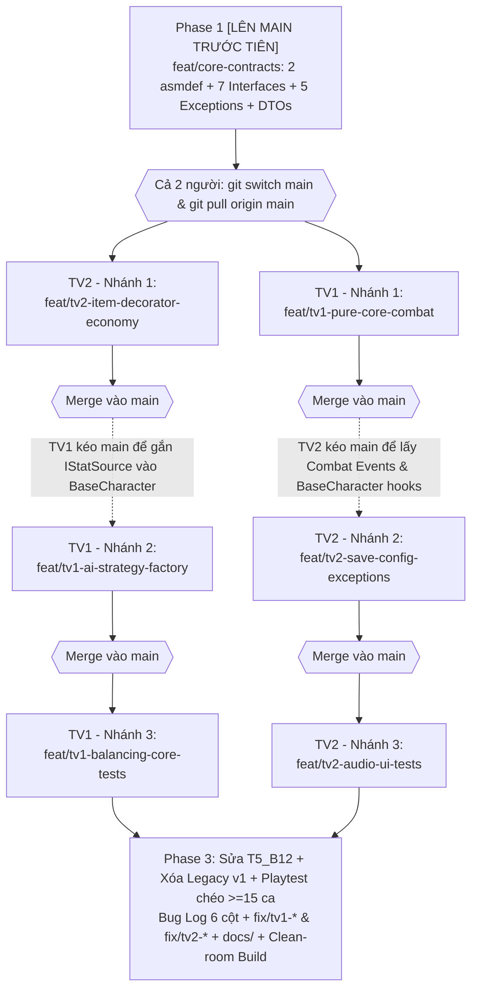

# HƯỚNG DẪN CHI TIẾT CHO 2 THÀNH VIÊN: LỆNH BAN ĐẦU, PHÂN CÔNG CÔNG VIỆC, QUY TRÌNH GIT & CÁC LƯU Ý

> **Dự án:** `Stickman game` (**MULTI-DIMENSIONS STICKMAN** — Unity `6000.5.4f1`)  
> **Học phần:** MI4090 – Lập trình hướng đối tượng (Nhóm 02 người)  
> **Repository GitHub:** <https://github.com/tienanh2701/Stickman-game-project.git>  
> **Hiện trạng hiện tại trên GitHub:** Nhánh `main` đã sạch sẽ tại commit `1de47d35` (gồm `.gitignore`, `README.md`, mã nguồn hiện tại, bộ test `EditMode 59/59 PASS` và khung thư mục chuẩn `Assets/CorePure/`, `Assets/Audio/`, `Assets/StreamingAssets/Config/`, `Assets/Tests/CoreUnit/`, `docs/`).

---

## MỤC LỤC

1. [Phần 1: Những bước cần làm BAN ĐẦU ngay bây giờ (Kèm lệnh copy-paste sẵn)](#phần-1-những-bước-cần-làm-ban-đầu-ngay-bây-giờ)
2. [Phần 2: Những việc cần xử lý SAU ĐÓ (Phân công chi tiết & Thứ tự lên Git)](#phần-2-những-việc-cần-xử-lý-sau-đó)
3. [Phần 3: Các lưu ý quan trọng & Xử lý sự cố khi làm việc nhóm Unity + Git](#phần-3-các-lưu-ý-quan-trọng--xử-lý-sự-cố)

---

## PHẦN 1: NHỮNG BƯỚC CẦN LÀM BAN ĐẦU NGAY BÂY GIỜ

> **Mục tiêu của bước khởi đầu:**  
> 1. Khóa an toàn nhánh `main` trên GitHub (không ai push nhầm thẳng lên `main`).  
> 2. Đưa bạn thứ hai (**TV2**) vào chung repo trên máy riêng.  
> 3. Đưa **khung hợp đồng lõi (`Phase 1: feat/core-contracts`)** lên `main` trước tiên để cả 2 thành viên có thể tách nhánh code song song mà không gãy biên dịch hay xung đột file.

### 1.1. Bước ban đầu trên máy TV1 (Máy đang có sẵn project)

#### Bước 1A — Bật bảo vệ nhánh `main` trên web GitHub (làm 1 lần, 1 phút)
1. Mở trình duyệt vào <https://github.com/tienanh2701/Stickman-game-project> → chọn **Settings** → **Branches**.
2. Bấm **Add branch protection rule** (hoặc **Add classic branch protection rule**).
3. Ở ô **Branch name pattern**, nhập đúng: `main`.
4. Tích chọn **Require a pull request before merging** → **Require approvals: 1**.
5. Bấm **Create / Save changes**.

#### Bước 1B — Kiểm tra thư mục làm việc & tạo nhánh nền `feat/core-contracts`
Mở **Windows PowerShell** (đóng Unity Editor tạm thời trước khi chuyển nhánh), chạy từng lệnh dưới đây:

```powershell
# 1. Di chuyển đúng vào thư mục chứa .git (KHÔNG đứng ở thư mục cha OOP Project)
cd "c:\Users\Admin\Documents\Tài liệu của TAnh\2026.1\VibeApp\OOP Project\Stickman game"

# 2. Kiểm tra trạng thái sạch & đồng bộ với GitHub
git switch main
git pull origin main
git status --short

# 3. Tạo nhánh đầu tiên của Phase 1 (khung hợp đồng chung cho cả 2 người)
git switch -c feat/core-contracts
```

#### Bước 1C — Tạo sẵn 2 file `.asmdef` thuần C# & sửa đường dẫn động cho `Tools/verify_project.py`
*(Nhờ 2 file `.asmdef` này, Unity tự ép mọi code mới đặt trong `Assets/CorePure/` và `Assets/Tests/CoreUnit/` hoàn toàn **không phụ thuộc `UnityEngine`**, mà vẫn không vi phạm test `F11_T1` cấm `.asmdef` trong `Assets/Scripts/` và `Assets/Editor/`)*:

```powershell
# 1. Tạo Stickman.CorePure.asmdef (thuần C# 100%, autoReferenced=true để Assets/Scripts tự nhìn thấy)
@'
{
    "name": "Stickman.CorePure",
    "rootNamespace": "StickmanBeatEmUp.CorePure",
    "references": [],
    "includePlatforms": [],
    "excludePlatforms": [],
    "allowUnsafeCode": false,
    "overrideReferences": false,
    "precompiledReferences": [],
    "autoReferenced": true,
    "defineConstraints": [],
    "versionDefines": [],
    "noEngineReferences": true
}
'@ | Set-Content -Encoding UTF8 "Assets\CorePure\Stickman.CorePure.asmdef"

# 2. Tạo Stickman.Tests.CoreUnit.asmdef (Unit Test thuần C# chạy không cần Scene)
@'
{
    "name": "Stickman.Tests.CoreUnit",
    "rootNamespace": "StickmanBeatEmUp.Tests.CoreUnit",
    "references": [
        "Stickman.CorePure"
    ],
    "includePlatforms": [
        "Editor"
    ],
    "excludePlatforms": [],
    "allowUnsafeCode": false,
    "overrideReferences": true,
    "precompiledReferences": [
        "nunit.framework.dll"
    ],
    "autoReferenced": false,
    "defineConstraints": [
        "UNITY_INCLUDE_TESTS"
    ],
    "versionDefines": [],
    "noEngineReferences": true
}
'@ | Set-Content -Encoding UTF8 "Assets\Tests\CoreUnit\Stickman.Tests.CoreUnit.asmdef"

# 3. Sửa PROJECT_ROOT trong Tools/verify_project.py sang đường dẫn động (để máy TV2 cũng chạy được)
(Get-Content "Tools\verify_project.py" -Raw -Encoding UTF8) -replace 'PROJECT_ROOT = r".*"', 'PROJECT_ROOT = os.path.dirname(os.path.dirname(os.path.abspath(__file__)))' | Set-Content -Encoding UTF8 "Tools\verify_project.py"
```

#### Bước 1D — TV1 tạo bộ Hợp đồng chung rồi đẩy nhánh lên mở PR
Trước khi mở Unity, TV1 hoàn thiện các file hợp đồng C# thuần sau trong `Assets/CorePure/` (hoặc chia TV1 tạo `Interfaces` + `Exceptions`, TV2 review bổ sung trường trong `DTO` qua PR):
- `Assets/CorePure/Interfaces/`:
  - `IInputProvider.cs` (hướng di chuyển, nhảy, dash, đánh, skill 1/2, transform, block, item Q/E, pause)
  - `IAIStrategy.cs` (`ComputeAction(EnemyAIContext ctx)` → `AIActionDecision`)
  - `IEnemyFactory.cs` (`CreateEnemyBlueprint(...)`)
  - `IItemEffect.cs` (`CanApply(...)`, `ApplyEffect(...)`)
  - `IStatSource.cs` (`AttackDamageMultiplier`, `MoveSpeedMultiplier`, `MaxShieldCapacity`, `DamageReflect`, `RagePerSecondBonus`)
  - `ISaveStorage.cs` (`SaveText`, `LoadText`, `Exists`, `Delete`)
  - `IAudioService.cs` (`PlayBgm`, `PlaySfx`, `SetMasterVolume`, `SetMuted`)
- `Assets/CorePure/Exceptions/`:
  - `StickmanGameException.cs` (lớp gốc)
  - `InvalidGameConfigException.cs`
  - `SaveCorruptedException.cs`
  - `InvalidCombatStateException.cs`
  - `InvalidPurchaseException.cs`
- `Assets/CorePure/Entities/DTOs/`:
  - `GameStateDTO.cs` (gồm cả trường trận đấu như `worldIndex`, `stageIndex`, `waveIndex`, `playerHp`, `playerRage`, `playerPosX/Y`, `activeEnemies` lẫn trường kinh tế/túi đồ như `coins`, `items`, `equippedSlots`, `activeBuffs`, `score`)
  - `HighScoreEntryDTO.cs`
  - `GameBalanceConfigDTO.cs`

Sau khi tạo xong các file trên, **mở Unity Editor 1 lần** để Unity tự sinh đầy đủ file `.meta` cho `.asmdef` và `.cs`, kiểm tra `Tools/verify_project.py`, rồi đẩy lên GitHub:

```powershell
# Kiểm tra Unity không sửa nhầm ProjectSettings.asset (nếu bị Unity tự sửa thì khôi phục lại)
git status --short

# Chạy kiểm tra tĩnh (nhớ có -B để Python không sinh __pycache__)
python -B Tools/verify_project.py

# Đóng gói & đẩy nhánh feat/core-contracts lên GitHub
git add Assets/CorePure/ Assets/Tests/CoreUnit/ Tools/verify_project.py
git commit -m "feat(contracts): add CorePure asmdef, 7 DIP interfaces, exceptions and GameStateDTO"
git push -u origin feat/core-contracts
```
→ Lên web GitHub mở **Pull Request (`feat/core-contracts` → `main`)** và gửi link cho **TV2** review & merge!

---

### 1.2. Bước ban đầu trên máy TV2 (Lần đầu tải project về làm việc)

TV2 mở **Windows PowerShell** tại thư mục muốn chứa project (ví dụ `D:\Projects\`), chạy đúng khối lệnh sau:

```powershell
# 1. Tải toàn bộ dự án từ GitHub về máy (tự tạo thư mục "Stickman game")
git clone https://github.com/tienanh2701/Stickman-game-project.git "Stickman game"

# 2. Đi vào đúng thư mục dự án
cd "Stickman game"

# 3. Cấu hình tên & email GitHub RIÊNG của TV2 (bắt buộc để GitHub ghi nhận 2 contributor)
git config user.name "<TenTaiKhoanGitHub_Cua_TV2>"
git config user.email "<Email_TaiKhoan_GitHub_Cua_TV2>"
git config core.autocrlf true

# 4. Kiểm tra lại cấu hình & chạy kiểm tra tĩnh lần đầu
git config --local --list
git log --oneline -n 5
python -B Tools/verify_project.py
```

**Sau đó TV2 làm tiếp 3 việc khởi động:**
1. Mở **Unity Hub** → **Add** → **Add project from disk** → chọn thư mục `Stickman game` vừa clone (phiên bản **`6000.5.4f1`**) → chờ Unity build `Library/` lần đầu (khoảng 2–5 phút) → chạy thử **Test Runner (EditMode)** xem xanh `59/59`.
2. Lên GitHub vào PR **`feat/core-contracts`** của TV1 → đọc kiểm tra 7 Interface, 5 CustomException và `GameStateDTO` (bổ sung trường còn thiếu nếu cần) → bấm **Approve** → **Merge pull request** vào `main`.
3. Quay lại PowerShell trên máy TV2 để kéo bộ hợp đồng mới nhất về:
   ```powershell
   git switch main
   git pull origin main
   ```
   **Từ thời điểm này, cả TV1 và TV2 chính thức tách nhánh làm song song các việc ở Phần 2!**

---

## PHẦN 2: NHỮNG VIỆC CẦN XỬ LÝ SAU ĐÓ

### 2.1. Sơ đồ thứ tự thực hiện & luồng đồng bộ (Phase 1 → Phase 3)



---

### 2.2. Bảng phân công chi tiết toàn bộ đầu việc cho TV1 và TV2

Để tránh xung đột file khi làm song song mà vẫn đảm bảo **cả 2 thành viên đều có đủ 4 mảng (Domain – GoF Pattern – Unit Test – Adapter/UI)** và **≥ 2 thuật toán lõi/người**, hai bạn chia ranh giới như sau:

#### Công việc của TV1 (Phân hệ Lõi chiến đấu, Nhân vật, AI, Spawner, Pooling & Scene trận)
1. **Nhánh `feat/tv1-pure-core-combat` (Làm & Merge đầu tiên ở Phase 2):**
   - Tách logic thuần C# khỏi `BaseCharacter.cs` (1,566 dòng), `RageManager.cs`, `Hitbox.cs` sang `Assets/CorePure/` (tạo thư mục con `Rules/Combat/`, `Entities/Combat/`): `DamageCalculator`, `RageRuleEngine`, `BaseStatSource : IStatSource`, `CombatRuleGuard`.
   - Biến `InputHandler.cs` thành Adapter triển khai `IInputProvider`; xóa đọc trực tiếp `Keyboard.current` trong `BaseCharacter.IsDropModifierHeld()`.
   - Sửa `TetherCableHitbox.TakeDamage()` đang rỗng (bảo toàn LSP).
   - Loại bỏ toàn bộ ép kiểu `is`/`as` downcast trong `Projectile.cs` (`IsEliteOrBoss` 7 lần check), `EnemyBase.cs` và `LordKivaAI.cs` bằng đa hình qua Interface/Virtual property.
2. **Nhánh `feat/tv1-ai-strategy-factory`:**
   - **GoF Strategy (`IAIStrategy`):** Tách hành vi AI ra khỏi `TickBehavior()` cứng trong `EnemyBase`/`BossBase` thành các Strategy rời (`MeleeChaseStrategy`, `RangedKiteStrategy`, `KamikazeRushStrategy`, `BossPhaseStrategy` + mức `Easy/Hard`) — làm điểm neo **Live OCP** của TV1.
   - **GoF Factory Method + Object Pool (`WorldEnemyFactory`):** Cài Factory tạo quái/đạn theo `IEnemyFactory` kết hợp **Object Pool** cho `Projectile`, `BeamAttack`, `Explosion`, Enemy spawn/despawn (giảm GC spike trong `Update`).
   - Nâng cấp `Projectile.cs` dùng `Physics2D.Raycast` / `CircleCast` giữa vị trí khung hình cũ và mới để **chống tunneling** (đạn bay nhanh xuyên tường/mục tiêu).
   - Loại bỏ đường dẫn cứng `"Assets/Prefabs/..."` trong `EndlessModeManager.cs` (dòng 26–52).
3. **Nhánh `feat/tv1-balancing-core-tests`:**
   - Điều chỉnh độ khó tăng dần (`enemyHpMultiplier`, `enemyDamageMultiplier`) trong 12 `Level_W*_S*.asset` và đồng bộ tham số với file cấu hình JSON ngoài (`GameBalanceConfigDTO`).
   - Tách `WaveCompositionCalculator` thuần C# từ `EndlessModeManager.cs`.
   - Viết **≥ 12 Pure Logic Unit Tests** + **≥ 3 Mock/Stub** (`StubInputProvider`, `MockStatSource`, `SpyAudioService`) trong `Assets/Tests/CoreUnit/TV1/` (test BVA `HP = 0`, `Rage = 0/10/20/30`, trạng thái cấm `Dead/Stunned`, AI Strategy, Wave scaling — chạy `< 1s` không mở Scene).
   - Bổ sung test `Hitbox` va chạm & `BossBase` multi-phase trong `PlayMode`.
4. **Hồ sơ `docs/` phần TV1:**
   - GDD tổng quan & bảng Luật chơi + Game Loop (`docs/01_Survey_GDD/`).
   - Giả mã, phân tích độ phức tạp $O(\cdot)$ & trường hợp biên cho các thuật toán TV1 (`Hitbox` + chống tunneling, AI Strategy FSM, `WaveCompositionCalculator`, 6-Pass Platform Placement, Max-Min Spawn) + Package Diagram 3 tầng + State/Sequence luồng chiến đấu (`docs/02_Analysis_UML/`).
   - Tài liệu Template Method, Strategy, Factory Method & phân tích đánh đổi W (`docs/03_Design_Patterns/`).
   - Ma trận Truy vết Test TV1 + Playtest phần TV2 (`docs/04_Testing_QA/`) + `README.md` + đóng gói Clean-room cuối kỳ.

---

#### Công việc của TV2 (Phân hệ Vật phẩm/Buff Decorator, Economy, Save/Load JSON, Audio, Ngoại lệ & UI phụ trợ)
1. **Nhánh `feat/tv2-item-decorator-economy` (Làm song song ngay đầu Phase 2):**
   - Tạo thư mục con `CorePure/Rules/Economy/`, `CorePure/Patterns/Decorators/` để không đụng file TV1.
   - **GoF Decorator (`IStatSource`):** Cài `StatDecoratorBase`, `SpinalFluidShieldDecorator`, `UltraDivineWaterDecorator`, `RageRegenDecorator` + thuật toán `BuffStackResolver` (giải quyết thứ tự cộng dồn và hết hạn buff theo `deltaTime`).
   - **Chiến lược Item (`IItemEffect`) + Item thứ 4:** Thay thế hoàn toàn `switch(itemType)` trong `PlayerItemController.ExecuteItemEffect()` bằng các lớp `IItemEffect` riêng lẻ (điểm neo **Live OCP** của TV2) và tạo thêm `ConsumableItemSO` thứ 4 (đạt chuẩn `≥ 4` loại Item).
   - Tách `ShopRuleEngine` & `InventoryRuleEngine` thuần C# khỏi `ShopManager.cs` và `InventoryManager.cs`.
2. **Nhánh `feat/tv2-save-config-exceptions`:**
   - **Save/Load giữa trận & HighScore (`ISaveStorage`):** Cài `FileJsonSaveStorage`, `MidMatchSaveService` lưu/khôi phục 100% `GameStateDTO` khi đang chơi → thoát app → mở lại (qua nút Save/Load trong `PauseMenuUI`), và `HighScoreService` (thuật toán Top-K sorting & deduplication ra `Assets/StreamingAssets/Config/highscore.json` hoặc `persistentDataPath`).
   - **Config JSON ngoài build:** Tạo `Assets/StreamingAssets/Config/game_balance.json` và `GameConfigLoader` đọc chỉ số quái/item/màn chơi (sửa bằng Notepad bên ngoài bản build `.exe` vẫn đổi thông số ngay, không cần biên dịch lại).
   - **Xử lý Ngoại lệ chuẩn:** Áp dụng cây `CustomException` (`SaveCorruptedException`, `InvalidGameConfigException`, `InvalidPurchaseException`) và **sửa triệt để 6 khối `catch` nuốt lỗi/trả null** tại `AccountManager.cs` (591, 602, 629), `GlassHudTheme.cs` (990), `UIManager.cs` (815), `MenuBackgroundLoader.cs` (224).
3. **Nhánh `feat/tv2-audio-ui-tests`:**
   - **Hệ thống Audio (`AudioManager : IAudioService`):** Thêm nhạc nền (BGM Menu/3 Worlds) và ≥ 5 SFX thật (`.wav`/`.ogg`) vào `Assets/Audio/{BGM,SFX}/`; dùng **Observer Pattern** đăng ký sự kiện đánh, trúng đòn, nhảy, dùng item, mua đồ, nút bấm UI (nhớ hủy `-=` sạch trong `OnDisable`/`OnDestroy`).
   - **UI Settings, Thống kê & Sửa lỗi UI:** Thêm panel **Settings** (Slider Volume BGM/SFX bật/tắt lưu bền vững) vào `PauseMenuUI`/`MainMenu`, panel **HighScore / Thống kê trận** đồng bộ phong cách Glassmorphism; sửa lỗi lambda không hủy được ở `GameUIManager.BindBoss(BossController)` (dòng 1194); tách nhỏ bớt phần nạp ảnh/điều hướng trong `UIManager.cs`.
   - **Pure Unit Tests TV2:** Viết **≥ 12 Pure Logic Unit Tests** + **≥ 3 Mock/Stub** (`InMemorySaveStorage`, `FakeClock`, `SpyAudioService`) tại `Assets/Tests/CoreUnit/TV2/` (test Decorator stack, Shop BVA `coins == price` & `coins < price`, Inventory slot biên `99`, Save/Load Round-Trip, `SaveCorruptedException` khi JSON hỏng, HighScore Top-K).
4. **Hồ sơ `docs/` phần TV2:**
   - Sơ đồ Use Case (≥ 8 UC chia 2 phân hệ) + bảng ánh xạ Scene (`docs/01_Survey_GDD/`).
   - Từ điển Lớp Thực thể & Bất biến, **01 UML Class Diagram tổng thể duy nhất (≥ 20 lớp, đủ 6 quan hệ UML)** ghép cả TV1–TV2, Giả mã & $O(\cdot)$ cho 2 thuật toán TV2 (`BuffStackResolver`, `HighScoreRanker`), State/Sequence luồng Save-Load/Shop (`docs/02_Analysis_UML/`).
   - Tài liệu Decorator, Observer & phân tích đánh đổi W (`docs/03_Design_Patterns/`).
   - Ma trận Truy vết Test TV2 + Playtest phần TV1 + khung `BUG_LOG.md` 6 cột (`docs/04_Testing_QA/`).

---

### 2.3. Quy trình & Lệnh chuẩn khi làm việc ở Phase 2 & Phase 3

#### A. Vòng lặp làm 1 nhánh tính năng (áp dụng giống nhau cho TV1 và TV2)
```powershell
# 1. Luôn bắt đầu từ bản main mới nhất
git switch main
git pull origin main

# 2. Tạo nhánh mới cho đầu việc hiện tại (VD: feat/tv2-item-decorator-economy)
git switch -c feat/ten-nhanh-cua-ban

# 3. Code từng phần nhỏ (mở Unity 1 lần để sinh .meta nếu có file mới) -> Kiểm tra:
git status --short

# 4. Nếu Unity tự làm bẩn ProjectSettings.asset thì trả lại trước khi add:
git checkout -- ProjectSettings/ProjectSettings.asset

# 5. Đóng gói commit nhỏ gọn (mỗi commit 1 việc rõ ràng, kèm đủ file .meta)
git add Assets/CorePure/... Assets/Scripts/... Assets/Tests/...
git commit -m "feat(items): add StatDecoratorBase and BuffStackResolver"

# 6. Đẩy nhánh lên GitHub (lần đầu dùng -u, các commit sau trên cùng nhánh chỉ gõ: git push)
git push -u origin feat/ten-nhanh-cua-ban
```
→ Lên web GitHub bấm **Compare & pull request** → ghi rõ đã làm gì, file nào đổi, test nào PASS → **người còn lại vào Review & Merge**.

#### B. Khi người kia vừa Merge PR vào `main`, bạn kéo code mới về nhánh mình đang làm dở:
```powershell
git fetch origin
git merge origin/main
```

#### C. Việc bắt buộc ở Phase 3 (Sau khi 2 người xong hết các nhánh Phase 2)
1. **Sửa lỗi test `T5_B12` đang FAIL:** Sửa đường dẫn/UI `HudItemSlotsPanel/SlotQ/ItemIcon` trong `Tier5_AdversarialUiHardeningTests.cs` / `HudItemSlotsUI.cs` để đạt **100% PASS** cả `CoreUnit`, `EditMode (59/59)` và `PlayMode (105/105)`.
2. **Dọn Dead Code:** Xóa các lớp legacy v1 không còn dùng (`BaseEnemy.cs`, `GruntEnemy.cs`, `RangerEnemy.cs`, `KamikazeEnemy.cs`, `EliteBruiserEnemy.cs`, `BossController.cs`, `EnemyStatsSO.cs`) và `SampleScene.unity` nếu kiểm chứng không còn tham chiếu.
3. **Playtest chéo & Bug Log 6 cột:**
   - **TV1** chơi test toàn bộ luồng của TV2 (Shop biên, 4 Item, Save giữa trận → tắt app → Load lại, sửa hỏng file save JSON, Volume) → ghi **≥ 3 bug** vào `docs/04_Testing_QA/BUG_LOG.md`.
   - **TV2** chơi test toàn bộ luồng của TV1 (Campaign 3 World + Boss 2 Phase, Endless Wave 5+, Training, kẹp biên map, trạng thái cấm) → ghi **≥ 3 bug** vào `docs/04_Testing_QA/BUG_LOG.md`.
   - Từng người tự mở nhánh `fix/tv1-<bug-id>` hoặc `fix/tv2-<bug-id>` để **sửa lỗi + viết Regression Test 1-1** tương ứng.
4. **Hoàn thiện `docs/` & Build Clean-room:**
   - Chạy thử `python -B Tools/verify_project.py` và toàn bộ Test Runner trên `main`.
   - Build bản thực thi Windows mới nhất ra **ngoài thư mục Git** (`../Releases/Version_Final/`), viết/cập nhật `README.md`, Checklist và quay Video Demo 3–5 phút.
   - Tập thử trước ở nhà: **Live OCP** (tắt AI, TV1 tự viết thêm 1 `IAIStrategy` mới, TV2 tự viết thêm 1 `StatDecorator` hoặc `IItemEffect` mới trong 2–3 phút không sửa lớp cũ) và **Live Fault-Injection + Debugger Call Stack**.

---

## PHẦN 3: CÁC LƯU Ý QUAN TRỌNG & XỬ LÝ SỰ CỐ

### 3.1. 6 lưu ý sống còn cho dự án Unity làm 2 người

1. **Khóa sở hữu Scene & Prefab (Tránh nát file `.unity`):**
   - **TV1** giữ quyền sửa `Stickman_DemoScene.unity` và `Assets/Prefabs/{Characters,Enemies,Combat,Hazards}/`.
   - **TV2** giữ quyền sửa `MainMenu.unity`, `CharacterSelectScene.unity`, `Assets/Audio/`, `Assets/StreamingAssets/Config/`.
   - **Tuyệt đối không 2 người cùng mở, chỉnh rồi `Ctrl + S` vào cùng một file `.unity` hay `.prefab`.** Nếu TV2 cần gắn UI mới vào `Stickman_DemoScene`, hãy làm thành Prefab riêng hoặc dựng qua code/`CanvasUIBuilder.cs` hoặc nhắn TV1 khóa scene trước khi sửa.
2. **Quy tắc `.meta` "đi có đôi":**
   - Bất kỳ file `.cs`, `.asmdef`, `.png`, `.wav`, `.ogg`, `.json`, `.prefab` hoặc thư mục mới nào trong `Assets/` đều có một file `<tên>.meta` đi kèm.
   - **Luôn mở Unity Editor 1 lần để Unity sinh `.meta`**, và luôn `git add` **cả file lẫn `.meta`**.
   - Muốn đổi tên hoặc xóa file trong `Assets/`, hãy thực hiện **ngay trong cửa sổ Project của Unity Editor** để Unity tự đổi/xóa `.meta` đồng bộ.
3. **Cẩn thận Unity tự sửa `ProjectSettings/ProjectSettings.asset`:**
   - Unity hay tự đổi dòng `scriptingDefineSymbols` (ví dụ bật/tắt `SENTIS_ANALYTICS_ENABLED`) khi mở máy khác nhau hoặc chạy batchmode.
   - Trước khi `git add`, luôn xem `git status --short`. Nếu thấy `M ProjectSettings/ProjectSettings.asset` mà bạn không chủ ý đổi Project Settings, chạy ngay:
     ```powershell
     git checkout -- ProjectSettings/ProjectSettings.asset
     ```
4. **3 "Vùng cấm" của bài test `F11_T1` (Nếu vi phạm sẽ FAIL EditMode test):**
   - **Cấm** đặt `*.asmdef` bên trong `Assets/Scripts/` và `Assets/Editor/` (vì vậy `CorePure` đặt ở `Assets/CorePure/`).
   - **Cấm** đặt thư mục `Releases/` bên trong `Stickman game/` (luôn build ra thư mục cha bên ngoài repo).
   - **Cấm** để tồn tại thư mục `__pycache__/` trong `Stickman game/` (luôn chạy Python với cờ `-B`: `python -B Tools/verify_project.py`).
5. **Copy-paste lệnh trên PowerShell & cảnh báo `LF/CRLF`:**
   - Khi copy lệnh từ tài liệu/chat vào PowerShell, không ghép nhiều thư mục vào 1 dòng quá dài tránh bị ngắt xuống dòng mất chữ `git add`.
   - Nếu thấy Git hiện chữ vàng `warning: ... LF will be replaced by CRLF the next time Git touches it`, đó chỉ là thông báo đổi chuẩn xuống dòng Windows, **không phải lỗi**.
6. **Quy tắc Git & Vấn đáp bảo vệ MI4090:**
   - **Commit rải đều theo từng ngày/từng tính năng nhỏ**, không dồn hết vào 48h cuối trước ngày nộp, không tạo commit rác 1 dòng sửa comment/dấu cách, không giả ngày commit.
   - Luôn tự review PR của nhau và **đọc hiểu code, GoF Pattern, Unit Test của người kia** để trả lời mượt vòng **vấn đáp chéo**.

---

### 3.2. Xử lý nhanh 5 sự cố Git hay gặp

| # | Lỗi gặp phải | Cách xử lý an toàn (Copy-Paste) |
| :-: | :--- | :--- |
| **1** | Đứng nhầm thư mục (`fatal: not a git repository`) | `cd "<đường-dẫn-tới>\Stickman game"` rồi gõ `pwd` kiểm tra đuôi phải là `\Stickman game`. |
| **2** | Quên tạo nhánh, lỡ code/commit thẳng lên `main` *(chưa push)* | **Chưa commit:** `git switch -c feat/ten-nhanh-moi`<br/>**Đã commit trên `main`:** `git branch feat/cuu-code` → `git reset --hard origin/main` → `git switch feat/cuu-code` |
| **3** | Lỡ `git add` nhầm file rác hoặc file không phải của mình | `git restore --staged <duong-dan-file>` *(rút khỏi vùng chờ commit, không mất code)*. |
| **4** | `CONFLICT` ở file code `.cs` khi merge `main` | Mở file `.cs` trong VS/VS Code, giữ phần code đúng của cả 2 bên, xóa các dòng `<<<<<<<`, `=======`, `>>>>>>>`, lưu file rồi chạy: `git add <file.cs>` → `git commit -m "chore: resolve conflict"`. |
| **5** | `CONFLICT` ở file `.unity` hoặc `.prefab` | **KHÔNG sửa tay YAML!** Chạy `git checkout --ours <file>` (giữ bản nhánh mình) hoặc `git checkout --theirs <file>` (lấy bản `main`), mở Unity kiểm tra/làm lại thao tác nhỏ, rồi `git add <file>` → `git commit -m "chore: resolve scene conflict"`. |
